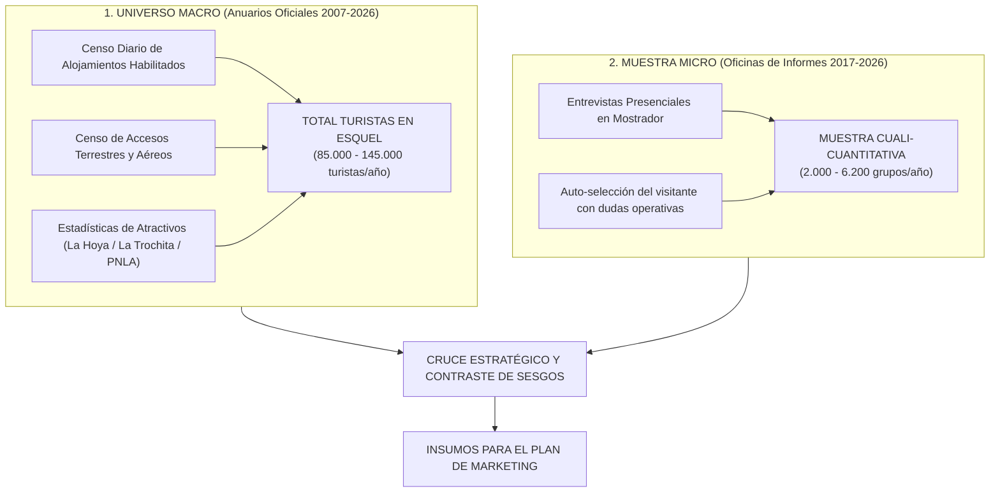
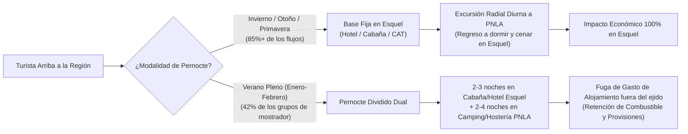

# DOCUMENTO 8: CRUCE ESTRATÉGICO E INTEGRACIÓN DE INTELIGENCIA
## CONVERGENCIA ENTRE EL UNIVERSO MACRO (ANUARIOS OFICIALES) Y LA MUESTRA MICRO (ENCUESTAS DE MOSTRADOR)

**Destino:** Esquel, Provincia del Chubut, Patagonia Argentina  
**Insumo Primario:** Anuarios Estadísticos de Turismo (2007–2026) + Microdatos de Encuestas de Perfil en Oficinas de Informes (2017–2026, >23.000 grupos) + Planillas de Monitoreo Diario de Prestadores (2026).  
**Destinatario:** Inteligencia Artificial / Equipo de Estrategia encargado del diseño del **Plan de Marketing Turístico de Esquel**.  
**Carácter Metodológico:** Documento de articulación, síntesis no dogmática y formulación de hipótesis analíticas abiertas.

---

## 1. MARCO EPISTEMOLÓGICO Y METODOLÓGICO: DOS LENTES PARA UNA MISMA REALIDAD

Para formular un plan de marketing riguroso, es imperativo no mezclar acríticamente las dos fuentes de datos disponibles, sino comprender qué mide cada una y qué sesgos intrínsecos poseen:

### Tabla de Definición Metodológica:
| Dimensión | Fuente A: Anuarios Estadísticos (Macro) | Fuente B: Encuestas de Mostrador (Micro) |
|:---|:---|:---|
| **Población Objetivo** | Todo turista que pernocta en alojamiento habilitado de Esquel. | Turistas que deciden entrar voluntariamente a una oficina de informes. |
| **Tamaño Anual** | 85.000 a 145.000 turistas anuales (censo/extrapolación). | 2.000 a 6.200 grupos (7.000 a 20.000 personas relevadas). |
| **Puntos de Toma** | Partes diarios telefónicos de hoteleros, cabañeros y CATs. | Centro de Informes Av. Alvear, Terminal de Ómnibus, Acceso Norte. |
| **Fortaleza** | Precisión matemática de volumen, estacionalidad y plazas ocupadas. | Profundidad psicológica, motivacional, logística y de consumo. |
| **Vulnerabilidad / Sesgo** | No captura percepciones, canales de decisión ni circuitos detallados. | Sesgo de auto-selección (sobre-representa a ciertos perfiles de viajeros). |

---

## 2. MATRIZ DE COMPARACIÓN CRUZADA: MACRO VS. MICRO

Al contrastar los indicadores macroeconómicos con las declaraciones en mostrador, emergen brechas reveladoras:

| Variable | Registro Macro (Anuarios) | Registro Micro (Oficina Informes) | Brecha / Lectura Estratégica |
|:---|:---:|:---:|:---|
| **Estadía Media Promedio** | **3,2 a 3,8 noches** (en Esquel ciudad) | **3,9 a 4,7 noches** (declaradas en total del viaje) | Los turistas declaran estancias más largas porque computan el viaje completo o su estadía combinada con el Parque Nacional Los Alerces. |
| **Origen Chubut / Costa Patagónica** | **30% - 35%** (anualizado global) | **18% - 24%** (en mostrador) | El turista chubutense (Comodoro, Madryn, Trelew) conoce la zona, tiene segundas residencias o va directo a cabañas; **visita poco el mostrador de informes**. |
| **Origen Buenos Aires (CABA + PBA)** | **40% - 48%** (global) | **48% - 58%** (en mostrador) | El turista bonaerense busca mapas físicos, validación de estado de caminos de ripio, clima y asesoramiento cara a cara. |
| **Uso de Cabañas vs. Hoteles** | Cabañas (44%), Hoteles (28%), CAT (18%) | Cabañas (35%), Camping (28% ver.), Hoteles (14%) | En el mostrador se sobredimensiona el usuario de **campings y alojamientos económicos**, y se subrepresenta el huésped corporativo de hotel. |
| **Medio de Transporte: Auto Propio** | **65% - 72%** (global estimado) | **76% - 84%** (en mostrador) | El mostrador es el refugio logístico del automovilista que viaja por ruta y necesita resolver rutas, senderos y accesos. |
| **Uso de Avión** | **8% - 14%** (macro) | **4% - 7%** (en mostrador) | El pasajero aéreo suele contratar paquetes previos, alquilar auto con GPS/agencia o alojarse en hosterías con conserjería dedicada. |

---

## 3. DIAGNÓSTICO DE SESGOS ESTRUCTURALES DE LA MUESTRA DE INFORMES

Para que la otra IA no cometa el error de proyectar el mostrador como si fuera el 100% del mercado, se detallan los tres perfiles que **sí van** y los tres que **no van**:

### ¿Quién visita activamente la Oficina de Informes?
1. **El Conductor Rutero Familiar o en Pareja (Auto/Camioneta):**
   - Viene manejando desde Buenos Aires, Córdoba o Santa Fe.
   - Demanda: estado de la RN 40, ripio de la RP 71, accesos a cascadas, horarios de La Trochita y mapas impresos.
2. **El Turista de Primera Vez (Nofito en la Cordillera):**
   - Más del 68% de los entrevistados en mostrador manifiestan que es su primera visita a Esquel.
   - Requiere reaseguro de seguridad, tiempos de traslado y sugerencias gastronómicas.
3. **El Campamentista y Mochilero / Senderista:**
   - Usuarios intensivos de carpa, motorhome o dormis en campings.
   - Demandan información de trekking, dificultad de senderos del PN Los Alerces, refugios y transporte público de enlace.

### ¿Quiénes son los "Invisibles" del Mostrador?
1. **El Turista Repetidor de la Costa de Chubut:**
   - Conoce perfectamente Esquel. Viene por el fin de semana a esquiar, a comprar o a desconectar en una cabaña previamente reservada por WhatsApp.
2. **El Esquiador de Nivel Socioeconómico Alto (NSE ABC1):**
   - Contrata paquetes de nieve cerrados, alojamiento en hosterías de alta gama en Esquel o pie de pista en La Hoya, con transfers privados. Rara vez pisa el centro de informes.
3. **El Viajero Corporativo y Funcionario Público:**
   - Ocupa hoteles céntricos de lunes a jueves durante todo el año. Su movilidad está resuelta y su consumo es urbano y gastronómico comercial.

---

## 4. LA DINÁMICA TERRITORIAL Y EL EJE ESQUEL - PARQUE NACIONAL LOS ALERCES

Uno de los aportes más críticos de cruzar los Anuarios con las planillas de Informes es la comprensión del fenómeno de la **Estadía Dual y la Frontera Administrativa**:

### Revelaciones Cuantitativas del Eje Esquel - PNLA:
1. **Verano (Enero - Febrero):**
   - El 42% de los grupos que pasan por la oficina de informes combinan noches en Esquel con noches de campamento o cabaña **dentro del Parque Nacional Los Alerces** o en Villa Futalaufquen.
   - Para el Anuario oficial de Esquel, ese turista "desaparece" durante 3 días del censo de camas habilitadas del municipio, computando una estadía urbana de solo 2,5 noches, cuando en el territorio cordillerano permaneció 5,5 noches.
   - **Oportunidad de Marketing:** Diseñar la comunicación como un *hub regional unificado*. Esquel es la base de abastecimiento, combustible, equipamiento técnico y gastronomía antes y después del parque.
2. **Resto del Año (Marzo a Diciembre):**
   - Más del 88% de los visitantes duermen en Esquel y realizan visitas diurnas al PN Los Alerces (Pasarela del Río Arrayanes, Lago Menéndez, Cascada Nant y Fall en Trevelin).
   - Esquel captura la totalidad del pernocte y el gasto gastronómico nocturno.

---

## 5. MATRIZ DE CIRCUITOS Y MOVILIDAD REGIONAL (ORIGEN - DESTINO)

A partir de la declaración de procedencia inmediata y destino posterior en los microdatos de informes, Esquel se confirma como un **nodo articulador de tránsito y distribución de flujos patagónicos**:

### A. Corredor Cordillerano (Ruta Nacional 40):
- **Sentido Norte -> Sur (El flujo dominante, ~48%):**
  - Origen inmediato: Bariloche o El Bolsón (Comarca Andina).
  - Comportamiento: Turistas que recorren la Patagonia en vehículo propio o de alquiler. Ingresan a Esquel, hacen base para La Trochita y PNLA.
  - Destino posterior declarado:
    - 60%: Continúa hacia el sur por RN 40 hacia Los Antiguos, Perito Moreno, El Chaltén y El Calafate.
    - 25%: Cruza hacia la costa por RN 25 (hacia Trelew, Madryn, Península Valdés).
    - 15%: Emprende regreso hacia el centro del país.
- **Sentido Sur -> Norte (~16%):**
  - Turistas que suben desde el sur patagónico hacia la región de los lagos del norte.

### B. Corredor Transversal Bioceánico / Meseta (Ruta Nacional 25):
- **Enlace Costa - Cordillera (~26%):**
  - Origen inmediato: Puerto Madryn, Trelew, Comodoro Rivadavia.
  - Segmento Dual:
    1. Residentes costeros patagónicos que vienen de descanso (estadía corta, alta repetición).
    2. Turistas nacionales que combinaron avistaje de fauna marina (ballenas/pingüinos) en la costa y cruzan la meseta por el Valle de Los Altares para buscar montaña, nieve y bosques.

### C. Conexión Internacional con Chile (Paso Futaleufú / Trevelin):
- **Flujo Binacional (~10% en meses estivales):**
  - Flujo de turistas europeos y chilenos que ingresan desde la Carretera Austral vía Futaleufú para tomar La Trochita o enlazar con la RN 40 argentina.

---

## 6. SÍNTESIS INTEGRADORA PARA LA IA DE MARKETING: 6 HIPÓTESIS ESTRATÉGICAS Y TENSIONES ABIERTAS

Este apartado constituye el puente directo con la inteligencia artificial que redactará el Plan de Marketing. No establece dogmas cerrados, sino **tensiones estratégicas, hipótesis fundadas en datos y preguntas operativas**:

### Hipótesis 1: "La Ilusión del Público Objetivo Único" (La Trampa del Promedio)
- *Dato:* El anuario muestra una estadía media de 3,3 noches y un gasto promedio moderado.
- *Cruce:* Los microdatos demuestran que conviven al menos tres arquetipos con presupuestos diametralmente opuestos:
  1. El viajero de invierno/esquí (alto gasto en pases, rentals, gastronomía y hotelería de confort).
  2. La familia rutera de verano (gasto medio, cabañas, cocina propia, alta sensibilidad al precio del combustible).
  3. El campamentista/trekker joven (gasto bajo en alojamiento, alto interés en experiencias activas de naturaleza).
- *Pregunta para la IA de Marketing:* ¿Debe el Plan de Marketing unificar el mensaje bajo un único paraguas ("Esquel Naturaleza") o debe estructurar campañas de conversión completamente atomizadas por canal y temporada?

### Hipótesis 2: "El Desacople Estacional entre Oferta y Demanda"
- *Dato:* Las planillas de prestadores (Doc 7) demuestran que en meses como septiembre u octubre, el 22,5% de las camas están fuera de servicio y la ocupación de lunes a jueves cae al 10%-14%, mientras que los fines de semana trepa al 45%-85%.
- *Cruce:* Hay una masa ociosa de infraestructura hotelera y gastronómica en otoño y primavera (temporadas intermedias).
- *Pregunta para la IA de Marketing:* ¿Cómo transformar a Esquel de un destino de fin de semana largo para los habitantes de Chubut en un destino de trabajo remoto (nómades digitales), turismo corporativo / MICE regional y escapadas de bienestar de media semana?

### Hipótesis 3: "La Paradoja de La Trochita: ¿Icono Tractor o Cuello de Botella?"
- *Dato:* El 82% de los consultantes en informes preguntan por La Trochita. Sin embargo, los anuarios muestran que las frecuencias son limitadas y en picos de demanda las salidas se agotan con semanas de anticipación.
- *Cruce:* Se genera frustración en el turista espontáneo que arriba en auto sin reserva previa y no consigue pasaje.
- *Pregunta para la IA de Marketing:* ¿Cómo apalancar la tracción icónica de La Trochita en la publicidad sin generar insatisfacción en destino? ¿Qué productos complementarios (e.g. senderismo, enoturismo en Trevelin, tulipanes, cascadas, canopy) deben posicionarse para redistribuir la demanda insatisfecha?

### Hipótesis 4: "La Gobernanza del Corredor Esquel - Trevelin - Parque Los Alerces"
- *Dato:* En los microdatos, más del 70% de las consultas de excursiones refieren a atractivos que están formalmente fuera del ejido municipal de Esquel (PN Los Alerces bajo Parques Nacionales; Campo de Tulipanes, Molino Nant Fach y Viñas bajo Municipio de Trevelin).
- *Cruce:* Esquel aporta la mayor masa de camas comerciales, hotelería y servicios bancarios/combustible, pero la "experiencia fotográfica de Instagram" se captura con frecuencia en municipios vecinos.
- *Pregunta para la IA de Marketing:* ¿Cómo debe plantearse el co-branding de destino? ¿Debe Esquel venderse como "Esquel Ciudad-Base de la Comarca Los Alerces" o competir individualmente por retener la identidad municipal?

### Hipótesis 5: "La Dependencia de la Conectividad Terrestre vs. El Techo Aéreo"
- *Dato:* Más del 75% de los turistas llegan en auto particular y son altamente vulnerables al estado de las rutas (deterioro histórico de tramos de la RN 40) y al precio del combustible. Aerolíneas Argentinas opera frecuencias acotadas (1 a 2 vuelos diarios, con picos de 3 en invierno).
- *Cruce:* Cada cancelación aérea o corte de ruta tiene un impacto inmediato en la ocupación hotelera.
- *Pregunta para la IA de Marketing:* ¿Qué peso presupuestario debe tener la promoción de cercanía (radio de 600 km: Comodoro, Trelew, Madryn, Caleta Olivia, Bariloche) que no depende de aviones versus la captura de mercados emisores de alto poder adquisitivo de Buenos Aires, Córdoba y Rosario?

### Hipótesis 6: "Digitalización de la Información y el Rol Futuro de las Oficinas de Informes"
- *Dato:* Las consultas presenciales en oficinas de informes pasaron de más de 6.000 grupos anuales en 2017 a ~2.400 en 2026, mientras que las consultas por WhatsApp, web y redes sociales se multiplicaron por cinco.
- *Cruce:* El viajero actual investiga en destino con su smartphone, pero sufre de sobrecarga de información y datos desactualizados en Google Maps o foros.
- *Pregunta para la IA de Marketing:* ¿Cómo reconvertir la oficina de turismo tradicional en un centro de experiencia del visitante, soporte de conectividad y captación de datos de satisfacción en tiempo real (Big Data / CRM de destino)?

---

## 7. PAUTAS FINALES PARA EL MODELO DE PROMPTING DE LA PRÓXIMA IA

Al entregarle esta biblioteca de insumos (Documentos 1 al 8 y matrices CSV) a la IA redactora del Plan de Marketing, se recomienda utilizar el siguiente encuadre de instrucciones:

> **Consigna Operativa sugerida para el Prompt:**  
> *"Actúa como un Especialista en Marketing Estratégico y Planificación de Destinos Turísticos. Se te entrega una base documental exhaustiva y empírica sobre Esquel (Chubut, Argentina), compuesta por series temporales de 20 años (2007-2026), perfiles de demanda en mostrador (>23.000 encuestas), monitoreo diario de prestadores y un cruce de inteligencia estratégica.*  
> *Tu tarea es diseñar un Plan de Marketing Turístico para Esquel a 4 años, con metas cuantificables, segmentación de audiencias, pilares de marca, plan de medios, gobernanza público-privada y tácticas para reducir la estacionalidad en otoño y primavera.*  
> *No utilices generalidades. Basa cada propuesta en los datos provistos en los Documentos 1 al 8. Resuelve y toma postura explícita sobre las 6 hipótesis y tensiones abiertas planteadas en el Documento 8."*
