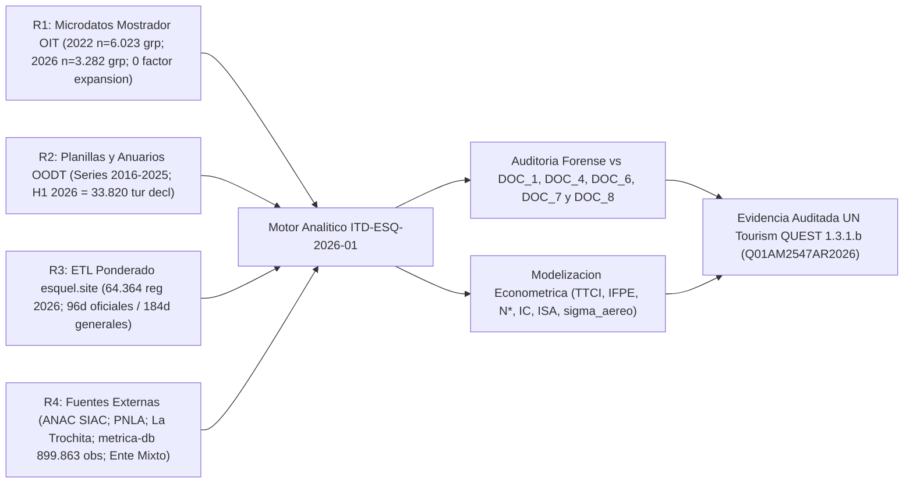

# INFORME TÉCNICO OFICIAL DE PERFIL DE DEMANDA Y COMPORTAMIENTO DEL VISITANTE

---

## 1. PORTADA Y METADATOS INSTITUCIONALES

| Atributo Institucional | Especificación Técnica Auditada |
|---|---|
| **Código de Documento Técnico** | **ITD-ESQ-2026-01** (Informe N° 1 de la Serie Oficial de Inteligencia de Demanda) |
| **Título Formal** | **Perfil Consolidado de la Demanda Turística, Patrones de Comportamiento, Conectividad Aérea, Posicionamiento Competitivo en OTAs y Auditoría de la Estructura del Gasto Turístico en Esquel (Chubut) — Línea Base Cuatrienal 2022–2026** |
| **Propósito Normativo y Certificación** | Evidencia cuantitativa primaria y auditoría metodológica para respaldo del **Indicador 1.3.1.b (*Análisis y Monitoreo Sistemático del Perfil de la Demanda Turística y Estructura del Gasto*)** — Área de Liderazgo Estratégico — Certificación Internacional **UN Tourism QUEST** |
| **Código de Programa / Expediente** | Programa UN Tourism QUEST **Q01AM2547AR2026** \| Expediente de Ejecución Presupuestaria Municipal **M-TC-24452-1482-26** |
| **Entidad Emisora** | **Observatorio de Oferta y Demanda Turística (OODT)** — **Subsecretaría de Turismo de la Municipalidad de Esquel** (Av. Alvear 1120, CP 9200, Esquel, Chubut, Patagonia Argentina) \| Mesa Técnica Conjunta con **Ente Mixto de Turismo de Esquel** |
| **Destinatarios de Auditoría** | Auditoría Externa UN Tourism QUEST \| Dirección Ejecutiva del Ente Mixto de Esquel \| Secretaría de Turismo y Plan Estratégico de Turismo Sustentable (PETS) |
| **Fecha de Emisión y Corte de Datos** | **11 de noviembre de 2026** *(Cortes empíricos: Microdatos de Mostrador hasta el `09/11/2026`; ETL Diario `esquel.site/data/` hasta el `09/11/2026`; Auditoría Presupuestaria al `02/11/2026`; Monitor OTA `metrica-db` al `11/11/2026`; ANAC SIAC hasta `agosto de 2026`)* |
| **Versión / Alcance Temporal** | v1.0 Audit-Grade \| Series estructurales **2016–2026** con foco cuatrienal **2022–2026** y comparación microanalítica directa **2022 vs. 2026** |

> [!IMPORTANT]
> **Cláusula de Integridad Probatoria y Gobernanza Estadística:** Conforme a los estándares de auditabilidad de UN Tourism QUEST, este documento **prohíbe explícitamente mezclar muestras no expandibles de mostrador con universos censales de ocupación o estimaciones paramétricas**. Toda magnitud citada se etiqueta bajo su régimen de origen (**R1–R4**), se reconcilia de forma transparente frente a informes previos de trabajo (**DOC_1**, **DOC_4**, **DOC_6**, **DOC_7**, **DOC_8**) y documenta sin omisiones las brechas instrumentales detectadas (particularmente la ausencia de encuesta primaria de gasto diario y NPS/satisfacción).

---

## 2. FICHA METODOLÓGICA Y AUDITORÍA FORENSE DE REGÍMENES DE DATOS

### 2.1 Arquitectura en Cuatro Regímenes Probatorios (R1–R4)

La base de inteligencia turística de Esquel no proviene de un único instrumento homogéneo, sino de **cuatro regímenes estadísticos con poblaciones objetivo, sesgos de selección, cobertura y mecanismos de inferencia distintos**. Un error recurrente en síntesis previas consistió en fusionar proporciones muestrales de mostrador (R1) con totales censales hoteleros (R2) o extrapolaciones de panel (R3). La arquitectura siguiente separa estrictamente los cuatro niveles:

### 2.2 Ficha Técnica por Régimen y Evaluación de Representatividad

| Régimen | Fuente Primaria Exacta | Período Relevado | Universo Teórico vs. Muestra / Cobertura Empírica | Técnica de Recolección y Protocolo de Depuración | Representatividad, Sesgos y Error Muestral |
|---|---|---|---|---|---|
| **R1 — Microdatos de Mostrador (OIT)** | `Perfil_2022.xlsx` (12 hojas mensuales) y `Perfil_2026.xlsx` (Enero – 09 Noviembre 2026). Serie resumen histórica en `Perfil_2017–2020.xlsx` *(sin bases fila-a-fila para **2023–2025**)* | **2022** completo (`01–12`) y **2026** YTD (`01–11`, corte `09/11/2026`) | **Universo:** Visitantes espontáneos que consultan en Centros de Informes Turísticos. **Muestra 2022:** `6.023` grupos / `16.678` PAX (`PAX_calc`). **Muestra 2026:** `3.282` grupos / `8.441` PAX (`PAX_calc`). | Encuesta presencial en mostrador de informes con carga mensual en Excel. **Sin factor de expansión estadística.** Depuración aplicada: extracción dinámica por encabezado (*offset* móvil entre filas `R22/R23`), homologación de columnas de `PAX_calc` y menores+mayores, y recorte de estadía turística `1–60` noches (excluyendo `0` noches = *"De paso"* y outliers `>60`, como `[90,0]` en 2022). | **Validez interna alta, validez externa sesgada hacia primerizos (`74,4%–78,1%`), viajeros independientes y demanda estival.** Subrepresenta al pasajero corporativo, repitente consolidado y huésped alojado en casas familiares o establecimientos con recepción propia. Precisión estadística estimada en estadía media (`IC 95%`): **2022:** `±0,07` noches (`[3,69; 3,84]`); **2026:** `±0,11` noches (`[3,88; 4,10]`). Para proporciones globales bajo M.A.S. asumido (`z=1,96`, `p=0,5`), margen máximo de **`±1,26 pp` (2022)** y **`±1,71 pp` (2026)** (no corregido por efecto diseño de conglomerado presencial). |
| **R2 — Planillas Tradicionales y Anuarios Oficiales (OODT)** | `Ocup_Historico_2016_2025.xlsx`, `Completo_Ocupacion_2026.xlsx`, Anuarios `2022–2025` (PDF) e Informe Semestral `H1 2026` | Serie anual `2016–2025` completa (`120` meses) y declarado `2026` (`Ene–Nov`) | **Universo:** Parque habilitado municipal de alojamientos turísticos. **Capacidad 2025 (media anual):** `909,33` UF y `3.101,25` plazas (`Dic 2025`: `967` UF / `3.387` plazas). **Capacidad H1 2026 (Informe Semestral):** `907` UF / `3.220` plazas (`3.320` en hoja quincenal Jun). | Declaración periódica voluntaria de establecimientos registrados al OODT, tabulada por quincena (`1Q`/`2Q`), mes y fines de semana largos. Estadía asignada por regla modal de planilla (`3,0` noches en meses normales; `3,2` a `4,25` en picos). | Serie oficial comparable longitudinalmente (`10` años completos), aunque afectada en `2023` por una brecha no conciliada de `+3.000` turistas en `hist_anio` (`103.311` declarado en `Com-Anual` vs. `100.311` suma mensual) y en `2026 H1` por divergencias de actualización entre el PDF semestral de junio y la planilla viva `Completo_Ocupacion_2026.xlsx`. |
| **R3 — ETL Ponderado Diario (`esquel.site/data/`)** | Parquets del pipeline `esquel-data-integration` (`fact_establecimiento_dia`, `dim_alojamiento`, `fact_categoria_dia`, `fact_dia`, `fact_mes`, `fact_mes_quincena`, `an_*`, `hist_*`) | `01/01/2026` al `09/11/2026` (`308` días observados; faltan los cierres de `31/01`, `28/02`, `31/03`, `30/04`, `31/05`) | **Panel:** `64.364` filas diarias sobre `258` establecimientos (`1.186` UF y `4.250` PAX nominales; trabajando `~817–942` UF/día y `~2.814–3.307` PAX/día). **Registros con dato real (`con_dato`):** `9.148` filas (`14,21%` global). | Sondeo diario de disponibilidad/ocupación vía gestión telefónica/WhatsApp estratificado por categoría. Extrapola el porcentaje observado de las categorías respondentes al universo habilitado/trabajando y fija umbrales de publicación (`publicable_general` `n=184` días; `publicable_oficial` `n=96` días). | Captura volatilidad diaria y microciclos imposibles de ver en R2, pero **exhibe sesgo de cobertura mensual (`5,2%` en junio a `26,2%` en octubre)** y heterogeneidad de respuesta entre estratos (**Hoteles** responden el `24,2%` de los días; **Hostels** `5,9%`; **Camping** `0,2%`; **Aloj. de Montaña** `0,0%`). En semanas de baja cobertura (`<=20%`) puede amplificar valores puntuales respecto a R2. |
| **R4 — Registros Administrativos, Mercado OTA y Presupuesto Público** | **ANAC `SIAC`** (`2019–2026 Ago`), **AA2000** (`2025`), **PNLA** (`2022–2025`), **La Trochita** (`2022–2025`), **CAM La Hoya** (`2023–2025`), **RNU La Zeta** (`2022–2025`), **`metrica-db`** (`899.863` obs OTA), **Tarifario BNA 2022** y **Ente Mixto** (`v3_master_data.json` al `02/11/2026`) | Ventanas específicas verificadas hasta `11/11/2026` | **Censal** en flujos aeroportuarios (`ANAC/AA2000`), portadas `PNLA`, boletos `La Trochita`, molinetes `La Hoya` y partidas devengadas del Ente Mixto (`ARS 327.118.485,26` auditado neto vigente). **Muestral web** en `metrica-db`: `1.048` corridas sobre `10` destinos patagónicos (`411` alojamientos activos en Esquel: `209` Airbnb + `202` Booking). | Descarga directa de bases administrativas oficiales, *scraping* longitudinal multi-horizonte (`metrica-db`, check-in `2026-07` a `2027-05`, tipo de cambio implícito + dólar blue `ARS 1.555`) y auditoría contable con criterios `DEP-01..DEP-08`. | Fuentes **objetivas libres de sesgo de autoselección de mostrador**. En `metrica-db`, `official_listings = 0` dentro de PostgreSQL por falta de cruce automatizado en tabla relacional (aunque el CSV externo cruza `54` registros oficiales de `109` en Booking). En ANAC, el dato por aeropuerto computa movimientos totales (llegadas + salidas). |

### 2.3 Auditoría de Integridad de Archivos Fuente (`Perfil_2022` y `Perfil_2026`)

El análisis forense celda por celda sobre los libros Excel originales reveló defectos estructurales críticos en las planillas administrativas del OIT que invalidarían cualquier lectura automatizada sin depuración previa:

1. **Subregistro del `Resumen` en `Perfil_2026.xlsx`:** La hoja compilada `Resumen` reporta en su fila de totales (`R27`) apenas **`668` PAX para octubre de 2026** y **`7.276` PAX en el acumulado enero–noviembre**. El recuento directo sobre las filas crudas de cada solapa mensual arroja **`1.652` PAX en octubre** (subregistro del **`-59,6%`** en la solapa resumen por fórmulas no actualizadas tras la fila de corte) y **`8.441` PAX acumulados** (**`-13,8%`** de pérdida artificial en el acumulado anual del libro).
2. **Desplazamiento de encabezados y fórmulas rotas:** En **`Marzo 2026`**, la tabla de microdatos inicia en la fila **`R23`** en lugar de `R22`; en **`Mayo 2026`**, se omitió el encabezado de la columna **`Grupo de viaje`**; y en la pestaña **`Estadísticas de Informantes` de `2026`**, la mayoría de las celdas posteriores a marzo (incluyendo todo el bloque de captura de correos electrónicos desde enero) devuelven errores **`#N/A`**, a diferencia de **`Perfil_2022.xlsx`**, donde sí operaba correctamente.
3. **Divergencias internas entre columnas de personas (`PAX`):** En **`2022`**, la columna numérica `PAX_col6` suma `16.613` personas (`11` faltantes en enero, febrero y marzo), la suma aritmética `Menores + Mayores` alcanza `16.706` (`2.716` menores + `13.990` mayores), `Resumen!R27` informa `16.611` y el indicador depurado `PAX_calc` consolida **`16.678` personas** (`24` desacuerdos menores en febrero y `2` en marzo). En **`2026`**, `PAX_col6` suma `8.113` (`57` nulos solo en octubre y `36` en julio), `Men + May` asciende a `8.375` (`1.053` + `7.322`) y `PAX_calc` consolida **`8.441` personas** (`27` desacuerdos de suma en octubre).
4. **Hojas auxiliares de localidades y barrios (`CABA` / `PBA`):** En ambos años, las solapas `Buenos Aires` y `Localidades` arrastran códigos mixtos en texto libre (e.g., código `22` etiquetado para Interior de Buenos Aires contiene **`198` grupos de los 24 partidos del GBA y `1` de CABA en `2022`**, y **`167` de GBA y `14` de CABA en `2026`**), los cuales fueron reclasificados íntegramente mediante reglas geográficas determinísticas sobre el campo de localidad en este informe.

### 2.4 Tabla de Reconciliación Metodológica y Auditoría Forense vs. Informes Previos (`DOC_1`, `DOC_4`, `DOC_6`, `DOC_7`, `DOC_8`)

En cumplimiento estricto de los principios de trazabilidad y rectificación científica exigibles ante una auditoría externa, se documentan **ocho discrepancias mayores** detectadas en los documentos preliminares del espacio de trabajo respecto de las fuentes primarias auditadas:

| # | Documento Previo | Afirmación / Cifra Errónea en Documento Previo | Valor Empírico Auditado en Fuente Primaria | Magnitud del Desvío y Causa Raíz |
|---|---|---|---|---|
| **1** | `DOC_1`, `DOC_4` | **Ocupación de octubre de 2025:** reportada como `89% UF / 76% Plazas` y media anual 2025 en `39,8% UF / 29,9% Plazas` | **`81% UF / 64% Plazas`** (`20.653` tur, `72.285,5` pernoctes). Media mensual simple `2025`: **`38,2% UF / 27,9% Plazas`** (ponderada de plazas-noche: **`27,10%`**) | Error de transcripción/lectura de pico `2023` (`88%`) o extrapolación errónea (`+8 pp` en UF y `+12 pp` en plazas). |
| **2** | `DOC_1`, `DOC_4` | **Serie de turistas "De Paso" 2022–2025:** reportada como `6.800 / 7.100 / 6.500 / 7.400` | **`6.315` (`2022`), `4.291` (`2023`), `3.334` (`2024`), `3.847` (`2025`)** en `Ocup_Historico` / `hist_anio` | Inflación artificial de hasta **`+95%`** en `2024` y `2025` por uso de valores redondeados sin lectura del libro matriz. |
| **3** | `DOC_1` | **Turistas declarados H1 2026 (`mar–may`):** reportados como `4.941` (marzo), `3.830` (abril) y `3.694` (mayo) | **`3.829,67` (`3.830` mar), `3.694` (`abr`), `4.941` (`may`)** (`33.819,67` / `33.820` en el semestre completo) | **Transposición de columnas mensuales:** se invirtió el orden `mar–abr–may`, distorsionando la estacionalidad de Semana Santa vs. feriados de mayo. |
| **4** | `DOC_1`, `DOC_4` | **Capacidad gastronómica (`2022–2024`) y flota Rent-a-Car (`2022–2024`):** cubiertos `2.100 / 2.350 / 2.520` y autos `110 / — / 145` | **Gastronomía (tablas anuarios):** **`50 estab / 2.326 cub` (`2022`**, vs. `45 / 1.866` en texto del mismo anuario), **`60 / 2.986` (`2023`)**, **`59 / 2.636` + `26` take away (`2024`)**, **`55 / 2.590` + `26` take away (`2025`)**. **Rent-a-Car:** `9 emp / 78 autos` (`2022`), `9 / 82` (`2023`), `9 / 90` (`2024`), `11 / 154` (`2025`). | Desviaciones de hasta `-636` cubiertos en `2023` y `+55` vehículos fantasma en `2024`. Se documenta además la inconsistencia interna entre texto (`45 / 1.866`) y cuadro (`50 / 2.326`) dentro del Anuario `2022`. |
| **5** | `DOC_6` | **Volumen de grupos en mostrador OIT (`2017–2026`):** `3.241 / 3.165 / 3.734 / 3.146 / 6.251 / 3.518` (`>23.055` grupos) | **`2017–2020` (`Resumen` solo cuenta PAX/registros globales):** `8.404 / 8.392 / 9.500 / 8.283`. **`2022`:** **`6.023` grupos / `16.678` PAX** (`5.975` en KPI `R3`). **`2026`:** **`3.282` grupos / `8.441` PAX** (`3.153` en KPI `R3`). | Sobreestimación de `grupos` en `2022` (`+228`) y `2026` (`+236`), e invención/inferencia indirecta del conteo de grupos `2017–2020` sin base cruda fila-a-fila. |
| **6** | `DOC_6`, `DOC_8` | **Pernoctes dentro del PN Los Alerces en verano (`DOC_6`):** afirmó que el **`42%`** de los visitantes de verano dormía dentro del PNLA | En microdatos reales (`PNLA > 0`): **`15,7%` en enero 2022 (`220` grp), `16,8%` en febrero 2022 (`190` grp), `10,6%` global `2022` (`622` grp)**; y en `2026`: **`9,2%` en enero (`88` grp), `8,0%` en febrero (`37` grp), `5,9%` global `2026` (`166` grp)** | **Desvío de ~2,6× (`+26 pp`) en 2022 y ~4,8× en 2026.** Confusión probable con proporción de visitas de excursión vs. pernoctes efectivos declarados en el Parque. |
| **7** | `DOC_6`, `DOC_8` | **Tasa de captura de correo electrónico en mostrador OIT:** reportada entre **`55%` y `93%`** | **`44,8%` global en `2022`** (pico `59,1%` en julio) y **`7,8%` global en `2026`** (desplome de `15,5%` en febrero a `2,8%` en julio, `0,3%` en octubre y **`0,0%`** en noviembre) | Colapso casi total de la captura CRM digital en `2026`, invisibilizado por los errores `#N/A` de la hoja `Estadísticas de Informantes`. |
| **8** | `DOC_7` | **Caída ocupacional de lunes a jueves en monitoreo diario (`esquel.site/data/`):** afirmó ocupación laboral de **`8% a 15%`** | En `fact_dia`: para días **`publicable_oficial` (`n=96`)**, lun–jue (`n=45`) = **`43,21% UF` (mediana `36,43%`) / `31,92% PAX`** vs. fin de semana (`n=51`) = **`44,31% UF` / `32,75% PAX`**. Para **`publicable_general` (`n=184`)**, lun–jue (`n=112`) = **`57,02% UF`** vs. finde (`n=72`) = **`48,57% UF`** | Las cifras `8%–15%` reflejaban días aislados de **temporada baja / junio con baja tasa de respuesta**, además de sesgo de autoselección de reporte en días hábiles (`cobertura 18,5%` vs. `28,2%` fines de semana en muestra general). |

---

## 3. RESUMEN EJECUTIVO (EXECUTIVE SUMMARY)

1. **Mutación Estructural de la Estacionalidad — Desplazamiento de la "Cuatro Estaciones" hacia el Quinto Pico Primaveral de Octubre:** Entre el cuatrienio prepandemia (`2016–2019`) y el cuatrienio consolidado (`2022–2025`), el peso relativo de **octubre prácticamente se duplicó (`+9,38 pp` de share**, saltando de `9,54%` a `18,91%` de los pernoctes anuales, con un crecimiento de volumen del **`+163,1%`**: `91.443` a `240.581` pernoctes acumulados) y **abril creció `+75,3%`**, mientras el invierno tradicional sufrió erosión relativa (**julio `-3,00 pp`, septiembre `-3,82 pp`**, agravado por la ausencia de nieve en CAM La Hoya durante `2025`). Este fenómeno redujo el **índice de concentración mensual de Gini** de `0,317` (`2016`) y `0,287` (`2022`) a **`0,197`** en la proyección de 11 meses `2026`.
2. **Desacople Crítico entre la Expansión de la Oferta Formal y la Ineficacia Comercial / Aérea (Efecto Shift-Share y Sub-tarificación en OTAs):** Entre `2016` y `2025`, la ciudad expandió sus **plazas habilitadas en `+22,2%` (`CAGR +2,25%/año`)** hasta `3.101,25` plazas promedio (`3.387` en Dic 2025 y `~3.700` en 2026 ponderado), superando ampliamente el crecimiento de turistas (`+13,4%`, `CAGR +1,41%`). El análisis *shift-share* demuestra que la contracción de `2023` (`-28.408` pernoctes) y `2024` (`-55.447` pernoctes) no obedeció a pérdida de capacidad —que aportó `+65.430` pernoctes positivos en el bienio—, sino a un desplome de tasa de ocupación (`-135.866` pernoctes). Paralelamente, Esquel ostenta **el ADR mediano más bajo de los 10 destinos benchmark (`USD 55,0` Booking / `USD 57,0` Airbnb)** a pesar de registrar **la 2° mejor reputación digital del corredor en Booking (`9,21` ponderado sobre `9.133` reseñas) y `4,90` en Airbnb**: existe un rezago severo de *revenue management* y una dualidad de calidad donde cabañas/departamentos superan `9,2–9,5` mientras la hotelería clásica promedia `8,48`.
3. **Asimetría Competitiva y Fuga de Puerta de Entrada Aérea (`BUE–EQS` vs. `BUE–BRC`):** La tarifa mediana ida y vuelta a 14 días **Buenos Aires–Esquel (`ARS 574.896` / `USD 369,71` a dólar blue `ARS 1.555`)** presenta una **brecha pura de `+USD 127,33/pax` (`+52,5%`)** frente a **Bariloche (`ARS 376.898` / `USD 242,38`)**, pese a distar solo `+7,8%` en ruta aérea (`~1.439 km` vs. `1.335 km`). Nuestro modelo econométrico demuestra que, para una **pareja tipo (`P=2`, `N=4` noches)**, el **Costo Total de Viaje (`TTCI`) hacia Esquel (`USD 959,4`) es `+36,1%` más caro que Bariloche (`USD 704,8`)**; Esquel **nunca logra compensar ese sobreprecio mediante alojamiento más barato frente a BRC (`N* = infinito`, `IC = -0,158`)**, y aun considerando un traslado terrestre de `USD 60/pax`, **la puerta óptima de ingreso sigue siendo Bariloche (`g* = BRC`)**, explicando por qué el **`27,8%–30,4%` entra y el `32,4%–42,0%` egresa por el corredor Norte RN (`BRC/Bolsón`)**, mientras los autos de alquiler se duplicaron de `3,35%` (`2022`) a **`7,96%` (`2026`)**, con **`12,89%`** en octubre 2026 (`74` grupos captados desde Bariloche/Bolsón).
4. **Recomposición Sociodemográfica del Turista en Mostrador (`2022 vs. 2026`) y Ruptura del Embudo Digital CRM:** En la serie comparable de mostrador OIT (`6.023` grupos/`16.678` PAX en `2022` vs. `3.282` grupos/`8.441` PAX YTD `2026`), la estadía turística efectiva creció de **`3,76` a `3,99` noches** (`mediana 3,0`), las **Parejas (`44,0% -> 45,8%`)** superaron aún más a las Familias (`35,2% -> 34,1%`), el **grupo medio cayó de `2,77` a `2,57` PAX**, los menores de 18 años se redujeron de `16,3%` a `12,6%`, el **alojamiento en Departamentos/CAT + Vivienda Turística escaló del `15,2%` al `21,8%`**, las visitas de **primera vez alcanzaron `78,1%`**, y la consulta digital (**Web/Google `81,9%` + RRSS `7,4%`**) alcanzó el **`89,2%`**. Como contrapartida crítica, la **tasa de captura de correo electrónico se desplomó del `44,8%` al `7,8%` (`0,3%` en octubre 2026)**, destruyendo la capacidad de remarketing propio.
5. **Brecha Auditada para UN Tourism QUEST (`Indicador 1.3.1.b`):** Aunque el Ente Mixto de Turismo cuenta con un presupuesto consolidado auditado neto vigente de **`ARS 327.118.485,26`** (`2025` ejecutado `ARS 76,08M` + `2026` operativo `ARS 151,04M` + Contrato PETS/QUEST `Q01AM2547AR2026` por `ARS 100,00M`), **la ejecución presupuestaria específica en encuestas primarias de gasto turístico y medición de satisfacción/NPS es exactamente `ARS 0`**. El valor de **`ARS 85.000/día/persona`** utilizado en el tablero `esquel.site/data/` (`parametros.json`) constituye un **parámetro estático de interfaz (`USD 54,66/día` al dólar blue `1.555`)**, no un promedio empírico relevado en campo, lo que exige su remediación instrumental inmediata.

### Cuadro de Mando Ejecutivo Consolidado (KPIs Verificados por Régimen)

| Dimensión Analítica | Régimen | Línea Base `2022` | Evolución / Ciclo `2023–2025` | Corte Actual `2026` | Variación / Interpretación Estratégica |
|---|---|---|---|---|---|
| **Turistas Oficiales Declarados** | `R2` | `116.290` (`+27,8%` vs. `2021`) | `100.311` (`2023` sum; `103.311` decl) / `83.895` (`2024`) / **`97.728` (`2025`)** | **`33.820` (`H1`)** / **`72.101` (`Ene–Nov`)** *(+ estacional Oct–Dic)* | Recuperación parcial en `2025` (`+16,5%` vs. `2024`), aún `-16,0%` por debajo del récord postpandemia `2022`. |
| **Turistas Proyectados Ponderados** | `R3` | N/A | N/A | **`116.314,83` (`YTD 11m`)** / **`352.358,7` pernoc** | Ubicación **#1/10 años (`percentil 100`)** bajo metodología ETL ponderada; brecha de `+61,3%` sobre el registro declarado (`72.101`). |
| **Ocupación UF / Plazas Anual** | `R2` | `51,8% UF / 40,7% Pl` (`Ene=95%/80%`, `Oct=83%/70%`) | `2025`: **`38,2% UF / 27,9% Pl`** *(simple)* / **`27,1% Pl`** *(pond.)* \| **`Oct 2025: 81% UF / 64% Pl`** | **`H1 2026 decl.: 28,3% UF / 19,0% Pl`** \| **`R3 YTD 11m: 50,6% UF / 37,4% PAX`** | Sobreoferta habilitada (`+22,2%` plazas `2016–2025`) mantiene baja la ocupación anual promedio a pesar de picos puntuales (`85% UF` FDL Oct `2026`). |
| **Muestra Mostrador OIT (Grupos / PAX)** | `R1` | **`6.023` grp / `16.678` PAX** (`Size 2,77`) | *Sin bases crudas disponibles `2023–2025`* | **`3.282` grp / `8.441` PAX** (`Size 2,57`, a `09/11/26`) | Reducción muestral parcial + caída del tamaño de grupo (`-0,20` pax/grp) y de menores (`16,3% -> 12,6%`). |
| **Estadía Media Turística (`1–60 n` OIT vs. R2)** | `R1` / `R2` | **`3,76 n`** (`R1`) vs. `3,125 n` (`R2`) | `R2`: `3,25 n` (`2023–2024`) -> `3,083 n` (`2025`) | **`3,99 n`** (`R1` IC95 `[3,88; 4,10]`) vs. `3,02 n` (`R2`/`R3`) | Los viajeros que llegan al mostrador pernoctan **`+0,97` noches más** que la moda fija de planilla (`3,0 n`); aéreo `5,33 n`. |
| **Tráfico Aeropuerto Esquel (`EQS` Total ANAC)** | `R4` | `80.506` PAX (`754` vuelos) | `90.175` (`23`) -> `92.865` (`24`) -> **`95.841` (`2025`, `882 v`)** | **`54.769` PAX (`537 v`, Ene–Ago `2026`)** | Récord pospandemia en `2025` (`+80,5%` vs. `2019`), aunque `2026` Ene–Ago cae **`-1,2%`** interanual vs. `2025` (`55.449`). |
| **Posición Tarifaria & Reputación OTA (`metrica-db`)** | `R4` | N/A *(BNA 2022 Hotel doble `USD 84–132`; Cab `USD 67–75`)* | N/A | **ADR Med: `USD 55,0` Booking / `USD 57,0` Airbnb** \| **Rating: `9,21` Bkg / `4,90` Airb** | **ADR mediano #10/10 (el más barato)** combinado con **2° mayor puntaje de calidad percibida** en Patagonia Norte. |
| **Competitividad / Conectividad `BUE–EQS` vs. `BRC`** | `R4` | N/A | N/A | **Brecha aérea `+USD 127,33/pax` (`+52,5%`)** \| **`TTCI P=2, N=4`: `USD 959,4` vs. `704,8`** | Dominancia negativa ante Bariloche (`N* = infinito`, `IC = -0,158`); gateway óptimo `g* = BRC`. |
| **Gasto Diario Real y NPS Primario (`1.3.1.b`)** | `R4` | Sin encuesta primaria de campo | Sin encuesta primaria de campo | **Parámetro estático `ARS 85.000/día` (`USD 54,66`)** \| **`ARS 0` ejecutado en encuesta de gasto/NPS** | **No conformidad crítica para UN Tourism QUEST 1.3.1.b**, subsanable mediante módulo corto de gasto en encuesta de salida / e-mail. |

---

## 4. ANÁLISIS ESTADÍSTICO DESCRIPTIVO Y CRUZADO

### 4.1 Dinámica Macro de la Demanda, Estacionalidad, Desplazamiento y Monitoreo Diario (2016–2026)

#### 4.1.1 Evolución Decenal de Capacidad, Arribos y Descomposición *Shift-Share* (`R2` / `R3`)

La trayectoria del mercado alojativo de Esquel durante la década `2016–2025` (y su proyección `2026`) revela una **expansión sostenida de la oferta formal superior al crecimiento orgánico de la demanda**: las **plazas habilitadas crecieron `+22,21%`** (`2.537,67` a `3.101,25` plazas promedio anual; `CAGR +2,25%`), las **unidades funcionales `+11,59%`** (`814,92` a `909,33`; `CAGR +1,23%`), mientras que los **turistas aumentaron `+13,41%`** (`86.173` a `97.728`; `CAGR +1,41%`), los **visitantes totales `+5,56%`** (`96.223` a `101.575`; `CAGR +0,60%`) y los **pernoctes `+30,76%`** (`234.577` a `306.721,5`; `CAGR +3,02%`, impulsado por la suba de estadía media asignada de `2,83` a `3,08` noches y picos de `3,25` en `2023–2024`).

| Año | Turistas (`hist_anio` sum) | Turistas Declarados (`Com-Anual`) | Visitantes Totales *(sum / decl)* | Turistas de Paso *(sum / decl)* | Pernoctes Totales | Estadía Simple *(R2)* | UF Habilitadas *(media)* | Plazas Habilitadas *(media)* | Ocupación Anual Plazas *(%)** | Gini Mensual *(Conc.)* | Var. Pernoctes Totales | Efecto Capacidad *(Shift-Share)* | Efecto Ocupación *(Shift-Share)* | Efecto Interacción *(Shift-Share)* |
|---|---|---|---|---|---|---|---|---|---|---|---|---|---|---|
| **2016** | `86.173` | `86.173` | `96.223` / `96.224` | `10.050` / `10.051` | `234.577,0` | `2,83` | `814,92` | `2.537,67` | `25,26%` | `0,317` | — | — | — | — |
| **2017** | `90.728` | `90.728` | `96.537` / `96.537` | `5.809` / `5.809` | `255.786,0` | `3,00` | `795,33` | `2.411,25` | `29,06%` | `0,298` | `+21.209,0` | `-12.295,5` | `+35.357,8` | `-1.853,3` |
| **2018** | `82.661` | `82.661` | `89.563` / `89.563` | `6.902` / `6.902` | `223.173,0` | `2,92` | `843,75` | `2.570,50` | `23,79%` | `0,277` | `-32.613,0` | `+16.905,3` | `-46.448,5` | `-3.069,9` |
| **2019** | `87.772` | `87.772` | `92.994` / `92.605` | `5.222` / `4.833` | `245.347,5` | `2,79` | `840,67` | `2.559,17` | `26,26%` | `0,211` | `+22.174,5` | `-987,8` | `+23.265,3` | `-103,0` |
| **2020** | `47.513` | `47.513` | `52.907` / `49.639` | `5.394` / `2.126` | `95.026,0` | `0,50` | `209,75` | `633,92` | `41,20%` | `0,814` | `-150.321,5` | `-184.767,6` | `+139.506,3` | `-105.060,2` |
| **2021** | `86.712` | `86.712` | `95.953` / `95.953` | `9.241` / `9.241` | `241.729,5` | `2,83` | `588,17` | `1.965,67` | `33,68%` | `0,287` | `+146.703,5` | `+200.678,0` | `-17.345,0` | `-36.629,5` |
| **2022** | **`116.290`** | `116.290` | `122.605` / `122.605` | `6.315` / `6.315` | **`359.170,0`** | `3,13` | `836,92` | `2.415,75` | `40,74%` | `0,287` | `+117.440,5` | **`+55.213,3`** | **`+50.656,8`** | `+11.570,5` |
| **2023** | `100.311` | **`103.311`** | `104.602` / `107.602` | `4.291` / `4.291` | `330.762,3` | `3,25` | `791,33` | `2.609,58` | `34,72%` | `0,278` | `-28.407,8` | `+28.872,4` | **`-53.018,2`** | `-4.261,9` |
| **2024** | `83.895` | `83.895` | `87.229` / `87.229` | `3.334` / `3.334` | `275.315,5` | `3,25` | `867,67` | `2.890,42` | `26,03%` | `0,301` | `-55.446,8` | `+36.558,0` | **`-82.847,9`** | `-9.156,9` |
| **2025** | **`97.728`** | `97.728` | `101.575` / `101.575` | `3.847` / `3.847` | `306.721,5` | `3,08` | `909,33` | `3.101,25` | `27,10%` | `0,288` | `+31.406,0` | `+19.289,9` | **`+11.322,8`** | `+793,3` |
| **2026 YTD (11m `R3`)** | **`116.315`** *(proy)* | **`72.101`** *(decl)* | `116.315` *(proy)* | N/D | **`352.358,7`** *(proy)* | `3,02` | `1.013,18` | `3.699,86` | `28,52%` *(YTD pax_tot)* | **`0,197`** | *No comparable R2* | — | — | — |

*\*Nota técnica: `Ocupación Anual Plazas (%)` = `pernoctes / plazas_noche_habilitadas`. Para `2026` se distingue entre el universo proyectado del ETL `esquel.site/data/` (`R3`) y los valores declarados en planilla `Completo_Ocupacion_2026.xlsx` (`R2`). En `2023`, la diferencia de `3.000` turistas obedece al ajuste no conciliado entre la suma mensual (`100.311`) y el total anual publicado en `Com-Anual` (`103.311`).*

La lectura *shift-share* desarma cualquier interpretación lineal de crisis de planta: entre `2022` y `2025`, la ciudad incorporó `+685,5` plazas promedio permanentes (`+28,4%`), por lo que el desplome de `2023–2024` (`-83.854,5` pernoctes acumulados) fue explicado íntegramente por **caída en la tasa de uso de la cama instalada (`-135.866,1` pernoctes por efecto ocupación negativo)**, amortiguado por una adición de infraestructura (`+65.430,4` por efecto capacidad). En **`2025`**, pese a un invierno prácticamente nulo en esquí alpino (`julio: 4.934 tur / 28% UF / 21% plazas`), el **crecimiento interanual total alcanzó `+16,49%` (`+31.406` pernoctes)** gracias a un octubre histórico (`20.653` turistas, `72.285,5` pernoctes, `81% UF / 64% plazas`).

#### 4.1.2 Serie Mensual 2022–2026, Dualidad `R2` Declarado vs. `R3` Proyectado y Anticipación Acumulada

Para garantizar total auditabilidad entre el régimen histórico oficial (`hist_mes` `2022–2025` + `Completo_Ocupacion_2026`) y el nuevo monitoreo ponderado (`fact_mes` `2026`), se presenta la serie mensual comparada completa:

| Mes | `2022` Tur / Pernoc (`%UF / %Pl`) | `2023` Tur / Pernoc (`%UF / %Pl`) | `2024` Tur / Pernoc (`%UF / %Pl`) | `2025` Tur / Pernoc (`%UF / %Pl`) | **`2026` Declarado `R2`** *(Tur / Pernoc / `%UF-%Pl`)* | **`2026` Proyectado `R3`** *(Tur / Pernoc / `%UF-%PAX`)* | Peso `%` Extranjeros (`2022–25` / `an_orig_men`) | Anticipación `R²` al Mes *(n=8 años)* |
|---|---|---|---|---|---|---|---|---|
| **01 Ene** | `18.845` / `56.535` (`95%/80%`) | `16.087` / `48.261` (`77%/61%`) | `12.355` / `37.065` (`55%/43%`) | `13.883` / `41.649` (`60%/44%`) | **`10.653`** / `31.959` (`45,0% / 34,0%`) | **`15.720`** / `47.159` (`64,5% / 49,5%`) | `4% / 10% / 11% / 6%` *(m: 7,5%)* | `0,656` (`15,5%` acum) |
| **02 Feb** | `16.351` / `49.053` (`81%/74%`) | `10.640` / `31.920` (`61%/46%`) | `8.735` / `26.205` (`41%/31%`) | `7.637` / `22.911` (`43%/26%`) | **`8.019`** / `24.056` (`38,0% / 26,5%`) | **`12.427`** / `37.280` (`53,8% / 41,7%`) | `4% / 14% / 17% / 9%` *(m: 12,6%)* | `0,451` (`26,1%` acum) |
| **03 Mar** | `10.688` / `32.064` (`58%/44%`) | `7.358` / `22.074` (`47%/30%`) | `5.128` / `15.384` (`30%/20%`) | `7.934` / `23.802` (`38%/25%`) | **`3.830`** / `11.489` (`26,0% / 15,0%`) | **`6.231`** / `18.694` (`32,7% / 19,3%`) | `8% / 17% / 9% / 15%` *(m: 10,9%)* | `0,529` (`33,2%` acum) |
| **04 Abr** | `10.615` / `31.845` (`50%/49%`) | `7.413` / `22.239` (`41%/30%`) | `4.331` / `12.993` (`25%/15%`) | `6.525` / `19.575` (`32%/22%`) | **`3.694`** / `11.082` (`21,5% / 11,5%`*¹) | **`9.153`** / `27.458` (`40,1% / 29,0%`) | `10% / 7% / 18% / 14%` *(m: 11,1%)* | `0,676` (`39,1%` acum) |
| **05 May** | `3.527` / `10.581` (`22%/16%`) | `2.823` / `8.469` (`22%/13%`) | `3.331` / `9.993` (`16%/13%`) | `4.466` / `13.398` (`19%/15%`) | **`4.941`** / `14.823` (`25,5% / 17,0%`*¹) | **`8.619`** / `25.857` (`33,0% / 27,0%`) | `14% / 15% / 11% / 17%` *(m: 13,4%)* | `0,733` (`42,2%` acum) |
| **06 Jun** | `2.485` / `7.455` (`34%/31%`) | `3.921` / `11.763` (`28%/19%`) | `2.197` / `6.591` (`17%/12%`) | `3.104` / `9.312` (`15%/10%`) | **`2.683`** / `8.050` (`13,0% / 9,0%`) | **`7.954`** / `23.862` (`29,4% / 25,1%`) | `6% / 8% / 9% / 14%` *(m: 9,0%)* | **`0,762`** (`45,2%` acum) |
| **07 Jul** | `9.232` / `32.312` (`50%/45%`) | `8.186` / `34.791` (`45%/42%`) | `6.736` / `26.944` (`40%/30%`) | `4.934` / `14.802` (`28%/21%`) | **`6.605`** / `19.815` (`33,1% / 22,6%`) | **`11.377`** / `34.132` (`49,6% / 36,8%`) | `6% / 8% / 9% / 8%` *(m: 5,5%)* | `0,702` (`55,3%` acum) |
| **08 Ago** | `5.684` / `22.736` (`37%/32%`) | `5.589` / `20.959` (`40%/31%`) | `4.543` / `18.172` (`35%/21%`) | `6.422` / `22.477` (`29%/25%`) | **`7.500`** / `22.500` (`33,2% / 25,7%`) | **`11.165`** / `33.496` (`50,1% / 38,5%`) | `7% / 6% / 9% / 6%` *(m: 4,6%)* | `0,754` (`62,7%` acum) |
| **09 Sep** | `8.286` / `24.858` (`46%/35%`) | `8.559` / `25.677` (`46%/33%`) | `6.797` / `20.391` (`33%/23%`) | `6.536` / `19.608` (`30%/20%`) | **`6.808`** / `20.424` (`37,0% / 25,6%`) | **`11.867`** / `35.601` (`69,0% / 42,4%`) | `9% / 20% / 9% / 22%` *(m: 11,8%)* | `0,717` (`71,7%` acum) |
| **10 Oct** | `17.600` / `52.800` (`83%/70%`) | `15.405` / `61.620` (`88%/73%`) | `15.393` / `53.876` (`80%/58%`) | **`20.653`** / **`72.286`** (**`81%/64%`**) | **`13.537`** / `43.318` (`68,7% / 56,1%`)*² | **`17.071`** / `54.628` (`83,1% / 59,9%`) | `4% / 4% / 4% / 2%` *(m: 4,4%)* | **`0,986`** (`86,0%` acum) |
| **11 Nov** | `7.948` / `23.844` (`45%/32%`) | `8.537` / `25.611` (`50%/31%`) | `9.310` / `32.585` (`54%/35%`) | `8.789` / `26.367` (`57%/40%`) | **`3.831`** *(Q1)* / `11.493` (`54,3% / 43,8%`) | **`4.731`** *(9d)* / `14.193` (`70,8% / 54,1%`)*³ | `17% / 20% / 10% / 9%` *(m: 14,2%)* | `0,998` (`94,3%` acum) |
| **12 Dic** | `5.029` / `15.087` (`31%/22%`) | `5.793` / `17.379` (`37%/27%`) | `5.039` / `15.117` (`28%/19%`) | `6.845` / `20.535` (`29%/23%`) | *En curso* | *En curso* | `19% / 27% / 10% / 19%` *(m: 17,0%)* | `1,000` (`100%` acum) |

*\*Notas técnicas: (1) En `Abril` y `Mayo 2026`, la planilla viva `Completo_Ocupacion_2026` reporta `21,5%/11,5%` y `25,5%/17,0%`, mientras el Informe Semestral PDF con corte `30/06` graficó `26%/22%` y `22%/13%`. (2) Quincenas `2026` de ocupación UF/Plazas en planilla oficial: `Oct 1Q 53,6% / 41,9%` y `Oct 2Q 80,5% / 66,8%`; `Oct total R3 = 83,1% UF` (`1Q 72,9%, 2Q 91,3%`). (3) `Nov 2026` abarca del `01` al `09/11/2026` (`54,3% UF` declarado; `an_bandas` asigna `54,3% UF / 43,8% PAX`). (4) El cierre a octubre permite anticipar el volumen final del año con `r = 0,993` (`R² = 0,986`), frente a `R² = 0,762` en junio (`an_anticipacion`).*

#### 4.1.3 Desplazamiento Estacional (`2016–2019` vs. `2022–2025`), Fines de Semana Largos y Dinámica Diaria (`R3`)

La matriz `an_desplazamiento` confirma una **redistribución profunda de los flujos hacia primavera y media temporada**, mientras los meses históricamente dominantes ceden participación:

* **Ganadores estructurales de share (`2016–2019 -> 2022–2025`):** **Octubre** pasa de `9,54%` (`91.443` pernoctes acumulados) a **`18,91%` (`240.581` pernoctes; `+9,38 pp`, `+163,1%` en volumen y `+39,5 pp` en tasa media de ocupación)**; **Abril** asciende de `5,15%` a **`6,81%` (`+1,66 pp`, `+75,3%`)**; **Mayo** crece **`+64,7%`** (`3,34%` share); **Noviembre** **`+41,8%`** (`8,52%` share); y **Marzo** **`+40,0%`** (`7,34%` share).
* **Perdedores relativos de share:** **Septiembre** cae de `10,93%` a **`7,12%` (`-3,82 pp`, `-13,7%` en volumen)**; **Julio** desciende de `11,56%` a **`8,56%` (`-3,00 pp`, `-1,8%`)**; **Enero** baja en participación relativa de `16,59%` a `14,43%` (`-2,17 pp`) aunque expande su volumen absoluto un `+15,3%` (`159.124` a `183.510`).
* **Potencia diferencial de los Fines de Semana Largos (`hist_evento_resumen` `2016–2025` vs. `2026`):** En la serie histórica, el feriado **Día de la Diversidad Cultural (Octubre, `n=9` ediciones)** promedia **`89,67%` de ocupación UF (`máx 100%`, `71,33%` PAX, uplift `+24,22 pp` sobre su mes, consistencia `0,849`)** —confirmado en **octubre de 2026 (`10–12 Oct`: `85% UF / 55% Plazas`)**—, seguido por **Carnaval (`n=10`, `75,50%` UF media, máx `95%`, `2026: 46%/33%`)**, **Semana Santa (`n=9`, `67,67%` UF, uplift `+26,33 pp`, `2026: 45%/30%`)**, **San Martín en agosto (`n=8`, `63,13%` UF, mayor uplift relativo `+73,1%` o `+26,38 pp`, consistencia `0,825`, ausente en `2026`)**, y **Soberanía en noviembre (`n=5`, `55,80%` UF)**, mientras **noviembre `2026` (`7–9 Nov`)** marcó **`56,2% UF / 39,3% Plazas`**. Los feriados de **Mayo y Junio** exhiben el desempeño más débil (`Revolución de Mayo` histórico `20,0%` UF y `uplift -10,5 pp`; `2026`: `1° Mayo 22%/15%`, `25 Mayo 27%/20%`, `Güemes 13%/9%` —con errata `%6` en PDF—, `Belgrano 0%/0%`).
* **Microestructura del Monitor Diario (`R3` `2026` — `fact_establecimiento_dia` y `fact_dia`):**
  1. **Composición de la demanda observada por estrato (`fact_categoria_dia`, `3.248` filas categoría-día):** El segmento **Parahotelero concentra el `77,59%` de los pernoctes observados (`180.431,9` plazas ocupadas)** sobre el registro real (`Cabañas 53,89% UF hab / 59,23% UF trab`; `Vivienda Turística 75,05% / 82,14%`; `Departamentos 64,18% / 64,78%`; `CAT 43,18% / 48,67%`), el **Hotelero aporta el `19,84%` (`46.133,3` pl; `Apart 57,00% UF trab`, `Hoteles 50,93%`, `B&B 45,13%`, `Hosterías 44,62%`, `Hostel 29,96%`)**, el **Complementario el `2,57%`** (`5.969,7` pl; `62,33%` UF trab) y **Aire Libre el `0,004%`** (subrepresentado por tasa de respuesta `0,65%`).
  2. **Refutación empírica del sesgo laboral (`Lunes–Jueves` vs. `Fin de Semana`):** Bajo días **`publicable_oficial` (`n=96`)**, la ocupación media de lunes a jueves (`n=45`) es **`43,21% UF` (mediana `36,43%`) y `31,92% PAX`**, prácticamente paritaria con viernes–domingo (`n=51`: **`44,31% UF`, mediana `42,07%`, `32,75% PAX`**), con coberturas similares (`34,45%` vs. `36,72%`). En el universo amplio **`publicable_general` (`n=184`)**, lunes a jueves (`n=112`) promedia incluso **`57,02% UF`** frente a **`48,57% UF`** en fines de semana (`n=72`), efecto impulsado por semanas continuas de vacaciones (`en_vacaciones=True` `61,61% UF` vs. `49,60%` fuera de vacaciones) y menor cobertura de respuesta entre semana (`18,52%` vs. `28,20%`), lo cual desmiente la tesis de vaciamiento sistemático de `8%–15%` lunes–jueves fuera de mayo/junio.

---

### 4.2 Perfil Sociodemográfico y Modalidades de Viaje en Mostrador (`2022 vs. 2026`, Régimen `R1`)

La comparación microanalítica directa entre **`2022` (`N=6.023` grupos / `16.678` PAX)** y **`2026` YTD (`N=3.282` grupos / `8.441` PAX al `09/11/2026`)** evidencia una transición hacia **grupos más compactos, mayor proporción de parejas y viajeros solos, maduración adulta (menor presencia infantil) y alargamiento de la estadía promedio efectiva**.

#### 4.2.1 Serie Mensual de Microdatos Mostrador (`2022` vs. `2026`)

| Mes | `2022` Grupos / PAX *(Size)* | `2022` `%<18` / `%Ext Grp` | `2022` Estadía Tur. `Mean [IC95]` *(Med)* | `2022` `Paso (0n)` / `PNLA>0` / `%Email` | `2026` Grupos / PAX *(Size)* | `2026` `%<18` / `%Ext Grp` | `2026` Estadía Tur. `Mean [IC95]` *(Med)* | `2026` `Paso (0n)` / `PNLA>0` / `%Email` |
|---|---|---|---|---|---|---|---|---|
| **01 Ene** | `1.413` / `4.232` (`3,00`) | `18,7%` / `4,46%` | `3,53 [3,38; 3,68]` (`3,0`) | `33 (2,3%)` / `220 (15,7%)` / `45,9%` | `997` / `2.640` (`2,65`) | `16,0%` / `9,53%` | `4,16 [3,92; 4,39]` (`3,0`) | `70 (7,2%)` / `88 (9,2%)` / **`8,2%`** |
| **02 Feb** | `1.134` / `3.134` (`2,76`) | `17,5%` / `5,29%` | `3,57 [3,38; 3,77]` (`3,0`) | `81 (7,1%)` / `190 (16,8%)` / `46,5%` | `567` / `1.493` (`2,63`) | `13,9%` / `14,64%` | `3,74 [3,47; 4,01]` (`3,0`) | `43 (7,8%)` / `37 (8,0%)` / **`15,5%`** |
| **03 Mar** | `588` / `1.372` (`2,33`) | `7,2%` / `9,52%` | `3,30 [3,07; 3,53]` (`3,0`) | `41 (7,0%)` / `102 (24,0%)` / `42,2%` | `286` / `623` (`2,18`) | `4,8%` / `16,84%` | `3,67 [3,28; 4,07]` (`3,0`) | `17 (6,1%)` / `18 (7,7%)` / `13,3%` |
| **04 Abr** | `286` / `728` (`2,55`) | `8,9%` / `11,19%` | `3,23 [3,02; 3,45]` (`3,0`) | `25 (8,7%)` / `31 (10,8%)` / `37,8%` | `176` / `409` (`2,32`) | `8,3%` / `9,71%` | `3,53 [3,22; 3,83]` (`3,0`) | `4 (2,3%)` / `11 (8,2%)` / `12,5%` |
| **05 May** | `104` / `252` (`2,42`) | `7,5%` / `18,27%` | `4,48 [3,29; 5,68]` (`3,0`) | `5 (4,8%)` / `9 (8,7%)` / `47,1%` | `112` / `283` (`2,53`) | `8,5%` / `6,25%` | `3,61 [2,79; 4,44]` (`3,0`) | `4 (3,6%)` / `2 (2,1%)` / `6,2%` |
| **06 Jun** | `160` / `459` (`2,87`) | `18,7%` / `7,50%` | `3,64 [3,29; 3,99]` (`3,0`) | `6 (3,8%)` / `4 (2,5%)` / `41,9%` | `47` / `121` (`2,57`) | `13,3%` / `17,39%` | `3,93 [3,08; 4,79]` (`3,0`) | `2 (4,4%)` / `0 (0,0%)` / `4,3%` |
| **07 Jul** | `567` / `1.943` (`3,43`) | **`31,1%`** / `7,05%` | `4,98 [4,73; 5,22]` (`5,0`) | `32 (5,6%)` / `4 (0,7%)` / `59,1%` | `212` / `701` (`3,31`) | **`26,3%`** / `6,13%` | `4,54 [4,17; 4,90]` (`4,0`) | `3 (1,4%)` / `1 (0,6%)` / `2,8%` |
| **08 Ago** | `289` / `822` (`2,84`) | `19,7%` / `7,27%` | `4,57 [4,24; 4,90]` (`4,0`) | `0 (0,0%)` / `4 (1,4%)` / `57,8%` | `102` / `257` (`2,52`) | `16,1%` / `4,90%` | `4,53 [4,01; 5,05]` (`4,0`) | `1 (1,0%)` / `1 (1,1%)` / `4,9%` |
| **09 Sep** | `246` / `674` (`2,74`) | `15,0%` / `10,16%` | `3,88 [3,58; 4,17]` (`3,0`) | `5 (2,0%)` / `5 (2,0%)` / `46,3%` | `74` / `190` (`2,57`) | `8,9%` / `5,41%` | `4,71 [3,79; 5,62]` (`3,5`) | `3 (4,2%)` / `2 (3,2%)` / `4,1%` |
| **10 Oct** | `868` / `2.255` (`2,60`) | `7,9%` / `5,41%` | `3,77 [3,62; 3,91]` (`3,0`) | `25 (2,9%)` / `21 (2,4%)` / `33,1%` | `677` / `1.652` (`2,44`) | `4,7%` / `3,91%` | `3,94 [3,75; 4,13]` (`4,0`) | `36 (6,0%)` / `6 (1,1%)` / **`0,3%`** |
| **11 Nov** | `211` / `450` (`2,13`) | `4,4%` / `15,17%` | `3,55 [3,28; 3,82]` (`3,0`) | `6 (2,8%)` / `13 (6,2%)` / `44,1%` | `32` / `72` (`2,25`) | `2,7%` / `3,12%` | `3,73 [3,17; 4,29]` (`3,0`) | `1 (3,7%)` / `0 (0,0%)` / **`0,0%`** |
| **12 Dic** | `157` / `357` (`2,27`) | `10,4%` / `22,29%` | `3,73 [3,19; 4,27]` (`3,0`) | `9 (5,8%)` / `19 (12,1%)` / `34,4%` | — | — | — | — |
| **TOTAL** | **`6.023` / `16.678`** (`2,77`) | **`16,3%`** / `7,34%` | **`3,76 [3,69; 3,84]`** (`3,0`) | `268 (4,45%)` / `622 (10,6%)` / **`44,8%`** | **`3.282` / `8.441`** (`2,57`) | **`12,6%`** / `9,40%` | **`3,99 [3,88; 4,10]`** (`3,0`) | `184 (5,88%)` / `166 (5,9%)` / **`7,8%`** |

#### 4.2.2 Composición del Grupo de Viaje, Estacionalidad Demográfica y Nuevas Variables (`Oct–Nov 2026`)

| Tipo de Grupo (`R1`) | `2022` Grupos (`% val`) | `2022` PAX (`% val`) | `2022` Size / `%<18` / `EstTur` | `2026` Grupos (`% val`) | `2026` PAX (`% val`) | `2026` Size / `%<18` / `EstTur` | Variación Estructural `2022 -> 2026` (`pp` grupos) |
|---|---|---|---|---|---|---|---|
| **Pareja** | `2.647` (`43,99%`) | `5.349` (`32,11%`) | `2,02` / `1,3%` / `3,51 n` | `1.472` (`45,77%`) | `2.943` (`35,38%`) | `2,00` / `0,3%` / `3,85 n` | **`+1,78 pp`** en grupos (`+3,27 pp` en PAX); alarga estadía `+0,34 n` |
| **Familia** | `2.120` (`35,23%`) | `8.176` (`49,08%`) | `3,86` / `30,0%` / `3,87 n` | `1.095` (`34,05%`) | `3.936` (`47,31%`) | `3,59` / `25,5%` / `3,99 n` | **`-1,18 pp`**; reducción del grupo familiar (`3,86 -> 3,59` pax) y `-4,5 pp` menores |
| **Solo** | `579` (`9,62%`) | `601` (`3,61%`) | `1,04` / `3,7%` / `4,54 n` | `360` (`11,19%`) | `373` (`4,48%`) | `1,04` / `0,5%` / `4,67 n` | **`+1,57 pp`**; estadía elevada (`mediana 4,0 n`) |
| **Amigos** | `669` (`11,12%`) | `2.521` (`15,13%`) | `3,77` / `6,6%` / `3,75 n` | `246` (`7,65%`) | `749` (`9,00%`) | `3,04` / `3,1%` / `3,59 n` | **`-3,47 pp`**; caída notable de barras/grupos en verano (`10,3% -> 5,7%`) |
| **Grupo Organizado** | `2` (`0,03%`) | `10` (`0,06%`) | `5,00` / `20,0%` / `3,00 n` | **`43` (`1,34%`)** | **`318` (`3,82%`)** | `7,40` / `5,4%` / **`5,23 n`** | **Emergencia del segmento grupal en Primavera 2026 (`3,9%` grupos)** e Invierno (`2,3%`) |
| *Sin dato* | *6 (`0,10% tot`)* | *21* | *3,50 / 0,0% / 2,80 n* | *66 (`2,01% tot`)* | *122* | *1,85 / 0,0% / 3,88 n* | Incremento de no registro (principalmente por omisión encabezado `Mayo`) |

* **Estacionalidad sociodemográfica (`% válido`):** En **Verano** dominan Parejas (`43,2%` -> `45,8%`) y Familias (`37,8%` en ambos años); en **Otoño**, las Parejas superan la mitad de la demanda (`53,3%` -> `50,8%`) junto al pico anual de viajeros Solos (`14,6%` en `2026`); en **Invierno**, el perfil se vuelve eminentemente familiar (`51,8%` en `2022` y `47,4%` en `2026`, con **`31,1%` y `26,3%` menores de 18 años en julio**); y en **Primavera (`Oct–Nov`)**, vuelve a traccionar la Pareja (`47,8%`), con fuerte incremento de Amigos (`12,5%`) y Grupos Organizados (`3,9%`, `mediana 4,0 n`).
* **Incorporación de nuevas variables (`Octubre–Noviembre 2026`):** En octubre (`n_val=555/677`), apenas **`3` grupos (`0,54%`) viajaron con mascota** (`1` en motorhome y `2` en vehículo particular, procedentes de PBA, Resto Patagonia y Cuyo/NEA/NOA); si bien es incipiente en mostrador (`0%` en hotelería clásica y cabañas relevadas), el indicador exige continuidad estival. Respecto a **pernoctes declarados en Trevelin (`Octubre 2026`)**, sobre `523` grupos válidos, **`40` (`7,65%`) pernoctaron efectivamente en la vecina localidad** con una **estadía media condicional de `3,23` noches** (`máx 8,0` noches), confirmando la complementariedad comarcal durante Tulipanes.

---

### 4.3 Procedencia Geográfica Nacional, Sub-Chubut e Internacional y Matriz Cruzada por Macro-Origen

El mapa emisor consolidado revela dos transformaciones de primer orden entre `2022` y `2026`: el **avance sostenido de emisores nacionales de radio medio y alto fuera de la Capital Federal (`Interior PBA +3,62 pp` y `Chubut +2,64 pp`)**, la **retracción relativa de CABA (`-2,37 pp`), GBA (`-2,27 pp`) y Centro (`-1,98 pp`) en participación grupal presencial**, y la **duplicación del flujo chileno (`0,82% -> 2,21%`)** en un contexto internacional donde crecen las estadías en meses de hombro.

#### 4.3.1 Matriz Bivariada Consolidada por Macro-Origen (`2022` vs. `2026`, Régimen `R1`)

| Macro-Origen (`R1`) | Año | Grupos (`% val`) | PAX (`% val`) | Size / `%<18` | `EstTur Mean ± IC95` *(Med/IQR)* | `% Paso (0n)` | `% PNLA >0` | `% 1ª Vez` | `% Auto Part.` | `% Avión` | `% Auto Alq.` | `% Bus Lín.` | `% Cab + CAT/VT` | `% Hot / Ap / Host` | `% Camp + MH` |
|---|---|---|---|---|---|---|---|---|---|---|---|---|---|---|---|
| **Interior Prov. Bs. As.** *(exc. 24 part.)* | `2022` | `1.254` (`20,91%`) | `3.464` (`20,86%`) | `2,76` / `13,9%` | `3,68 ± 0,16` (`3 / 2-5`) | `4,31%` | `11,8%` | `79,9%` | `75,4%` | `14,3%` | `1,8%` | `4,8%` | `42,1%` | `24,7%` | `16,9%` |
| **Interior Prov. Bs. As.** *(exc. 24 part.)* | **`2026`** | **`745` (`24,53%`)** | **`1.833` (`23,67%`)** | `2,46` / `10,8%` | **`4,37 ± 0,24`** (`4 / 3-5`) | `5,09%` | `7,0%` | `83,7%` | `59,2%` | **`24,7%`** | `8,4%` | `3,1%` | `56,9%` | `22,0%` | `12,9%` |
| **Chubut (Intraprovincial)** | `2022` | `833` (`13,89%`) | `2.698` (`16,25%`) | `3,24` / `27,8%` | `3,64 ± 0,18` (`3 / 2-4`) | `6,01%` | `6,7%` | `34,7%` | `88,3%` | `0,2%` | `0,1%` | `9,4%` | `54,2%` | `17,3%` | `10,9%` |
| **Chubut (Intraprovincial)** | **`2026`** | **`502` (`16,53%`)** | **`1.385` (`17,88%`)** | `2,76` / `20,4%` | `3,79 ± 0,25` (`3 / 2-4`) | `5,37%` | `2,4%` | `47,2%` | `87,7%` | `0,6%` | `1,4%` | `8,6%` | `55,8%` | `18,7%` | `7,3%` |
| **GBA (24 Partidos)** | `2022` | `813` (`13,56%`) | `2.082` (`12,54%`) | `2,56` / `13,6%` | `4,55 ± 0,25` (`4 / 3-6`) | `3,57%` | `12,9%` | `79,0%` | `57,7%` | `27,0%` | `5,7%` | `5,8%` | `41,3%` | `24,4%` | `14,1%` |
| **GBA (24 Partidos)** | **`2026`** | `343` (`11,29%`) | `857` (`11,07%`) | `2,50` / `9,6%` | **`4,71 ± 0,42`** (`4 / 3-6`) | `5,67%` | `5,9%` | `80,5%` | `54,7%` | `20,7%` | **`14,7%`** | `5,4%` | `47,6%` | `29,3%` | `10,1%` |
| **CABA** | `2022` | `762` (`12,71%`) | `1.945` (`11,71%`) | `2,55` / `13,9%` | `4,59 ± 0,21` (`4 / 3-6`) | `4,47%` | `11,6%` | `81,0%` | `45,4%` | `34,3%` | `6,9%` | `9,1%` | `40,5%` | `29,8%` | `8,2%` |
| **CABA** | **`2026`** | `314` (`10,34%`) | `818` (`10,56%`) | `2,61` / `11,9%` | **`4,69 ± 0,45`** (`4 / 3-5`) | `5,70%` | `8,3%` | `84,2%` | `42,6%` | **`37,2%`** | `10,1%` | `5,7%` | `51,0%` | `23,9%` | `11,6%` |
| **Resto Patagonia** *(RN/NQN/SC/TF)* | `2022` | `736` (`12,27%`) | `2.163` (`13,02%`) | `2,94` / `18,8%` | `3,34 ± 0,17` (`3 / 2-4`) | `5,43%` | `8,5%` | `71,7%` | `93,0%` | `0,5%` | `0,5%` | `4,2%` | `49,9%` | `17,1%` | `16,6%` |
| **Resto Patagonia** *(RN/NQN/SC/TF)* | **`2026`** | `327` (`10,77%`) | `919` (`11,87%`) | `2,81` / `13,7%` | `3,52 ± 0,25` (`3 / 2-4`) | `6,71%` | `3,9%` | `71,8%` | `86,0%` | `0,6%` | `2,5%` | `5,7%` | `60,7%` | `18,9%` | `11,4%` |
| **Centro (Córdoba + Santa Fe)** | `2022` | `762` (`12,71%`) | `2.108` (`12,69%`) | `2,77` / `12,9%` | `3,32 ± 0,21` (`3 / 2-4`) | `3,41%` | `8,5%` | `83,8%` | `77,3%` | `10,0%` | `3,5%` | `4,2%` | `39,5%` | `30,8%` | `15,1%` |
| **Centro (Córdoba + Santa Fe)** | **`2026`** | `326` (`10,73%`) | `784` (`10,12%`) | `2,40` / `9,0%` | `3,51 ± 0,27` (`3 / 2-4`) | `4,17%` | `7,5%` | `86,5%` | `64,4%` | **`17,0%`** | `8,2%` | `4,1%` | `53,1%` | `20,8%` | `16,0%` |
| **Cuyo + NEA + NOA** | `2022` | `394` (`6,57%`) | `1.154` (`6,95%`) | `2,93` / `11,8%` | `3,56 ± 0,30` (`3 / 2-4`) | `3,30%` | `5,0%` | `85,6%` | `78,5%` | `9,5%` | `2,1%` | `7,2%` | `42,3%` | `27,4%` | `14,4%` |
| **Cuyo + NEA + NOA** | **`2026`** | `173` (`5,70%`) | `455` (`5,88%`) | `2,63` / `11,4%` | `3,53 ± 0,31` (`3 / 2-5`) | `3,05%` | `2,7%` | `84,1%` | `70,1%` | `8,5%` | `8,5%` | `4,3%` | `52,1%` | `19,9%` | `13,0%` |
| **Chile** | `2022` | `49` (`0,82%`) | `131` (`0,79%`) | `2,67` / `10,7%` | `3,06 ± 0,71` (`3 / 1-4`) | `4,08%` | `4,1%` | `81,2%` | `85,7%` | `2,0%` | `0,0%` | `8,2%` | `51,0%` | `20,4%` | `12,2%` |
| **Chile** | **`2026`** | **`67` (`2,21%`)** | **`187` (`2,41%`)** | `2,79` / `21,7%` | **`2,09 ± 0,38`** (`2 / 1-3`) | **`15,38%`** | `3,6%` | `78,8%` | `78,8%` | `0,0%` | `3,0%` | `7,6%` | `39,7%` | `29,3%` | `17,2%` |
| **Otros Extranjeros** | `2022` | `393` (`6,55%`) | `862` (`5,19%`) | `2,19` / `9,9%` | `3,02 ± 0,19` (`3 / 2-4`) | `4,58%` | **`23,5%`** | `93,6%` | `38,6%` | `7,9%` | `10,7%` | `31,5%` | `21,6%` | `18,0%` | `25,5%` |
| **Otros Extranjeros** | **`2026`** | `240` (`7,90%`) | `506` (`6,53%`) | `2,11` / `8,1%` | `3,44 ± 0,47` (`3 / 2-4`) | `5,63%` | `11,4%` | `93,4%` | `29,9%` | **`12,5%`** | **`21,4%`** | `24,6%` | `27,3%` | `33,2%` | `17,1%` |
| *Sin dato origen* | *22 / 26* | *27 / 245* | *71 / 697* | *2,63 / 2,84* | *3,33 / 3,92* | *7,7% / 11,0%* | *11,5% / 4,6%* | *70,4% / 91,4%* | *85,2% / 72,0%* | *7,4% / 15,6%* | *0% / 2,7%* | *3,7% / 5,3%* | *34,6% / 50,5%* | *15,4% / 25,0%* | *11,5% / 10,4%* |

* **AMBA + Interior PBA como eje volumétrico (`47,2%` en `2022` -> `46,2%` en `2026`):** Los emisores bonaerenses y porteños generan las **mayores estadías del destino (`4,69–4,71` noches CABA/GBA; `4,37` Interior PBA)** y concentran la demanda aérea (`37,2%` CABA, `24,7%` Interior PBA, `20,7%` GBA). En localidades específicas dominan **Mar del Plata (`77` grupos `22` / `21` `26`)**, **Quilmes (`54` / `17`)**, **Lomas de Zamora (`33` / `15`)**, **La Plata (`45`)**, **Bahía Blanca (`30` / `13`)**, **Tigre (`38` / `12`)** y **Vicente López (`26` / `14`)**.
* **Radiografía Sub-Provincial de Chubut (`833` grp / `2.698` PAX en `2022` -> `502` grp / `1.385` PAX en `2026`):** El mercado intraprovincial cumple un rol **anticíclico vital en invierno y otoño**: representa el **`26,6%` de grupos (`30,3%` PAX) en Invierno `2022` y escala al `34,5%` de grupos (`36,5%` PAX) en Invierno `2026`**, frente a solo `9,3%–13,0%` en Verano y `9,6%–11,3%` en Primavera. Internamente, **`Valle y Costa (Puerto Madryn/Trelew/Rawson)` aporta `54,1% -> 52,2%`** (`451` -> `262` grp, estadía `3,78 -> 3,80 n`), seguido por **`Comodoro Rivadavia + Rada Tilly` (`35,4% -> 32,9%`**, `295` -> `165` grp, estadía `3,39 -> 3,94 n`), Meseta/Sarmiento (`5,3% -> 4,4%`) y Comarca Andina (`1,2% -> 3,6%`). Su tasa de **repetición** supera al promedio (`1ª vez = 34,7% -> 47,2%`, es decir, **`52,8%–65,3%` repitentes**) y viaja en **vehículo particular (`88%`)**.
* **Demanda Internacional (`R1` vs. `R2` `an_origen_anual`):** En la serie censal/declarada `R2`, los **extranjeros representaron el `7,46%` en `2022` (`8.675` PAX), pico de `12,16%` en `2023` (`12.195`), `9,93%` en `2024` (`8.327`) y `9,76%` en `2025` (`9.540`)**, con marcada estacionalidad de media-baja temporada (`an_origen_mensual`: **Diciembre `17,0%`, Noviembre `14,2%`, Mayo `13,4%`, Febrero `12,6%`, Septiembre `11,8%`**, vs. apenas `4,4%` en Octubre por desplazamiento de argentinos). En los microdatos `R1` (`442` grp / `993` PAX en `2022`; `307` grp / `693` PAX en `2026`), **`Chile` se consagró 1° mercado extranjero en `2026` (`21,8%` ext / `2,21%` total, `187` PAX)** pero con **la estadía más corta (`2,09` noches) y `15,4%` de paso**, seguido por **Francia (`18,3% -> 12,1%`)**, **Brasil (`17,2% -> 11,4%`, estadía `3,45 -> 2,97 n`)**, **Uruguay (`7,5% -> 9,8%`, `30` grp, `4,46 n` en `2026`)**, **España (`10,2% -> 6,2%`)**, **Alemania (`4,5% -> 5,9%`)** y **EE.UU. (`3,8% -> 5,9%`)**. El extranjero no chileno combina alta propensión a **hostels/hoteles (`33,2%` hoteleria)** y **auto de alquiler (`10,7% -> 21,4%`)** con **ómnibus de línea (`31,5% -> 24,6%`)**.

---

### 4.4 Motivación, Fidelidad, Canales de Planificación, Actividades y Corredores Territoriales (`R1`)

#### 4.4.1 Motivación del Viaje y Fuentes de Información / Decisión

El análisis de propósito y embudo informativo (`5D–5E`) ratifica a Esquel como un **destino eminentemente vacacional (`95,98%` en `2022` y `93,42%` en `2026`) de descubrimiento (`1ª Vez = 74,39% -> 78,09%`)**:

* **Motivación secundaria y de estadía extendida (`2022 -> 2026`):** Turismo Aventura / Activo (`2,13% -> 1,14%`, `4,21 n`), De paso (`3,15%` en `2026`, `1,97 n`), Trabajo (`0,60% -> 0,44%`, estadía **`7,31 n`**), Visita a familiares y amigos (`0,32% -> 0,29%`, `6,84 -> 6,11 n`), Eventos deportivos (`0,25% -> 0,19%`) y Congresos (`0,05% -> 0,16%`, `4,00 n`).
* **Fidelidad / Recurrencia:** Quienes visitan Esquel por **Primera Vez (`74,39% -> 78,09%`)** provienen casi en un `50%` de AMBA+PBA (`50,7% -> 49,5%`), viajan `15,2% -> 17,6%` en avión, alargan su estadía (`3,66 -> 3,97 n`) y eligen Cabañas/CAT (`52,3%` en `2026`). En cambio, el **Repetidor (`2ª vez 15,74% -> 15,75%`, `Todos los años 2,63% -> 2,45%` [estadía `5,42 n`], `Varias veces 1,74% -> 3,06%`)** suma `31,0% -> 38,2%` de chubutenses, arriba **`76,9%–81,0%` en auto propio** y utiliza Casa de Familiares/Amigos en el `8,1% -> 10,3%`.
* **Hegemonía absoluta de la búsqueda digital en la fuente de planificación (`2022 -> 2026`):** En **`2022`** (`n_val=5.890`), el `81,04%` citó `Internet / Redes` (`13.133` PAX), `14,04%` `Sin info previa` (`827` grp), `2,56%` `Folletería/Guías`, `1,14%` `Oficina de Informes` y apenas `0,24%` `Agencias`; en cuanto al canal que *decidió* el viaje (`Decisión22`), `Internet/Redes` marcó `66,24%`, `Otro (paso/trabajo)` `20,70%` y `Guías de viaje` `9,04%`. En **`2026`** (`n_val=3.075`), las **fuentes digitales escalan al `89,23%` consolidado (`Web Esquel / Google = 81,85%` [`2.517` grp] + `Redes Sociales = 7,38%` [`227` grp])**, seguidas por `Sin info / Ya conocía` (`5,07%`), `Otro` (`5,24%`), `Guías` (`0,20%`), `WhatsApp/Tel` (`0,16%`) y `Agencias` (`0,10%`). **Diagnóstico crítico de contraste:** mientras **`89,2%` planifica por Web/Google y RRSS**, el mostrador captura e-mails del **`7,8%`** en `2026`.

#### 4.4.2 Actividades Demandadas Multi-Etiqueta y Flujos de Corredores (`ORIGEN -> ESQUEL -> DESTINO`)

En **`2022` (`5.191/6.023` grupos con actividad = `86,2%`, `14.201` menciones, media `2,74` tags/grupo)** frente a **`2026` (`2.095/3.282` = `63,8%`, `7.342` menciones, media `3,50` tags/grupo)**, se profundiza el consumo de naturaleza activa gratuita/autoguiada junto a íconos comarcales:

| Actividad / Producto (`% sobre grupos con >=1 etiqueta`) | `2022` Menciones (`% grp c/act`) | `2026` Menciones (`% grp c/act`) | Variación `22 -> 26` / Lectura Operativa |
|---|---|---|---|
| **Parque Nacional Los Alerces (PNLA)** | `3.796` (`73,13%`) | **`1.789` (`85,39%`)** | **`+12,26 pp`**: Ancla absoluta casi universal de la demanda activa |
| **RNU Laguna La Zeta** | `2.798` (`53,90%`) | **`1.692` (`80,76%`)** | **`+26,86 pp`**: Explosión del parque urbano como consumo cotidiano sin costo |
| **Trekking** | `1.200` (`23,12%`) | **`1.197` (`57,14%`)** | **`+34,02 pp`**: Consolidación del turismo activo/senderismo de naturaleza |
| **Viejo Expreso Patagónico "La Trochita"** | `1.781` (`34,31%`) | **`886` (`42,29%`)** | **`+7,98 pp`**: Sólido liderazgo entre productos pagos de ticket |
| **Trevelin (explicitado en consulta)** | `825` (`15,89%`) | **`569` (`27,16%`)** | **`+11,27 pp`**: Creciente integración funcional binucleada Esquel–Trevelin |
| **Esquí / Snowboard (CAM La Hoya)** | `831` (`16,01%`) | **`202` (`9,64%`)** | **`-6,37 pp`**: Secularización tras crisis nívea `2025` y caída peso invierno en muestra |
| **Campo de Tulipanes** | `605` (`11,65%`) | **`138` (`6,59%`)** | Sub-captado en `2026` por menor tasa de carga de etiquetas en octubre (`677` grp) |
| **Lacustre / Alerzal Milenario / Viñedos / Otros** | `150` (`2,9%`) / `131` (`2,5%`) / `136` Ver.Hoya | `103` (`4,9%`) / `44` (`2,1%`) / `35` Cabalg. | Lacustre PNLA duplica penetración relativa en interesados (`2,89% -> 4,92%`) |

El rastreo de **corredores territoriales (`ORIGEN -> ESQUEL -> DESTINO`)** sobre `n_pares=5.773` (`2022`) y `2.640` (`2026`) demuestra la **dependencia estructural del corredor norte rionegrino (`Bariloche / El Bolsón`) y el crecimiento del corredor aéreo/directo Buenos Aires**:

* **Puerta de Entrada (`ORIGEN`):** En **`2022` (`n=5.835`)**, el **`30,37%` (`1.772`) arribó desde Bariloche / El Bolsón**, `15,37%` (`897`) directo desde AMBA/PBA, `13,80%` (`805`) desde Puerto Madryn, `10,90%` (`636`) desde Santa Cruz y `6,75%` desde Resto de Chubut. En **`2026` (`n=2.734`)**, **Bariloche / El Bolsón continúa #1 con `27,76%` (`759`)**, **Buenos Aires Directo salta al `#2` con `21,36%` (`584`)**, Puerto Madryn retrocede a `10,35%` (`283`), Otra Provincia sube a `6,66%`, Santa Cruz a `6,04%` y **Chile escala de `0,46%` (`27`) a `2,60%` (`71`)**.
* **Puerta de Salida (`DESTINO`):** En **`2022` (`n=5.794`)**, el **`42,03%` (`2.435`) egresó rumbo a Bariloche / El Bolsón** (capturando flujos que entraron por Madryn `502` grupos o Santa Cruz `429` grupos y subieron por Ruta 40), contra `15,29%` (`886`) directo a Buenos Aires y `10,68%` a Madryn. En **`2026` (`n=2.684`)**, **Bariloche / El Bolsón concentra `32,38%` (`869`)**, **Bs.As. Directo `21,94%` (`589`)** y Madryn `9,24%` (`248`).
* **Top Pares de Flujo Circuito Completo (`2026`):** `Bs.As. Directo -> Bs.As. Directo` (`20,87%`, `551` grupos vs. `13,74%` en `2022`), `BRC/Bolsón -> BRC/Bolsón` (`15,11%`, `399`), `Puerto Madryn -> BRC/Bolsón` (`5,11%`, `135`), `Puerto Madryn -> Puerto Madryn` (`4,47%`, `118`), `BRC/Bolsón -> Puerto Madryn` (`4,05%`, `107`), `Santa Cruz -> BRC/Bolsón` (`3,94%`, `104`), `Comodoro -> Comodoro` (`3,71%`, `98`), y **`Chile -> BRC/Bolsón` (`1,40%`, `37`)**.

---

### 4.5 Estadía, Alojamiento, Transporte, Atractores e Inteligencia Competitiva en OTAs (`R1`, `R2`, `R3` y `R4`)

#### 4.5.1 Estadía y Modalidad de Alojamiento (`2022 vs. 2026` en `R1` y Oferta Real en `R3`)

La tabla cruzada de modalidades de alojamiento confirma una **fuerte recomposición hacia el alquiler temporario urbano (`Depto/CAT + Vivienda Turística`: `15,20% -> 21,75%`) y caída del Camping (`9,62% -> 5,96%`) y Hostel (`9,94% -> 4,00%`)**, mientras **Cabañas se sostiene como formato líder (`27,55% -> 28,76%`)** y las **estancias reales superan ampliamente el piso fijo de `3,0` noches de la planilla R2**:

| Modalidad Agrupada (`R1`) | Año | Grupos (`% val`) | PAX *(Size)* | Familias / Parejas / Sol+Am | Estadía Turística `Mean ± IC95` *(Med)* | `% Avión` | `% Auto Part.` | `% AMBA+PBA` / `Chubut` / `Ext` | `% 1ª Vez` |
|---|---|---|---|---|---|---|---|---|---|
| **Cabañas** | `2022` | `1.641` (`27,55%`) | `5.381` (`3,28`) | `53,1%` / `35,5%` / `11,4%` | `4,08 ± 0,11` (`3,0 n`) | `9,1%` | `83,5%` | `47,4%` / `16,7%` / `3,1%` | `70,4%` |
| **Cabañas** | **`2026`** | **`820` (`28,76%`)** | `2.489` (`3,04`) | `44,4%` / `43,7%` / `10,6%` | **`4,11 ± 0,21` (`4,0 n`)** | `12,3%` | `76,0%` | `49,0%` / `17,8%` / `4,4%` | `76,7%` |
| **Depto/CAT + Viv. Turística** | `2022` | `905` (`15,20%`) | `2.643` (`2,92`) | `41,7%` / `40,7%` / `17,6%` | `4,04 ± 0,23` (`3,0 n`) | `14,4%` | `72,2%` | `42,9%` / `19,4%` / `6,4%` | `71,1%` |
| **Depto/CAT + Viv. Turística** | **`2026`** | **`620` (`21,75%`)** | `1.663` (`2,68`) | `40,6%` / `43,3%` / `14,9%` | **`4,10 ± 0,19` (`4,0 n`)** | **`19,2%`** | `62,4%` | `45,1%` / `16,3%` / `7,8%` | `80,4%` |
| **Hotel + Apart + Hostería** | `2022` | `1.415` (`23,76%`) | `3.574` (`2,53`) | `25,6%` / `55,8%` / `18,5%` | `3,32 ± 0,11` (`3,0 n`) | `18,9%` | `66,6%` | `51,7%` / `10,1%` / `5,7%` | `77,3%` |
| **Hotel + Apart + Hostería** | **`2026`** | `642` (`22,52%`) | `1.492` (`2,32`) | `26,1%` / `49,3%` / `22,6%` | **`3,75 ± 0,20`** (`3,0 n`) | **`23,2%`** | `56,6%` | `48,8%` / `13,0%` / **`14,3%`** | `79,3%` |
| **Camping** | `2022` | `573` (`9,62%`) | `1.521` (`2,65`) | `29,0%` / `49,7%` / `21,1%` | `2,51 ± 0,13` (`2,0 n`) | `2,8%` | `82,7%` | `47,3%` / `9,5%` / `8,6%` | `80,2%` |
| **Camping** | **`2026`** | `170` (`5,96%`) | `385` (`2,26`) | `24,1%` / `54,1%` / `21,2%` | `2,88 ± 0,35` (`2,0 n`) | `4,7%` | `76,3%` | `46,3%` / `12,3%` / `13,6%` | `77,5%` |
| **Motorhome (Alojamiento)** | `2022` | `299` (`5,02%`) | `813` (`2,72`) | `26,1%` / `60,5%` / `13,4%` | `3,12 ± 0,26` (`3,0 n`) | `5,4%` | `80,6%` | `38,9%` / `12,1%` / `18,8%` | `73,7%` |
| **Motorhome (Alojamiento)** | **`2026`** | `164` (`5,75%`) | `375` (`2,29`) | `21,0%` / **`69,1%`** / `9,9%` | `3,10 ± 0,37` (`3,0 n`) | `0,0%` | `52,1%` | `44,1%` / `6,6%` / `15,1%` | `84,0%` |
| **Hostel** | `2022` | `592` (`9,94%`) | `1.134` (`1,92`) | `9,5%` / `37,5%` / `53,1%` | `3,70 ± 0,21` (`3,0 n`) | `24,8%` | `35,4%` | `50,3%` / `7,0%` / `17,7%` | `86,4%` |
| **Hostel** | **`2026`** | `114` (`4,00%`) | `212` (`1,86`) | `9,7%` / `17,7%` / **`70,8%`** | `3,68 ± 0,55` (`3,0 n`) | `20,9%` | `26,4%` | `32,7%` / `12,7%` / **`30,0%`** | `89,0%` |
| **Casa Familiar / Amigos** | `2022` | `242` (`4,06%`) | `608` (`2,51`) | `38,8%` / `27,7%` / `33,5%` | `6,74 ± 0,80` (`5,0 n`) | `21,9%` | `60,3%` | `44,4%` / `25,3%` / `3,3%` | `46,2%` |
| **Casa Familiar / Amigos** | **`2026`** | `127` (`4,45%`) | `299` (`2,35`) | `33,6%` / `31,2%` / `32,8%` | **`7,56 ± 1,30`** (`5,0 n`) | `15,7%` | `67,7%` | `39,0%` / **`37,3%`** / `4,2%` | `49,6%` |
| *Otros / B&B / 2ª Viv / De Paso* | `22 / 26` | *289 / 194* | *789 / 516* | *EstTur `4,06` (`22`) / `4,74` (`26` VT `87` grp)* | *De Paso 26 (`77` grp): Med 4 / B&B `3,12`* | — | — | — | — |

*\*Desagregación `2026` (`R1`): `Hotel 14,80%` (`422` grp, `3,65 n`), `Hostería 4,95%` (`141` grp, `3,79 n`), `Apart Hotel 2,77%` (`79` grp, `4,22 n`), `Depto/CAT 18,70%` (`533` grp, `4,00 n`), `Vivienda Turística 3,05%` (`87` grp, `4,74 n`), `Segunda Vivienda 0,18%` (`5` grp, `10,50 n`), `Sin dato 431` grp. En estacionalidad (`2026`), `Cabañas` alcanza su pico en **Invierno (`34,9%`)** y `Depto/CAT+VT` en **Invierno (`28,3%`)** y **Primavera (`28,1%`)**, desplazando al bloque hotelero clásico.*

En **`dim_alojamiento.parquet` (`R3` `2026`)**, la infraestructura total monitoreada consta de **`258` establecimientos (`1.186` UF y `4.250` plazas nominales)**: `57` Cabañas (`229,5` UF / `1.089,5` PAX), `56` CAT (`174` / `734`), `44` Viviendas Turísticas (`47` / `222`), `30` Hospedajes Complementarios (`49` / `193`), `14` Departamentos (`32` / `161`), `14` Hostels (`153` / `252`), `12` Apart Hoteles (`64` / `212`), `11` Hosterías (`107` / `327`), `6` Hoteles (`180` / `463`), `4` B&B (`17` / `29`), `3` Camping (`93` / `465`), `3` Aloj. de Montaña (`21` / `53`), `3` Aloj. Familiar (`15` / `33`) y `1` Refugio (`4` / `16`). En términos de transparencia activa, solo `3` establecimientos presentan `tasa_respuesta = 100%`, mientras `247` recaen en la familia `Sin gestión` en la grilla diaria completa.

#### 4.5.2 Medio de Transporte y Dinámica del *Fly & Drive* (`2022 vs. 2026`, `R1`)

| Transporte (`R1`) | Año | Grupos (`% val`) | PAX (`%`) / `Size` | `EstTur Mean ± IC95` *(Med/IQR)* | `% AMBA+PBA` / `Chubut` / `Ext` | `% Hot` / `% Cab+CAT` | `% 1ª Vez` | Nota Estructural y Picos Mensuales |
|---|---|---|---|---|---|---|---|---|
| **Vehículo Particular** | `2022 -> 2026` | `4.274 (71,32%)` -> **`2.028 (64,57%)`** | `12.673 (76,5%)` -> `5.579 (68,5%)` (`2,97 -> 2,75`) | `3,39 ± 0,07` -> **`3,71 ± 0,14`** (`3/2-4`) | `41,3->39,2%` / `17,3->22,9%` / `4,5->6,4%` | `22,3->20,4%` / `47,8->57,0%` | `70,8->73,7%` | Retrocede **`-6,75 pp`**, sustituyéndose por aéreo + alquiler. |
| **Avión** | `2022 -> 2026` | `809 (13,50%)` -> **`492 (15,66%)`** | `1.810 (10,9%)` -> `1.095 (13,5%)` (`2,24 -> 2,23`) | **`5,71 ± 0,31`** -> **`5,33 ± 0,32`** (`5/3-7`) | `81,4->77,9%` / `0,2->0,7%` / `4,0->6,1%` | `33,0->34,2%` / `34,6->50,7%` | **`84,0->87,6%`** | Alcanza picos del **`33,3%` (`Ago26`)**, **`30,4%` (`Oct26`)**, `28,2%` (`Sep26`). Origen `2026`: Bs.As. `382`, BRC `24`, COR `13`. |
| **Vehículo de Alquiler** | `2022 -> 2026` | `201 (3,35%)` -> **`250 (7,96%)`** | `536 (3,2%)` -> `647 (8,0%)` (`2,67 -> 2,59`) | **`4,42 ± 0,39`** -> **`4,20 ± 0,28`** (`4/3-5`) | `59,7->57,0%` / `0,5->2,9%` / `20,9->20,5%` | `28,6->28,4%` / `51,3->60,2%` | `87,1->84,2%` | **Crecimiento explosivo `+4,61 pp` (`×2,38` share)**; pico **`12,89%` (`Oct26`)**. Origen `2026`: Bs.As. `101`, **Bariloche/Bolsón `74` (`29,6%`)**. |
| **Ómnibus de Línea** | `2022 -> 2026` | `473 (7,89%)` -> `209 (6,65%)` | `940 (5,7%)` -> `477 (5,9%)` (`1,99 -> 2,28`) | `3,65 ± 0,25` -> `3,88 ± 0,57` (`3/2-4`) | `37,3->28,9%` / `16,5->21,3%` / `26,9->30,5%` | `17,6->26,2%` / `22,1->33,5%` | `80,0->83,0%` | Canal principal para mochileros/extranjeros (`30,5%`) y chubutenses sin vehículo. |
| **Motorhome / Excursión / Moto / Bici** | `2022 -> 2026` | Bus Exc `1,40->0,80%`; MH `0,12->2,93%`; Moto `0,57->0,54%`; Bici `0,08->0,19%` | `92` grp MH (`218` pax) + `25` Bus Exc (`48` pax) en `2026` | `Bus Exc 5,17 n` / `MH 3,05 n` / `Moto 2,25 n` | `MH`: `36,0%` AMBA+PBA, `19,8%` Ext, `25,3%` PNLA | — | `80,0–93,8%` | Fuerte formalización del registro de Motorhomes autónomos como medio de transporte (`0,12% -> 2,93%`). |

#### 4.5.3 Benchmark Regional de Tarifas, Oferta Digital y Reputación (`metrica-db`, `R4`) vs. Tarifario Histórico 2022

La base **`metrica-db` (`899.863` observaciones disponibles entre `2026-07-10` y `2026-11-11`, `1.048` corridas, check-in hasta `2027-05-10`, FX diario al `10/11/2026`: `ARS 1.545,66` Airbnb / `ARS 1.545,52` Booking)** sitúa a Esquel en una posición paradójica frente a 9 competidores cordilleranos y atlánticos:

| Destino Benchmark (`metrica-db`) | Propiedades Activas (`Airbnb / Booking`) | ADR Mediano `Últ. 30d` **Airbnb** *(P25–P75, USD)* | ADR Mediano `Últ. 30d` **Booking** *(P25–P75, USD)* | ADR Mediano `Global / Verano / Parahot. / Hotel.` *(USD)* | Rating **Airbnb** *(Pond. / Simple / n / Reseñas)* | Rating **Booking** *(Pond. / Simple / n / Reseñas)* |
|---|---|---|---|---|---|---|
| **Esquel** | **`209 / 202` (`411`)** | **`USD 57,0`** (`40–88`, `ARS 80.690`) | **`USD 55,0`** (`35–80`, `ARS 83.061`) | **`55,0` / `60,0` / `56,0` / `62,0`** | **`4,90`** (`4,91` / `81` / `3.334`) | **`9,21`** (`9,14` / `189` / `9.133`) |
| **Trevelin** | `111 / 103` (`214`) | `USD 77,0` (`62–114`) | `USD 68,0` (`50–100`) | `74,0` / `76,0` / `74,0` / `125,0` | `4,92` (`4,87` / `42` / `739`) | `9,20` (`9,14` / `89` / `2.088`) |
| **El Bolsón** | `3.760 / 214` | `USD 68,0` (`37–127`) | `USD 50,0` (`24–92`) | `59,0` / `89,0` / `65,0` / `32,0` | `4,90` (`4,90` / `168` / `6.522`) | `9,17` (`9,15` / `172` / `7.664`) |
| **El Hoyo** | `116 / 95` (`211`) | `USD 73,0` (`47–104`) | `USD 65,0` (`45–86`) | `64,0` / `72,0` / `65,0` / `68,0` | `4,91` (`4,88` / `28` / `401`) | **`9,30`** (`9,24` / `72` / `1.510`) |
| **Lago Puelo** | `70 / 67` (`137`) | `USD 78,0` (`46–88`) | `USD 75,0` (`45–94`) | `72,0` / `77,0` / `75,0` / `58,0` | `4,92` (`4,91` / `23` / `261`) | `9,19` (`9,46` / `58` / `980`) |
| **Bariloche** | `806 / 754` (`1.560`) | `USD 69,0` (`42–111`) | `USD 55,0` (`32–104`) | `64,0` / `82,0` / `80,0` / `56,0` | `4,89` (`4,89` / `303` / `23.689`) | `8,62` (`9,01` / `585` / `102.036`) |
| **San Martín de los Andes** | `3.115 / 392` | `USD 79,0` (`52–138`) | `USD 97,0` (`58,3–147`) | `87,0` / `120,0` / `90,0` / `89,0` | `4,89` (`4,89` / `210` / `25.380`) | `8,90` (`9,20` / `324` / `25.471`) |
| **Villa La Angostura** | `1.119 / 249` | `USD 114,0` (`72–158`) | `USD 106,0` (`71–160`) | `99,0` / `125,0` / `100,0` / `99,0` | `4,82` (`4,82` / `155` / `6.091`) | `8,99` (`9,18` / `218` / `20.115`) |
| **Junín de los Andes** | `2.198 / 62` | `USD 94,0` (`62–161`) | `USD 85,0` (`65–103`) | `80,0` / `90,0` / `81,0` / `67,0` | `4,83` (`4,79` / `16` / `249`) | `9,05` (`9,20` / `50` / `1.840`) |
| **Puerto Madryn** | `295 / —` | `USD 63,0` (`49–96`) | — | `63,5` / `63,0` / `63,0` / `77,0` | — | — |

* **Desglose Interno Esquel en `metrica-db` por Tipología y Mes:**
  1. **Tarifas OTA por Tipología (`Últ. 30 días`):** **Cabañas** encabeza con mediana **`USD 92,0`** (`P25 38 – P75 130`, media `84,3`, `n=59` props), **Hoteles `USD 65,0`** (`52–98`, `n=6`), **Casas `USD 60,0`** (`44–90`, `n=74`), **Departamentos `USD 60,0`** (`41–77`, `n=147`), **Hosterías `USD 54,0`** (`24–90`, `n=15`), **Otros `USD 42,0`** (`n=42`) y **Hostels `USD 23,0`** (`n=4`).
  2. **Brecha de Calidad Percibida (`Rating` OTA):** En **Booking (`n=189`, `9.133` reseñas)**, **Casas (`9,501` pond. / `9,44` simple)**, **Departamentos (`9,328` / `9,23`, `4.319` rev)** y **Cabañas (`9,223` / `8,92`)** brillan con excelencia de servicio, mientras **Hoteles (`8,482` pond. / `8,48` simple, `894` rev)** y el promedio simple de **Hostels (`6,70`, `9,12` pond.)** acusan obsolescencia física y menor valoración del huésped. En **Airbnb (`n=81`, `3.334` reseñas)**, el piso de satisfacción es homogéneamente alto (`4,902` pond.: Deptos `4,907`, Casas `4,915`, Cabañas `4,825`).
  3. **Curva Temporal de ADR Mediano Esquel (`Check-in` `2026-07` a `2027-05`):** **`2026-07: USD 49,0`**, **`2026-08: USD 44,0`** (mínimo invernal sin nieve), `2026-09: USD 45,0`, salto de tulipanes **`2026-10: USD 55,0`** (`media USD 74,0`, `337` props), `2026-11: USD 50,0`, `2026-12: USD 51,0`, pico estival **`2027-01: USD 59,0`** y **`2027-02: USD 60,0`**, cayendo apenas a `USD 54–55` en marzo–mayo `2027`. Comparado contra el **Anuario `2022` (USD BNA Vendedor `ARS 110,71` Verano / `ARS 137,93` Invierno)**, en `2022` la **Base Doble** de Hoteles cotizaba **`USD 84,13` en verano y `USD 131,95` en invierno (`+56,8%`)**, Cabañas **`USD 66,50 -> USD 74,93`** y Hosterías `USD 55,70 -> USD 82,89` (y Cuádruple: Hoteles `USD 117,20 -> USD 178,45`, Cabañas `USD 82,08 -> USD 98,98`). Es decir: el **ADR mediano observado en OTAs `2026` para hoteles (`USD 65,0`) se sitúa por debajo de sus tarifas en dólares oficiales de `2022`**, reflejando pérdida de poder de fijación de precios en dólares reales por falta de nieve e incremento de competencia parahotelera (`411` activos OTA; **`55` de los `109` de Booking CSV sin verificación de registro oficial**, `official_listings=0` en PostgreSQL).

#### 4.5.4 Capacidad de Carga, Infraestructura Complementaria y Flujos de Atractores (`R2` / `R4`)

| Indicador de Carga / Atractor (`R2` / `R4`) | `2022` | `2023` | `2024` | `2025` | `2026` *(Corte disponible)* | Lectura Operativa |
|---|---|---|---|---|---|---|
| **Gastronomía (Establecimientos / Cubiertos)** | **`50 / 2.326`** *(texto: `45/1.866`)* | **`60 / 2.986`** | **`59 / 2.636`** (`+26` take away) | **`55 / 2.590`** (`+26` take away) | **`2.693` cubiertos (`H1`)** | Ratio **cubiertos/plaza habilitada (`2025 dic`) = `2.590 / 3.387 = 0,76`** (riesgo de congestión en picos de `>80%` UF como octubre si no se computa take away). |
| **Agencias de Viajes / Rent-a-Car (`Flota`)** | `9` agencias \| `9` RaC / **`78`** autos | `9` *(typo `"8"`)* ag \| `9` RaC / **`82`** autos | `9` ag \| `9` RaC / **`90`** autos | `11` RaC / **`154`** autos | N/D | Flota oficial habilitada en Esquel creció **`+97,4%` (`78 -> 154`)**, capturando la explosión del *fly & drive* (`3,35% -> 7,96%`). |
| **Parque Nacional Los Alerces (`Portadas APN`)** | `12.411` *(May–Dic parcial; Oct `5.415`)* | **`123.250`** (`Ene 60.986`, `Feb 38.916`, `Oct 5.923`) | N/D en Anuario | **`133.282`** (`Ene 42.690`, `Feb 22.210`, **`Oct 16.718`**) | N/D | Composición `2025`: `34,6%` nac., `29,3%` locales (`39.125`), `13,9%` prov., `12,9%` jubil., solo **`3,4%` tarifa general/ext**. El peso de **Octubre sube del `4,8%` (`2023`) al `12,5%` (`2025`)**. |
| **Viejo Expreso Patagónico "La Trochita"** | `185` trenes / `24.143` pax | `142` trenes / `22.052` pax | `135` trenes / `21.046` pax | **`119` trenes / `17.042` pax** | N/D | Erosión interanual de volumen (`-29,4%` vs. `2022`). En `2025`, **Octubre (`24 t / 4.397 pax`) superó a Enero (`22 t / 3.538 pax`)**. |
| **CAM La Hoya (Esquí y Peatones)** | N/D tabla | **`59.503`** (`50.789` esq / `8.714` peat, `106 d`, `645/d`) | **`49.548`** (`43.121` esq / `6.427` peat, `112 d`, `708/d`) | **`~0` / Cierre sin nieve** | Temporada invernal severamente acotada | La falta crítica de nieve en `2025` hundió julio en `-49%` vs. `2023`, validando la necesidad de diversificación de producto de montaña sin nieve. |
| **RNU Laguna La Zeta (`Conteo Ene–Feb`)** | `8.815` vis / `3.859` veh | `12.310` vis / `4.756` veh | `7.904` vis / `2.663` veh | `11.418` vis / `2.952` veh | N/D | Desde `2024` pasa a prácticas de Guardaparques (cobertura discontinua no comparable directamente con `2022–2023`). |

---

### 4.6 Estructura del Gasto, Presupuesto Ente Mixto, Conectividad ANAC y Modelización Econométrica (`R4`)

#### 4.6.1 Auditoría de la Estructura del Gasto Turístico y Brecha UN Tourism QUEST (`1.3.1.b`)

La auditoría rigurosa del ecosistema informático (`esquel.site/data/`, `demanda.py`, `parametros.json`) y presupuestario (`v3_master_data.json` al `02/11/2026`, expediente `M-TC-24452-1482-26`) arroja **dos constataciones sustantivas críticas**:

1. **Inexistencia de Relevamiento Primario del Gasto Diario por Rubro y Satisfacción/NPS:** El valor de **`ARS 85.000/día por turista`** (`USD 54,66/día` al dólar blue `ARS 1.555`) empleado para calcular `derrame_estimado` (`ARS 4.643,34M` en octubre `2026` proyectado; `ARS 2.716,52M` en enero `2026` declarado) **es una constante paramétrica de interfaz (`parametros.json`), no el resultado de una encuesta de gasto**. Esquel carece de serie empírica verificada sobre distribución porcentual de gasto (alojamiento vs. gastronomía vs. excursiones/La Trochita/nieve vs. compras regionales) e Índice de Satisfacción / NPS post-visita, lo que **constituye el vacío central que debe subsanarse para aprobar sin observaciones el `Indicador 1.3.1.b` de UN Tourism QUEST**.
2. **Auditoría del Gasto Promocional Público — Ente Mixto de Turismo (`2025–2026`):** Sobre la partida municipal **`405 - 2.6.1.3.13`** (`Contribución Ente Mixto Turístico` al `20/10/2026`), el **crédito vigente asciende a `ARS 400.000.000`** (`300M` inicial + `100M` ampliación), con **`ARS 151.060.469,26` comprometido**, **`ARS 140.089.369,26` devengado**, **`ARS 140.013.069,26` pagado** y **`ARS 230.832.849,08` saldo disponible**. Mediante aplicación estricta de las ocho reglas de depuración contable (**`DEP-01..DEP-08`**), el gasto neto vigente auditado al `02/11/2026` alcanza **`ARS 327.118.485,26`**:
   * **Operativo Ejecutado `2025` (`n=33` ítems): `ARS 76.078.787,51`** (`Agencias/Redes/Contenidos: ARS 42,98M`, `Pauta/Medios: ARS 18,46M`, `Merch/Diseño: ARS 6,72M`, `Conectividad/Pasajes: ARS 6,15M`, `Eventos: ARS 1,60M`, `Gastronomía: ARS 0,17M`).
   * **Operativo Vigente `2026` (`n=62` ítems): `ARS 151.039.697,75`** (`Agencias/Redes/Contenidos: ARS 68,21M` [`45,2%`], `Pauta/Medios: ARS 32,05M` [`21,2%`], `Eventos: ARS 17,05M` [`11,3%`], `Conectividad/Pasajes: ARS 15,23M` [`10,1%`], `Merch/Diseño: ARS 12,03M` [`8,0%`], `Hotelería: ARS 4,47M` [`3,0%`], `Gastronomía: ARS 2,01M` [`1,3%`]). En estos montos ya se descontaron **`ARS 10.000.000`** por baja definitiva Fiesta Electrónica (`DEP-01` Res. 16/26), `-ARS 14.470.000` por desglose EPIKOY/Estudio 1640/Bobbett (`DEP-02`), rectificaciones menores (`DEP-03..DEP-07`) y se aislaron **`ARS 75.778.090,13`** en `58` cotizaciones no aprobadas (`DEP-08`).
   * **Inversión Estratégica PETS / Certificación UN Tourism QUEST (`Q01AM2547AR2026`): `ARS 100.000.000,00`** (`Canon ONU Turismo ARS 71.382.892,11` + `Honorarios Economía y Regiones ARS 28.617.107,89` contrato / `28.607.107,89` nota TC; retenciones/sellos `ARS 3.904.441,72`; 1ª entrega de evidencias cumplida `26/10/2026`). **Sin embargo, el gasto ejecutado destinado a medición primaria de gasto turístico y satisfacción/NPS es `ARS 0` (`0,0%` del presupuesto total).**

#### 4.6.2 Dinámica Aeroportuaria Comparada (`ANAC SIAC 2019–2026 Ago`)

| Aeropuerto Patagónico (`ANAC Total Movimientos`) | `2019` PAX *(Vuelos)* | `2022` PAX *(Vuelos)* | `2023` PAX *(Vuelos)* | `2024` PAX *(Vuelos)* | `2025` PAX *(Vuelos / PAX/v)* | `2026 Ene–Ago` PAX *(Vuelos)* | Var. `2025` vs. `2019` / Lectura |
|---|---|---|---|---|---|---|---|
| **Esquel (`EQS` Total / `AEP–EQS`)** | **`53.100`** (`756` / `AEP 53.073`) | `80.506` (`754` / `67.760`) | `90.175` (`845` / `78.421`) | `92.865` (`843` / `89.700`) | **`95.841`** (`882` / `108,7`; `AEP 88.828`) | **`54.769`** (`537` / `AEP 46.534`) | **`+80,5%` vs. `2019`** (`AA2000 2025`: `48.031 arr + 48.628 sal = 96.659`) |
| **San Carlos de Bariloche (`BRC`)** | `1.810.601` (`13.721`) | `1.957.789` (`13.793`) | `2.478.197` (`16.886`) | `2.278.609` (`15.159`) | **`2.431.232`** (`16.336` / `148,8`) | `1.489.546` (`9.439`) | **`25,4×`** el tráfico de EQS; triopolio (`AR + Flybondi + JetSMART`) |
| **Chapelco / SMA (`CPC`)** | `144.763` (`1.267`) | `195.798` (`1.522`) | `261.765` (`2.089`) | `316.339` (`2.640`) | **`347.863`** (`3.323` / `104,7`) | `233.183` (`2.182`) | **`+140,3%` vs. `2019`**; pasa de `2,7×` a `3,6×` EQS con alta frecuencia estival/invernal |
| **Puerto Madryn (`PMY`)** | `79.832` (`717`) | `108.793` (`1.181`) | `195.953` (`1.899`) | `151.058` (`1.435`) | **`179.829`** (`1.777` / `101,2`) | `78.183` (`722`) | **`+125,3%` vs. `2019`**; superó ampliamente a EQS tras despegue pospandemia |
| **Trelew (`REL`)** | `357.632` (`4.011`) | `303.980` (`2.771`) | `298.396` (`3.284`) | `280.898` (`2.772`) | `289.311` (`2.614` / `110,7`) | `192.708` (`1.885`) | **`-19,1%` vs. `2019`** por trasvase competitivo hacia `PMY` |
| **Comodoro Rivadavia (`CRD`)** | `644.061` (`8.040`) | `447.178` (`5.189`) | `566.641` (`6.200`) | `535.818` (`5.784`) | `574.212` (`5.918` / `97,0`) | `351.173` (`3.654`) | Mercado corporativo energético (`6,0×` EQS); en `Ene–Ago 2026` `-7,2%` i.a. |
| **El Calafate (`FTE`) / Ushuaia (`USH`)** | `675k` / `921k` | `721k` / `975k` | `894k` / `1.185k` | `899k` / `1.144k` | `884.109` / `1.123.527` | `532.097` / `741.496` | Destinos aéreos maduros (`9,2×` y `11,7×` Esquel) |

*Nota sobre ruta **`Bariloche – Esquel` (`BRC–EQS`)**: Registró **`0` pasajeros comerciales en `2023–2026`** (`19 / 7 / 22 / 9` vuelos técnicos/escala vacíos en registros ANAC), confirmando la inexistencia de puente aéreo cordillerano comercial entre ambos destinos.*

#### 4.6.3 Modelización Econométrica de Conectividad, Competitividad Total y Umbrales Operativos (`TTCI`, `N*`, `IC`, `IFPE`, `ISA`, $\sigma_{\text{aéreo}}$)

Formalizamos la estructura de costos y restricciones de capacidad aérea siguiendo las especificaciones corregidas del sistema analítico `esquel-data-integration` (separando magnitudes *por pasajero* y *por unidad-noche*, evaluadas a **dólar blue `ARS 1.555`**, mediana tarifaria aérea RT `14` días y ADRs medianos `metrica-db`):

$$
\text{TTCI}_{o \to d}^{(g)}(t,\ell,P,N) = P \cdot F_{og}(t,\ell) + G_{g \to d}(P) + N \cdot \left\lceil \frac{P}{c} \right\rceil \cdot A_d(t,\ell) \qquad \text{y} \qquad \text{ttci}^{pppn} = \frac{\text{TTCI}}{P \cdot N}
$$

$$
N^{*} = \frac{P \cdot \big[(F_{o,\text{EQS}} + G_{\text{EQS}}) - (F_{o,\text{BRC}} + G_{\text{BRC}})\big]}{\lceil P / c \rceil \cdot \big(A_{\text{BRC}} - A_{\text{EQS}}\big)} \qquad A_{\text{EQS}}^{req}(N) = A_{\text{BRC}} - \frac{P \cdot \big[(F_{o,\text{EQS}} + G_{\text{EQS}}) - (F_{o,\text{BRC}} + G_{\text{BRC}})\big]}{N \cdot \lceil P / c \rceil} \qquad \text{IC} = \frac{A_{\text{EQS}}^{req}(N)}{A_{\text{EQS}}^{obs}}
$$

$$
\text{ISA}_d = \frac{\text{butacas mensuales llegadas a } d}{\text{plazas trabaj./hab.} \times \text{días del mes}} \times 1000 \qquad \sigma_{\text{aéreo}} = \frac{S_d \cdot 4{,}33 \cdot LF^{\max} \cdot \bar{N}_{\text{aéreo}}}{\text{pernoctes totales del mes}}
$$

1. **Resultados del Índice de Costo Total de Viaje (`TTCI`) y Compensabilidad (`G_simétrico = 0`, Base Doble `P=2, c=2, N=4` y Familia `P=4, c=4, Cabaña`):**
   Con tarifas medianas a 14 días **`BUE<->EQS = ARS 574.896` (`USD 369,71/pax`)**, **`BUE<->BRC = ARS 376.898` (`USD 242,38/pax`)** y **`BUE<->CPC = ARS 421.181` (`USD 270,86/pax`)** —brecha pura **`+USD 127,33/pax` (`+52,5%`)** sobre Bariloche—:

| Escenario de Sustitución (`N=4` noches) | Aéreo Grupo *(USD)* | Alojamiento 4n *(USD)* | **`TTCI` Total *(USD)*** | `ttci pppn` *(USD)* | Peso Aéreo $w_A$ | Umbral $N^{*}$ *(noches)* | ADR Requerido $A_{\text{EQS}}^{req}$ | Índice `IC` | Dictamen Competitivo |
|---|---|---|---|---|---|---|---|---|---|
| **P=2 Booking med: `EQS (55)` vs. `BRC (55)`** | `739,4` vs. `484,8` | `220,0` vs. `220,0` | **`959,4`** vs. **`704,8`** | `119,93` vs. `88,09` | **`77,1%`** vs. `68,8%` | **$N^{*} = \infty$** *(Dominado)* | **`USD -8,66`** *(negativo)* | **`-0,158`** | **Compensación imposible:** BRC iguala ADR y cobra `-36%` menos por paquete total; el hotelero de Esquel tendría que pagarle al turista para empatar. |
| **P=2 Booking med: `EQS (55)` vs. `VLA (106)`** | `739,4` vs. `484,8` | `220,0` vs. `424,0` | `959,4` vs. `908,8` | `119,93` vs. `113,59` | `77,1%` vs. `53,3%` | **`4,99 noches`** | `USD 42,34` | `+0,770` | A partir de la 5ª noche Esquel supera por precio a Villa La Angostura vía BRC. |
| **P=2 Booking med: `EQS (55)` vs. `SMA (97)`** | `739,4` vs. `541,7` | `220,0` vs. `388,0` | `959,4` vs. `929,7` | `119,93` vs. `116,21` | `77,1%` vs. `58,3%` | **`4,71 noches`** | `USD 47,57` | `+0,865` | A 5 noches o más Esquel se vuelve más barato que San Martín de los Andes. |
| **P=2 Airbnb med: `EQS (57)` vs. `BRC (69)`** | `739,4` vs. `484,8` | `228,0` vs. `276,0` | `967,4` vs. `760,8` | `120,93` vs. `95,09` | `76,4%` vs. `63,7%` | **`21,22 noches`** | `USD 5,34` | `+0,094` | Inviable en turismo vacacional estándar (`4 noches`): necesitaría ADR de `USD 5,34/noche`. |
| **P=2 Airbnb med: `EQS (57)` vs. `VLA (114)`** | `739,4` vs. `484,8` | `228,0` vs. `456,0` | `967,4` vs. `940,8` | `120,93` vs. `117,59` | `76,4%` vs. `51,5%` | **`4,47 noches`** | `USD 50,34` | `+0,883` | Prácticamente en paridad en estadía aérea típica (`5,33 n`). |
| **P=4 Familia (`c=4`, 1 Cab): `EQS (92)` vs. `VLA (106)`** | `1.478,8` vs. `969,5` | `368,0` vs. `424,0` | **`1.846,8`** vs. `1.393,5` | `115,43` vs. `87,09` | **`80,1%`** vs. `69,6%` | **`36,38 noches`** | **`USD -21,33`** | **`-0,232`** | **Estrangulamiento familiar total:** multiplicarse por 4 boletos vuelve al aire el `80,1%` del presupuesto; `N* = 79,08` noches vs. SMA (`IC=-0,020`). |

2. **Índice de Fuga de Puerta de Entrada (`IFPE`) por Bariloche:** Bajo una estructura paramétrica realista de traslado en pareja (`P=2`, `G_EQS = USD 15/pax` aeropuerto-centro RT vs. `G_BRC = USD 60/pax` bus/transfer RT Bariloche–Esquel, es decir, $\Delta G_{pax} = -\text{USD } 45,0$), **el vuelo vía Bariloche conserva un ahorro neto de `+USD 82,33/pax` (`+ARS 256.046` por pareja)**. Incluso con un traslado carísimo de $\Delta G = -\text{USD } 80/\text{pax}$, Bariloche retiene una ventaja neta de `+USD 47,33/pax` (`+ARS 147.196` por pareja), probando que el corredor norte actúa como puerta de entrada económicamente óptima (`g* = BRC`) y explicando el auge del *fly & drive* desde BRC (`29,6%` de los autos de alquiler de `R1`).
3. **Índice de Suficiencia Aérea (`ISA`), Techo Estructural ($\sigma_{\text{aéreo}}$) y Valor Marginal de la Frecuencia:**
   Evaluado sobre arribos totales del aeropuerto Esquel (`PAX_Airport / 2`) con una estadía aérea verificada de `5,33` noches (`R1 2026`), factor de ocupación máximo objetivo `LF = 85%` y comparativa de módulo de flota real **B737-800 (`170` ast)** y **B737-700 (`128` ast)**:
   * En **`2025`**: El **ISA₁₇₀ osciló entre un valle de `37,5‰` en mayo (`4,97` frec/sem; `LF 61,9%` s/170; `LF 82,2%` s/128)** y un pico de **`107,5‰` en octubre (`14,20` frec/sem; `7.610` arribos; `LF 72,8%` s/170 y `96,7%` s/128!)**, saturando prácticamente las cabinas de `128` asientos y marcando un techo teórico de **`47.344` pernoctes/mes (`σ = 65,5%` de los `72.285,5` pernoctes de octubre)** y un aporte real estimado a `5,33 n` de **`40.545` pernoctes (`σ_real = 56,1%`)**. En julio 2025, `ISA₁₇₀` fue `79,5‰` y en enero `59,8‰`.
   * En **`2026` (Enero–Agosto)**: Con mayor capacidad hotelera (`~3.671–3.876` plazas habilitadas `R3`), el **`ISA₁₇₀` cayó respecto a 2025**, variando desde **`29,0‰` en junio (`4,39` frec/sem)** y `41,5‰` en mayo hasta **`57,8‰` en enero**, **`65,8‰` en julio (`10,16` frec/sem)** y **`68,0‰` en agosto (`10,51` frec/sem)**. Contra la serie proyectada `R3`, el aporte real aéreo en enero (`21.132` pernoctes) representa `σ_proy = 44,8%` (y `σ_real_decl = 66,1%` contra `31.959` pernoctes declarados `R2`), mientras en junio cae a techo teórico de `14.627` pernoctes (`σ = 61,3%`). *(Nota: en meses bajos como julio, donde `PernocReal / Pernoc_R2 > 100%`, el cociente evidencia que el arribo aéreo ANAC incluye residentes locales retornando y viajeros corporativos/familiares que no pernoctan en alojamiento turístico habilitado o no fueron captados por la planilla R2).*
   * **Valor Marginal de `+1` Frecuencia Semanal (`4,33` rotaciones/mes, `N_aereo = 5,33 n`, `LF = 85%`, derrame paramétrico `ARS 85.000/día` = `USD 54,66`):**
     * **Embraer 190 (`96` asientos):** `+353,3` pax/mes -> **`+1.882` pernoctes/mes** -> **`+ARS 160,00M/mes` (`+USD 102,9k/mes`)**.
     * **Boeing 737-700 (`128` asientos):** `+471,1` pax/mes -> **`+2.510` pernoctes/mes** -> **`+ARS 213,33M/mes` (`+USD 137,2k/mes`)**.
     * **Boeing 737-800 (`170` asientos):** `+625,7` pax/mes -> **`+3.333` pernoctes/mes** -> **`+ARS 283,33M/mes` (`+USD 182,2k/mes`)**.

#### 4.6.4 Calibración de Curvas de Anticipación (`ℓ₉₀` e `IAT`) — Nota Metodológica

La ecuación del **punto de congelamiento de reservas ($\ell_{90} = \min\{\ell : B(\ell) \ge 0{,}90 \cdot B(0)\}$)** y el **Índice de Alerta Temprana ($\text{IAT} = 0{,}30\,S_1 + 0{,}15\,S_2 + 0{,}30\,S_3 + 0{,}25\,S_4$)** exigen construir cohortes retrospectivas por fecha fija de *check-in* con `>= 80%` de cobertura aérea y hotelera simultánea. Dado que **`metrica-db` acumula corridas continuas recién desde julio de 2026 (`~4` meses de historia de lead-time para check-ins `2026-07..2027-05`)**, el sistema se encuentra formalmente en **Fase 0 de Arranque en Frío**: resulta operativamente válido para señales transversales (`S1` brecha `TTCI` y `S4` pace OTA disponible por fecha futura), pero **no debe reportar un coeficiente numérico cerrado de $\ell_{90}$ ni una elasticidad puntual $\hat\eta$ hasta completar un ciclo interanual pleno (`>=12–24` meses)**, adoptando entretanto el rango a priori estándar para turismo doméstico de ocio $\eta \in [-1,3; -0,6]$.

---

## 5. ANÁLISIS FODA DE LA DEMANDA

| **FORTALEZAS (Internas / Demanda Activa)** | **OPORTUNIDADES (Externas / Mercado y Producto)** |
|---|---|
| 1. **Desestacionalización comprobada en Octubre:** Share duplicado en la década (`9,54% -> 18,91%`), pico de `20.653` turistas y `81% UF` en `2025` (`85% UF` FDL `2026`) y descenso del Gini de `0,317` (`2016`) a `0,197` (`2026`). 2. **Excelencia en satisfacción digital del segmento parahotelero:** Puntaje ponderado **`9,21` en Booking** (2° del corredor) y **`4,90` en Airbnb**, con liderazgos en Casas (`9,50`) y Departamentos (`9,33`). 3. **Fuerte tracción de naturaleza gratuita/autoguiada y estadía real superior al supuesto oficial:** `PNLA` (`85,4%`), `La Zeta` (`80,8%`) y `Trekking` (`57,1%`) elevan la estadía efectiva de mostrador a **`3,99` noches** (`5,33` en vía aérea) frente al supuesto fijo de `3,0` noches. 4. **Anclaje anticíclico del turismo provincial (`Chubut`):** Sostiene **`34,5%` de grupos (`36,5%` PAX) en invierno** y aporta tasa de recurrencia superior al `52%`. | 1. **Captura e industrialización del corredor Bariloche (`IFPE`):** Capitalizar que el `27,8%` entra y el `32,4%` sale por BRC (`29,6%` de rent-a-car desde allí) mediante paquetes *Fly & Drive BRC–Esquel*, transfers coordinados y *two-center trips* que bajen el `TTCI` en `~USD 82–127/pax`. 2. **Revalorización de ADR sin pérdida de demanda (`Pricing Power`):** Siendo Esquel el destino más barato de 10 plazas (`USD 55–57` mediano frente a `USD 74` Trevelin, `USD 87` SMA y `USD 99` VLA), las propiedades con rating `>9,2` tienen amplio margen para *revenue management* dinámico en picos de octubre, enero y feriados largos. 3. **Mercado de larga distancia con alta conectividad digital y rent-a-car:** Expansión en `Interior PBA` (`24,5%`, `4,37 n`), `Grupos Organizados` (`0,03% -> 1,34%`, `5,23 n`), `Uruguay` (`4,46 n`), `España` y `Chile` (`2,21%`, reconversión de visita de paso `2,09 n` a estadía corta comarcal). |
| **DEBILIDADES (Internas / Gestión y Oferta)** | **AMENAZAS (Externas / Estructurales)** |
| 1. **Ceguera empírica de gasto y NPS (`Indicador 1.3.1.b`):** Ejecución `ARS 0` en encuestas primarias de gasto real y satisfacción en un presupuesto global auditado de `ARS 327,12M`; dependencia de constante estática UI (`ARS 85.000/día`). 2. **Colapso del embudo CRM en mostrador y defectos de planilla:** Captura de e-mails cayó de **`44,8%` (`2022`) a `7,8%` (`2026`, `0,3%` en Oct)** pese a que el `89,2%` planifica digitalmente; además de subregistros del `59,6%` en `Resumen` Oct `2026` y omisión de microdatos `2023–2025`. 3. **Rezago de calidad y tarifa en la hotelería tradicional (`Hotel 8,48`, `Hostel 6,70`):** Contrasta con el `9,3–9,5` de departamentos/casas; tasas de respuesta diaria críticas en `R3` (`14,2%` global, `5,2%` jun, `55` alojamientos Booking sin validación oficial en CSV). 4. **Desajuste oferta-demanda:** Sobreexpansión de plazas (`+22,2%`) y vulnerabilidad de cubiertos gastronómicos en picos (`ratio 0,76 cubiertos/plaza`). | 1. **Monopolio y brecha tarifaria aérea (`BUE–EQS` `+52,5%` vs. `BRC`):** Encarece el paquete familiar (`P=4`) al **`80,1%` del `TTCI`**, imposibilitando cualquier compensación tarifaria del sector alojativo local (`IC = -0,232`). 2. **Riesgo climático nivológico sobre el producto invernal:** Cierre/falta de nieve en CAM La Hoya (`2025`) desplomó julio un `-49%` vs. `2023` y hundió el ADR de agosto `2026` a su piso anual (`USD 44,0`). 3. **Estancamiento de excursiones pagas tradicionales:** Contracción acumulada del `-29,4%` en pasajeros anuales de *La Trochita* (`24.143 -> 17.042`) y baja conversión a turismo internacional pago en PNLA (`3,4%` tarifa general). 4. **Competencia agresiva de destinos con conectividad múltiple (`Chapelco +140,3%` y `Madryn +125,3%` en ANAC `2019–2025`)**, capturando el crecimiento aéreo nacional que Esquel solo capta parcialmente (`+80,5%`, pero estancado `-1,2%` en `Ene–Ago 2026`). |

---

## 6. IMPLICANCIAS PARA LA GESTIÓN DE DESTINO Y AUDITORÍA UN TOURISM QUEST

Con base estricta en la evidencia estadística cruzada (R1–R4), se establecen **cuatro directrices accionables y verificables** para el Plan Estratégico de Turismo Sustentable (PETS), el Ente Mixto de Esquel y el cumplimiento del **Indicador 1.3.1.b (`Q01AM2547AR2026`)**:

### Directriz 1 — Remediación Inmediata del Indicador 1.3.1.b (Encuesta Estandarizada de Gasto Turístico, Satisfacción y Reingeniería del Mostrador OIT)
* **Fundamento Empírico:** El `89,2%` de los visitantes utiliza fuentes digitales y la muestra OIT alcanza `3.282–6.023` grupos/año, pero la captura de correos colapsó al `7,8%` (`0,3%` en octubre `2026`), las bases crudas de `2023–2025` no están archivadas y **el gasto diario carece de medición empírica (`ARS 0` ejecutado)**.
* **Acción Obligatoria (Q4 2026 – Verano 2027):**
  1. **Unificar e informatizar la ficha OIT en formulario web/tablet único con validación obligatoria de columnas** (eliminando corrimientos como `Marzo R23` y los `#N/A` de `Resumen`) e incorporar el registro geográfico unificado que separe explícitamente `CABA`, `GBA 24 Partidos` e `Interior PBA`.
  2. **Desplegar el Módulo Trimestral de Encuesta de Salida (Gasto por 5 Rubros + NPS/CSAT) con meta mínima de `n >= 400` encuestas válidas por temporada (`IC 95%`, error `< ±5%`)** vía QR en alojamientos adheridos (`>35%` de cobertura `R3`), transfer aeroportuario EQS, PNLA y mostrador OIT (con incentivo de sorteo/descuento local que restaure la captura de e-mail al `>= 50%`), reemplazando el valor estático `ARS 85.000/día` por una serie empírica estratificada por segmento (*aéreo, terrestre familiar, motorhome, chileno*).

### Directriz 2 — Estrategia Dual de Conectividad Aérea y Captura Estructurada del Corredor Norte (`BRC – El Bolsón – Esquel`)
* **Fundamento Empírico:** Esquel pierde frente a Bariloche en costos totales (`TTCI` `+36,1%` en parejas; `IC = -0,158` a `-0,232`), presentando una fuga económica estructural (`IFPE`) con ahorros netos de `+USD 82,33/pax` aun sumando `USD 60/pax` de bus/transfer, mientras **1 frecuencia semanal extra en B737-700 aporta `+471,1` pax y `+ARS 213,33M/mes` (`+USD 137,2k/mes`)**.
* **Acción Obligatoria:**
  1. **Mesa Técnica ANAC / Aerolíneas / Low-Cost (`S3/S1`):** Presentar el dossier cuantificado de brecha pura (`+USD 127,33/pax`), `ISA_128 = 80,9‰` con `LF = 96,7%` en octubre `2025`, y retorno marginal por rotación semanal para negociar frecuencias adicionales en picos (`Oct–Nov`, `Jul`, `Ene–Feb`) y la **apertura a un segundo operador en EQS** o ruta troncal `COR–EQS` todo el año.
  2. **Programa "Corredor Lago–Alerces (`BRC -> Esquel`)":** En lugar de ignorar la fuga vía `BRC`, articular un esquema comercial formal junto a los `11` Rent-a-Car (`154` autos habilitados) y transfers regulares con tarifa combinada y *drop-off* Esquel–Trevelin, reorientando pauta de *Fly & Drive* hacia el eje AMBA/Interior PBA (`24,5%`) y Córdoba/Santa Fe (`10,7%`).

### Directriz 3 — Gobernanza Presupuestaria del Ente Mixto Orientada a Temporadas Valle, Emisores Terrestres y Diversificación Invernal Sin Nieve
* **Fundamento Empírico:** El bloque `Agencias/Redes + Pauta` absorbe `ARS 100,26M` (`66,4%` del operativo `2026`), mientras el año sufre **cuatro meses estructuralmente deprimidos (`Mar–Jun`: ocupaciones declaradas `13%–26%` UF)** y la estadía invernal depende de la nieve (`Jul 2025` `-49%` vs. `2023`), con **`Chubut` (`34,5%–36,5%`) y `Resto Patagonia` (`10,8%`)** actuando como sostén vehicular terrestre.
* **Acción Obligatoria:**
  1. **Regla de Reasignación Automática de Pauta (según `IAT` y $\sigma_{\text{aéreo}}$):** Cuando el canal aéreo supere umbrales de precio o saturación (`S1/S3`) o baje la nieve en `La Hoya`, redirigir automáticamente inversión desde pauta nacional BUE hacia **emisores terrestres gravitacionales (`<600 km`: Comodoro Rivadavia, Rada Tilly, Valle/Costa Chubut, Comarca Andina, Santa Cruz Norte)** y el mercado binacional **Chile (`2,21%` en ascenso, buscando subir su estadía de `2,09` a `>=3,0` noches con paquetes gastronómicos y comerciales)**.
  2. **Reposicionamiento de Oferta Invierno/Otoño (`Mar–Jun` y `Jul–Sep`):** Capitalizar el boom de **Trekking (`57,1%`)**, **Laguna La Zeta (`80,8%`)** y **Trevelin (`27,2%`)** diseñando productos de montaña 4 estaciones y turismo activo/termal/ferroviario-patrimonial (*La Trochita* + Ruta de Viñedos + PNLA todo el año) que rompan la monodependencia nívea de La Hoya y revaliden el crecimiento del `+75,3%` ya alcanzado en abril.

### Directriz 4 — Censo Único de Oferta (`esquel.site` + `metrica-db`), Nivelación de Calidad Hotelera y Programa de *Revenue Management*
* **Fundamento Empírico:** En `metrica-db` (`411` listings activos) coexisten **`55` propiedades de Booking sin cruce oficial validado (`official_listings = 0` en PostgreSQL)**, `tasa_respuesta = 14,21%` en el monitoreo diario `R3`, hotelería tradicional con rating rezagado (`8,48` vs. `9,33–9,50` en Deptos/Casas) y el **ADR mediano más bajo de toda la Patagonia Norte (`USD 55–57`)**.
* **Acción Obligatoria:**
  1. **Integración Censal Obligatoria (`R3` + `R4`):** Completar el padrón `official_listings` dentro de PostgreSQL cruzando habilitaciones municipales contra Booking/Airbnb para depurar informalidad, elevar la tasa de respuesta diaria del panel por encima del **`>= 35%` todos los meses** (estabilizando el puente estadístico entre `R2` declarado y `R3` proyectado), y consolidar `12` meses completos de *lead-time* OTA para habilitar $\ell_{90}$ y $\hat\eta$.
  2. **Clínica de Calidad y Tarifación Dinámica para Prestadores:** Focalizar capacitación del Ente Mixto/Subsecretaría en las tipologías tradicionales (**Hoteles y Hostels**, `<8,5` Booking) para cerrar la brecha de infraestructura/experiencia, acompañada de herramientas de fijación dinámica de tarifas que permitan a Esquel capturar mejor margen sin resignar competitividad regional.

---

### ANEXO DE TRAZABILIDAD DOCUMENTAL Y CRUCE DE VERIFICACIÓN

* **Bases primarias auditadas localmente (`C:\Users\agenc\.gemini\antigravity\scratch\esquel_estadisticas\`):** `Perfil_2022.xlsx`, `Perfil_2026.xlsx`, `Perfil_2017–2020.xlsx`, `Ocup_Historico_2016_2025.xlsx`, `Completo_Ocupacion_2026.xlsx`, Anuarios `2022–2025` (PDF), Informe Semestral `2026` (PDF), Script de auditoría [`analyze_itd01_cross_tabs.py`](file:///C:/Users/agenc/.gemini/antigravity/scratch/esquel_estadisticas/analyze_itd01_cross_tabs.py).
* **Bases operativas y de monitoreo (`esquel-data-integration` / `metrica-db` / `ente-mixto-transparencia`):** Parquets diarios y analíticos (`fact_establecimiento_dia`, `dim_alojamiento`, `fact_categoria_dia`, `fact_dia`, `fact_mes`, `fact_mes_quincena`, `an_bandas`, `an_cagr`, `an_concentracion`, `an_desplazamiento`, `an_shift_share`, `an_anticipacion`, `an_ytd`, `an_origen_anual`, `an_origen_mensual`, `hist_anio`, `hist_mes`, `hist_evento_resumen`, `dim_evento`, `ext_fx_diario`), ANAC `SIAC` (`2001–2026 Ago`), AA2000 `2025`, PostgreSQL `metrica-db` (`899.863` observaciones) y `v3_master_data.json` (`corte 02/11/2026`, `DEP-01..DEP-08`).
* **Próximo Paso en Plan de Trabajo (Pendiente de Aprobación del Usuario):** Concluido y verificado el **Informe N° 1 (`ITD-ESQ-2026-01`)**, el Observatorio queda a disposición de la Dirección para iniciar la redacción del **Informe N° 2** una vez emitida la conformidad formal.
