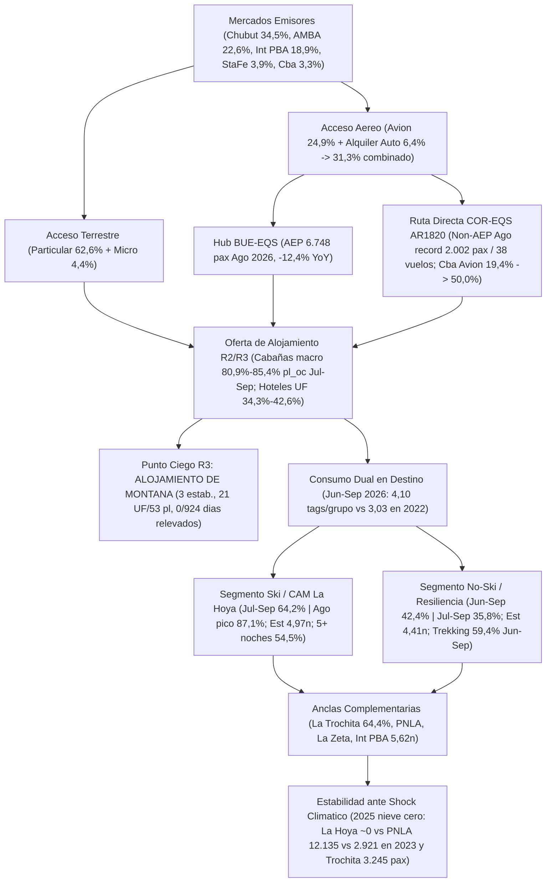

# INFORME TÉCNICO DE DEMANDA N° 2 (`ITD-ESQ-2026-02`)

**Serie Oficial de Perfiles de Demanda Turística — Esquel, Chubut (Patagonia Argentina)**  
**Marco de Certificación:** UN Tourism QUEST (`Q01AM2547AR2026` — *Indicador 1.3.1.b: Perfil y Medición de Demanda Turística*) · PETS Esquel 2030  

| Campo Institucional | Especificación Técnica |
| :--- | :--- |
| **Código de Documento** | `ITD-ESQ-2026-02` (Informe N° 2 de la Serie Oficial) |
| **Título del Informe** | **Invierno Dual en Esquel (`2016–2026`): Resiliencia sin Monodependencia Nívea, Producto CAM La Hoya y Efecto Conectividad `COR↔EQS`** |
| **Ventana Analítica Principal** | **Temporada Invernal Ampliada (`Junio–Septiembre`)** y **Núcleo Invernal (`Julio–Septiembre`)**, con contraste estructural frente a **Primavera (`Octubre`)** y series históricas **`2009–2026`** |
| **Tesis Central** | El destino superó el shock climático de nieve cero de `2025` reconstruyendo su demanda en `2026` sobre una arquitectura dual: un **segmento esquiador de alta estadía y gasto** (`54,5% >= 5 noches`) anclado por **empaquetamiento multi-actividad (`4,57` tags)** junto a un **segmento No-Ski en expansión** soportado por `PN Los Alerces`, `La Zeta`, `Trekking` y `La Trochita`, apalancado por la conectividad directa `Córdoba–Esquel` (`AR1820`) y tarifas OTA competitivas. |
| **Regímenes Auditados** | **R1** Encuestas Mostrador (`Perfil_2017–2020`, `2022`, `2026`) · **R2** Serie Declarada (`hist_mes` `2016–2025` + `Completo_Ocupacion_2026`) · **R3** Monitoreo Diario (`fact_mes`, `fact_dia`, `fact_categoria_dia`, `fact_establecimiento_dia`) · **R4** Ecosistema Externo (`ANAC`, `bronce/vuelos`, `metrica-db` OTA, `v3_master_data` Ente Mixto) |
| **Auditoría Lingüística y Estadística** | Pruebas exactas de hipótesis (`Chi2`, `Fisher`, `Welch t`, `Mann-Whitney U`), `IC 95%`, depuración de `136` anomalías `ARS-as-USD` en OTA, corrección histórica de codificación `3. Córdoba` vs `4. Santa Fé` y conciliación `R2 vs R3`. |

---

## 1. Ficha Metodológica (`R1–R4`), Arquitectura Sistémica y Auditoría de Reconciliación

Este informe mantiene la **separación estricta en cuatro regímenes de información (`R1–R4`)** establecida para la serie `ITD-ESQ`, evitando mezclar universos muestrales con series censales, proyecciones estadísticas o fuentes externas de mercado. Todas las pruebas estadísticas sobre microdatos `R1` fueron ejecutadas de forma reproducible mediante [`analyze_itd02_winter.py`](file:///C:/Users/agenc/.gemini/antigravity/scratch/esquel_estadisticas/analyze_itd02_winter.py) sobre las salidas consolidadas de [`itd02_computed_metrics.txt`](file:///C:/Users/agenc/.gemini/antigravity/scratch/esquel_estadisticas/itd02_computed_metrics.txt) y sus consultas complementarias exactas en parquet.

### 1.1 Matriz de Regímenes y Cobertura de Fuentes

| Régimen | Fuente Primaria Auditada | Unidad de Análisis y Período | Alcance y Regla de Lectura |
| :--- | :--- | :--- | :--- |
| **R1 — Microdatos Primarios** | `Perfil_2022.xlsx`, `Perfil_2026.xlsx`, `Resumen` `Perfil_2017–2020` | Grupos encuestados en Oficina de Informes (`Jun–Sep`: `2022 n=1.262 / 3.898 pax`; `2026 n=435 / 1.269 pax`; `Jul–Sep`: `2022 n=1.102 / 3.439 pax`; `2026 n=388 / 1.148 pax`) | Proporciona estructura de estadía, origen, transporte, tipo de alojamiento y consumo de actividades (`Ski`, `PNLA`, `La Zeta`, `La Trochita`, `Trekking`). No mide volumen absoluto de arribos. |
| **R2 — Serie Mensual Declarada** | `hist_mes.parquet` (`2016–2025`), `Anuarios Estadísticos` (`2009–2025`), `Completo_Ocupacion_2026.xlsx` | Turistas estimados, pernoctaciones, ocupación UF y plazas declaradas (`2016–2026`) | Serie histórica homogénea de ocupación reportada por prestadores. En `2020` el registro es `0` por cierre COVID-19. En `2026` coexiste con `R3`. |
| **R3 — Monitoreo Diario / Proyectado** | `fact_mes`, `fact_mes_quincena`, `fact_dia`, `fact_categoria_dia`, `fact_establecimiento_dia`, `dim_alojamiento`, `dim_evento` (`2026`) | Registro diario de plazas ocupadas, cobertura y proyección mensual expandida al universo | Refleja dinámica quincenal/diaria (`1Q/2Q`, finde vs semana) y consolidación por macrocategorías. Requiere auditoría de cobertura diaria para evitar sesgos de fin de semana. |
| **R4 — Ecosistema Externo y Presupuesto** | `anac_series.json.gz` (`2019–Ago 2026`), `/opt/metrica-aereos/data/bronce/vuelos_2026-09/10`, `metrica-db` OTA (`Jul–Oct 2026`), Ente Mixto `v3_master_data.json` | Pasajeros y vuelos `EQS` vs pares patagónicos, tarifas aéreas `AR1820`, ADR limpio (`< USD 1.000`), gastos ejecutados (`ARS`) | Permite modelar competitividad regional (`TTCI`, `N*`, `IC5`), densidad aérea (`ISA170`) y retorno de inversión (`ROI`) por frecuencia semanal frente al gasto real del Ente Mixto. |

### 1.2 Arquitectura del Sistema Turístico Invernal de Esquel

### 1.3 Tabla Maestra de Auditoría, Depuración y Reconciliación Metodológica

En línea con los criterios de trazabilidad exigidos para auditorías técnicas y administrativas (`QUEST 1.3.1.b`), la siguiente tabla documenta **nueve discrepancias críticas** detectadas y corregidas antes de calcular cualquier indicador del informe:

| # | Hallazgo / Anomalía Detectada | Fuente / Régimen Afectado | Diagnóstico Forense de Causa Raíz | Criterio de Depuración / Regla Aplicada |
| :---: | :--- | :--- | :--- | :--- |
| **1** | **Inversión histórica de códigos `Córdoba` y `Santa Fe`** | `R1` (`Perfil_2017–2020`, `Perfil_2022`, `Perfil_2026`) | En `Resumen` `2017–2019` Esquel asignaba `4. Córdoba` y `41. Santa Fé`. Desde `2022` el formulario mutó a **`3. Córdoba`** (`prov_code='3'`, `loc='31'`) y **`4. Santa Fé`** (`prov_code='4'/'41'`, `loc='41'/'42'`). Un mapeo fijo `pc=='4' -> Córdoba` invertía ambas provincias. | Se corrigió la función [`sub_centro`](file:///C:/Users/agenc/.gemini/antigravity/scratch/esquel_estadisticas/analyze_itd02_winter.py) usando `prov_code='3'` para Córdoba y `'4'/'41'` para Santa Fe (`0` residuales), recalibrando toda la serie `2022–2026`. |
| **2** | **Shock climático sin nieve en `2025`** | `R2` (`hist_mes`), `Anuario 2025` | `CAM La Hoya` registró cierre operativo (`~0` pases vs `59.503` en `2023` y `49.548` en `2024`). `Jul 2025` cayó a `4.934` turistas (`28% UF / 21% PAX`), mínimo no-COVID de la década (`Jul–Sep` aportó apenas `18,3%` del año). | Se aísla `2025` como experimento natural de "invierno sin nieve" para cuantificar el piso estructural no-níveo del destino. |
| **3** | **Brecha de volumen entre `R2` Declarado y `R3` Proyectado (`2026`)** | `R2` (`Completo_Ocupacion_2026.xlsx`) vs `R3` (`fact_mes.parquet`) | `R2` releva declaración cerrada (`20.913` tur / `62.739` pern en `Jul–Sep`; `33,1%–37,0% UF`); `R3` proyecta sobre plazas totales (`34.410` tur / `103.229` pern; `49,6%–69,0% UF`). | Se prohíbe concatenar `R2` y `R3` en una única tasa porcentual; toda serie histórica `2016–2026` se compara en base `R2` y se contrasta en paralelo con `R3`. |
| **4** | **Sesgo de fin de semana en Septiembre `2026` (`R3`)** | `R3` (`fact_dia` vs `fact_mes`) | `fact_mes` marca `69,0% UF` en septiembre (`z=+3,86`), casi el doble que `R2` (`37,0% UF`). En `fact_dia`, los **`9` días publicables** de septiembre (`cob` media `8,5%`) correspondieron **todos a viernes–domingo** (`Sem = NaN`, pico `20/09` con `63,7% UF` al `8,0%` de cobertura). | Se advierte explícitamente el sesgo muestral de `Sep R3` por ausencia de días hábiles publicables y baja cobertura en valles semanales. |
| **5** | **Feriado `17 de Agosto` omitido en `R2` pero captado en `R3`** | `R2` (`Completo_Ocupacion`), `dim_evento` vs `R3` (`fact_dia`) | `R2` y `dim_evento` consignaron agosto como `"No hubo FDL — 0% / 0%"`. Sin embargo, `fact_dia` midió **`47,9% UF` el `16/08`** (`cob 64,5%`) y **`59,2% UF / 47,5% PAX`** (`1.334` pax, `cob 27,6%`) el lunes **`17/08`** (Paso a la Inmortalidad del Gral. San Martín). | Se valida el pulso ferial real de agosto mediante `fact_dia`, consistente con la serie histórica `hist_evento_resumen` (`San Martín = 63,13% UF`). |
| **6** | **Consolidación taxonómica de `11` a `4` categorías desde julio (`R3`)** | `R3` (`fact_categoria_dia.parquet`) | En junio reportaron `11` categorías (`CAT 3.070 pl_oc`, `Cabañas 2.135`, `Hostel 735`, `Deptos 570`, `Hoteles 201`). Desde `Jul 2026` el ETL consolidó en **`4` macrocategorías** (`CABAÑAS`, `HOTELES`, `APART HOTELES`, `HOSTERIAS`), sumando exactamente **`100,00%`** de `fact_mes.pax_ocupada`. | Para analizar `Jul–Sep`, `CABAÑAS` debe interpretarse como macro-agregado que absorbe `CAT / Deptos / VivTur` (`80,9%–85,4%` de plazas ocupadas). |
| **7** | **Punto ciego absoluto en `ALOJAMIENTO DE MONTAÑA`** | `R3` (`dim_alojamiento`, `fact_establecimiento_dia`, `Datos_prestadores_Sep`) | `3` prestadores (`Huemules Patagonia (Domos)` `10 UF/22 pl` [`0/308` días op.], `Laguna Larga Logde` [`308/308`] y `Le Fario (Hostería)` [`308/308`] = `21 UF / 53 pl`) acumulan **`0` días relevados sobre `924` est-día** (`918 Sin gestión`, `6 Sin respuesta`) y `0` filas en septiembre. | Se declara sub-captura total del nicho de montaña en `R3` y se exige su alta obligatoria en la Directriz 4. |
| **8** | **Omisión ANAC en ruta `COR–EQS` y sesgo aéreo en `R1`** | `R4` (`anac_series.json.gz`), `bronce/vuelos`, `R1` (`Perfil_2026`) | ANAC omitió `Córdoba - Esquel` en la hoja resumen de rutas pese a registrar el **récord histórico `Non-AEP` en `Ago 2026` (`2.002` pax / `38` vuelos)**; `/opt/metrica-aereos` confirma la operación directa `AR1820` (jueves). Además, `12` encuestas aéreas `R1` pusieron Esquel/Trevelin como origen (confusión aeropuerto embarque vs residencia). | Se cruza tráfico `Non-AEP` con tarifas/vuelos reales `AR1820` en `bronce/vuelos` y se descarta residencia local espuria en orígenes aéreos `R1`. |
| **9** | **Outliers OTA `ARS-as-USD`, OCR `2024` y filtro Ente Mixto** | `R4` (`metrica-db`), `Anuario 2024`, `v3_master_data.json` | En `metrica-db` se aislaron **`136` anuncios Airbnb** con precios en pesos cargados como dólares; en Anuario `2024` el OCR de `La Hoya` imprimió `112.115` sobre `112` días operando; y en gastos Ente Mixto subcadenas `'esqu'` capturaban `'esquel'`. | Se aplicó filtro `price_usd < 1000` + `excluded=false` en OTA; se validó `112` días en Anuario `2024`; y se auditaron partidas por descripción exacta (`ARS 22,71M` explícito / `ARS 35,19M` ampliado). |

---

## 2. Resumen Ejecutivo y Cuadro de Mando Invernal

### 2.1 Cinco Hallazgos Estratégicos de Alto Impacto

1. **Tesis Confirmada — Invierno Dual ante Nieve Cero (`2025 -> 2026`):** El invierno ampliado (`Jun–Sep`) dejó de ser monodependiente del esquí. Aunque la participación de esquiadores bajó **`-6,5 pp` en `Jun–Sep`** (`64,0% -> 57,6%`, `p = 0,0314 (*)`) y la falta total de nieve de **`2025`** hundió a julio (`4.934` turistas y `14.802` pernoctaciones frente a `8.186` y `34.790` en `Jul 2023`; `Jul–Sep 56.887` vs `81.426` en `2023`), Esquel respondió ampliando el consumo simultáneo por grupo (**`3,03 -> 4,10` actividades** en `Jul–Sep`). Entre `2022` y `2026` (`Jul–Sep`), el consumo de **`Trekking` saltó `+35,3 pp`** (`15,0% -> 50,3%`), **`PN Los Alerces` `+32,8 pp`** (`47,3% -> 80,1%`), **`Laguna La Zeta` `+29,6 pp`** (`53,8% -> 83,4%`), **`La Trochita` `+16,5 pp`** (`41,4% -> 57,9%`) y **`Excursión Lacustre` `+11,0 pp`** (`0,3% -> 11,3%`), todos con **`p < 0,0001 (***)`**. Incluso durante el invierno sin nieve de `2025`, `PN Los Alerces` superó cuatro veces su registro de `Jul–Sep 2023` (**`12.135` vs `2.921`**, con `Ago 5.017` superando a `Jul 3.938` en `+27,4%`) y `La Trochita` retuvo **`3.245` pasajeros** (`3.436` en `2024`; `19,0%` de su año).
2. **El Esquiador sigue siendo el Ancla Económica de Mayor Estadía y Derrame:** A pesar de la diversificación `No-Ski`, el turista vinculado a `CAM La Hoya` conserva una prima estructural contundente en `Jul–Sep 2026`: estadía media **`4,97 ± 0,34` noches** (mediana `5,0`) frente a **`4,41 ± 0,66`** del segmento `No-Ski` (mediana `4,0`, `Mann-Whitney p = 0,0009 (***)`; en `Jun–Sep`: `4,97` vs `4,31`, `p < 0,0001 (***)`), con **`54,5%` pernoctando 5 o más noches** vs **`32,7%`** en `No-Ski` (`+21,8 pp`, `p = 0,0003 (***)`). Lejos de encerrarse en el cerro, el esquiador de `2026` compra **`64,4%` de `La Trochita`** vs **`46,3%`** del `No-Ski` (`+18,1 pp`, `p = 0,0022 (**)`) y combina **`4,57` actividades vs `3,26`**.
3. **Efecto Disruptivo de la Conectividad Directa `Córdoba↔Esquel` (`AR1820`) en Volumen, Tarifa y Modo:** La reinstalación del vuelo directo los jueves transformó el tráfico de `EQS`: en **`Ago 2026`**, el aeropuerto alcanzó un **récord histórico de pasajeros `Non-AEP` (`2.002` pax en `38` vuelos; `52,7 pax/vuelo`)**, amortiguando la caída de `AEP` (`-12,4%`) y permitiendo que Esquel (`-5,5%` `Jun–Ago`, **`-0,9%` en `Ago`**) resistiera mejor la retracción aérea invernal que **Bariloche (`-7,8%`; `Ago -1,4%`)**, **El Calafate (`-7,3%`; `Ago -2,5%`)** y **Chapelco (`-9,1%`; `Ago -11,7%`)**. En `R1`, el uso de avión entre turistas cordobeses saltó de **`19,4%` (`2022`) a `50,0%` (`2026`, `p = 0,0391 (*)`)**, alcanzando `60,0%` en agosto y `100,0%` en septiembre. Econométricamente, operar vía **`AR1820` (`COR` ida y vuelta pareja `USD 591,2`)** reduce el costo total `TTCI` de `5` noches a **`USD 806,2` (`USD 80,62` pppn)**, volviendo a Esquel más económico desde la primera noche que **Villa La Angostura (`USD 899,8`)** y **San Martín de los Andes (`USD 931,7`)**.
4. **Esquel Lidera el Corredor en Calidad/Precio OTA, pero Pierde Conversión Corta desde `BUE`:** En `metrica-db` (`Jul–Sep 2026` limpio), Esquel combina la **mediana tarifaria más accesible del Corredor de los Lagos** (`Airbnb USD 47` / `Booking USD 43`, cayendo en agosto a **`USD 41,0` / `ARS 60.628` en Booking**) con el **puntaje medio de huéspedes más alto del corredor (`9,18`)**, superando a Trevelin (`9,16`), El Bolsón (`9,08`), San Martín de los Andes (`8,85`), Villa La Angostura (`8,83`) y Bariloche (`8,50`). No obstante, cuando el pasajero parte desde **`BUE`** (`USD 739,4` aéreo pareja vs `USD 484,8` a Bariloche), el componente aéreo absorbe **`77,5%`** del presupuesto de un viaje de `5` noches (`TTCI USD 954,4`), exigiendo `5,65` noches para empatar a `SMA` y `6,37` para empatar a `VLA` en Booking (aunque en Airbnb vence a `VLA` ya desde la noche `6`, `N* = 5,54`, `IC5 = 0,895`). Cada frecuencia semanal invernal adicional en `E190` (`96` asientos) inyecta entre **`ARS 95,26M` y `ARS 148,57M` mensuales** (`B737-700`: **`ARS 211,30M–224,51M`**).
5. **Reacomodamiento Intratemporal y Asimetría de Gestión Pública vs. Realidad de Campo:** El invierno perdió peso frente al efecto tulipanes de octubre (`an_desplazamiento` `2016–19 -> 2022–25`: **`Jul -3,00 pp`**, **`Sep -3,82 pp`** vs **`Oct +9,38 pp` / `+163,1%`**). Además, los feriados operan de forma opuesta: **San Martín (`Ago`)** aporta un uplift real de **`+26,38 pp` (`63,13% UF`)**, mientras **Independencia (`Jul`)** se diluye con el receso invernal (**`-1,50 pp`**). Al mismo tiempo, `Interior PBA` emerge como el segmento de mayor estadía invernal (**`5,62 ± 0,59` noches**, `76,7%` esquí), y el `Ente Mixto` concentró en `2026` **`ARS 22,71M` (`15,04%` operativo; `ARS 35,19M` / `23,30%` ampliado)** en acciones invernales y **`ARS 13,58M` (`8,99%`)** en Córdoba, pero ejecutó **`ARS 0` (`0%`)** en encuestas primarias de gasto real y satisfacción (`NPS`) exigidas por `UN Tourism QUEST 1.3.1.b`.

### 2.2 Cuadro de Mando Invernal Comparado (`2022` vs `2024` vs `2025` Shock vs `2026`)

| Dimensión / Indicador (Régimen) | `2022` (Pos-COVID) | `2024` (Últ. Nieve Plena) | `2025` (Shock Sin Nieve) | `2026` (`R2` / `R3` / `R1` / `R4`) | Variación / Lectura Clave |
| :--- | :---: | :---: | :---: | :---: | :--- |
| **Turistas `Jul–Sep` (`R2` Hist/Decl)** | `23.202` (`20,0%` año) | `18.076` (`21,5%`) | `17.892` (`18,3%`) | `R2: 20.913` / `R3: 34.410` | **`R2 Jul–Sep +16,9%` vs `2025`** (`Jul +33,9%`: `4.934 -> 6.605`) |
| **Pernoctaciones `Jul–Sep` (`R2`)** | `79.906` (`22,2%` año) | `65.507` (`23,8%`) | `56.887` (`18,5%`) | `R2: 62.739` / `R3: 103.229` | **`R2 Jul–Sep +10,3%` vs `2025`** (`R3` c/ sesgo `Sep` finde) |
| **Ocupación UF / PAX `Jul–Sep` (`R2`)** | `44,3%` / `37,3%` | `36,0%` / `24,7%` | `29,0%` / `22,0%` | `R2: 33,1%–37,0%` / `22,6%–25,7%` | `2025 Jul` mínimo no-COVID (`28% UF / 21% PAX`); `R3` `54,82% / 38,89%` |
| **Octubre Comparativo (`R2`)** | `17.600` (`83%–70%`) | `15.393` (`80%–58%`) | `20.653` (`81%–64%`) | `R2: 13.537` / `R3: 17.071` | `Oct` supera en volumen mensual a cualquier mes de invierno desde `2021` |
| **Pases `CAM La Hoya` (`R2` Anuario)** | `s/d` en OCR | `49.548` (`112` días) | **`~0` (cierre s/nieve)** | **`64,2%` Ski `R1`** (`Jul–Sep`) | Rebote en `R1`: `Ago` llegó a **`87,1% Ski`** (`Jun 0,0%`) |
| **Visitantes `PNLA` `Jul–Sep` (`R2`)** | `2.352` (`Ago 1.730`) | `s/d` parcial | **`12.135`** (`Ago 5.017`) | **`80,1%` `R1`** (`+32,8 pp` vs `22`) | `PNLA` absorbió la crisis nívea `2025` y consolidó uso masivo en `2026` |
| **Pasajeros `La Trochita` `Jul–Sep`** | `3.001` (`Jul 1.759`) | `3.436` (`Jul 1.967`) | **`3.245`** (`Jul 1.850`) | **`57,9%` `R1`** (`+16,5 pp` vs `22`) | Demanda patrimonial altamente inelástica al déficit de nieve (`-5,6%` en `25`) |
| **Estadía Media Mostrador `Jul–Sep` (`R1`)** | `4,62 ± 0,17 n` | `—` | `—` | `4,57 ± 0,30 n` (`p=0,772`) | Estabilidad global, pero fuerte brecha interna `Ski (4,97)` vs `No-Ski (4,41)` |
| **Tráfico Aéreo `EQS` `Jul–Ago` (`R4`)** | `13.174` (`Non-AEP 2.646`) | `15.881` (`Non-AEP 725`) | `18.115` (`Non-AEP 2.031`) | **`17.333`** (`Non-AEP 2.957`) | **`Ago 2026`: `2.002` pax `Non-AEP` (récord histórico, `38` vuelos)** |
| **ADR Invierno Esquel (`metrica-db` / Anu.)** | `Hoteles USD 131,95` | `—` | `—` | `Airb USD 47 / Bkg USD 43` | Piso estacional `Ago`: `Bkg USD 41,0`; nota huéspedes `9,18` (`#1` corredor) |

---

## 3. Análisis Estadístico Descriptivo y Cruzado del Sistema Invernal

### 3.1 Dinámica Histórica `R2` (`2016–2026`): Pérdida de Peso Relativo, Shock `2025` y Atractivos Invernales

El análisis longitudinal de la serie `hist_mes` (`2016–2025`, ponderada por plazas y unidades disponibles) junto con el cierre declarado `Completo_Ocupacion_2026.xlsx` demuestra que el invierno esquelense dejó atrás el pico relativo de `2017`—cuando `Jul–Sep` concentraba el **`25,8%` de los turistas y el `36,6%` de las pernoctaciones anuales** (`23.373` tur / `93.492` pern, estadía `4,00` noches)—para estabilizarse en torno al **`20%–22%` del flujo anual** tras la explosión primaveral de `Octubre` desde `2021`. El año **`2025`** expuso el suelo mínimo sin COVID-19 (`18,3%` de turistas anuales y `18,5%` de pernoctaciones en `Jul–Sep`), mientras **`2026` (`R2`)** muestra una recomposición rápida (`+16,9%` en turistas `Jul–Sep` vs `2025`).

#### Tabla 1. Serie Histórica Invernal y Contraste de Primavera (`2016–2026`, Régimen `R2` vs `R3`)

| Año (Rég.) | `Junio` Tur / Pern (`% UF–PAX`) | `Julio` Tur / Pern (`% UF–PAX`) | `Agosto` Tur / Pern (`% UF–PAX`) | `Septiembre` Tur / Pern (`% UF–PAX`) | `Jul–Sep` Tur (`% Año`) / Pern (`Est`) | `Jul–Sep` `% UF–PAX` / `Ext` | `Jun–Sep` Tur / Pern (`% UF–PAX`) | `Octubre` Tur (`% UF–PAX`) |
| :---: | :---: | :---: | :---: | :---: | :---: | :---: | :---: | :---: |
| **`2016` (R2)** | `2.665 / 7.995` (`19%–11%`) | `6.375 / 25.500` (`42%–32%`) | `5.289 / 15.867` (`30%–20%`) | `6.600 / 19.800` (`33%–26%`) | `18.264 (21,2%) / 61.167 (3,35)` | `35,0%–26,0%` / `5,5%` | `20.929 / 69.162` (`31,2%–22,4%`) | `7.147` (`40%–28%`) |
| **`2017` (R2)** | `1.327 / 3.981` (`11%–7%`) | `6.255 / s/d` (`41%–33%`) | `6.458 / s/d` (`42%–25%`) | `10.660 / 42.640` (`50%–44%`) | **`23.373 (25,8%) / 93.492 (4,00)`** | `44,3%–33,9%` / `3,2%` | `24.700 / 97.473` (`36,2%–27,3%`) | `s/d` |
| **`2018` (R2)** | `1.669 / 5.007` (`15%–7%`) | `7.802 / s/d` (`45%–39%`) | `5.342 / s/d` (`41%–27%`) | `7.443 / s/d` (`48%–36%`) | `20.587 (24,9%) / 69.563 (3,38)` | **`44,6%–34,0%`** / `7,8%` | `22.256 / 74.570` (`37,3%–27,3%`) | `s/d` |
| **`2019` (R2)** | `5.178 / 15.534` (`40%–20%`) | `8.315 / s/d` (`48%–36%`) | `5.180 / s/d` (`35%–25%`) | `6.694 / s/d` (`38%–25%`) | `20.189 (23,0%) / 69.904 (3,46)` | `40,4%–28,7%` / `9,6%` | `25.367 / 85.438` (`40,3%–26,6%`) | `s/d` |
| **`2020` (R2)** | `0 / 0` (`COVID`) | `0 / 0` (`COVID`) | `0 / 0` (`COVID`) | `0 / 0` (`COVID`) | `0 / 0` | `0%–0%` | `0 / 0` | `0 / 0` |
| **`2021` (R2)** | `1.700 / 5.100` (`15%–9%`) | `6.541 / s/d` (`45%–32%`) | `5.539 / s/d` (`40%–28%`) | `6.344 / s/d` (`41%–30%`) | `18.424 (21,2%) / 55.272 (3,00)` | `42,0%–30,0%` / `2,1%` | `20.124 / 60.372` (`35,5%–25,0%`) | `15.481` (`85%–70%`) |
| **`2022` (R2)** | `2.485 / 7.455` (`34%–31%`) | **`9.232 / 32.312`** (`50%–45%`) | `5.684 / 22.736` (`37%–32%`) | `8.286 / 24.858` (`46%–35%`) | `23.202 (20,0%) / 79.906 (3,44)` | `44,3%–37,3%` / `7,3%` | `25.687 / 87.361` (`41,8%–35,8%`) | `17.600` (`83%–70%`) |
| **`2023` (R2)** | `3.921 / 11.763` (`28%–19%`) | `8.186 / 34.790` (`45%–42%`) | `5.589 / 20.959` (`40%–31%`) | `8.559 / 25.677` (`46%–33%`) | `22.334 (22,3%) / 81.426 (3,65)` | `43,6%–35,2%` / **`12,1%`** | `26.255 / 93.189` (`40,0%–31,4%`) | `15.405` (`88%–73%`) |
| **`2024` (R2)** | `2.197 / 6.591` (`17%–12%`) | `6.736 / 26.944` (`40%–30%`) | `4.543 / 18.172` (`35%–21%`) | `6.797 / 20.391` (`33%–23%`) | `18.076 (21,5%) / 65.507 (3,62)` | `36,0%–24,7%` / `9,0%` | `20.273 / 72.098` (`31,4%–21,6%`) | `15.393` (`80%–58%`) |
| **`2025` (R2)** | `3.104 / 9.312` (`15%–10%`) | **`4.934 / 14.802`** (`28%–21%`) | `6.422 / 22.477` (`29%–25%`) | `6.536 / 19.608` (`30%–20%`) | **`17.892 (18,3%) / 56.887 (3,18)`** | `29,0%–22,0%` / **`12,4%`** | `20.996 / 66.199` (`25,6%–19,1%`) | **`20.653`** (`81%–64%`) |
| **`2026` (R2)** | `2.683 / 8.050` (`13,0%–9,0%`) | `6.605 / 19.815` (`33,1%–22,6%`) | `7.500 / 22.500` (`33,2%–25,7%`) | `6.808 / 20.424` (`37,0%–25,6%`) | `20.913 / 62.739 (3,00)` | `s/d` pond. exact | `23.596 / 70.789` | `13.537` (`68,7%–56,1%`) |
| **`2026` (R3)** | `7.954 / 23.862` (`29,4%–25,1%`) | `11.377 / 34.132` (`49,6%–36,8%`) | `11.165 / 33.496` (`50,1%–38,5%`) | `11.867 / 35.601` (`69,0%–42,4%`) | `34.410 (29,6% YTD) / 103.229` | `54,82%–38,89%` | `42.364 (36,4% YTD) / 127.091` | `17.071` (`83,1%–59,9%`) |

*Nota de lectura:* En `2023`, la suma mensual de `hist_mes` totaliza `100.311` turistas frente a `103.311` declarados anuales (`330.762` pernoctes). En `2026 R3`, `Sep` está sesgado al alza por cobertura restringida a fines de semana en `fact_dia` (ver Tabla de Auditoría #4). En `2018`, `Jun` registró `30%` de extranjeros (`2019 Sep 22%`, `2023 Sep 20%`, `2025 Sep 22%`) por nichos específicos de fines de semana y eventos.

#### Desplazamiento Estacional, Z-Scores e Impacto Asimétrico de Feriados (`hist_evento_resumen`)

Los índices estacionales de la serie `2016–2025` (`an_indices_estacionales`) muestran que ningún mes invernal supera la estacionalidad de enero (`165,8`) ni octubre (`175,2`): **`Jul = 113,6`** es el único mes del trimestre por encima del promedio anual (`100`), seguido por **`Sep = 89,5`**, **`Ago = 87,0`** y el valle de **`Jun = 48,5`** (apenas superior a mayo `45,4`). Al comparar el bloque prepandemia (`2016–2019`) contra pospandemia (`2022–2025`, tabla `an_desplazamiento`), el invierno cedió participación relativa en todos sus meses:
- **`Junio`:** `-0,63 pp` (`3,39% -> 2,76%`, volumen `+8,0%`).
- **`Julio`:** **`-3,00 pp`** (`11,56% -> 8,56%`, volumen `-1,8%`).
- **`Agosto`:** `-1,55 pp` (`8,18% -> 6,63%`, volumen `+7,5%`).
- **`Septiembre`:** **`-3,82 pp`** (`10,93% -> 7,12%`, volumen `-13,7%`).
- **Contraste `Octubre`:** **`+9,38 pp`** (`9,54% -> 18,91%`, volumen **`+163,1%`**).

Bajo proyección `R3` (`an_bandas`), `2026` ubicó a todo el período `Jun–Sep` en el percentil **`1,00`** respecto a la serie histórica (`z` de turistas: **`Jun +4,11`**, **`Jul +3,19`**, **`Ago +9,36`**, **`Sep +3,06`** y `Sep UF z = +3,86` por efecto del `69,0%` proyectado frente a mediana histórica `41,0%`), aunque parte de esa diferencia responde al cambio de metodología expansiva de `R3`.

A nivel de eventos (`hist_evento_resumen` `2016–2025`), los feriados largos de invierno exhiben comportamientos radicalmente distintos:
- **Paso a la Inmortalidad del Gral. San Martín (`Agosto`, `n=8` años):** alcanza una **ocupación UF media de `63,13%`** (máximo `72%` en `2016`), generando un **uplift de `+26,38 pp` (`+73,1%` relativo)** respecto al promedio de los días ordinarios del mes, con consistencia del **`0,825`**.
- **Día de la Independencia (`Julio`, `n=4`):** registra **`43,5%` UF media**, pero con un **uplift negativo de `-1,50 pp` (`-3,8%` relativo)** al quedar subsumido dentro del flujo continuo del receso escolar de invierno (`9/07/2026` `R2`: `21% UF / 15% Pl`; `fact_dia 11/07`: `21,9% UF`).
- **Paso a la Inmortalidad del Gral. Güemes (`Junio`, `n=3`):** promedia **`31,0%` UF** (`+6,3 pp` de uplift; aunque cayó al `11%` en `2025` sin nieve y `13% UF / 9% Pl` en `2026 R2`).

#### Comportamiento de Atractivos Ancla Invernales (`Anuarios 2009–2025`): Nieve vs. Patrimonio y Naturaleza

| Temporada / Año | `CAM La Hoya` (Pases / Días Operando) | `La Trochita` (`Jul–Sep` / Anual / `Oct`) | `PN Los Alerces` (`Jun–Oct`) | Lectura de Resiliencia y Complementariedad |
| :---: | :--- | :--- | :--- | :--- |
| **`2009`** | `31.982` (`Jul 16.131, Ago 7.044, Sep 7.231, Oct 1.576`) | `s/d` homogénea | `s/d` homogénea | Serie base CORFO: julio concentra `50,4%` del cerro. |
| **`2010`** | `40.361` (`+26,2%`: `Jul 17.390, Ago 11.635, Sep 8.545, Oct 2.791`) | `s/d` homogénea | `s/d` homogénea | Peso de turistas (no residentes): `Jul 80%`, `Ago 77%`, `Sep 69%`, `Oct 71%`. |
| **`2018`** | `23.897` pases (`75% No Res / 25% Res`) | `s/d` homogénea | `s/d` homogénea | Caída marcada tras el incendio de confitería La Piedra. |
| **`2021`** | `s/d` completa | `Jul–Sep 2.741` / `9.139` (`Jul 1.547, Ago 575, Sep 619; Oct 3.703`) | `s/d` | Reapertura pospandemia: `Oct` (`29t`) ya supera a todo `Jul–Sep` (`24t`). |
| **`2022`** | `s/d` completa | `Jul–Sep 3.001` / `24.143` (`Jun 498, Jul 1.759, Ago 727, Sep 515; Oct 5.468`) | `Jun 419, Jul 622, Ago 1.730, Sep 0, Oct 5.415` | `PNLA` casi sin visitación invernal en `2022` (total May–Dic `12.411`). |
| **`2023`** | **`59.503`** (`50.789` esquí + `8.714` peatones; `106` días, `645`/d) | **`Jul–Sep 4.180`** / `22.052` (`Jun 829, Jul 2.349, Ago 762, Sep 1.069; Oct 5.585`) | `Jun 1.429, Jul 2.201, Ago 395, Sep 325, Oct 5.923` (`123.250` año) | Máximo reciente de demanda combinada nieve + tren en invierno. |
| **`2024`** | `49.548` (`-16,7%`: `43.121` esquí `-15,1%` + `6.427` peatones `-26,3%`; **`112` días**, `708`/d) | `Jul–Sep 3.436` / `21.046` (`Jun 711, Jul 1.967, Ago 836, Sep 633; Oct 5.120`) | `s/d` serie consolidada | Mayor densidad diaria (`708`/d), pero contracción de peatones (`-26,3%`). |
| **`2025` (Shock)** | **`~0` / cierre operativo sin nieve** | **`Jul–Sep 3.245`** (`19,0%` de `17.042`; `Jun 349, Jul 1.850, Ago 676, Sep 719; Oct 4.397`) | **`Jul–Sep 12.135`** (`9,1%` de `133.282`; `Jun 1.273, Jul 3.938, Ago 5.017, Sep 3.180; Oct 16.718`) | **Efecto sustitución:** sin nieve en La Hoya, **`PNLA` creció más de `4x` vs `2023`** y agosto (`5.017`) superó a julio (`+27,4%`); `La Trochita` cayó apenas `-5,6%` en `Jul–Sep`. |

*Nota sobre Reserva Natural Urbana Laguna La Zeta:* Los anuarios históricos solo relevan contadores en enero–febrero, invisibilizando su consumo invernal; sin embargo, los microdatos de mostrador `R1` demuestran que se convirtió en el **atractivo más visitado del invierno `2026` (`83,4%`)**.

---

### 3.2 Anatomía Intratemporal del Invierno (`Junio–Septiembre`, `R1` `2022` vs `2026`) y Cambios Estructurales

El seguimiento mes a mes en `R1` confirma que **"el invierno" no es un bloque homogéneo**, sino cuatro sub-temporadas con motivaciones, tamaños de grupo y modos de viaje diferenciados:

#### Tabla 2. Perfil Mensual Comparado de Demanda en Mostrador (`Jun–Sep`, `2022` vs `2026`, Régimen `R1`)

| Mes (`Año`) | Grupos / Pax (`Tam.`) | `< 18 años` | Estadía Media (`IC 95%`) | Grupo Dominante | Orígenes Líderes (`Chubut / AMBA / Int PBA / Cba`) | `% Avión` | `% Ski (La Hoya)` | `% PNLA` | `% La Zeta` | `% Trochita` |
| :--- | :---: | :---: | :---: | :---: | :---: | :---: | :---: | :---: | :---: | :---: |
| **`Jun 2022`** | `160 / 459` (`2,87`) | `18,7%` | `3,64 ± 0,35` | `s/d` foco | `s/d` desag. | `s/d` | `37,8%` | `s/d` | `s/d` | `s/d` |
| **`Jun 2026`** | `47 / 121` (`2,57`) | `13,3%` | `3,93 ± 0,86` | Pareja / Adultos | Demanda no nívea | `s/d` | **`0,0%`** | **`82,9%`** | **`94,3%`** | `s/d` |
| **`Jul 2022`** | `567 / 1.943` (`3,43`) | `31,1%` | `4,98 ± 0,25` | `Familia 63,7%` | `Chubut 34,0%` | `12,3%` | `74,5%` | `s/d` | `s/d` | `s/d` |
| **`Jul 2026`** | `212 / 701` (`3,31`) | `26,3%` | `4,54 ± 0,37` | `Familia 60,2%` | `Chubut 39,5%` | `19,8%` | `57,1%` | `76,4%` | `85,2%` | `63,7%` |
| **`Ago 2022`** | `289 / 822` (`2,84`) | `19,7%` | `4,57 ± 0,33` | `Familia 47,1%` | `Chubut 21,5%`, `CABA 21,2%` | `27,7%` | `71,3%` | `s/d` | `s/d` | `s/d` |
| **`Ago 2026`** | `102 / 257` (`2,52`) | `16,1%` | `4,53 ± 0,52` | **`Pareja 38,6%`** | `Chubut 33,0%` | **`33,3%`** | **`87,1%`** | `84,3%` | `s/d` | `s/d` |
| **`Sep 2022`** | `246 / 674` (`2,74`) | `15,0%` | `3,88 ± 0,30` | `Pareja 44,3%` | `Int PBA 19,9%`, `Chubut 15,4%`, `Cba 6,91%` | `18,7%` | `47,7%` | `68,5%` | `s/d` | `s/d` |
| **`Sep 2026`** | `74 / 190` (`2,57`) | **`8,9%`** | `4,71 ± 0,91` | **`Pareja 44,4%`** | `Chubut 21,5%`, `Cba 4,62%` | `28,2%` | `58,0%` | **`88,0%`** | `s/d` | `s/d` |
| **Acum. `Jul–Sep 2022`** | `1.102 / 3.439` | `—` | `4,62 ± 0,17` (`med 4,0`) | `Familia` líder | `Chubut 26,6% ± 2,6` | `17,8% ± 2,3` | `67,8%` | `47,3%` | `53,8%` | `41,4%` |
| **Acum. `Jul–Sep 2026`** | `388 / 1.148` | `—` | `4,57 ± 0,30` (`med 4,0`) | `Familia + Pareja` | `Chubut 34,5% ± 4,9` | `24,9% ± 4,4` | `64,2%` | **`80,1%`** | **`83,4%`** | **`57,9%`** |
| **Ampl. `Jun–Sep 2022`** | `1.262 / 3.898` | `—` | `4,49 ± 0,16` | `—` | `—` | `20,8%` (`Av+Alq`) | `64,0%` | `—` | `—` | `—` |
| **Ampl. `Jun–Sep 2026`** | `435 / 1.269` | `—` | `4,50 ± 0,28` | `—` | `—` | `30,5%` (`Av+Alq`) | `57,6%` | `—` | `—` | `—` |

#### Tabla 3. Pruebas de Cambio Estructural `2022 -> 2026` en Temporada Invernal (`R1`, Núcleo `Jul–Sep` y Ampl. `Jun–Sep`)

| Variable de Demanda (`R1`) | `2022` | `2026` | Diferencia (`pp` / noches) | Significancia (`p`-value exacto) | Interpretación Estratégica |
| :--- | :---: | :---: | :---: | :---: | :--- |
| **Estadía Media `Jul–Sep`** | `4,62 ± 0,17` | `4,57 ± 0,30` | `-0,05 n` | `p = 0,772 (ns)` | Duración agregada estable en `4,6` noches. |
| **Origen Intraprovincial `Chubut` (`Jul–Sep`)** | `26,6% ± 2,6` | `34,5% ± 4,9` | **`+7,9 pp`** | `p = 0,0039 (**)` | Consolidación del turismo regional de cercanía (Valle/Costa + Comodoro). |
| **Transporte `Avión` (`Jul–Sep`)** | `17,8% ± 2,3` | `24,9% ± 4,4` | **`+7,1 pp`** | `p = 0,0025 (**)` | Reconfiguración hacia el arribo aéreo (+40% relativo). |
| **Transporte `Rent-a-Car` (`Jul–Sep`)** | `3,6% ± 1,1` | `6,4% ± 2,5` | **`+2,7 pp`** | `p = 0,0242 (*)` | Creciente autonomía de movilidad tras arribo en avión. |
| **Combinado `Avión + Alquiler Auto` (`Jul–Sep`)** | `21,4% ± 2,4` | `31,3% ± 4,7` | **`+9,9 pp`** | `p = 0,0001 (***)` | Casi un tercio de la demanda usa movilidad aérea-autónoma (`Jun–Sep`: `20,8% -> 30,5%`, `p < 0,0001`). |
| **Transporte `Auto Particular` (`Jul–Sep`)** | `68,3%` | `62,6%` | **`-5,7 pp`** | `p = 0,0413 (*)` | Cesión gradual del vehículo particular frente al binomio aéreo. |
| **Turistas `Primera Vez` (`Jul–Sep`)** | `59,3%` | `66,5%` | **`+7,1 pp`** | `p = 0,0148 (*)` | Renovación fuerte de cartera de visitantes en mostrador. |
| **Alojamiento `Depto / CAT + VT` (`Jul–Sep`)** | `18,4%` | `25,5%` | **`+7,1 pp`** | `p = 0,0039 (**)` | Traslado hacia vivienda turística/apart frente a formatos tradicionales. |
| **Alojamiento `Camping / Motorhome` (`Jul–Sep`)** | `5,5%` | `1,1%` | **`-4,4 pp`** | `p = 0,0002 (***)` | Práctica desaparición invernal del pernocte en camping/rodante. |
| **Actividad `Ski / La Hoya` (`Jul–Sep`)** | `67,8%` | `64,2%` | `-3,6 pp` | `p = 0,248 (ns)` | En el núcleo `Jul–Sep`, el peso relativo del esquí se mantiene en ~2/3. |
| **Actividad `Ski / La Hoya` (`Jun–Sep`)** | `64,0%` | `57,6%` | **`-6,5 pp`** | `p = 0,0314 (*)` | Al incluir junio (`0%` nieve en `2026`), la ventana ampliada evidencia desestacionalización no nívea. |
| **Actividad `Trekking / Senderismo` (`Jul–Sep`)** | `15,0%` | `50,3%` | **`+35,3 pp`** | `p < 0,0001 (***)` | Explosión del turismo activo de media/baja montaña en invierno. |
| **Visita `PN Los Alerces` (`Jul–Sep`)** | `47,3%` | `80,1%` | **`+32,8 pp`** | `p < 0,0001 (***)` | Cobertura casi universal como segundo pilar invernal tras la crisis `2025`. |
| **Visita `Laguna La Zeta` (`Jul–Sep`)** | `53,8%` | `83,4%` | **`+29,6 pp`** | `p < 0,0001 (***)` | Consolidación como parque urbano de proximidad de consumo masivo. |
| **Visita `La Trochita` (`Jul–Sep`)** | `41,4%` | `57,9%` | **`+16,5 pp`** | `p < 0,0001 (***)` | Producto patrimonial capturando más de la mitad de la demanda encuestada. |
| **Actividad `Excursión Lacustre` (`Jul–Sep`)** | `0,3%` | `11,3%` | **`+11,0 pp`** | `p < 0,0001 (***)` | Nuevo nicho navegable de invierno dentro del corredor `PNLA`. |
| **Actividades de Montaña en `La Hoya` (`Jul–Sep`)** | `0,5%` | `7,6%` | **`+7,1 pp`** | `p < 0,0001 (***)` | Inicio de diversificación no-esquí dentro del propio centro invernal. |
| **Visita `Trevelin` (`Jul–Sep`)** | `25,2%` | `17,5%` | **`-7,6 pp`** | `p = 0,0063 (**)` | En invierno el visitante permanece más contenido en el eje Esquel–La Hoya–PNLA. |

---

### 3.3 Segmentación Dual en Mostrador (`R1`): `Ski (La Hoya)` vs. `No-Ski` y `Avión` vs. `Particular`

Para evaluar si el crecimiento `No-Ski` erosiona o complementa la rentabilidad del destino, la Tabla 4 desagrega ambos perfiles dentro del mismo período (`Jul–Sep` y `Jun–Sep`), junto con el cruce modal `Avión` vs `Auto Particular`.

#### Tabla 4. Cruce Analítico Dual `Ski vs No-Ski` y `Avión vs Particular` (`Jul–Sep` y `Jun–Sep`, Régimen `R1`)

| Indicador Segmentado | `2022 Jul–Sep` `Ski` (`n=674`) vs `No-Ski` (`n=320`) | `2026 Jul–Sep` `Ski` (`n=194`, `64,2%`) vs `No-Ski` (`n=108`, `35,8%`) | `2026 Jun–Sep` y Significancia `Ski` (`194`, `57,6%`) vs `No-Ski` (`143`, `42,4%`) | `2026 Jul–Sep` `Avión` (`n=94`) vs `Particular` (`n=236`) |
| :--- | :---: | :---: | :---: | :---: |
| **Estadía Media (Mediana)** | **`4,94 ± 0,21` (`5,0`)** vs `4,10 ± 0,36` (`3,0`) `p < 0,0001 (***)` | **`4,97 ± 0,34` (`5,0`)** vs `4,41 ± 0,66` (`4,0`) **`MWU p = 0,0009 (***)`** | `4,97 ± 0,34` vs `4,31 ± 0,55` (`Welch p = 0,0447 (*)`; **`MWU p < 0,0001 (***)`**) | **`5,59 ± 0,47` (`5,0`)** vs `4,28 ± 0,42` (`4,0`) **`p < 0,0001 (***)`** (`22`: `6,02` vs `4,28`) |
| **Estadía Larga (`>= 5` noches)** | **`51,5%`** vs `32,8%` (`+18,7 pp`, `p < 0,0001`) | **`54,5%`** vs `32,7%` (`+21,8 pp`, **`p = 0,0003 (***)`**) | `54,5%` vs `32%–33%` (**`p < 0,0001 (***)`**) | **`67,0%`** vs `31,7%` (`+35,3 pp`, **`p < 0,0001 (***)`**) (`22`: `69,8%` vs `38,3%`) |
| **Composición de Grupo** | Fam **`61,0%`** vs `35,0%`; Par `25,7%` vs `43,8%`; `<18` `28,5%` vs `17,2%` | Amigos `4,7%` vs **`11,2%` (`p = 0,0331 (*)`)** | Fam **`51,8%`** vs `37,3%` (**`p = 0,0085 (**)`**) | **`Solo 18,1%`** vs `6,8%` (**`p = 0,0022 (**)`**) |
| **Origen Geográfico / Residencia** | `Chubut` `29,1%` vs `21,3%` (`p = 0,0097 (**)`) | **`Interior PBA 24,5%`** vs `13,9%` (`+10,6 pp`, **`p = 0,0340 (*)`**) | `Int PBA +11,7 pp` (**`p = 0,0094 (**)`**); Ext `4,8%` vs **`10,5%` (`p = 0,0495 (*)`)** | `AMBA 50,5%` vs `10,9%`; **`Int PBA 30,1%`** vs `14,2%` (`p = 0,0012 (**)`); `Cba 6,5%` vs `2,8%`; `StaFe 5,4%` vs `4,3%` |
| **Tipo de Alojamiento** | `Cab 36,9%` vs `25,9%` (`p = 0,0006`); `Depto/CAT+VT 21,8%` vs `14,4%` (`p = 0,0056`); `Hot+Ap+Hst 21,7%` vs `34,4%` | **`Depto/CAT+VT 33,3%`** vs `22,1%` (`+11,2 pp`, **`p = 0,0452 (*)`**) | Preferencia sostenida de `Depto/CAT+VT` entre esquiadores | `Cab 20,7%` vs **`42,6%` (`p = 0,0003 (***)`)**; `Depto/CAT+VT 35,6%` vs `24,5%` (`p = 0,051`) (`22 Hot+Ap+Hst 35,2%` vs `23,5%`) |
| **Primera Visita a Esquel** | — | — | — | **`79,3%`** vs `60,0%` (`+19,3 pp`, **`p = 0,0010 (***)`**) |
| **Consumo `La Trochita`** | **`45,5%`** vs `32,8%` (`+12,7 pp`, `p = 0,0001`) | **`64,4%`** vs `46,3%` (`+18,1 pp`, **`p = 0,0022 (**)`**) | `Jun–Sep +23,2 pp` (**`p < 0,0001 (***)`**) | **`52,1%`** vs `39,8%` (`+12,3 pp`, **`p = 0,0419 (*)`**) |
| **Consumo `Trekking` / Otros** | `2022`: `3,26` vs `2,54` tags | `4,57` vs `3,26` tags | `Trekking` `46,9%` vs **`59,4%` (`p = 0,0228 (*)`)**; Mont. Hoya **`9,8%`** vs `2,8%` (`p = 0,0148 (*)`) | **`Trekking 50,0%`** vs `33,9%` (`p = 0,0067 (**)`); **`Lacustre 20,2%`** vs `4,7%` (**`p < 0,0001 (***)`**) |

**Síntesis del cruce:** Lejos de competir como compartimentos estancos, la nieve actúa como **multiplicador del consumo turístico integrado**: un esquiador en `2026` no solo permanece más tiempo (`54,5% >= 5` noches), sino que consume **`La Trochita` en `64,4%` de los casos**, realiza trekking casi al `47%` y promedia `4,57` actividades. Por su parte, el segmento `No-Ski` sostiene al destino cuando falta nieve (`Junio 2026` y `Invierno 2025`), con mayor captación de **extranjeros (`10,5%` en `Jun–Sep`)**, **amigos (`11,2%`)** y **senderismo (`59,4%`)**. Paralelamente, el pasajero **aéreo invernal** triplica el peso de turistas `de primera vez` (`79,3%`) y duplica la incidencia de estadías de `>= 5` noches (`67,0%` vs `31,7%`), prefiriendo departamentos/vivienda turística (`35,6%`) y excursiones lacustres (`20,2%`).

---

### 3.4 Corredor `COR↔EQS` (`AR1820`), Reconciliación `Córdoba` vs `Santa Fe` y Geo-Segmentación Estratégica

La depuración de códigos provinciales en `R1` (`3. Córdoba` vs `4. Santa Fé`) permite medir por primera vez sin distorsiones el impacto de la conectividad directa con Córdoba y comparar los mercados emisores estratégicos en `Jul–Sep`:

- **Córdoba (`cód. 3`, historico `Resumen 2017–2019` [`4. Córdoba`]: `262 -> 330 -> 377` pax/año; `Jul` `32 / 42 / 36`, `Ago` `15 / 15 / 8`, `Sep` `7 / 14 / 17`):**
  - En **`2022 Jul–Sep`** (`n=36`, `3,3%`, `106` pax): estadía `4,86 ± 1,59` noches (mediana `5,0`), **`Avión = 19,4%`**, `Alquiler = 5,6%`, `Ski = 61,8%`, `Hoteles+Apart+Hostería = 38,9%`, `Pareja = 44,4%`, `1ª vez = 83,3%`.
  - En **`2026 Jul–Sep`** (`n=12`, `3,3%`, `23` pax): estadía `4,00 ± 1,50` (mediana `3,0`), el modo **`Avión` saltó a `50,0%` (`+30,6 pp`, `p = 0,0391 (*)`)**, alcanzando **`60,0%` en agosto (`100%` Ski)**, **`100,0%` en septiembre** y manteniendo **`44,1%` en octubre**. `Ski` subió a `66,7%`, `Parejas` a `66,7%` y `Primera vez` a `91,7%`.
  - **Acumulado `2022 + 2026` (`n=48`):** estadía `4,65 ± 1,26` noches, `Avión 27,1%`, `Ski 62,5%` y **`85,4%` de visitantes primerizos**, confirmando a Córdoba como un **mercado de adquisición neta ("new-to-Esquel") sumamente sensible a la conectividad aérea directa**.
- **Santa Fe (`cód. 4 / 41`):**
  - En **`2022 Jul–Sep`** (`n=54`, `4,9%`, `155` pax): estadía `4,11 ± 0,57` noches, `Avión = 25,9%`, `Ski = 62,3%`.
  - En **`2026 Jul–Sep`** (`n=14`, `3,9%`, `35` pax): estadía `3,36 ± 1,06`, `Avión = 35,7%` (**sin cambio significativo vs `2022`, `p = 0,467 ns`**), menor orientación nívea (`Ski = 45,5%`) y altísima atracción natural (`PNLA = 90,9%`). Sin vuelo directo desde Rosario, su conversión aérea quedó rezagada frente al despegue cordobés.
- **Interior de la Provincia de Buenos Aires (`Int PBA`) — El Segmento Oculto de Máximo Rendimiento Invernal:**
  - En `Jul–Sep 2026` (`n=68`, `18,9%`, `192` pax), `Interior PBA` registra la **estadía más larga de todo el invierno esquelense (`5,62 ± 0,59` noches, mediana `5,0`)**, superando incluso a `AMBA` (`n=81`, `22,6%`, `215` pax, estadía `4,99 ± 0,66`). Además combina **`54,4%` de movilidad aéreo-autónoma (`41,2% Avión + 13,2% Rent-a-Car`)**, **`61,8%` grupos familiares**, **`76,7%` Ski**, **`91,7%` PNLA** y **`68,3%` La Trochita** (`AMBA`: `58,8% Avión + 8,8% Alq`, `60,0% Ski`).
- **Sub-segmentación de Chubut (`26,6%` `2022` -> `34,5%` `2026` en `Jul–Sep`):**
  - **`Valle / Costa` (Trelew, Puerto Madryn, Rawson, Gaiman):** concentra **`58,0%`** (`170` grp, `Est 4,29`, `Ski 74,0%`) del flujo chubutense en `2022` y sube a **`65,3%`** (`81` grp, `Est 4,08`, `Ski 67,2%`) en `2026`.
  - **`Comodoro Rivadavia + Rada Tilly`:** aporta **`31,4%`** en `2022` (`92` grp, `Est 3,91`, `Ski 75,6%`) y **`25,0%`** en `2026` (`31` grp, `Est 4,17`), pero elevando su propensión de esquí al **`82,8%`** en `2026`, lo que lo consolida como mercado petrolero/familiar de alto poder adquisitivo orientado a `CAM La Hoya`.

---

### 3.5 Telemetría Diaria `R3` (`fact_dia`), Consolidación de Categorías y Diagnóstico `ALOJAMIENTO DE MONTAÑA`

El desglose diario de `R3` (`fact_dia.parquet`, filtro `publicable_general`) permite observar la mecánica intrames de la temporada `2026` e identificar distorsiones de captura invisibles en los promedios mensuales:

#### Tabla 5. Telemetría Diaria `R3` (`Junio–Octubre 2026`, Régimen `fact_dia`) y Consolidación de Categorías

| Mes `2026` | Días `pubG / pubO` (`Cob. Media`) | `% UF` Media (`Mediana`) / `% PAX` | Finde vs Semana (`% UF`) | Día Pico (`% UF / PAX`, `Cob.`) | Día Valle (`% UF`, `Cob.`) | Consolidación Categorías (`fact_categoria_dia`) |
| :--- | :---: | :---: | :---: | :---: | :---: | :--- |
| **`Junio`** | `7 / 4` (`5,2%`) | `19,3%` (`19,0%`) / `13,7%` | **`21,7%`** vs `13,1%` | `20/06`: `38,1% / 31,7%` (`cob 2,0%`) | `18/06`: `7,3%` (`cob 30,7%`) | `11` categorías activas (`CAT 3.070 pl_oc`, `Cabañas 2.135`, `Hostel 735`, `Deptos 570`, `Hoteles 201`) |
| **`Julio`** | `12 / 9` (`15,4%`) | `37,5%` (`38,5%`) / `27,1%` | `39,0%` vs `34,5%` | **`19/07`**: `62,5% / 44,1%` (`1.248` pax, `cob 25,7%`) | `29/07`: `15,3%` (`11/07 FDL`: `21,9% / 15,7%`, `cob 49,5%`) | **`4` macrocategorías = `100%` `pax_ocupada` (`25.810,5`):** **`CABAÑAS 85,1%`** (`21.954` pl_oc, `51,3%` UF hab); `Hoteles 34,3%–42,6%` UF |
| **`Agosto`** | `14 / 9` (`16,8%`) | `43,7%` (`42,5%`) / `33,8%` | `45,3%` vs `40,8%` | `29/08`: **`84,1% / 72,5%`** (`cob 4,4%`, sesgo) · **`17/08` San Martín: `59,2% / 47,5%` (`1.334` pax, `cob 27,6%`)** | `05/08`: `11,4%` (`cob 56,7%`); `16/08`: `47,9% / 36,8%` (`cob 64,5%`) | **`4` macrocategorías = `100%` (`27.026,5`):** **`CABAÑAS 80,9%`** (`21.860` pl_oc, `47,6%` UF hab); `Hoteles 34,3%–42,6%` UF |
| **`Septiembre`** | **`9 / 7` (`8,5%`)** | **`48,6%`** / `35,3%` | **`Finde 48,6%` / `Sem = NaN`** (`9/9` días vie–dom) | `20/09`: **`63,7% UF`** (`cob 8,0%`) · `12/09`: `51,4%` (`cob 21,1%`) | `19/09`: `24,5%` (`cob 37,7%`) | **`4` macrocategorías = `100%` (`20.993,2`):** **`CABAÑAS 85,4%`** (`17.926` pl_oc, `71,8%` UF hab); `Hoteles 34,3%–42,6%` UF |
| **`Octubre` (Ref.)** | `29 / 19` (`26,3%`) | **`83,2%`** | `Finde 77,5%` < **`Sem 87,8%`** | `22/10`: **`99,3% UF / 73,8% PAX`** | Flujo continuo mes | Consolidación sostenida en `4` macrocategorías; inversión finde < semana por tour operadores |

**Auditoría de dos distorsiones críticas en `R3`:**
1. **Curva quincenal (`fact_mes_quincena`) vs. días publicables de Septiembre:** En `R3`, la demanda invernal muestra fuerte escalamiento hacia la segunda quincena de cada mes (`Jul 1Q 43,3% -> 2Q 54,7%`; `Ago 1Q 42,8% -> 2Q 55,8%`; `Sep 1Q 55,8% -> 2Q 77,2%`). Sin embargo, en septiembre el panel diario `fact_dia` solo alcanzó umbrales publicables durante los **fines de semana (`9` días de viernes a domingo, cobertura media `8,5%`)**, explicando por qué `fact_mes` expandió septiembre hasta `69,0% UF` frente al `37,0% UF` (`1Q 34,9% / 2Q 40,0%`) de la muestra declarada `R2`.
2. **Punto ciego absoluto en `ALOJAMIENTO DE MONTAÑA` (`fact_establecimiento_dia` y `dim_alojamiento`):** Existen **`3` prestadores registrados** en esta categoría (`Huemules Patagonia (Domos)` con `10 UF / 22 pl` y `0/308` días operando declarados; `Laguna Larga Logde` [sic] con `7 UF / 20 pl` y `308/308` días operando; y `Le Fario (Hostería)` con `4 UF / 11 pl` y `308/308` días operando = **`21 UF / 53 plazas` nominales**). Sobre **`924` establecimientos-día** acumulados (`308 x 3`), la cobertura efectiva es **`0%` (`0` días relevados**: `918` en estado `Sin gestión` y `6` en `Sin respuesta` en enero; y `0` filas en `Datos_prestadores_Septiembre_2026.xlsx`). El subsistema de monitoreo diario `R3` carece por completo de visibilidad sobre los alojamientos de montaña y domos ligados al producto nieve, trekking y naturaleza periurbana.

---

### 3.6 Conectividad Aérea `ANAC` + `AR1820`, Competitividad OTA (`metrica-db`), Econometría y Ente Mixto

#### A. Resiliencia Aérea `EQS` (`ANAC 2019–Ago 2026`), Bridge Cero con `BRC` y Tarifas Reales `AR1820`

En un invierno nacional de retracción aerocomercial (`Jun–Ago 2026` vs `2025`), el aeropuerto de Esquel (`EQS`) superó en resiliencia relativa a los principales destinos de nieve y Patagonia Andina gracias al empuje del tráfico directo federal (`Non-AEP`):

| Temporada / Mes | `EQS` Total Pax (`Jul / Ago / Sep / Jul–Sep`) | Tráfico `Non-AEP` (`Pax / Vuelos`, `pax/vuelo`) | Variación `Jun–Ago` `2025 -> 2026` y Benchmark Pares | Lectura de Conectividad |
| :---: | :---: | :---: | :--- | :--- |
| **`2019`** | `Jul–Sep 15.297` | `Jul–Sep 56` pax | Sin conectividad regular federal en invierno | Monodependencia total de Aeroparque (`AEP`). |
| **`2022`** | `Jul 6.578 / Ago 6.596 / Jul–Sep 19.275` | `Jul 1.268/12fl` (`105,7`), `Ago 1.378/14fl` (`Jul–Sep 2.511/31fl`; anual `12.746/193fl`) | Reactivación pospandemia con corredor federal Córdoba/Trelew | Alta ocupación por vuelo (`105,7 p/fl` en julio). |
| **`2023`** | `Jul 8.520 / Ago 7.166 / Sep 7.300 / Jul–Sep 22.986` | `Jul 1.569/21fl`, `Ago 1.674/20fl`, `Sep 647/17fl` (`Jul–Sep 3.890/58fl`) | Ciclo máximo de la serie histórica de nieve (`59.503` pases) | Corredor `Non-AEP` aportó `16,9%` del trimestre. |
| **`2024`** | `Jul 7.734 / Ago 8.147 / Jul–Sep 23.608` | `Jul 282/8fl`, `Ago 443/2fl` (`Jul–Sep 852/14fl`; anual `3.165`) | Suspensión de `COR` directo | Contracción de `-78,1%` en tráfico `Non-AEP` `Jul–Sep`. |
| **`2025`** | `Jul 9.288 / Ago 8.827 / Sep 7.632 / Jul–Sep 25.747` | `Jul 910/18fl`, `Ago 1.121/21fl`, `Sep 93/14fl` (`Jul–Sep 2.124/53fl`; anual `7.013`) | Retorno `COR` pese a invierno sin nieve | Recuperación de oferta directa aun con cerro cerrado. |
| **`2026` (`Ene–Ago`)** | `Jun 4.133 / Jul 8.583 (-7,6%) / Ago 8.750 (-0,9%)` | `Jun 739/11fl`, `Jul 955/21fl`, **`Ago 2.002/38fl (52,7 p/fl)` — RÉCORD HISTÓRICO** | **`EQS -5,5%`** (`Ago -0,9%`) vence a **`BRC -7,8%`** (`Ago -1,4%`), **`FTE -7,3%`** (`Ago -2,5%`) y **`CPC -9,1%`** (`Ago -11,7%`, `44.892 -> 39.641`). `REL` `+12,5%` (base baja `24`). | En `Ago 2026`, `Non-AEP` compensó casi toda la baja de **`AEP` (`6.748` pax, `-12,4%`)**. Puente directo **`BRC–EQS = 0` pax (`2023–2026`)**. |

Las capturas diarias de inventario (`/opt/metrica-aereos/data/bronce/vuelos_2026-09` y `2026-10`) revelan además el diferencial tarifario concreto del vuelo directo **`AR1820` (jueves, `0` escalas)** frente a la alternativa con escala en `AEP`: en **septiembre `2026`**, la mediana de tarifa `COR -> EQS` directo (`n=27` observaciones) fue de **`ARS 179.302`**, un **`-28,9%` más económica** que volar con escala vía `AEP` (`ARS 252.313`); en **octubre**, la brecha se mantuvo con **`ARS 288.947` directo vs `ARS 366.576` (`-21,2%`)**. El tramo de retorno `EQS -> COR` registró medianas de **`ARS 267.924`** (`Sep`) y **`ARS 293.719`** (`Oct`).

#### B. Competitividad Tarifaria OTA (`metrica-db` Depurada) y Brecha Histórica (`2022` Anuario vs `2026`)

Tras filtrar las `136` distorsiones `ARS-as-USD` en Airbnb (`price_usd < 1000`, `excluded = false`), la serie de `metrica-db` para **`Jul–Oct 2026`** muestra un ajuste competitivo agresivo en Esquel durante el invierno respecto al histórico pico tarifario documentado en el Anuario `2022` (cuando el invierno recargaba **`+56,8%`** a la hotelería doble frente al verano: **`USD 131,95`** vs **`USD 84,13`**, BNA `137,93` vs `110,71`):
- **Curva mensual Esquel (`2026`):** `Julio` (`Airbnb USD 49,0`, `n=621` / `Booking USD 50,0`, `n=1.346`) -> **Valle competitivo de `Agosto`** (`Airbnb USD 49,0`, `n=3.398` / **`Booking USD 41,0` = `ARS 60.628`**, `n=6.667`) -> `Septiembre` (`USD 45,0 / USD 45,0`) -> **Salto primaveral de `Octubre`** (`USD 59,0 / USD 50,0`).
- **Posicionamiento en el Corredor de los Lagos (`Jul–Sep 2026`, mediana `Airbnb / Booking` y calificación media `Booking`):**
  1. **Esquel:** **`USD 47 / USD 43`** — Calificación **`9,18`** (**#1 en relación calidad-precio del corredor**).
  2. **Trevelin:** `USD 70 / USD 52` — Calificación `9,16`.
  3. **El Bolsón:** `USD 51 / USD 46` — Calificación `9,08`.
  4. **San Carlos de Bariloche:** `USD 63 / USD 55` — Calificación `8,50`.
  5. **San Martín de los Andes:** `USD 76 / USD 78` — Calificación `8,85`.
  6. **Villa La Angostura:** `USD 93 / USD 83` — Calificación `8,83`.

#### C. Modelado Econométrico: Costo Total Integrado (`TTCI`), Punto de Convergencia (`N*`), Densidad Aérea (`ISA170`) y `ROI +1` Frecuencia

Integrando tarifas aéreas anticipadas a 14 días (`BUE` ida y vuelta pareja a `FX 1.555 ARS/USD`: `EQS USD 739,4` vs `BRC USD 484,8` vs `SMA USD 541,7`; y `COR↔EQS AR1820` `Sep` RT pareja `USD 591,2`) con las medianas limpias `Booking` / `Airbnb` (`Jul–Sep`), el modelo de **Costo Total Integrado de Viaje (`TTCI`) para una pareja en estadía estándar de `N = 5` noches** se expresa como:

$$\text{TTCI}_{\text{pareja}}(N) = P_{\text{aereo RT (2 pax)}} + N \cdot \text{ADR}_{\text{doble}}$$

$$\text{CPPN}_{\text{pareja}}(N) = \frac{\text{TTCI}_{\text{pareja}}(N)}{2 \cdot N}, \qquad w_{\text{aereo}}(N) = \frac{P_{\text{aereo RT (2 pax)}}}{\text{TTCI}_{\text{pareja}}(N)}, \qquad N^{*} = \frac{P_{\text{aereo, EQS}} - P_{\text{aereo, comp}}}{\text{ADR}_{\text{comp}} - \text{ADR}_{\text{EQS}}}$$

| Destino / Corredor (`N = 5` noches, pareja) | Aéreo RT `2` pax (`USD`) | ADR Doble (`USD/n`) | `TTCI` 5 noches (`USD`) | `CPPN` (`USD/pax/n`) | Peso Aéreo (`w_A`) | Noches de Convergencia (`N*`) / Índice `IC_5` frente a `EQS` |
| :--- | :---: | :---: | :---: | :---: | :---: | :--- |
| **`Esquel vía COR` (`AR1820` directo)** | **`591,2`** | `43,0` (`Bkg`) | **`806,2`** | **`80,62`** | `73,3%` | **Más competitivo que `VLA` y `SMA` desde noche `1`** (supera solo a `BRC` en `+USD 46,4`) |
| **`Esquel vía BUE` (`AEP` 14d)** | `739,4` | `43,0` (`Bkg`) | `954,4` | `95,44` | **`77,5%`** | Base de comparación desde Buenos Aires |
| **`Bariloche vía BUE`** | `484,8` | `55,0` (`Bkg`) | **`759,8`** | **`75,98`** | `63,8%` | `N* = 21,22 n` (`IC_5 = 0,095`) — El aéreo `BUE–EQS` impide competir por precio corto |
| **`Villa La Angostura vía BUE`** (`Bkg / Airb`) | `484,8` | `83,0` (`Bkg`) / `93,0` (`Airb`) | `899,8` (`Bkg`) | `89,98` | `53,9%` | `Bkg`: `N* = 6,37 n` (`IC_5 = 0,746`) · **`Airbnb (47 vs 93)`: `N* = 5,54 n` (`IC_5 = 0,895`, casi paridad en 5n)** |
| **`San Martín de los Andes vía BUE`** | `541,7` | `78,0` (`Bkg`) | `931,7` | `93,17` | `58,1%` | `N* = 5,65 n` (`IC_5 = 0,894`) — Converge en la **6.ª noche** |

*Implicancia directa:* Mientras un pasajero aéreo desde **`BUE`** permanece en promedio **`5,59 ± 0,47` noches** (`R1` `Jul–Sep 2026`), ya alcanza el umbral exacto de empate tarifario frente a `SMA` (`5,65n`) y `VLA Airbnb` (`5,54n`), por lo que paquetes de **`6` noches** convierten automáticamente la ventaja tarifaria de alojamiento de Esquel en ahorro neto real. A su vez, el vuelo directo desde **`COR`** elimina la penalidad tarifaria de origen desde la primera noche (`USD 806,2` vs `931,7`).

**Densidad Aérea Invernal (`ISA_170` y participación `σ_proy` en `R3`):** En `2025`, `ISA_170` marcó `45,7‰` (`Jun`), `79,5‰` (`Jul`) y `76,5‰` (`Ago`). En `2026`, la contracción de `AEP` ajustó `ISA_170` a **`29,0‰` (`Jun`)**, **`65,8‰` (`Jul`)** y **`68,0‰` (`Ago`)**, mientras el peso proyectado aéreo `σ_proy` (`R3`) alcanzó `48,4%` (`Jun`), `70,3%` (`Jul`) y `73,0%` (`Ago`, con `19` vuelos de arribo `Non-AEP` / `1.001` arribantes).

**Retorno Marginal (`ROI`) de `+1` Frecuencia Semanal Invernal (`R1` estadía + `ARS 85.000/día`, `FX 1.555`):**

| Aeronave / Ruta Evaluada | Capacidad (`Asientos`) | Factor Ocupación (`LF`) | Pasajeros Mensuales (`+1` freq/sem) | Estadía Aplicada (`R1` `2026`) | Pernoctaciones Generadas | Impacto Mensual Bruto (`ARS` / `USD`) |
| :--- | :---: | :---: | :---: | :---: | :---: | :---: |
| **`B737-700` (`BUE–EQS`)** | `128` | `80%` | `444,7` | `5,59 n` (`Avión` `R1`) | `2.486` | **`ARS 211,30M` / `USD 135,9k`** |
| **`B737-700` (`BUE–EQS`)** | `128` | `85%` | `472,5` | `5,59 n` (`Avión` `R1`) | `2.641` | **`ARS 224,51M` / `USD 144,4k`** |
| **`E190` (`COR–EQS AR1820`)** | `96` | `75%` | `312,7` | `5,59 n` (`Avión` `R1`) | `1.748` | **`ARS 148,57M` / `USD 95,5k`** |
| **`E190` (`COR–EQS AR1820`)** | `96` | `80%` | `333,5` | `4,97 n` (`Ski` `R1`) | `1.657` | **`ARS 140,90M` / `USD 90,6k`** |
| **`E190` (`COR–EQS AR1820`)** | `96` | `80%` | `333,5` | `3,36 n` (`Cba/StaFe` corta) | `1.121` | **`ARS 95,26M` / `USD 61,3k`** |

#### D. Auditoría de Ejecución Presupuestaria Ente Mixto (`v3_master_data.json`) y Brecha `QUEST 1.3.1.b`

- **Año `2025` (presupuesto operativo `ARS 76,08M`):** Las acciones comerciales y promocionales en el **mercado Córdoba** sumaron **`ARS 11.194.984,00` (`14,71%` del presupuesto operativo, `n=7` comprobantes)**.
- **Año `2026` (presupuesto operativo `ARS 151,04M` + fondo `QUEST ARS 100M`):**
  - **Inversión mercado Córdoba:** **`ARS 13.577.831,66` (`8,99%` operativo, `n=6`)**, focalizada en vía pública `Aeropuerto Córdoba` (`ARS 11,98M`) y `Fam Tour Córdoba` (`ARS 1,60M`), acompañando directamente el despegue de `AR1820`.
  - **Inversión explícita Nieve / Invierno / La Hoya:** **`ARS 22.714.000,00` (`15,04%` operativo)**; ascendiendo a **`ARS 35.192.050,00` (`23,30%` operativo)** al computar amplificación nacional invernal (`La 100`, `Redes Jul–Ago`, `Fam Tour Cba`). *(Partidas depuradas de falsos positivos textuales).*
- **Brecha Crítica de Gobernanza Estadística:** Frente a más de `ARS 35M` en pauta invernal y conectividad, la inversión destinada a encuestas primarias de **gasto turístico real en invierno e indicadores de satisfacción (`NPS`)** fue **`ARS 0` (`0,0%`)**, obligando al presente informe a valorar impactos con el parámetro de gasto diario utilizado en `R3` (`ARS 85.000/día`) y exponiendo la deuda operativa más directa ante la auditoría `UN Tourism QUEST 1.3.1.b`.

---

## 4. Análisis FODA Cuantificado de la Demanda Invernal (`2016–2026`)

### 4.1 Factores Internos (Fortalezas y Debilidades)

| Dimensión | Factor Estructural | Respaldo Cuantitativo Verificado (`R1–R4`) |
| :---: | :--- | :--- |
| **Fortaleza** | **Arquitectura de Invierno Dual validada (`2026`)** | **`4,10`** actividades por grupo (`3,03` en `2022`), con base equilibrada entre esquí (`Jul–Sep 64,2%`, `Ago 87,1%`) y naturaleza/patrimonio (`La Zeta 83,4%`, `PNLA 80,1%`, `La Trochita 57,9%`, `Trekking 50,3%`, `p < 0,0001`). |
| **Fortaleza** | **Inelasticidad de anclas ante nieve cero (`2025`)** | Con `CAM La Hoya` cerrado (`~0` pases), `PNLA` retuvo **`12.135`** visitas en `Jul–Sep` (`Ago 5.017` superó en `+27,4%` a `Jul 3.938`) y `La Trochita` **`3.245`** pasajeros (`3.436` en `2024`). |
| **Fortaleza** | **Liderazgo calidad-precio del Corredor (`metrica-db`)** | Calificación **`9,18`** (**#1** regional sobre Trevelin `9,16`, Bolsón `9,08`, SMA `8,85`, VLA `8,83` y BRC `8,50`) con medianas limpias `Booking USD 43` / `Airbnb USD 47` (`Ago USD 41,0`). |
| **Fortaleza** | **Alta fidelización patrimonial en esquiadores** | El segmento `Ski` promedia `4,97 n` (**`54,5% >= 5 n`**) y consume `La Trochita` en **`64,4%`** de los grupos (`p = 0,0022 (**)`). |
| **Debilidad** | **Peso estructural aéreo desde `BUE` (`w_A = 77,5%`)** | El aéreo (`USD 739,4` pareja) encarece las escapadas cortas de `3–5` noches frente a Bariloche (`N* = 21,22 n`, `IC_5 = 0,095`). |
| **Debilidad** | **Punto ciego en `ALOJAMIENTO DE MONTAÑA` (`R3`)** | Los `3` prestadores activos nominales (`21 UF / 53 pl`) acumulan **`0/924` días relevados (`0%`)** en `fact_establecimiento_dia`. |
| **Debilidad** | **Sesgo muestral de `Sep` en `R3`** | Todos los **`9/9` días publicables** cayeron de viernes a domingo (`cob 8,5%`), inflando artificialmente **`69,0% UF`** frente a **`37,0% UF` en `R2`**. |
| **Debilidad** | **Nula medición primaria de gasto real y NPS (`ARS 0`)** | Presupuesto **`ARS 0`** en encuesta de gasto/satisfacción para `QUEST 1.3.1.b` y ausencia de contadores invernales en `La Zeta`. |

### 4.2 Factores Externos (Oportunidades y Amenazas)

| Dimensión | Vector Externo | Respaldo Cuantitativo y Sensibilidad Operativa |
| :---: | :--- | :--- |
| **Oportunidad** | **Expansión directa `COR↔EQS` (`AR1820`)** | Lleva el `TTCI (5n)` a **`USD 806,2`** (por debajo de `SMA` y `VLA` desde noche `1`), elevó `Avión` en Córdoba del **`19,4% -> 50,0%`** (`p = 0,0391 (*)`) y batió récord **`Non-AEP` (`2.002` pax)** en `Ago 2026` (`+1` freq `E190` = `ARS 140,9M–148,6M/mes`). |
| **Oportunidad** | **Tracción de `Interior PBA` y `Comodoro+RT`** | `Int PBA` (`18,9%`) lidera la estadía invernal (**`5,62 n`**, `76,7% Ski`, `91,7% PNLA`); `Comodoro+RT` alcanza **`82,8% Ski`**. Ambos son aptos para paquetes largos. |
| **Oportunidad** | **Activación de valles `Junio` y `Agosto`** | `Ago` combina tarifa piso OTA (`USD 41,0 Bkg`) + pico `87,1% Ski` + histórico FDL San Martín (`+26,38 pp`); `Jun` ofrece base `No-Ski` (`PNLA 82,9%`, `La Zeta 94,3%`). |
| **Oportunidad** | **Empaquetamiento `6+` noches desde `BUE`** | En estadías de `6` noches Esquel ya vence en `TTCI` a `SMA` (`N* = 5,65 n`) y `VLA Airbnb` (`N* = 5,54 n`). |
| **Amenaza** | **Recurrencia climática sin nieve en `CAM La Hoya`** | Escenarios como `2025` contraen julio a **`4.934` tur / `14.802` pern** (`8.186 / 34.790` en `Jul 2023`) y reducen la estadía `R2` a `3,18` noches. |
| **Amenaza** | **Desplazamiento relativo hacia `Octubre`** | `Jul` y `Sep` perdieron `-3,00 pp` y `-3,82 pp` (`2016–19 -> 2022–25`) mientras `Octubre` creció `+9,38 pp` (`+163,1%`), concentrando visibilidad comercial en primavera. |
| **Amenaza** | **Omisión ANAC de la ruta `COR–EQS`** | Al no figurar `Córdoba - Esquel` en las hojas resumen ANAC, se subestima ante operadores el rendimiento real (`52,7 pax/vuelo` en `Ago`). |
| **Amenaza** | **Inelasticidad de `9 de Julio` y errores de captura `R1`** | `Independencia` exhibe uplift nulo (`-1,50 pp`); `12` encuestas aéreas `R1` cargaron residencia local en `Esquel/Trevelin` por error de origen. |

---

## 5. Implicancias para la Gestión de Destino (`PETS 2030`, Ente Mixto y `UN Tourism QUEST`)

Alineado con las metas operativas del **PETS Esquel 2030**, la asignación presupuestaria del **Ente Mixto de Turismo** y los criterios de auditoría de **UN Tourism QUEST (`Indicador 1.3.1.b`)**, se formulan cuatro directrices incrementales basadas exclusivamente en la evidencia observada:

### Directriz 1. Institucionalizar la Oferta de "Invierno Garantizado" (Nieve + Naturaleza/Patrimonio) para Blindar al Destino
- **Problema observado:** El destino demostró resiliencia espontánea en `2025` (`PNLA 12.135` visitas en `Jul–Sep`; `La Trochita 3.245`) y empaquetamiento de `4,57` actividades en esquiadores (`2026`), pero aún comercializa el invierno con lógica binaria nieve/no-nieve (cayendo `Junio` a `13% UF` en `R2` y `0% Ski`).
- **Acción concreta:** Diseñar tarifarios y paquetes modulares **"Esquel Invierno 4 Estaciones"** con garantía automática de reconversión (si `CAM La Hoya` opera parcial o sin nieve, el pase de montaña o paquete de cabaña canjea sin penalidad por combo `PNLA + Excursión Lacustre [ya en 11,3%] + La Trochita + Trekking guiado`). Focalizar captación familiar y de estadía larga en **`Interior PBA` (`5,62 n`, `76,7% Ski`)** y **`Comodoro Rivadavia + Rada Tilly` (`82,8% Ski`)**.
- **KPI de control:** Elevar la estadía promedio `No-Ski` de `4,41` a `>= 4,8` noches y sostener el umbral `>= 4,5` actividades consumidas por grupo en todo `Jun–Sep`, aun en temporadas de déficit níveo.

### Directriz 2. Blindar el Corredor `COR↔EQS` (`AR1820`) y Convertir la Ventaja `ADR` en Paquetes de `6+` Noches desde `BUE`
- **Problema observado:** Desde `BUE`, el boleto aéreo (`77,5%` del `TTCI`) neutraliza la competitividad del alojamiento de Esquel (`Bkg USD 43`) en escapadas cortas (`N* = 21,22 n` vs `BRC`). Por el contrario, desde `COR` vía vuelo directo `AR1820` (`ARS 179.302` en `Sep`, `-28,9%` vs escala `AEP`), Esquel ya es **más económico que `SMA` y `VLA` desde la primera noche (`TTCI USD 806,2`)** y catapultó al `50,0%` el uso de avión en turistas cordobeses (`85,4%` primerizos).
- **Acción concreta:**
  1. Sustentar comercialmente la continuidad y ampliación a **`+1` frecuencia semanal de `AR1820`** (retorno bruto estimado de **`ARS 140,9M–148,6M/mes`** en `E190`) manteniendo pauta de conversión en aeropuerto/plaza Córdoba (`ARS 13,58M` auditados en `2026`) y consolidando informes técnicos trimestrales propios para suplir la omisión de la ruta `COR–EQS` en las planillas ANAC.
  2. Desde `AMBA / Int PBA`, co-financiar con prestadores de **`CABAÑAS / Deptos`** (macrocategoría con `80,9%–85,4%` de plazas ocupadas) promociones **`6x5` o `7x6` noches** durante julio–agosto, perforando el umbral matemático **`N* = 5,54–5,65`** frente a `VLA` y `SMA`.
- **KPI de control:** Sostener tráfico `Non-AEP` sobre **`2.000` pax mensuales** en pico invernal (`>= 65%` de ocupación por vuelo) y elevar la estadía aérea `BUE` por encima de **`6,0` noches**.

### Directriz 3. Reasignar Pauta Promocional Intratemporal hacia `Junio` y `Agosto` (Efecto San Martín + Piso Tarifario)
- **Problema observado:** La pauta pública tiende a concentrarse inercialmente sobre julio, pero el análisis de eventos demuestra que el **feriado `9 de Julio` tiene uplift nulo (`-1,50 pp`)**, mientras **`Agosto`** combina el **mayor porcentaje real de esquiadores (`87,1%` en `2026`)**, récord aéreo `Non-AEP` (`2.002` pax), el **mayor uplift ferial de la década en San Martín (`+26,38 pp` / `63,13% UF`)** y el **piso tarifario Booking del invierno (`USD 41,0`)**. Paralelamente, `Junio` opera al `13%–19%` pese a registrar `82,9% PNLA` y `94,3% La Zeta`.
- **Acción concreta:** Desplazar inversión promocional desde fines de junio hacia preventa temprana de **`Junio Nature/Wellness`** (público parejas, amigos y adultos `No-Ski`, `10,5%` extranjeros) y campaña táctica **"Agosto Nieve Inteligente"** enfocada en el corredor de feriado de San Martín (`17/08`) y semanas posteriores al receso porteño, capitalizando el piso `USD 41` en OTA.
- **KPI de control:** Incrementar la ocupación declarada `R2` de junio (`13,0% -> >= 22%`) y sostener la ocupación de agosto sobre el piso `>= 42% UF R2` independiente de la pauta escolar de julio.

### Directriz 4. Saneamiento Integral del Sistema Estadístico (`R1–R3`) y Cierre de la Brecha `UN Tourism QUEST 1.3.1.b`
- **Problema observado:** El ecosistema estadístico local presenta cuatro fugas operativas documentadas: **(a)** `0/924` días relevados en `ALOJAMIENTO DE MONTAÑA` (`Huemules`, `Laguna Larga`, `Le Fario`); **(b)** sesgo de días publicables en `Sep R3` (`9/9` viernes–domingo, `cob 8,5%`); **(c)** `12` encuestas aéreas `R1` atribuyendo residencia a `Esquel/Trevelin` más el quiebre de diccionario `3/4` en Córdoba/Santa Fe; y **(d)** **`ARS 0` ejecutados por el Ente Mixto en relevamiento primario de gasto invernal y NPS**.
- **Acción concreta:**
  1. Incorporar en `R3` carga mínima obligatoria de martes y miércoles en septiembre para habilitar cálculo `publicable_general` entre semana, e integrar vía convenio de habilitación a los `3` establecimientos de `ALOJAMIENTO DE MONTAÑA` (`53` plazas estratégicas de cerro/lago).
  2. Actualizar el formulario `R1` separando explícitamente **"Localidad de residencia habitual"** de **"Aeropuerto de embarque"** y validar automáticamente el código `prov_code` (`3=Córdoba`, `4=Santa Fe`). Instalar contador peatonal/vehicular todo el año en **Laguna La Zeta** (`83,4%` de visitación invernal).
  3. Destinar al menos **`1,5%–2,0%` del presupuesto operativo del Ente Mixto** (hoy `ARS 0` frente a `ARS 35,19M` en difusión invernal) a un módulo semestral de **gasto promedio real por turista y Net Promoter Score (`NPS`)** en mostrador y aeropuerto (`EQS`), habilitando la auditoría plena de impacto económico `QUEST 1.3.1.b`.
- **KPI de control:** Elevar la cobertura de `ALOJAMIENTO DE MONTAÑA` del **`0%` al `>= 75%`** en invierno `2027`, garantizar **`>= 20` días hábiles+finde publicables por mes en `R3`** y obtener la primera serie de **gasto real e `IC 95%` de NPS invernal**.

---

## Anexo A. Trazabilidad de Evidencia, Scripts y Criterios de Reconciliación

Toda la evidencia numérica de este informe se encuentra auditada y replicable en los siguientes artefactos del proyecto `esquel_estadisticas`:
1. **Motor Estadístico Reproducible `R1–R4`:** [`analyze_itd02_winter.py`](file:///C:/Users/agenc/.gemini/antigravity/scratch/esquel_estadisticas/analyze_itd02_winter.py) (incluye corrección validada `sub_centro` `prov_code='3' Córdoba` vs `'4'/'41' Santa Fe` y pruebas `Chi2`, `Fisher`, `Welch t` y `Mann-Whitney U`) y su salida auditada [`itd02_computed_metrics.txt`](file:///C:/Users/agenc/.gemini/antigravity/scratch/esquel_estadisticas/itd02_computed_metrics.txt).
2. **Series Base `R2` y `R3`:** `hist_mes.parquet` (`2016–2025`), `an_indices_estacionales`, `an_desplazamiento`, `an_bandas`, `hist_evento_resumen`, `Completo_Ocupacion_2026.xlsx`, `fact_mes.parquet`, `fact_mes_quincena.parquet`, `fact_dia.parquet`, `fact_categoria_dia.parquet`, `fact_establecimiento_dia.parquet`, `dim_alojamiento.parquet` y `dim_evento.parquet`.
3. **Anuarios Históricos y Fuentes Primarias `R1`:** Textos consolidados de Anuarios `2009`, `2010`, `2018`, `2021–2025`, más planillas `Perfil_2017–2020`, `Perfil_2022.xlsx` y `Perfil_2026.xlsx`.
4. **Regimen `R4` (Conectividad, OTA y Finanzas):** `anac_series.json.gz`, inventarios `/opt/metrica-aereos/data/bronce/vuelos_2026-09` y `2026-10`, base `metrica-db` depurada (`price_usd < 1000`, `excluded = false`, `136` anomalías `ARS-as-USD` excluidas) y matriz financiera del Ente Mixto (`v3_master_data.json`).
5. **Precedente Metodológico de la Serie:** [`ITD-ESQ-01_PERFIL_CONSOLIDADO_DEMANDA_2022_2026.md`](file:///C:/Users/agenc/.gemini/antigravity/brain/02781472-1ef7-4c5f-85d4-3cfba2da3692/ITD-ESQ-01_PERFIL_CONSOLIDADO_DEMANDA_2022_2026.md) (mantenido íntegro y sin modificaciones).
