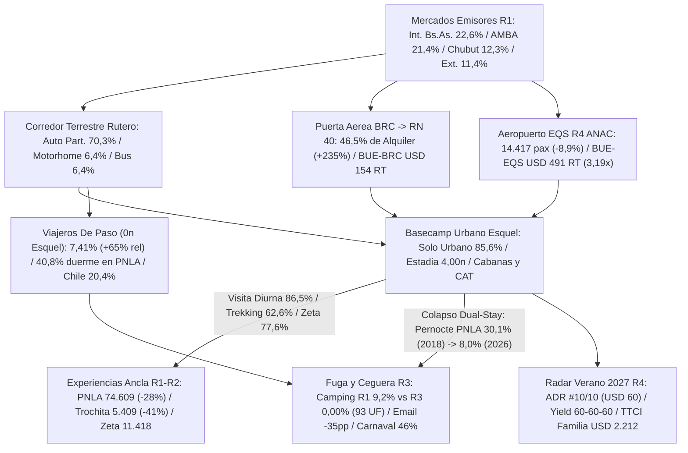

# INFORME TÉCNICO DE DEMANDA N° 3 (`ITD-ESQ-2026-03`)
## Perfil de Demanda Estival, Circuito Rutero-Motorhome y Dinámica del Corredor Esquel – Parque Nacional Los Alerces (`2016–2026` y Radar Predictivo `Verano 2027`)

| Atributo Institucional | Especificación Oficial del Documento |
| :--- | :--- |
| **Programa y Norma** | Certificación Internacional **UN Tourism QUEST** · Código `Q01AM2547AR2026` · Indicador `1.3.1.b` (Perfil y Comportamiento de la Demanda) |
| **Marco Rector Local** | **Plan Estratégico de Turismo Sostenible Esquel 2030 (PETS 2030)** · Res. `INT-1958/26` y Res. `27/26` (OGD Subsecretaría de Turismo) |
| **Período y Recorte Analítico** | Núcleo Estival (`Ene–Feb`), Estival Ampliado (`Dic–Mar`), Hombro Tardío (`Marzo`) y Anticipado (`Verano 2027`: `Dic 2026–Mar 2027`) |
| **Cobertura Cuadri-Régimen** | **`R1` Mostrador (`2018–2026`)** · **`R2` Anuarios (`2016–2025` / `2026` decl.)** · **`R3` Telemetría Diaria (`Ene–Mar 2026`)** · **`R4` Externo (`ANAC`, `metrica-db`, `Ente Mixto`)** |
| **Autoría Técnica** | Inteligencia Turística y Estadística Aplicada — Serie Oficial de Perfiles de Demanda de Esquel (Informe `3` de la Serie; precede a `ITD-ESQ-04`) |
| **Documentos Base Vinculados** | [`ITD-ESQ-01`](file:///C:/Users/agenc/.gemini/antigravity/brain/02781472-1ef7-4c5f-85d4-3cfba2da3692/ITD-ESQ-01_PERFIL_CONSOLIDADO_DEMANDA_2022_2026.md) · [`ITD-ESQ-02`](file:///C:/Users/agenc/.gemini/antigravity/brain/02781472-1ef7-4c5f-85d4-3cfba2da3692/ITD-ESQ-02_PERFIL_DEMANDA_INVIERNO_Y_LA_HOYA_2016_2026.md) · [`DOC_1`](file:///C:/Users/agenc/.gemini/antigravity/brain/02781472-1ef7-4c5f-85d4-3cfba2da3692/DOC_1_MATRIZ_HISTORICA_SERIES_TEMPORALES_2007_2026.md)–[`DOC_8`](file:///C:/Users/agenc/.gemini/antigravity/brain/02781472-1ef7-4c5f-85d4-3cfba2da3692/DOC_8_CRUCE_ESTRATEGICO_ANUARIOS_VS_PERFIL_MOSTRADOR.md) |

---

## 1. Ficha Metodológica (`R1–R4`), Arquitectura Estival y Auditoría Forense de Datos

Siguiendo la arquitectura metodológica instaurada en [`ITD-ESQ-01`](file:///C:/Users/agenc/.gemini/antigravity/brain/02781472-1ef7-4c5f-85d4-3cfba2da3692/ITD-ESQ-01_PERFIL_CONSOLIDADO_DEMANDA_2022_2026.md) e [`ITD-ESQ-02`](file:///C:/Users/agenc/.gemini/antigravity/brain/02781472-1ef7-4c5f-85d4-3cfba2da3692/ITD-ESQ-02_PERFIL_DEMANDA_INVIERNO_Y_LA_HOYA_2016_2026.md), el análisis de la demanda estival separa de forma estricta los **cuatro regímenes probatorios (`R1–R4`)** para impedir mezclas espurias entre muestras de mostrador, series declaradas no imputadas, proyecciones de padrón diario y fuentes de mercado externo. Asimismo, al aplicar el principio de **no encorsetamiento analítico**, este informe pivotea desde la hipótesis tradicional del "veraneante de camping y auto familiar en Los Alerces" hacia lo que los microdatos demuestran: la transformación de Esquel en un **basecamp urbano de cabañas y departamentos** acoplado a un circuito multimodal (`RN 40` desde Bariloche, `Fly & Drive` y `Motorhomes`), severamente tensionado por el colapso tarifario-aéreo y la pérdida de captura nocturna dentro del Parque Nacional.

### 1.1 Matriz de Regímenes y Cobertura de Fuentes Estivales

| Régimen | Naturaleza Estadística | Fuentes Primarias Verificadas | Recorte Estival Utilizado | Indicadores y Rol Analítico |
| :--- | :--- | :--- | :--- | :--- |
| **`R1`** | **Encuesta no probabilística en mostrador** (`encuestado != 0` en OIT/Trochita) | `Perfil_2018.xlsx`, `Perfil_2019.xlsx`, `Perfil_2020.xlsx`, `Perfil_2022.xlsx`, `Perfil_2026.xlsx` (procesados en [`analyze_itd03_summer.py`](file:///C:/Users/agenc/.gemini/antigravity/scratch/esquel_estadisticas/analyze_itd03_summer.py) y [`check_2018_2020.py`](file:///C:/Users/agenc/.gemini/antigravity/brain/02781472-1ef7-4c5f-85d4-3cfba2da3692/scratch/check_2018_2020.py)) | `2018 Ene–Feb` (`n=1.601`), `2019 Ene–Feb` (`n=1.236`), `2020 Ene–Feb` (`n=2.670`), `2022 Ene–Feb` (`n=2.547 / 7.366 pax`), `2026 Ene–Feb` (`n=1.564 / 4.133 pax`), `Mar 2022` (`n=588`) vs `Mar 2026` (`n=286`), `Dic 2022` (`n=372`) | Microestructura del visitante: origen, transporte, alojamiento, `De Paso (0n)`, pernocte `PNLA > 0n`, estadía `1–60n`, `ORIGEN_INM -> DEST_PROX`, actividades y pruebas `Chi2 / Welch / Mann-Whitney U` |
| **`R2`** | **Serie oficial histórica declarada y anuarios municipales** | `hist_mes.parquet` (`2016–2025`), `hist_evento_resumen`, `Completo_Ocupacion_2026.xlsx`, `Anuarios` (`2019`, `2022–2025`) | `Ene–Feb`, `Mar` y `Dic` (`2016–2026`), serie decadal `Carnaval` (`10` ediciones), anexos `PNLA`, `La Trochita`, `RNU Laguna La Zeta` y `Personas de Paso` | Volumen histórico declarado (sin imputación retrospectiva), quiebre decadal pre/post pandemia, derrumbe de Carnaval `2026` y tracción real de atractivos |
| **`R3`** | **Telemetría diaria e imputación sobre padrón completo** (`VPS esquel_data_vps`) | `fact_dia.parquet`, `fact_mes.parquet`, `fact_mes_quincena`, `fact_categoria_dia`, `dim_alojamiento`, `fact_establecimiento_dia` | `2026-01-01` al `2026-03-31` (`30` días Ene, `27` Feb, `30` Mar) + auditoría `3` campings y `Aloj. Montaña` en Q1 y año completo | Ocupación proyectada de padrón (`% UF` y `% PAX`), quincenas, derrame estimado (`ARS`), sesgo de reporte `pubO vs no_pubO` y ceguera de categorías |
| **`R4`** | **Inteligencia externa, conectividad aérea, precios OTA y gasto OGD** | `anac_series.json.gz` (`2019–2026`), `metrica-db` (`Verano 2027` y tarifas aéreas), `v3_master_data.json` (`Ente Mixto`) | `Ene–Mar 2019–2026` (`ANAC`), `Dic 2026–Mar 2027` (`41.730` obs limpias `Esquel` + `9` pares), `2025–2026` (`42` Res / `35` Ped / `123` Part) | Flujo aéreo real `AEP` vs `Non-AEP`, competitividad tarifaria `ADR` y aérea, ecuación `TTCI / N* / A_req / ROI +1 freq` y auditoría de pauta/rendiciones |

### 1.2 Arquitectura del Sistema Turístico Estival de Esquel (`2016–2026`)

El diagrama siguiente sintetiza cómo interactúan las puertas de entrada físicas (`BRC Fly&Drive`, `RN 40 / RN 25 / RN 26`, `EQS AEP/Non-AEP` y `Paso Futaleufú Chile`), el quiebre de captura de pernocte en el eje `Esquel ↔ PN Los Alerces`, la ceguera estadística en campings (`R3`) y la pinza económica observada para el `Verano 2027` (`R4`):

### 1.3 Tabla Maestra de Auditoría, Depuración y Reconciliación Metodológica

En cumplimiento estricto de los principios de transparencia y auditabilidad administrativa de los criterios de depuración aplicados, se documentan los **diez hallazgos forenses** detectados al cruzar `R1–R4` en temporada estival:

| # | Campo o Fuente | Régimen | Anomalía o Sesgo Detectado | Regla de Depuración y Corrección Aplicada | Impacto Analítico Concreto |
| :-: | :--- | :---: | :--- | :--- | :--- |
| **1** | Columna `alojamiento` en `2026` (`Perfil_2026.xlsx`) | `R1` | El campo mezcla tipología habitacional (`Cabana`, `Depto/CAT`, `Camping`) y también captura **`Motorhome` (`6,39%`)** y `Establecimiento`, mientras la variable `sub_centro` registra **`De Paso` (`0n` en Esquel y `0n` en `PNLA`)** y registros con `encuestado == 0` | Filtrado `encuestado != 0`; recodificación uniforme `norm_aloj` y `norm_transp`; estadía urbana acotada a `1 <= n_esq <= 60`; `De Paso` calculado sobre registros con dato válido (`n=1.524` en `Ene–Feb 2026`) | Evita contaminación de promedios de estadía por ceros o `outliers` de residencia estacional, aislando el verdadero salto de **`De Paso` (`4,48% -> 7,41%`)** |
| **2** | Códigos numéricos crudos (`2018–2020`) vs texto (`2022–2026`) | `R1` | `Perfil_2018–2020.xlsx` codifica respuestas con prefijos numéricos (`11`, `22`, `25`, `2`) y algunas filas solo guardan el dígito crudo | Decodificación exacta contra hojas `Resumen` de `2018–2020` vía [`check_2018_2020.py`](file:///C:/Users/agenc/.gemini/antigravity/brain/02781472-1ef7-4c5f-85d4-3cfba2da3692/scratch/check_2018_2020.py): `11=Hotel`, `22=Cabanas`, `23=CAT`, `25=Camping`, `26=Hostel`, `1=Auto Part.`, `2=Alquiler` | Habilita la serie longitudinal **de 8 años (`2018–2026`)**, revelando la caída continua de `PNLA>0n` (`30,11% -> 7,99%`) y `Camping` (`26,6% -> 9,21%`) |
| **3** | Filtro de orígenes y grupos en `itd03` | `R1` | Búsqueda literal previa `"Interior BsAs"` arrojó `0,00%`; la etiqueta real en tablas normalizadas es `"Interior Prov. Bs.As."` | Re-ejecución exacta en [`check_supplements.py`](file:///C:/Users/agenc/.gemini/antigravity/brain/02781472-1ef7-4c5f-85d4-3cfba2da3692/scratch/check_supplements.py) con etiquetas exactas (`Interior Prov. Bs.As.`, `Resto Patagonia`, `Cuyo+NEA+NOA`, `Solo`, `Amigos`, `Fidelidad`) | Restituye a **Interior Prov. Bs.As.** como **#1 emisor estival (`22,57%`)** por encima de **AMBA (`21,36%`, caída `-6,05 pp ***`)** |
| **4** | Multiplicador `hist_mes` y salto metodológico `2021–2022` | `R2` | `hist_mes.parquet` almacena fracciones (`0.69`, `0.09`); además, hasta `2021` `Enero` asumía estadía entera `2,0n` y desde `2022` fijó **`3,0n`** (`Pernoctes = Turistas * Estadia`) | Conversión `100x` explícita en lectura y explicitación de que un mismo volumen de pernoctes dividido por `3,0n` reduce mecánicamente en `-33%` el conteo estimado de `turistas` frente a `2016–2020` | Impide comparar linealmente `turistas 2016–20` vs `2022–26` sin mirar **`% UF`** y **`Pernoctes`** como métricas invariantes de demanda |
| **5** | Discrepancia `Marzo 2026` (`4.941` vs `3.830` turistas) | `R2` vs `R3` | Tablas resumen preliminares (`2026_resumen_semestral`) reportaban `4.941` turistas en Marzo; la base oficial (`Completo_Ocupacion_2026` y `fact_mes.turistas_declarados`) registra **`3.830`** (`4.941` pertenece a Mayo) | Se adopta **`3.830` declarados** (`11.489` pernoctes; `26% UF` / `15% pl`) y `6.231` proyectados (`R3`) como cifra auditada de Marzo 2026 | Corrige sobreestimación de `+29%` en el cierre del verano 2026 y revela que Marzo cayó al **percentil `12,5%`** (`z = -1,05`) |
| **6** | Panel incompleto y sesgo de autoselección `pubO` en `fact_dia` | `R3` | Faltan 3 días clave de cierre de mes (`2026-01-31`, `2026-02-28`, `2026-03-31`); además los días con baja cobertura (`no_pubO`, `cob 3,7–10,5%`) reportan tasas anormalmente altas (`84,0%` Ene vs `47,8%` en días `pubO` con `cob 29,8%`) | Lectura de porcentajes normalizada a `100x` y estratificación obligatoria **`publicable_oficial == True`** vs `False` y **`Finde vs Semana`** | Desmonta la paradoja aparente de "semana mayor a finde" en Enero y restituye un **plus real de fin de semana de `+4,8 pp` (`50,2%` vs `45,4%`)** en días válidos |
| **7** | Punto ciego total en `Camping` y `Aloj. Montaña` | `R3` | Los `3` campings declarados en `dim_alojamiento` (`93 UF / 465 pl`, ~`12%` del total de plazas del padrón) presentan **`0/261` est-día (`0,00%`)** en `Ene–Mar 2026` (`144` registros sin respuesta/gestión); `Aloj. Montaña` (`21 UF / 53 pl`) también marca **`0/261` (`0,00%`)** | Se documenta la **ceguera de telemetría Q1** y se prohíbe inferir ocupación de campings desde `R3`, recurriendo a `R1` (`9,21%`) y `Anuario PNLA` | Señala riesgo crítico de subcaptación de **turismo rutero, juvenil y naturista** dentro del tablero diario oficial |
| **8** | Plantilla `Anuario 2023` (`Chubut 28,2%`) y omisión `PNLA 2024` | `R2` | El `Anuario 2023` arrastró un error de plantilla en origen regional (`Chubut 28,2%`, desmentido en microdatos) y el `Anuario 2024` omitió íntegramente el anexo de ingresos de `PNLA` | Descarte del origen agregado `Anuario 2023` (sustitución por `R1`) y marcación explícita de `s/d` para `PNLA 2024`, tomando `2019`, `2023` y `2025` | Preserva integridad empírica sin interpolaciones artificiales en la serie del Parque Nacional |
| **9** | Tráfico aéreo `Non-AEP` opaco en `ANAC` (`2023` y `2026`) | `R4` | Las rutas desagregadas publicadas de `EQS` (`AEP` y `COR` invernal) omiten la desagregación exacta de charters/chubutenses/LADE en verano; la resta `Aeropuerto Total - AEP` salta de `361 pax (2,3%)` en `Ene–Feb 2025` a **`2.036 pax (14,1%)`** en `Ene–Feb 2026` (`19,5%` en Feb) | Cuantificación transparente de la brecha `Non-AEP = Tot - AEP` sin inventar aerolínea emisora cuando `ANAC` publica `(None, vuelos)` en pares secundarios | Identifica un cambio operativo estival silencioso que amortiguó la caída del `-19,8%` en `AEP–EQS` |
| **10** | Limpieza de `metrica-db` (`Verano 2027`) y `Ente Mixto` | `R4` | En `metrica-db`, **`53` observaciones de Esquel** superan `USD 1.000/noche` (error de moneda `ARS` cargada en campo `USD` por anfitriones OTA); en `Ente Mixto`, `123` partidas tienen `49` en `0 ARS` ("Carpeta/Sin Res.") | Filtro estricto `excluded = false AND 0 < price_usd < 1.000` (`41.730` obs limpias en `Esquel`, FX implícito `1.512,1`) y clasificación mutuamente excluyente de `74` partidas devengadas (`ARS 206,01M`) | Revela la posición real de **Esquel `#10/10` (`USD 60,00` mediana)** en la Patagonia estival y separa ejecución real (`GAS`) de resoluciones marco (`RES`) |

---

## 2. Resumen Ejecutivo y Cuadro de Mando Estival (`2019–2026` y Radar `2027`)

### 2.1 Cinco Hallazgos Estratégicos de Alto Impacto

1. **Fin del "Dual-Stay" en Los Alerces y consolidación del Basecamp Urbano (`R1–R2`):** Entre `2018` y `2026`, la proporción de visitantes que **pernocta al menos 1 noche dentro del PN Los Alerces (`PNLA > 0n`) cayó a casi la cuarta parte: del `30,11%` (`2018`) y `28,54%` (`2020`) al `16,10%` (`2022`) y apenas `7,99%` en `Ene–Feb 2026`** (`p < 0,0001 ***`; `6,29%` en Marzo). Al mismo tiempo, la **visita diurna al Parque subió al `86,45%`** (`+3,95 pp`, `p = 0,0027 **`), el `Solo Urbano Esquel` escaló al **`85,61%` (`p = 0,0024 **`)** y la estadía en ciudad creció `+0,46n` hasta **`4,00` noches** (`IC 95% [3,82; 4,19]`, `p < 0,0001 ***`). Esquel retiene las noches en cabañas (`27,7%`) y departamentos/CAT (`17,6%`, `+6,00 pp ***`), mientras el Parque pierde hospedaje (`Camping 26,6% -> 9,21%`) y boletería (`-28,0%` entradas `Ene–Mar 2025` vs `2023`), aunque con fuerte rebote en `Oct–Dic 2025` (`38.687` visitas).
2. **Contracción volumétrica de verano y crisis extrema de `Carnaval 2026` (`R2–R3`):** En `R2`, el bimestre `Ene–Feb` bajó de `34.080` (`2016`) y `35.196` (`2022`) a **`18.672` turistas declarados en `2026`** (`28.147` proyectados `R3`). La ocupación urbana proyectada `2026` (`64,48%` Ene, `53,79%` Feb, `32,71%` Mar — percentil `12,5%`) operó debajo de la media histórica (`z < 0`). El síntoma más agudo ocurrió en **Carnaval `2026` (`14–17 Feb`)**: cayó a **`46,0% UF / 33,0% PAX` (`R2`)** frente a un promedio histórico decadal de `75,5% UF / 60,3% PAX` (confirmado día por día en `R3`: `46,7%`, `46,7%`, `46,6%`, `54,5%`), evidenciando pérdida masiva de escapadas regionales de fin de semana largo.
3. **Mutación del circuito rutero: auge `Fly & Drive` vía `BRC` (`+235%`), `Motorhome` (`2,0x`) y tránsito `De Paso` + `Chile` (`9,7x`) (`R1`):** El automóvil particular tradicional retrocedió **`-7,68 pp` (`78,01% -> 70,33% ***`)**, sustituido por tres vectores de alta movilidad: **(a) `Alquiler / Fly & Drive` se multiplicó `3,35x` desde `2022` (`2,08% -> 6,97% ***`; `7,7x` vs `2018` `0,9%`), entrando `46,5%` desde `Bariloche/El Bolsón`**; **(b) `Motorhome` duplicó su peso en alojamiento (`3,14% -> 6,39% ***`) y saltó de `0,04% -> 3,71%` en transporte (`***`)**; y **(c) el tráfico `De Paso (0n Esq)` creció `+65,4%` (`4,48% -> 7,41% ***`)**, impulsado por **`Chile` (`9,7x` `0,27% -> 2,62% ***`; `4,76%` en Feb; `20,6x` en Mar)** y por viajeros que pernoctan exclusivamente en `PNLA` (`40,8%` de los `De Paso`).
4. **Ceguera absoluta de campings en `R3` (`0,00%`) y colapso del CRM en mostrador (`-35,3 pp`) (`R1–R3`):** Mientras `Camping` aún explica `9,21%` de encuestados en `R1` y los `3` campings empadronados (`93 UF / 465 pl`) representan ~`12%` de las plazas urbanas, su tasa de carga en `fact_establecimiento_dia` durante `Q1 2026` fue **`0/261` (`0,00%`)**, dejando ciego al tablero diario sobre los estratos de naturaleza y jóvenes (`Hostel` además cayó `-6,20 pp ***` y reportó `6,14%`). En paralelo, la recolección de **emails en mostrador se derrumbó del `46,17%` al `10,87%` (`-35,30 pp ***`)** y el Ente Mixto desestimó propuestas de email marketing en lugar de reconstruir la base propia.
5. **Pinza competitiva `Verano 2027`: `ADR` más barato de la Patagonia (`USD 60`) anulado por brecha aérea `3,19x` (`R4`):** En `metrica-db` (`41.730` obs limpias), Esquel ocupa el puesto **`#10/10` (`USD 60,00`)** frente a Villa La Angostura (`USD 121`), San Martín (`USD 115`), El Bolsón (`USD 85`), Bariloche (`USD 80`) y Trevelin (`USD 75`, `+25%` arriba), con una curva de precios completamente **plana (`USD 60–60–60`)** de Julio a Noviembre de 2026 y brecha extrema en cabañas (**Airbnb `USD 108` vs Booking `USD 48`**). Sin embargo, el monopolio estival de Aerolíneas (`AR 0`) sitúa el boleto **`BUE↔EQS` en `ARS 742.310` (`USD 490,91` RT en Enero), `3,19x` más caro que `BUE↔BRC` (`ARS 232.891`, `USD 154,02`)**. Para una familia (`P=4`, `4n`), el **Costo Total Integrado (`TTCI`) alcanza `USD 2.211,65` en Esquel (`88,8%` aéreo)** contra `USD 1.016,07` en Bariloche: ni regalando el alojamiento a **`-USD 236,90/noche`** Esquel empata en estadías cortas, explicando racionalmente por qué el turista aéreo de Buenos Aires elige aterrizar en `BRC` y bajar en auto alquilado por la `RN 40`.

### 2.2 Cuadro de Mando Estival Comparado (`2019–2026` y Radar `Verano 2027`)

| Eje e Indicador | Rég. | Verano `2019` (Hanta) | Verano `2020` (Pre-COVID) | Verano `2022` (PreViaje) | Verano `2025` | Verano `2026` (Actual) | Variación `22 -> 26` / Radar `2027` |
| :--- | :---: | :---: | :---: | :---: | :---: | :---: | :--- |
| **Turistas `Ene–Feb` (Declarados)** | `R2` | `20.848` | `42.565` | `35.196` | `21.520` | **`18.672`** | `-46,9%` vol (`-13,2%` YoY vs `2025`) |
| **Turistas `Ene–Feb` (Proyectados)** | `R3` | `s/d` | `s/d` | `s/d` | `s/d` | **`28.147`** | `84.439` pern (`ARS 7.177,3M` derrame) |
| **Ocupación `% UF` (`Ene / Feb / Mar`)** | `R2` | `47% / 39% / 35%` | `80% / 67% / 31%` | `95% / 81% / 58%` | `60% / 43% / 38%` | **`45% / 38% / 26%`** (`R3: 64%/54%/33%`) | `z` `R3` negativos (`-0,31 / -0,24 / -1,05`) |
| **Ocupación Carnaval (`% UF / % PAX`)** | `R2` | `33% / 20%` (Mar) | `74% / 53%` | `89% / 76%` | `41% / 28%` (Mar) | **`46,0% / 33,0%`** (`R3: 46,6–54,5%`) | `-43,0 pp UF` vs `2022`; mínimo de Febrero |
| **Estadía Urbana Media (`Ene–Feb`)** | `R1` | `3,30n` (`n=1.092`) | `3,12n` (`n=2.345`) | `3,55n` (`n=2.547`) | `3,0n` (`R2`) | **`4,00n`** `[3,82; 4,19]` | **`+0,46n`** (`p < 0,0001 ***`) |
| **Tamaño Grupo (`pax/grupo`, `Ene–Feb`)** | `R1` | `s/d` | `s/d` | `2,89` (`18,3%` men.) | `s/d` | **`2,65`** (`15,2%` men.) | **`-0,25 pax`** (`***`); `Solo 10,5% (*)` |
| **Pernocte `PNLA > 0n` (`Ene–Feb`)** | `R1` | `27,02%` | `28,54%` | `16,10%` | `s/d` | **`7,99%`** (`Mar 6,29%`) | **`-8,11 pp`** (`p < 0,0001 ***`; `1/4` de `2018`) |
| **Tráfico `De Paso (0n Esq)` (`Ene–Feb`)** | `R1` | `2,83%` | `2,70%` | `4,48%` | `s/d` | **`7,41%`** (`n=113/1.524`) | **`+2,94 pp`** (`+65,4% rel ***`) |
| **Participación `AMBA` vs `Int. PBA` vs `Chile`** | `R1` | `s/d` | `s/d` | `27,4% / 23,4% / 0,27%` | `s/d` | **`21,4% / 22,6% / 2,62%`** | `AMBA -6,05pp ***`; **`Chile 9,7x ***`** |
| **Auto Part. vs `Alquiler` vs `Motorhome`** | `R1` | `70,1% / 1,5% / s/d` | `78,1% / 1,9% / s/d` | `78,0% / 2,1% / 3,1%` | `s/d` | **`70,3% / 7,0% / 6,4%`** | **`Alquiler 3,35x ***`**; **`Motorhome 2,0x ***`** |
| **Entradas `PNLA` (`Ene–Mar`) / `Trochita` (`E–F`)** | `R2` | `83.443 / s/d` | `s/d` | `s/d / 9.103` | `74.609 / 5.409` | `s/d` (`Mar 2026`: `Troch.` s/d) | `-28,0%` `PNLA` (`vs 2023`); `-40,6%` `Troch.` |
| **Pasajeros Aeropuerto `EQS` (`Ene–Feb`)** | `R4` | `9.616` (`133 fl`) | `s/d` | `15.054` (`149 fl`) | `15.832` (`145 fl`) | **`14.417`** (`143 fl`; **`14,1% Non-AEP`**) | **`-8,9% YoY`**; `AEP -19,8%`, **`Non-AEP 5,6x`** |
| **Tarifa `ADR` OTA vs `BUE↔EQS` RT (`Ene 27`)** | `R4` | `s/d` | `s/d` | `s/d` | `s/d` | Radar **`Verano 2027`** | **`USD 60` (`#10/10`)** vs **`USD 491` RT (`3,19x BRC`)** |

---

## 3. Análisis Longitudinal `R2` (`2016–2026`): Contracción de Volumen, Crisis de Carnaval y Atractivos Ancla

### 3.1 Serie Decadal de Meses Estivales (`Ene`, `Feb`, `Mar`, `Dic`, `2016–2026`, `R2` vs `R3`)

La tabla maestra decadal expone la trayectoria completa del verano esquelense desde `hist_mes.parquet` (`100x`), `Completo_Ocupacion_2026.xlsx` (`R2` declarado) y `fact_mes.parquet` (`R3` proyectado `2026`). Debe recordarse el **corte metodológico de `2022`** (paso de estadía asumida de `2,0n` a `3,0n`), razón por la cual **`% UF`**, **`% PAX`** y **`Pernoctes`** constituyen la vara más fiel de demanda física:

| Año | `Enero` `%UF/%PAX` · `Tur.` (`Pern.`) | `Febrero` `%UF/%PAX` · `Tur.` (`Pern.`) | `Marzo` `%UF/%PAX` · `Tur.` (`Pern.`) | `Diciembre` `%UF/%PAX` · `Tur.` (`Ext.`) | Total `Ene–Feb` (`% del Año`) | Lectura Coyuntural y Shocks |
| :-: | :--- | :--- | :--- | :--- | :---: | :--- |
| **`2016`** | `69% / 54%` · `21.497` (`42.994`) | `61% / 42%` · `12.583` (`37.749`) | `62% / 29%` · `7.592` (`22.776`) | `30% / 20%` · `5.069` (`18%`) | `34.080` (`39,5%`) | Ciclo clásico concentrado (~`40%` anual en `E–F`); `Est 2,0n` Ene |
| **`2017`** | `74% / 54%` · `20.123` (`40.246`) | `60% / 44%` · `12.494` (`24.988`) | `39% / 26%` · `5.893` (`17.679`) | `33% / 20%` · `7.154` (`16%`) | `32.617` (`36,0%`) | Máximo pre-pandemia sostenido; `Paso Ene 2.012` |
| **`2018`** | `64% / 51%` · `19.492` (`38.984`) | `61% / 40%` · `13.120` (`26.240`) | `46% / 23%` · `4.066` (`12.198`) | `25% / 16%` · `4.105` (`24%`) | `32.612` (`39,5%`) | Pico de `Extranjeros` en Dic (`24%`); inicio desaceleración |
| **`2019`** | `47% / 31%` · `12.300` (`36.900`) | `39% / 23%` · `8.548` (`17.096`) | `35% / 17%` · `6.998` (`13.996`) | `29% / 19%` · `5.168` (`18%`) | `20.848` (`23,8%`) | **Shock Hantavirus Epuyén**: desplome `-22 pp UF` en `Feb` |
| **`2020`** | `80% / 60%` · `23.177` (`46.354`) | `67% / 53%` · `19.388` (`38.776`) | `31% / 25%` · `4.948` (`9.896`) | `0% / 0%` · `0` (`cierre`) | `42.565` (`89,6%`) | Rebote récord pre-COVID en `Ene–Feb` antes de ASPO (`Mar`) |
| **`2021`** | `45% / 36%` · `9.841` (`19.682`) | `60% / 50%` · `10.961` (`27.402`) | `38% / 28%` · `6.170` (`15.425`) | `36% / 32%` · `7.068` (`6%`) | `20.802` (`24,0%`) | Reapertura fronteriza cerrada (`Ext. 0–1%`); Carnaval `95%` |
| **`2022`** | `95% / 80%` · `18.845` (`56.535`) | `81% / 74%` · `16.351` (`49.053`) | `58% / 44%` · `10.688` (`32.064`) | `31% / 22%` · `5.029` (`19%`) | `35.196` (`30,3%`) | **Techo decadal `PreViaje II`**: `105.588` pern `E–F`; `Est 3,0n` |
| **`2023`** | `77% / 61%` · `16.087` (`48.261`) | `61% / 46%` · `10.640` (`31.920`) | `47% / 30%` · `7.358` (`22.074`) | `37% / 27%` · `5.793` (`27%`) | `26.727` (`26,6%`) | Reapertura internacional (`Dic 27% ext`); cae `-24%` vs `2022` |
| **`2024`** | `55% / 43%` · `12.355` (`37.065`) | `41% / 31%` · `8.735` (`26.205`) | `30% / 20%` · `5.128` (`15.384`) | `28% / 19%` · `5.039` (`10%`) | `21.090` (`25,1%`) | Devaluación Dic 2023 y crisis de ingreso nacional; piso Feb |
| **`2025`** | `60% / 44%` · `13.883` (`41.649`) | `43% / 26%` · `7.637` (`22.911`) | `38% / 25%` · `7.934` (`23.802`) | `29% / 23%` · `6.845` (`19%`) | `21.520` (`22,0%`) | Incendios estivales y retracción Feb (`26% PAX`); alza `Mar` |
| **`2026 R2`** | `45% / 34%` · `10.653` (`31.959`) | `38% / 26,5%` · `8.019` (`24.056`) | `26% / 15%` · **`3.830`** (`11.489`) | `pendiente` | **`18.672`** (`56.015 pern`) | Mínimo decadal en `R2` declarado (`Mar 3.830` auditado) |
| **`2026 R3`** | `64,48% / 49,51%` · `15.720` (`47.159`) | `53,79% / 41,72%` · `12.427` (`37.280`) | `32,71% / 19,30%` · `6.231` (`18.694`) | `pendiente` | **`28.147`** (`84.439 pern`) | `z` negativo: `-0,31` Ene / `-0,24` Feb / **`-1,05` Mar (`perc. 12,5%`)** |

**Lectura de Desplazamiento Estacional (`2016–2019` vs `2022–2025`) e Índices Estacionales (`R2`):**
Al comparar los dos cuatrienios estables (`2016–19` vs `2022–25`), el **verano nuclear perdió peso estructural dentro del año turístico esquelense**: **`Enero` cedió `-2,17 pp` de share anual** (`16,59% -> 14,43%`, aunque subió `+15,3%` en volumen absoluto por efecto `PreViaje`/`Tulipanes`/`invierno`) y **`Febrero` bajó `-0,83 pp`** (`11,06% -> 10,23%`, `+22,6%` vol.), mientras **`Marzo` creció `+0,39 pp` (`6,95% -> 7,34%`, `+40,0%` en turistas)** posicionándose como hombro activo antes de su tropiezo en `2026`. Los **índices estacionales** sobre la serie oficial (`base 100 = promedio mensual anual`) muestran un verano todavía dominante (`Ene = 165,8`, `Feb = 127,4`, `Mar = 83,0`, `Dic = 73,1`), pero cada año menos capaz de sostener por sí solo el equilibrio anual de los prestadores sin corregir el colapso de Febrero.

### 3.2 La Crisis de `Carnaval 2026` (`46% UF`) y la Erosión del Feriado Estival

Un hallazgo mayor del cruce `hist_evento_resumen` (`R2`) con `fact_dia` (`R3`) es que el tradicional "salvavidas" de Febrero perdió tracción de manera acelerada y continua:

- **Trayectoria Decadal de `Carnaval` (`10` ediciones, `R2`):** En los 10 años previos, Carnaval promedió **`75,5% UF / 60,3% PAX`**, aportando un **salto de `+19,0 pp` (`uplift`)** respecto al resto del mes. Sin embargo, las ediciones de Febrero encadenaron cuatro retrocesos consecutivos tras el pico pospandemia: **`2021` (`95%`) -> `2022` (`89% UF / 76% PAX`) -> `2023` (`78% UF`) -> `2024` (`59% UF`) -> `2026` (`14–17 Feb`) = `46,0% UF / 33,0% PAX`**. Las únicas ediciones más bajas de la década habían caído en **Marzo** bajo shocks puntuales (`2019 = 33%` por hantavirus y `2025 = 41%`).
- **Validación Microscópica en `R3` (`fact_dia`):** La telemetría diaria de prestadores de `Febrero 2026` confirma que no se trató de un artefacto estadístico: el Viernes `13/02` abrió en `46,7% UF` (`cob 38,9%`, `963` pax ocupados), el Sábado `14/02` marcó `46,7%` (`cob 45,4%`, máximo de cobertura del mes, `1.070` pax), el Domingo `15/02` `46,6%` (`cob 38,9%`) y recién el Lunes `16/02` tocó un breve techo de `54,5%` (`cob 30,1%`, `1.304` pax), cayendo al `34,1%` el Miércoles `18/02`. El **Aniversario de Esquel (`24–27 Feb`)** apenas promedió `49,1%` en su único día oficial `pubO` (`24/02`).
- **Goteo de `Personas de Paso` en Anuarios (`R2`):** Mientras en `2020` las personas atendidas en mostrador que seguían viaje registraron `3.160` en Ene (`13%`), `1.917` en Feb (`14%`) y `315` en Mar (`15%`), en `2025` el conteo de paso alcanzó **`1.543` en Ene (`10,0%` del total de viajeros), `575` en Feb y `981` en Mar**, reconfirmando el resurgimiento del corredor de tránsito antes de dar el salto estadístico en `R1 2026`.

### 3.3 La Tríada de Atractivos Estivales (`R2` Anuarios): `PN Los Alerces`, `La Trochita` y `Laguna La Zeta`

| Atractivo Ancla (`R2` Anuarios) | `2022` | `2023` | `2024` | `2025` | Variación Estructural y Nota de Coyuntura |
| :--- | :---: | :---: | :---: | :---: | :--- |
| **`PN Los Alerces` (`Ene–Mar` / Anual)** | `12.411` (`May–Dic`) | `103.610` (`Ene 60.986 / Feb 38.916 / Mar 3.708`) · Anual `123.250` | `s/d` (anexo omitido en Anuario `2024`) | **`74.609`** (`Ene 42.690 / Feb 22.210`) · Anual `133.282` | **`-28,0%` en `Ene–Mar 2025` vs `2023`** (`-42,9%` en `Feb` por incendios y tarifas); rebote `Oct–Dic 2025` (`38.687` vis) salvó el total anual (`34,6%` nac., `29,3%` loc., `13,9%` prov., `12,9%` jub., `3,4%` ext.) |
| **`La Trochita` (`Ene–Feb` / `Mar` / Anual)** | `9.103` (`5.164+3.939`) · `Mar 1.467` · Anual `24.143` | `6.496` (`3.718+2.778`) · `Mar 1.159` · Anual `22.052` | `6.532` (`4.264+2.268`) · `Mar 1.378` · Anual `21.046` | **`5.409`** (`3.538+1.871`) · `Mar 758` · `Dic 126` · Anual `17.042` | **`-40,6%` en `Ene–Feb 2025` vs `2022`** (y `-29,4%` en anual). Sub-captura crítica en boletería frente a demanda declarada en `R1` (`45,4%` dice hacerla), sugiriendo cuellos de cupo/frecuencias o tarifas |
| **`RNU Laguna La Zeta` (`Ene–Feb`)** | `8.815 vis` (`3.859 veh.`) | `12.310 vis` (`4.756 autos`) | `7.904 vis` (`2.663 autos`) | **`11.418 vis`** (`2.952 veh.`) | **`+44,5%` en `2025` vs `2024`** con menos autos (`2.952` vs `4.756` en `2023`), es decir **`3,87 pax/vehículo`**: reserva periurbana gratuita convertida en refugio de alto uso familiar y senderismo |

---

## 4. Anatomía Longitudinal del Visitante Estival en Mostrador (`R1`, `2018–2026`)

Para comprender *quién* sostiene hoy el verano esquelense y cómo mutó su estructura frente al ciclo pospandemia (`2022`) y prepandemia (`2018–2020`), se integraron **`8.518` encuestas estivales (`Ene–Feb`)** y **`874` de Marzo (`2022` vs `2026`)**, más el bloque de `Diciembre 2022` (`n=372`). Todas las diferencias clave entre `2022` y `2026` se validaron mediante pruebas exactas de hipótesis (**Chi-cuadrado** para proporciones y **Welch t-test + Mann-Whitney U** para variables continuas).

### 4.1 Tabla 2. Evolución Comparada de Largo Plazo (`2018–2026`) y Pruebas de Hipótesis (`Ene–Feb` y `Mar`, `R1`)

| Indicador (`R1` Mostrador) | `2018 E–F` (`n=1.601`) | `2019 E–F` (`n=1.236`) | `2020 E–F` (`n=2.670`) | `2022 E–F` (`n=2.547`) | `2026 E–F` (`n=1.564`) | Test `22 -> 26` (`E–F`) | `Mar 2022 -> Mar 2026` (`n=588 -> 286`) | `Dic 2022` (`n=372`) |
| :--- | :---: | :---: | :---: | :---: | :---: | :--- | :--- | :---: |
| **Estadía Urbana (`1–60n`)** | `2,97n` | `3,30n` | `3,12n` | `3,55n` `[3,43; 3,67]` | **`4,00n`** `[3,82; 4,19]` | **`+0,46n` (`p < 0,0001 ***`)** | `Ene 4,16n / Feb 3,74n / Mar 3,67n` | `3,53n` |
| **Tamaño Grupo (`pax/enc.`)** | `s/d` | `s/d` | `s/d` | `2,89` (`18,3%` men.) | **`2,65`** (`15,2%` men.) | **`-0,25 pax` (`p < 0,0001 ***`)** | Menor presencia infantil y grupos grandes | `2,55` |
| **Pareja / Familia / Solo / Amigos** | `s/d` | `s/d` | `s/d` | `43,2% / 37,7% / 8,6% / 10,3%` | **`45,6% / 37,6% / 10,5% / 5,7%`** | `Solo +1,93pp (*)` · **`Amigos -4,64pp ***`** | **`Solo` salta `11,22% -> 17,13%` (`p=0,0153 *`)** | `Pareja` líder |
| **`De Paso (0n Esq)`** | `2,25%` | `2,83%` | `2,70%` | `4,48%` (`114/2.547`) | **`7,41%`** (`113/1.524`) | **`+2,94 pp` (`+65,4% rel ***`)** | `Ene 2,34%->7,22%` · `Feb 7,14%->7,75%` | `4,84%` |
| **Pernocte `PNLA > 0n`** | **`30,11%`** (`3,49n`) | `27,02%` (`3,50n`) | `28,54%` (`3,36n`) | `16,10%` (`410/2.547`) | **`7,99%`** (`125/1.564`) | **`-8,11 pp` (`p < 0,0001 ***`)** | **`17,35% -> 6,29%` (`-11,05 pp ***`)** | `12,63%` |
| **`Solo Urbano Esquel`** | `s/d` | `s/d` | `s/d` | `81,98%` | **`85,61%`** | **`+3,64 pp` (`p = 0,0024 **`)** | Urbanización récord (`4,00n` en `E–M 26`) | `82,53%` |
| **Fidelidad (Repitentes `2da+`)** | `s/d` | `s/d` | `s/d` | `17,82%` (1ª vez `78,5%`) | **`21,04%`** (1ª vez `76,8%`) | **`+3,21 pp` (`p = 0,0109 *`)** | Crecimiento gradual de recurrencia | `21,77%` |
| **Captura de Email en Mostrador** | `s/d` | `s/d` | `s/d` | `46,17%` | **`10,87%`** | **`-35,30 pp` (`p < 0,0001 ***`)** | Desplome operativo del embudo CRM | `40,32%` |

### 4.2 Desplazamiento de Mercados Emisores (`Ene–Feb` y `Mar`, `R1` `2022 -> 2026`)

| Origen Geográfico | `Ene–Feb 2022` | `Ene–Feb 2026` | Dif. `22 -> 26` | `p`-valor (`Chi2`) | Comportamiento `Mar 2022 -> Mar 2026` y Perfil Específico |
| :--- | :---: | :---: | :---: | :---: | :--- |
| **Interior Prov. Bs.As. (#1 Nac.)** | `23,44%` | **`22,57%`** (`25,47%` s/Nac.) | `-0,87 pp` | `0,521 ns` | Se convierte en el **emisor #1 del verano**; estadía prolongada y alta motorización propia |
| **`AMBA` (`CABA + GBA`)** | `27,40%` (`12,8% + 14,6%`) | **`21,36%`** (`9,0% + 12,4%`) | **`-6,05 pp`** | **`< 0,0001 ***`** | CABA `-3,85 pp (0,0002 ***)`; GBA `-2,20 pp (0,0467 *)`. En **Marzo cae `-15,28 pp` (`28,91% -> 13,64% ***`)** |
| **`Chubut` (#3 y #1 Regional)** | `9,23%` | **`12,28%`** | **`+3,05 pp`** | **`0,0019 **`** | En `2026`: Valle/Costa `42,7%`, Comodoro `39,1%`. En **Marzo duplica: `6,46% -> 13,64%` (`+7,17 pp ***`)** |
| **Resto Patagonia (`NQN/RN/SC/TF`)** | `13,62%` | **`10,49%`** | **`-3,14 pp`** | **`0,0031 **`** | Contracción en `Ene–Feb` (pérdida de escapadas de cercanía por costo combustible y fin de PreViaje) |
| **`Santa Fe`** | `7,89%` | **`5,37%`** | **`-2,52 pp`** | **`0,0020 **`** | Pérdida sustancial de participación frente al ciclo `2022` |
| **`Córdoba`** | `5,89%` | **`4,67%`** | `-1,22 pp` | `0,093 ns` | Sin vuelo estival `COR–EQS`, no crece pese a fuerte pauta del Ente Mixto en esa plaza (`ARS 22M`) |
| **`Cuyo + NEA + NOA`** | `7,15%` | **`6,33%`** | `-0,82 pp` | `0,314 ns` | Estabilidad marginal de mercados extrapampeanos |
| **Total `Extranjeros`** | `4,83%` | **`11,38%`** | **`+6,55 pp`** | **`< 0,0001 ***`** | Reapertura plena. En **Marzo trepa del `9,52%` al `16,78%` (`p = 0,0019 **`)** |
| **Subtotal `Chile` (dentro de Ext.)** | `0,27%` (`7` enc.) | **`2,62%`** (`41` enc.) | **`+2,35 pp` (`9,7x`)** | **`< 0,0001 ***`** | **`4,76%` en Febrero** y **`3,50%` en Marzo (`20,6x`!)**; `22,6%` del total extranjero `Ene–Mar 2026` |

### 4.3 Mutación del Transporte, Alojamiento y Canasta de Actividades (`R1`, `2018–2026`)

| Dimensión / Categoría | `2018 E–F` | `2020 E–F` | `2022 E–F` | `2026 E–F` | Cambio `22 -> 26` (`p`-valor) y Claves `Marzo 2026` |
| :--- | :---: | :---: | :---: | :---: | :--- |
| **Transporte · Vehículo Particular** | `79,5%` | `78,1%` | `78,01%` | **`70,33%`** | **`-7,68 pp` (`p < 0,0001 ***`)** · Estadía urbana `3,82n` |
| **Transporte · Avión** | `4,7%` | `4,0%` | `8,24%` | **`9,53%`** | `+1,29 pp` (`p = 0,158 ns`) · Estadía récord **`5,59n`** (`+1,77n` vs auto) |
| **Transporte · `Vehículo de Alquiler` (`Fly & Drive`)** | `0,9%` | `1,9%` | `2,08%` (`53`) | **`6,97%`** (`109`) | **`+4,89 pp` (`3,35x`, `p < 0,0001 ***`)** · **`46,5%` llega vía `BRC/Bolsón`** |
| **Transporte · Ómnibus (Línea+Exc.)** | `10,3%` | `10,4%` | `7,58%` | **`6,39%`** | `-1,19 pp` (`p = 0,152 ns`) · `35%` de sus pasajeros son extranjeros |
| **Transporte · `Motorhome` (campo transp.)** | `s/d` | `s/d` | `0,04%` (`1`) | **`3,71%`** (`58`) | **`+3,67 pp` (`p < 0,0001 ***`)** · Visibilización directa como modo principal |
| **Alojamiento · `Cabañas`** | `24,8%` | `26,1%` | `25,25%` | **`27,69%`** | `+2,44 pp` (`p = 0,084 ns`) · Tipología líder indiscutida (`Est 4,10n`) |
| **Alojamiento · `Depto/CAT + Viv. Tur.`** | `11,1%` (`CAT`) | `12,7%` (`CAT`) | `11,58%` | **`17,58%`** | **`+6,00 pp` (`p < 0,0001 ***`)** · En **Marzo sube `11,05% -> 18,53%` (`**`)** |
| **Alojamiento · `Hotel + Apart + Host.`** | `22,1%` | `19,3%` | `20,42%` | **`17,97%`** | `-2,45 pp` (`p = 0,054 ns`) · Presión competitiva contra `CAT/Cabañas` |
| **Alojamiento · `Camping`** | **`26,6%`** | `21,9%` | `17,20%` | **`9,21%`** | **`-7,99 pp` (`p < 0,0001 ***`)** · En **Marzo se hunde `9,18% -> 2,80%` (`***`)** |
| **Alojamiento · `Hostel`** | `5,9%` | `9,4%` | `10,48%` | **`4,28%`** | **`-6,20 pp` (`p < 0,0001 ***`)** · Desplome juvenil y mochilero |
| **Alojamiento · `Motorhome` (campo aloj.)** | `s/d` | `s/d` | `3,14%` | **`6,39%`** | **`+3,25 pp` (`2,0x`, `p < 0,0001 ***`)** · Supera a `Hostel` y alcanza `2/3` de `Camping` |
| **Actividades (`s/ Enc. c/ Act` `2.194 -> 1.203`)** | `s/d` | `s/d` | — | — | `PNLA`: `82,5% -> 86,5% (p=0,0027 **)` · **`La Zeta`: `50,6% -> 77,6% (+26,9pp ***)`** · **`Trekking`: `27,6% -> 62,6% (+35,0pp ***)`** · **`La Trochita`: `33,0% -> 45,4% (+12,3pp ***)`** · **`Trevelin TXT`: `11,3% -> 26,1%`** (**`Mar 49,1% act / 30,1% tot` + `Viñedos 8,6%`**) · `Lacustre`: `5,6% -> 1,3%` · `La Hoya Verano`: `5,6% (123) -> ~0%` |

**Doble alerta de producto:** Mientras el senderismo libre (`Trekking +35,0 pp`) y la naturaleza de proximidad gratuita (`La Zeta +26,9 pp`) explotan, **dos productos comerciales muestran quiebre**: la **navegación lacustre (`5,6% -> 1,3%`)** en Los Alerces y las **actividades de verano de `La Hoya` (`5,6% -> ~0%`)**, confirmando que el verano hoy carece de propuesta comercial activa en montaña.

---

## 5. Pivotes Estratégicos de Segmentación Estival (`R1` Cruces Microdatos)

### 5.1 Refutación Empírica del "Dual-Stay" `Esquel ↔ PN Los Alerces`: De Destino de Pernocte a Excursión Diurna

Durante décadas se asumió que el veraneante dividía sus noches entre la ciudad y el Parque Nacional. Los microdatos decadenales demuestran que ese modelo se rompió:

- **Colapso continuo de `PNLA > 0n` (`2018 -> 2026`):** `30,11%` (`2018`) -> `27,02%` (`2019`) -> `28,54%` (`2020`) -> `16,10%` (`2022`) -> **`7,99%` (`Ene–Feb 2026`)** y apenas **`6,29%` en `Marzo 2026`**.
- **Descompresión incluso en campistas:** Aún entre quienes duermen en **`Camping`**, el porcentaje que pernocta dentro de `PNLA` bajó del **`45,0%` (`2022`) al `32,6%` (`2026`)**. El campista residual se repliega o hacia campings de ruta/ciudad o directamente muta al vehículo autónomo (`Motorhome`).
- **Implicancia de captura urbana:** Dado que el **`86,45%` de todos los turistas estivales visita `PNLA`** (`Mar 85,71%`), casi **8 de cada 10 visitantes de Esquel recorren el Parque por el día y regresan a dormir en la ciudad** (`Solo Urbano Esquel = 85,61%`, estadía `4,00n`). Cada incidente vial, corte de sendero, incendio estival o fricción en tarifas de acceso a `PNLA` golpea inmediatamente la tasa de retorno y estadía urbana en Esquel, aunque las noches figuren en cabañas y CAT municipales.

### 5.2 El Crecimiento del Viajero `De Paso (0n en Esquel)`: Tres Veces Más Alto que en `2018` (`7,41%`)

El segmento de visitantes atendidos en mostrador con **cero noches en Esquel** escaló de `2,25%` (`2018`) y `4,48%` (`2022`) al **`7,41%` en `Ene–Feb 2026`** (`n=113/1.524`, `p < 0,0001 ***`; `Ene` se triplicó `2,34% -> 7,22%`). Al auditar el trimestre `Ene–Mar 2026` (`n=130` casos `De Paso`):

- **El `40,8%` SÍ pernocta dentro de `PNLA` (`PNLA > 0n`)** y el **`76,5%` visita el Parque Nacional**: son turistas que consumen servicios públicos e información en Esquel pero **hospedan su presupuesto directamente dentro de jurisdicción de Parques Nacionales o en Trevelin/Corredor**.
- El **`16,9%` son extranjeros**, liderados por **`Chile` (`7,7%` de todo `De Paso`)** usando la ciudad como escala técnica hacia la frontera o hacia el norte/sur de la `RN 40`.

### 5.3 Corredor Rutero `ORIGEN_INM -> DEST_PROX`, Boom `Fly & Drive` desde `BRC` y Fenómeno `Motorhome`

La auditoría conjunta de origen inmediato, próximo destino y modos móviles (`Ene–Feb 2026`, `n_válido = 1.384`) revela la verdadera geometría vial de la demanda estival:

| Posición | Flujo `ORIGEN_INM -> DEST_PROX` (`Ene–Feb 2026`) | `% s/ Válidos` (`n`) | Lectura Operativa del Corredor |
| :-: | :--- | :---: | :--- |
| **`#1`** | **`Bariloche / El Bolsón -> Bariloche / El Bolsón`** | **`17,56%`** (`243`) | **Circuito rebote Comarca–RN 40**: usan el aeropuerto/base de `BRC` y bajan por el corredor `Bolson -> Esquel -> BRC` |
| **`#2`** | **`Bs.As. / Directo -> Bs.As. / Directo`** | **`13,44%`** (`186`) | Mercado destino directo (aéreo `EQS` o ruta directa larga `RN 3 / RN 25 / RN 40` ida y vuelta) |
| **`#3`** | **`Puerto Madryn / Costa -> Bariloche / El Bolsón`** | **`6,58%`** (`91`) | Transversalidad Atlántica `RN 25` (`Península Valdés -> Esquel -> Lagos Norte`) |
| **`#4`** | **`Bariloche / El Bolsón -> Puerto Madryn / Costa`** | **`5,56%`** (`77`) | Sentido inverso Cordillera -> Costa Atlántica vía `RN 40 + RN 25` |
| **`#5`** | **`Otra Provincia -> Otra Provincia`** | **`5,06%`** (`70`) | Tránsito pampeano/cuyano multidestino |
| **`#6`** | **`Santa Cruz -> Bariloche / El Bolsón`** | **`4,84%`** (`67`) | Travesía patagónica austral Sur -> Norte por `RN 40` |
| **`#7`** | **`Bariloche / El Bolsón -> Santa Cruz`** | **`4,55%`** (`63`) | Travesía patagónica Norte -> Sur hacia Los Glaciares / El Chaltén |
| **`#11`** | **`Chile -> Bariloche / El Bolsón`** | **`2,10%`** (`29`) | Integración Carretera Austral (`Futaleufú -> Esquel -> Bariloche`) |

**Dos sub-segmentos explosivos que exigen política propia:**
1. **`Vehículo de Alquiler / Fly & Drive` (`6,97%` `E–F`, `3,35x`; `n=129` en `Ene–Mar 2026`):** El **`46,5%` (`60/129`) ingresa por `Bariloche/El Bolsón`** frente a solo **`25,6%` (`33/129`) directo desde Buenos Aires** (evidencia microempírica directa de la desviación aérea hacia `BRC`); concentra **`29,4%` extranjeros**, presenta **`4,26` noches de estadía** (mediana `4,0n`), **`92,7%` visita `PNLA`** y **`57,3%` toma `La Trochita`**. Es el **segmento rutero de mayor gasto diario y conversión en excursiones pagas**.
2. **`Motorhome` (`6,39%` en alojamiento `E–F`, `+3,25 pp ***`; `3,71%` transporte `***`):** Duplicó su peso desde `2022` (`3,14%`), superando ampliamente al `Hostel` (`4,28%`). Se mueve con total autonomía pernoctando fuera de los alojamientos formales convencionales y responde al circuito de largo aliento (`Santa Cruz ↔ BRC` y `Chile ↔ Argentina`), careciendo actualmente de inventario tarifado o red de servicios dedicada (`aguas grises/energía/parador`) en la pauta pública municipal.

### 5.4 Dualidad Internacional Estival: `Chile` (Proximidad Transfronteriza) vs `Europa` (Long-Haul Activo)

Dentro de los **`226` turistas extranjeros** relevados en `Ene–Mar 2026` (`11,4%` `E–F`, `16,8%` `Mar`), coexisten **dos sub-mercados radicalmente distintos**:

- **`Europa` (`46,5%` de extranjeros, `n=105`):** Estadía urbana sólida de **`3,43` noches**, foco intensivo en senderismo (**`48,6%` hace `Trekking`**) y bajo pernocte en el Parque (solo `14,3%` con `PNLA > 0n`), utilizando cabañas/hoteles y ómnibus/alquiler dentro de circuitos patagónicos norte-sur.
- **`Chile` (`22,6%` de extranjeros, `n=51`; crecimiento `9,7x` `E–F`, `20,6x` `Mar`):** Estadía urbana acotada a **`2,10` noches**, **`20,4%` en condición `De Paso (0n)`**, con **`52,9%` entrando directo desde territorio chileno** y **`41,2%` saliendo hacia Chile**. El **Paso Internacional Futaleufú** consolidó un corredor real de tránsito y compras/gastronomía que aún no está capturado con campañas binacionales en Chaitén–Puerto Montt ni con retención de `3+` noches en Esquel.

### 5.5 Marzo: Desempeño de Hombro, Colapso de `AMBA` y Eje Enogastronómico `Trevelin` (`49,1%`)

Mientras en `Ene–Feb` el visitante llega mayoritariamente de Buenos Aires e Interior PBA, **`Marzo 2026` (`n=286`)** revela un desacople agudo: **`AMBA` se desplomó `-15,28 pp` (`28,91% -> 13,64% ***`)**, mientras **`Extranjeros` (`16,78% **`)** y **`Chubut` (`13,64% ***`)** sostuvieron la plaza; el viajero **`Solo` saltó al `17,13% (*)`**; **`Camping` cayó al `2,80% (***)`** a favor de **`Depto/CAT/Viv.Tur.` (`18,53% **`)**; y **`Trevelin`** escaló al **`49,1%` de quienes declaran actividades (`30,1%` del total) acompañado por `Viñedos` (`8,6%` s/ act)**. Esquel actúa en Marzo como cabecera urbana del producto enoturístico y gastronómico del valle de Trevelin sin coordinar calendarios de ocupación de hombro conjunto.

---

## 6. Telemetría Diaria `R3` (`Ene–Mar 2026`), Sesgo de Reporte y Punto Ciego de `CAMPING`

### 6.1 Consolidación Diaria (`fact_dia`), Quincenas (`fact_mes_quincena`) y Desmontaje del Sesgo `pubO`

Al auditar los **`87` días registrados** entre el `01/01/2026` y el `31/03/2026` en `fact_dia.parquet` (`30` en Ene, `27` en Feb, `30` en Mar; faltan exactamente `31/01`, `28/02` y `31/03`), surge un hallazgo metodológico decisivo para la credibilidad estadística ante `UN Tourism QUEST`:

| Mes `2026` (`R3`) | `pubG` (Días) | `%UF` / `%PAX` (`pubG`) | Cob. Media (`pubG`) | `pubO` (`Cob >= 25%`) | `%UF` `pubO` (`Finde vs Sem`) | `no_pubO` (`Cob < 25%`) | `%UF` `no_pubO` (`Cob`) | Quincenas (`1Q -> 2Q`) y Derrame `fact_mes` |
| :--- | :---: | :---: | :---: | :---: | :---: | :---: | :---: | :--- |
| **`Enero` (`30d`)** | `30` | `69,5% / 51,4%` | `18,2%` | **`12d`** | **`47,8%`** (`50,2% vs 45,4%`, **`+4,8 pp`**) | `18d` | `84,0%` (`10,5%`) | `55,2% -> 75,4%` · **`ARS 4.008,5M`** (`15.720` tur) |
| **`Febrero` (`27d`)** | `26` | `57,3% / 43,5%` | `15,6%` | **`9d`** | **`43,6%`** (`42,3% vs 44,5%`, Carnaval) | `17d` | `64,5%` (`4,8%`) | `57,5% -> 49,3%` · **`ARS 3.168,8M`** (`12.427` tur) |
| **`Marzo` (`30d`)** | `16` | `38,6% / 23,3%` | `14,7%` | **`6d`** | **`28,4%`** (`30,9% vs 25,9%`, **`+5,0 pp`**) | `10d` | `44,7%` (`3,7%`) | `29,3% -> 34,7%` · **`ARS 1.589,0M`** (`6.231` tur) |

- **Demostración del sesgo de autoselección inverso:** Si se analiza sin estratificar la serie general `pubG` de Enero (`69,5% UF`), los días de **semana (`73,5%`) parecen superar a los fines de semana (`58,6%`)**. Sin embargo, ese resultado es un artefacto estadístico: los `18` días sin corte oficial (`no_pubO`, concentrados en días hábiles o cierres con apenas `10,5%` de cobertura promedio, y extremos como `2026-02-27 = 86,4%` con `2,2%` de padrón!) responden principalmente los alojamientos más llenos. Al filtrar exclusivamente los días con **validez muestral oficial (`pubO`)**, la ocupación real estival cae al **`47,8%` en Enero y `28,4%` en Marzo**, recuperando un comportamiento económicamente lógico con **+4,8 pp a +5,0 pp de prima de fin de semana** (`Febrero` invertido `42,3% vs 44,5%` por la caída específica del fin de semana de Carnaval).

### 6.2 Peso por Categoría (`fact_categoria_dia`) y Auditoría Forense del Punto Ciego `CAMPING`

La distribución de **plazas ocupadas (`Enero 2026`, `fact_categoria_dia`)** refleja la predominancia casi absoluta de las tipologías extra-hoteleras y departamentos urbanos: **`Cabañas` (`34,98%` de plazas ocupadas, `70,0%` UF trabajadas)**, **`CAT` (`23,36%`, `72,0%`)**, **`Viviendas Turísticas` (`11,49%`, `89,5%`)**, **`Hoteles` (`10,03%`, `58,5%`, solo `18/30` días informados)**, **`Deptos` (`6,83%`, `77,1%`)**, **`Hosp. Complementario` (`6,23%`, `76,5%`)**, **`Hosterías` (`3,81%`, `36,6%`)** y **`Hostel` (`1,77%`, `29,0%`)**.

| Categoría Crítica / Punto Ciego (`R3`) | Padrón `dim_alojamiento` | Peso en Padrón Estival | Cobertura `Q1 2026` (`fact_estab_dia`) | Diagnóstico Operativo |
| :--- | :--- | :--- | :---: | :--- |
| **`Camping`** (`Camping La Colina 25 UF/125 pl [0/308 op]`, `Millalen 28 UF/140 pl`, `Nahuel Pan 40 UF/200 pl`) | `3` establecimientos (`93 UF / 465 pl`) | `9,21%` en `R1` / ~`12%` plazas urbanas | **`0 / 261` est-día (`0,00%`)** (`144` op. `Sin gestión/Sin resp.`) | **Ceguera total de verano (`0%` reporte en Q1 y apenas `2/923 = 0,22%` en todo `2026`, ambos en Oct; `0/29` en `Sep`)**. La OGD desconoce en tiempo real la ocupación real de acampe |
| **`Alojamiento de Montaña`** | `3` establecimientos (`21 UF / 53 pl`) | Nicho trekking/alta montaña | **`0 / 261` est-día (`0,00%`)** | Invisibilidad total pese a que **`Trekking` subió al `62,6%` (`+35 pp`)** |
| **`Refugios` / `Aloj. Familiar` / `Hostel`** | Padrón complementario | Segmento joven / bajo costo | `1,15%` / `3,45%` / `6,14%` (`1.188` filas) | Infra-representación severa frente a `Hoteles` (`23,45%`) y `Cabañas` (`18,74%`) |

---

## 7. Mercado Externo `R4`: Conectividad `ANAC`, Radar `Verano 2027`, Modelado Econométrico y Auditoría `Ente Mixto`

### 7.1 Desempeño Aéreo Estival `ANAC` (`2019–2026`): Contracción `AEP` y Salto Opaco de Tráfico `Non-AEP`

| Temporada `Ene–Feb` (y `Marzo`) | `EQS` Total `E–F` (`vuelos`) | `AEP–EQS` (`vuelos`) | `Non-AEP` (`Tot - AEP`, `vuelos`) | `% Non-AEP` | `Marzo` `EQS` (`vuelos`) | Contraste Pares Patagonia `Ene–Feb 2025 -> 2026` (`ANAC`) |
| :---: | :---: | :---: | :---: | :---: | :---: | :--- |
| **`2019`** (`pre-COVID`) | `9.616` (`133 fl`) | `9.400` (`119 fl`) | `216` (`14 fl`) | `2,2%` | `4.336` (`56 fl`) | **Bariloche (`BRC`)**: `412.753` (`-8,6%` YoY; `28,6x` EQS) |
| **`2022`** (`PreViaje II`) | `15.054` (`149 fl`) | `13.549` (`112 fl`) | `1.505` (`37 fl`) | `10,0%` | `6.880` (`68 fl`) | **El Calafate (`FTE`)**: `234.524` (`+12,6%` YoY) |
| **`2023`** (`Máx. Non-AEP`) | `16.388` (`130 fl`) | `11.857` (`81 fl`) | `4.531` (`49 fl`) | `27,6%` | `7.084` (`79 fl`) | **Comodoro Rivadavia (`CRD`)**: `79.910` (`-10,6%` YoY) |
| **`2024`** (`Pico Decadal`) | **`16.683`** (`159 fl`) | `15.483` (`126 fl`) | `1.200` (`33 fl`) | `7,2%` | `7.945` (`93 fl`) | **Chapelco (`CPC`)**: `64.295` (`-1,4%` YoY) |
| **`2025`** | `15.832` (`145 fl`) | `15.471` (`123 fl`) | `361` (`22 fl`) | `2,3%` | `6.977` (`71 fl`) | **Trelew (`REL`)**: `48.536` (`+20,4%` YoY) |
| **`2026`** | **`14.417`** (`143 fl`) | **`12.381`** (`104 fl`) | **`2.036`** (`39 fl`) | **`14,1%`** (`Feb 19,5%`) | **`6.589`** (`66 fl`) | **Puerto Madryn (`PMY`)**: `28.717` (`+6,3%` YoY; **`2,0x` EQS**) |

- **Radiografía del choque aéreo estival `2026`:** `EQS` perdió **`-8,9% YoY`** en `Ene–Feb` (`-13,6%` respecto al techo `2024`) y `-5,6%` en Marzo. La caída real del tronco **`Aeroparque – Esquel` fue casi el doble de profunda: `-19,8%` en `Ene–Feb` (`15.471 -> 12.381`; solo `Febrero` cayó `-27,9%` de `7.231` a `5.217` pax y de `60` a `45` vuelos)**. Ese derrumbe quedó parcialmente maquillado por el salto **`5,6x` de operaciones `Non-AEP`** (`361 -> 2.036` pax: `769` en Ene [`9,7%`] y `1.267` en Feb [`19,5%`]), sin ruta regular `Córdoba–Esquel` activa en verano (a diferencia del invierno `AR1820`) y sin `LADE`/`Bariloche–Esquel` regulares reportadas con pasajeros continuos en `ANAC`.

### 7.2 Radar Predictivo `Verano 2027` (`metrica-db`): Posicionamiento `#10/10` en `ADR`, Curva Plana y Brecha Aérea `3,19x`

El relevamiento vivo en `metrica-db` para la ventana completa **`2026-12-01` al `2027-03-31`** (filtrando `excluded=false AND 0 < price_usd < 1.000`, excluidos `53` errores de moneda en Esquel; `FX` implícito `1.512,1`, `avail_false = 0`) arroja los siguientes valores de mercado comparados:

| Puesto | Destino Patagónico (`Dic 26–Mar 27`) | Mediana `ADR` Limpia (`USD`) | Mediana `cabana_casa_depto` (`Ene–Feb 27`) | Mediana Aérea RT desde `BUE` (`Ene 27` · `ARS` / `USD @1.512,1`) | Aerolíneas Directas/Escala (`Ene–Feb`) | Ratio Aéreo `EQS / Destino` |
| :-: | :--- | :---: | :---: | :--- | :--- | :---: |
| **`#1`** | **Villa La Angostura** (`vía BRC`) | **`USD 121`** (`126` Ene / `123` Feb) | `USD 126` | `ARS 232.891` (`USD 154,02` vía `BRC`) | `AR`, `FO`, `WJ` (`0` y `1` esc.) | **`3,19x`** |
| **`#2`** | **San Martín de los Andes** (`CPC`) | **`USD 115`** | `USD 114` | `ARS 418.890` (`USD 277,03` `BUE↔CPC`) | `AR`, `WJ` (`0` esc.) | `1,77x` |
| **`#3`** | **Junín de los Andes** | **`USD 90`** | `s/d` | `ARS 418.890` (vía `CPC`) | `AR`, `WJ` | `1,77x` |
| **`#4`** | **El Bolsón** (`vía BRC`) | **`USD 85`** | `USD 96` | `ARS 232.891` (`USD 154,02` vía `BRC`) | `AR`, `FO`, `WJ` | **`3,19x`** |
| **`#5`** | **San Carlos de Bariloche** (`BRC`) | **`USD 80`** (`82` Ene–Feb) | `USD 100` | `ARS 232.891` (`USD 154,02` `BUE↔BRC`) | `AR`, `FO`, `WJ` (`0` y `1` esc.) | **`3,19x`** |
| **`#6`** | **Lago Puelo** (`Comarca`) | **`USD 78`** | `s/d` | `ARS 232.891` (vía `BRC`) | `AR`, `FO`, `WJ` | `3,19x` |
| **`#7`** | **Trevelin** (`Valle 16 de Octubre`) | **`USD 75`** (**`+25%`** s/ `EQS`) | `USD 76` | `ARS 742.310` (vía `EQS`) / `BRC` | Mismo umbral que Esquel | `1,00x` |
| **`#8`** | **El Hoyo** | **`USD 72`** | `s/d` | `ARS 232.891` (vía `BRC`) | `AR`, `FO`, `WJ` | `3,19x` |
| **`#9`** | **Puerto Madryn** (`PMY`) | **`USD 63`** | `USD 63,5` | `ARS 200.742` (`USD 132,76` `BUE↔PMY`) | `AR`, `FO` (`0` esc.) | **`3,70x`** |
| **`#10`** | **Esquel (`41.730` obs / `280` lst)** | **`USD 60,00`** (`avg 67,78`; `p25 41 / p75 84`) | **`USD 62,00`** (`210` lst, `avg 72,68`) | **`ARS 742.310`** (**`USD 490,91`** `BUE↔EQS`) | **`AR` monopolio directo (`0` esc.)** | `1,00x` (base máx.) |

**Hallazgos microestructurales de precios en `Esquel Verano 2027` (`R4`):**
- **Sub-pricing y curva temporal completamente plana:** Esquel es **`25%` más barato que su vecina Trevelin (`USD 60` vs `75`)** y **`37,5%` más barato en `cabana_casa_depto` que El Bolsón (`USD 62` vs `96`)**. Su evolución mensual estival (`Dic 26 = USD 51`, `Ene 27 = 59`, `Feb 27 = 60`, `Mar 27 = 53`; `ARS 99.746`) muestra además **cero gestión de `Revenue Management`**: el precio mediano por anticipación (`lead time`) es **`USD 61` (`31–60d`), `USD 59` (`61–90d`), `USD 60` (`91–120d`), `USD 60` (`121–150d`) y `USD 60` (`151+d`)**, mientras por mes de observación permanece congelado (`Jul 26 = 60`, `Ago = 57`, `Sep = 60`, `Oct = 60`, `Nov = 60`).
- **Fractura dual de canales OTA (`Ene–Feb 2027`):** En **cabañas**, **`Airbnb` opera a `USD 108` mediana (`avg 114,17`, `20` lst)** mientras **`Booking` líquida a `USD 48` (`avg 65,74`, `16` lst, menos de la mitad!)**; en **deptos** **`Airbnb USD 70` vs `Booking USD 60`**; **`Booking hotel USD 85`** y **`hostel USD 23`**. El operador local regala inventario masivo en `Booking` antes de validar el techo de demanda de Verano 2027.
- **Brecha aérea persistente todo el verano (`BUE↔EQS` RT mediana):** `Dic 2026 = ARS 635.012` (`2,73x BRC ARS 232.891`), **`Ene 2027 = ARS 742.310` (`3,19x BRC`; `3,70x PMY ARS 200.742`; `3,98x REL ARS 186.514`)**, `Feb 2027 = ARS 538.390` (`1,71x BRC ARS 314.563`) y `Mar 2027 = ARS 373.645` (`1,92x BRC ARS 194.243`).

### 7.3 Modelado Econométrico Estival: `TTCI`, `N*`, `A_req` y `ROI +1 Frecuencia Semanal`

Se aplica el sistema estructural de **Costo Total Integrado de Viaje (`TTCI`)** tomando como referencia base `N=4` noches (alineado con la estadía urbana empírica de `4,00n` en `Ene–Feb 2026`, frente a `5,59n` del segmento aéreo) junto con simulaciones de `5` y `7` noches sobre la canasta `cabana_casa_depto` de `Ene–Feb 2027` al tipo de cambio OTA observado (`FX = 1.512,1 ARS/USD`, equivalente a `USD 490,91` RT en `EQS` y `USD 154,02` en `BRC`, o `USD 472,81` / `USD 148,34` al tipo oficial de `1.570`):

$$
\text{TTCI}_{i}(P, N) = P \cdot \text{Air}_{i}^{\text{RT}} + N \cdot \text{ADR}_{i}
$$

$$
w_{A, i} = \frac{P \cdot \text{Air}_{i}^{\text{RT}}}{\text{TTCI}_{i}(P, N)}, \qquad N^{*}_{j} = \frac{P \cdot (\text{Air}_{\text{EQS}}^{\text{RT}} - \text{Air}_{j}^{\text{RT}})}{\text{ADR}_{j} - \text{ADR}_{\text{EQS}}}, \qquad A_{\text{req}}(N=4, j) = \text{ADR}_{j} - \frac{P \cdot (\text{Air}_{\text{EQS}}^{\text{RT}} - \text{Air}_{j}^{\text{RT}})}{4}
$$

| Escenario de Demanda (`Ene 2027` · `cabana_casa_depto`) | Esquel (`EQS`) | Bariloche (`BRC`) | El Bolsón (`vía BRC`) | Villa La Angostura (`vía BRC`) | San Martín (`CPC`) | Madryn (`PMY`) |
| :--- | :---: | :---: | :---: | :---: | :---: | :---: |
| **`TTCI` Familia `P=4`, `N=4n` (`wA` aéreo)** | **`USD 2.211,65`** (`88,8%`) | `USD 1.016,07` (`60,6%`) | `USD 1.000,07` (`61,6%`) | `USD 1.120,07` (`55,0%`) | `USD 1.564,10` (`70,8%`) | `USD 785,03` (`67,6%`) |
| **`PPPN` Familia `P=4`, `N=4n` (`USD / pax-noche`)** | **`USD 138,23`** | `USD 63,50` (`2,18x` más bajo) | `USD 62,50` | `USD 70,00` | `USD 97,76` | `USD 49,06` |
| **`TTCI` Familia `P=4`, `N=7n` (`wA` aéreo)** | **`USD 2.397,65`** (`81,9%`) | `USD 1.316,07` (`46,8%`) | `USD 1.288,07` (`47,8%`) | `USD 1.498,07` (`41,1%`) | `USD 1.906,10` (`58,1%`) | `USD 975,53` (`54,4%`) |
| **`TTCI` Pareja `P=2`, `N=4n` (`wA` aéreo)** | **`USD 1.229,83`** (`79,8%`) | `USD 708,04` (`43,5%`) | `USD 692,04` (`44,5%`) | `USD 812,04` (`37,9%`) | `USD 1.010,05` (`54,9%`) | `USD 519,51` (`51,1%`) |
| **Convergencia `N*` (`Familia P=4` / `Pareja P=2`)** | Base (`ADR USD 62`) | **`35,46n`** / **`17,73n`** | **`39,63n`** / **`19,82n`** | **`21,06n`** / **`10,53n`** | **`16,45n`** / **`8,23n`** | Dominado (`dADR` ~`+1,5`) |
| **Tarifa requerida `A_req` a `4n` (`P=4` / `P=2`)** | — | **`-USD 236,90`** / **`-68,45`** | **`-USD 240,90`** / **`-72,45`** | **`-USD 210,90`** / **`-42,45`** | **`-USD 99,89`** / **`+7,06`** | Imposible vía `ADR` |

**Conclusión económica irrefutable y cálculo de `ROI +1` frecuencia semanal:**
Mientras en invierno el esquiador compensaba el boleto aéreo con una estadía larga (`N*` alcanzable alrededor de `14–16n` en temporada media/baja de tarifas o por producto nieve exclusivo), en **`Verano 2027` el exceso aéreo de `USD 336,89/pax` frente a `BRC`** vuelve **matemáticamente imposible competir bajando tarifas hoteleras**: una familia `P=4` tendría que quedarse **`35,5` noches** en Esquel para amortizar la brecha aérea contra Bariloche, y en `4` noches el cabañero necesitaría pagarle **`USD 236,90/noche`** al huésped. En cambio, la apertura de competencia (`JetSMART / Flybondi`) o apenas **`+1` frecuencia semanal adicional** multiplicada por la estadía empírica de pasajeros aéreos en verano (**`5,59` noches en `R1 Ene–Feb 2026`** y factor `4,33` sem/mes) genera un impacto directo masivo sobre el destino:

$$
\Delta \text{Pern}_{\text{mes}} = S \cdot \text{LF} \cdot 4,33 \cdot E_{\text{aerea}} \qquad (E_{\text{aerea}} = 5,59\text{n})
$$

| Aeronave Simulada (`+1` freq/sem) | Asientos (`S`) | `LF 70%–80%` · Arribos/mes | Pernoctes Generadas/mes (`x 5,59n`) | Impacto s/ `Enero R3` (`47.159`) | Impacto s/ `Enero R2` (`31.959`) | Impacto s/ `Febrero R2` (`24.056`) |
| :--- | :---: | :---: | :---: | :---: | :---: | :---: |
| **`Embraer E190`** | `96` | `291 – 333` pax/mes | **`+1.627 – 1.859`** | `+3,45% – +3,94%` | `+5,09% – +5,82%` | `+6,76% – +7,73%` |
| **`Boeing 737-700`** | `128` | `388 – 443` pax/mes | **`+2.169 – 2.479`** | `+4,60% – +5,26%` | `+6,79% – +7,76%` | `+9,02% – +10,30%` |
| **`Boeing 737-800`** | `170` | `515 – 589` pax/mes | **`+2.880 – 3.292`** | **`+6,11% – +6,98%`** | **`+9,01% – +10,30%`** | **`+11,97% – +13,68%`** |

### 7.4 Auditoría Cruzada del `Ente Mixto` (`v3_master_data.json`): Gasto Estival, Desalineamientos y Brecha de Rendición

El análisis estructurado de **`42` resoluciones (`ARS 356,12M`, incluyendo `ARS 100,00M` de `PETS + UN Tourism QUEST`)**, **`74` partidas devengadas positivas sobre `123` ítems (`ARS 206,01M` en `GAS`)** y **`35` pedidos de apoyo** descubre cuatro desacoples severos entre la inversión promocional y los hallazgos reales de demanda estival:

| Eje de Gasto / Resolución Auditada (`v3_master_data.json`) | Monto Devengado (`GAS`) / Marco (`RES`) | Hallazgo de Desalineamiento Frente a Demanda Estival (`R1–R4`) |
| :--- | :--- | :--- |
| **`Estudio 1640 SAS` (RRSS + Pauta Digital)** y **`Epikoy` (Prensa)** | `ARS 71,78M` (`34,84% GAS`) + `ARS 15,90M` (`7,72%`) = **`ARS 87,68M` (`42,56% GAS`)** | El Ente Mixto **desestimó las propuestas de Email Marketing (`Res. 22/26`)** justo mientras la **captura de emails en mostrador (`R1`) colapsaba `-35,30 pp` (`46,17% -> 10,87%`)**, desperdiciando la base de fidelización (`Repitentes 21,04% *`) |
| **`Plaza Córdoba` (Vuelo `COR–EQS`, Aeropuerto, Vía Pública)** | `ARS 22,04M` (`10,70%` de `GAS`; incl. `ARS 11,98M` Aeropuerto COR `Oct 25–Mar 26`) | Pauta activa en Aeropuerto Córdoba durante `Ene–Mar 2026` **sin ruta aérea estival `COR–EQS` operativa en `ANAC`**, mientras el segmento real crece desde **`Bariloche Fly&Drive` (`46,5%`)**, **`Chile` (`9,7x`)** y **`Interior PBA` (`22,6%`)** |
| **`Pauta Tradicional / Contenidos / Web`** (`Diario Río Negro`, `TV Pública`, `La 100`, `ESPN`) | `ARS 48,50M` medios (`23,54%`) + `ARS 31,94M` prod/web (`15,50%`) | Cobertura audiovisual de alto nivel (`La 100`, `ESPN Aguas Arriba ARS 3,85M`, campaña `Esquel Te Hace Bien ARS 2,18M`), pero con **`ARS 0` orientado a capturar `Fly&Drive` en ruta `BRC -> RN 40`, paradores `Motorhome` o mercado binacional `Futaleufú–Chile`** |
| **`Eventos Estivales/Activos`** + **`35` Pedidos de Apoyo** (`Res. Nov 25–Mar 26: ARS 108,64M`) | `ARS 15,85M` (`7,70% GAS`: `Desafío Los Alerces ARS 4,8M`, `Rally 4,5M`, `Juegos Montaña 2,79M`, `Zeta 0,9M`, `Q Trail 0,7M`, `Bike Fest 0,5M`) | **Brecha de control y `QUEST`**: de `35` pedidos de apoyo revisados, el **`77,1%` (`27/35`) carece de rendición** (sin rendición: `Desafío Los Alerces 2026`, `Desafío Capri`, `VII Travesía Kayaks PNLA`, `Q Trail`, `Bike Fest`, `3° Encuentro Senderismo`; solo `20,0%` rinde, p. ej. `Aguas Abiertas PNLA` y `Clínica Trail`) |

---

## 8. Matriz FODA Cuantificada de la Demanda Estival (`2016–2026`)

| Dimensión | Eje | Factores Cuantificados y Trazabilidad (`R1–R4`) |
| :--- | :---: | :--- |
| **FORTALEZAS** | `F1` | **Destino `basecamp` consolidado**: `Solo Urbano` escaló al **`85,61%` (`**`)**, estadía urbana subió **`+0,46n` a `4,00n` (`***`)** y repitentes alcanzaron **`21,04%` (`*`)** |
| **FORTALEZAS** | `F2` | **Tracción natural de alto valor**: **`PNLA 86,45%` (`**`)**, **`Trekking 62,6%` (`+35,0 pp ***`)**, **`La Zeta 77,6%` (`+26,9 pp ***`)** y **`La Trochita 45,4%` (`***`)** |
| **FORTALEZAS** | `F3` | **Competitividad `ADR` y hombro `Trevelin`**: tarifa OTA cabañas/deptos **`USD 60–62/noche` (`#10/10`)** y articulación con `Trevelin` en hombro (**`Marzo 49,1%` act**) |
| **DEBILIDADES** | `D1` | **Colapso estival de volumen**: `Ene–Feb` declarados cayeron `-46,9%` vs `2022` (`35.196 -> 18.672`), **`Carnaval 2026 = 46,0% UF`** y `Marzo = 32,71% UF` (`z=-1,05`) |
| **DEBILIDADES** | `D2` | **Pérdida del producto lacustre y de montaña estival**: navegación lacustre cayó `5,6% -> 1,3%` y actividades de verano en `La Hoya` a `~0%` |
| **DEBILIDADES** | `D3` | **Ceguera operativa (`R3`) y CRM (`R1`)**: **`0/261` (`0,00%`)** en campings (`93 UF / 465 pl`) y `Aloj. Montaña`, **`-35,30 pp`** en email y **`77,1%`** de pedidos sin rendir |
| **OPORTUNIDADES** | `O1` | **Captación activa `Fly & Drive` vía `BRC` (`46,5%` de alquilados)** y corredor transversal `PNLA – Valdés` (`12,1%` ida/vuelta) con estadías de `4–5n` |
| **OPORTUNIDADES** | `O2` | **Ordenamiento de `Motorhome` (`6,39% ***`)**, **`Interior Prov. Bs.As.` (`22,6%`)** y **`Chile` (`9,7x`, `52,9%` vía Futaleufú)** con agenda binacional |
| **OPORTUNIDADES** | `O3` | **Corrección `Revenue Management` `Verano 2027`**: cerrar brecha **`Airbnb USD 108` vs `Booking USD 48`** y activar tarifa dinámica en `Ene–Feb` (hoy `60-60-60`) |
| **AMENAZAS** | `A1` | **Pinza aérea monopolística (`AR 0` esc.)**: `BUE↔EQS` en **`ARS 742.310` (`3,19x` vs `BRC`)** lleva el **`TTCI` familiar a `USD 2.212`** y desvía demanda hacia Bariloche |
| **AMENAZAS** | `A2` | **Fricción y shocks en `PN Los Alerces`**: caída **`-28,0%`** en boletería `2025`, pernocte interno en **`7,99%` (`***`)** e incendios estivales sobre el motor del viaje |
| **AMENAZAS** | `A3` | **Erosión de segmento joven y camping (`Camping -7,99 pp`, `Hostel -6,20 pp`, `AMBA -6,05 pp`)** reduciendo base futura de recambio generacional |

---

## 9. Directrices Estratégicas para la Gestión Estival (`PETS 2030`, Ente Mixto y `UN Tourism QUEST`)

1. **Directriz 1 · Reposicionar Comercialmente a Esquel como "Basecamp Urbano Cordillera–Lagos" y Monetizar el `Basecamp` (`PNLA` + `La Zeta` + `Trevelin`):** Dado que el **`85,61%`** pernocta solo en ciudad (`4,00n`) pero el **`86,45%`** visita `PNLA` y el **`62,6%`** hace senderismo, articular con Administración de Parques Nacionales protocolos preventivos de temporada y paquetes urbanos integrados (`Cabaña/CAT 4n + La Trochita + Trekking guiado + Transfer/Viñedos Trevelin`) para recuperar los boletos de `La Trochita` (`5.409` Ene–Feb `2025`) y reactivar las concesiones de navegación lacustre (`1,3%`) y montaña de verano en `La Hoya` (`~0%`).
2. **Directriz 2 · Estrategia "Interceptar `Fly & Drive` en `BRC` + Corredor `Chile/Motorhome`":** Redireccionar parte del presupuesto hoy inmovilizado en plazas aéreas sin vuelo estival (`ARS 22,04M` Córdoba) hacia señalización digital geolocalizada en el **Aeropuerto de Bariloche, rentadoras de `BRC` y tramo `El Bolsón – Esquel` (`RN 40`)**, donde hoy nace el **`46,5%` de los autos de alquiler** de Esquel (`4,26n` de estadía). En paralelo, crear una **Red Municipal de Paradores `Motorhome` (`6,39%`)** con descarga de aguas grises, energía y tarifa registrada —convirtiendo tráfico de paso (`7,41%`) en gasto local— y una campaña estacional `Futaleufú–Chaitén` para extender de `2,10n` a `3+` noches la visita chilena (`9,7x`).
3. **Directriz 3 · Romper el Monopolio `AR` (`3,19x`) y Corregir el Sub-Pricing OTA (`USD 60` plano) antes de `Verano 2027`:** Utilizar el modelado `TTCI` (`USD 2.212` familia `4n` vs `BRC USD 1.016`) y el `ROI +1` frecuencia semanal (`+2.880` a `+3.292` pernoctes mensuales en `B737-800`, `+10%` Enero `R2`) como dossier técnico de negociación ante `Flybondi / JetSMART / Aerolíneas` (incorporando franja de bajas tarifas estivales y acuerdos corporativos o charter `Non-AEP`, hoy en `19,5%` en Febrero). Simultáneamente, capacitar a cabañeros en **`Revenue Management`**: el diferencial **`Airbnb USD 108` vs `Booking USD 48`** y la planicie `60-60-60` destruyen margen sin compensar jamás un boleto de `USD 491`.
4. **Directriz 4 · Blindaje `Carnaval 2027`, Enoturismo de `Marzo` y Saneamiento Estadístico `R1–R3` (`QUEST 1.3.1.b`):** Reconstruir la agenda de **`Carnaval` (`46% UF` piso)** con producto cultural/gastronómico urbano-rural que traccione mercados regionales de fin de semana (`Chubut 12,3% -> 13,6% Mar` y `Resto Patagonia`); institucionalizar Marzo junto a `Trevelin` (`49,1%` act) como mes ancla de vendimia y senderismo patagónico para compensar la salida de `AMBA` (`-15,28 pp`). Finalmente, auditar obligatoriamente la carga `R3` en **`3` campings (`93 UF / 465 pl`, hoy `0,00%`)** y `Aloj. Montaña`, restablecer la captura obligatoria de **Email en mostrador (`10,87% -> >45%`)** y exigir rendición cuantitativa (`ocupación/origen`) como condición de desembolso a todos los eventos apoyados (revirtiendo el `77,1%` actual sin rendir).

---

## Anexo A. Trazabilidad Auditada y Reglas de Reproducción

| Artefacto o Script Verificado | Ruta de Trazabilidad | Alcance Auditado en Este Informe |
| :--- | :--- | :--- |
| **Motor Estadístico Estival (`R1`, `R2`, `R3`)** | [`analyze_itd03_summer.py`](file:///C:/Users/agenc/.gemini/antigravity/scratch/esquel_estadisticas/analyze_itd03_summer.py) · [`itd03_computed_metrics.txt`](file:///C:/Users/agenc/.gemini/antigravity/scratch/esquel_estadisticas/itd03_computed_metrics.txt) | `3.143` líneas de cómputo exacto (`Chi2`, `Welch`, `MWU`, quincenas `R3`, `ANAC`, `metrica-db`) |
| **Suplemento Origen/Sesgo `pubO`/`ANAC`** | [`check_supplements.py`](file:///C:/Users/agenc/.gemini/antigravity/brain/02781472-1ef7-4c5f-85d4-3cfba2da3692/scratch/check_supplements.py) | Depuración `"Interior Prov. Bs.As."`, estratificación `pubO vs no_pubO`, `Carnaval`, `Non-AEP` |
| **Decodificador `2018–2020` (`R1`)** | [`check_2018_2020.py`](file:///C:/Users/agenc/.gemini/antigravity/brain/02781472-1ef7-4c5f-85d4-3cfba2da3692/scratch/check_2018_2020.py) | Mapeo `Perfil_2018–2020.xlsx` (`n=5.507` `E–F`) hacia serie longitudinal `PNLA>0n` y `Camping` |
| **Verificación Econométrica & `Ente Mixto`** | [`verify_math_itd03.py`](file:///C:/Users/agenc/.gemini/antigravity/brain/02781472-1ef7-4c5f-85d4-3cfba2da3692/scratch/verify_math_itd03.py) · [`audit_em_clean.py`](file:///C:/Users/agenc/.gemini/antigravity/brain/02781472-1ef7-4c5f-85d4-3cfba2da3692/scratch/audit_em_clean.py) | Ecuaciones `TTCI`, `N*`, `A_req`, `ROI +1`, clasificación de `74` partidas (`ARS 206,01M`) y `35` pedidos |
| **Informes Antecesores Inalterados** | [`ITD-ESQ-01`](file:///C:/Users/agenc/.gemini/antigravity/brain/02781472-1ef7-4c5f-85d4-3cfba2da3692/ITD-ESQ-01_PERFIL_CONSOLIDADO_DEMANDA_2022_2026.md) · [`ITD-ESQ-02`](file:///C:/Users/agenc/.gemini/antigravity/brain/02781472-1ef7-4c5f-85d4-3cfba2da3692/ITD-ESQ-02_PERFIL_DEMANDA_INVIERNO_Y_LA_HOYA_2016_2026.md) | Consistencia estricta entre regímenes `R1–R4`, métricas y formato institucional `QUEST` |
