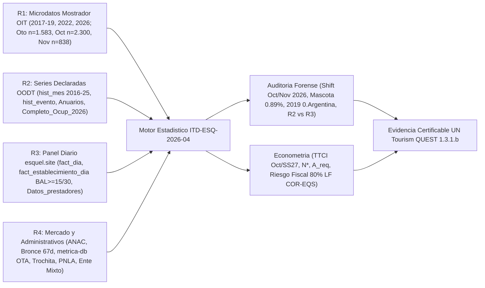

# INFORME TÉCNICO DE DEMANDA N° 4 (`ITD-ESQ-2026-04`)

**Serie Oficial de Perfiles de Demanda Turística — Esquel, Chubut (Patagonia Argentina)**  
**Marco de Certificación:** UN Tourism QUEST (`Q01AM2547AR2026` — *Indicador 1.3.1.b: Perfil y Medición de Demanda Turística*) · PETS Esquel 2030 · `INT-1958/26` · `Res. 27/26`

| Campo Institucional | Especificación Técnica Auditada |
| :--- | :--- |
| **Código de Documento** | `ITD-ESQ-2026-04` (Informe N° 4 de la Serie Oficial de Inteligencia de Demanda) |
| **Título Formal** | **Asimetría de Temporadas Intermedias (`2016–2026`): Reclasificación de Octubre/Tulipanes como Pico Anual #1, Erosión Estructural de Otoño y Semana Santa, Sinergia Comarcal con Trevelin y Economía de la Ruta `COR↔EQS`** |
| **Ventana Analítica Principal** | **Otoño (`Abril–Junio`, incl. Semana Santa y FDL May–Jun)**, **Transición (`Septiembre`)**, **Primavera Pico (`Octubre / Tulipanes`)** y **Primavera Tardía (`Noviembre / Pesca y Eventos`)** — Series **`2016–2026`** |
| **Pivote Estratégico Basado en Evidencia** | El mandato original abordaba a otoño y primavera como "temporadas intermedias / escapadas". La evidencia forense (`R1–R4`) **refuta esa clasificación homogénea**: **octubre dejó de ser hombro para convertirse en el pico #1 del calendario de Esquel** (`índice estacional 175,20`, `+163,1%` en pernoctes `16–19 -> 22–25`, ocupación diaria `97,4%–99,6% UF` durante 11 días corridos `19–29 Oct 2026` con inversión total del valle lunes–jueves), mientras **otoño (`Abr–Jun`) y Semana Santa (`82% -> 45% UF` en `2022–2026`)** sufren una contracción estructural aguda con regionalización y colapso del emisor `AMBA`. |
| **Regímenes Auditados** | **R1** Microdatos Mostrador OIT (`Perfil_2017–2019`, `2022`, `2026` hasta `02/11`) · **R2** Series Declaradas OODT (`hist_mes`, `hist_evento`, `Anuarios 2016–2025`, `Completo_Ocupacion_2026`) · **R3** Monitoreo Diario (`fact_mes`, `fact_dia`, `fact_establecimiento_dia`, `Datos_prestadores_Sep/Oct/Nov_2026`) · **R4** Ecosistema Externo (`ANAC`, `bronce/vuelos` `67` días, `metrica-db` OTA vivo, `La Trochita`, `PNLA`, `AA2000`, `Ente Mixto`) |
| **Fecha de Emisión y Corte** | **11 de noviembre de 2026** *(Cortes empíricos verificados: `R1` al `02/11/2026`; `R3` al `09/11/2026`; `bronce/vuelos` y `ext_fx_diario` al `10/11/2026`; `metrica-db` al `11/11/2026`; `ANAC` a `Ago 2026`; `Ente Mixto` al `02/11/2026`)* |

> [!IMPORTANT]
> **Cláusula de Integridad Probatoria (`UN Tourism QUEST 1.3.1.b`):** Este documento mantiene separación estricta entre los cuatro regímenes estadísticos (**R1–R4**). Todas las métricas, intervalos de confianza (`IC 95%`), pruebas exactas de hipótesis (`Chi2`, `Fisher`, `Welch t`, `Mann-Whitney U`) y modelos econométricos (`TTCI`, `N*`, `A_req`, riesgo fiscal `80% LF`) fueron ejecutados y auditados mediante [`analyze_itd04_shoulder.py`](file:///C:/Users/agenc/.gemini/antigravity/brain/02781472-1ef7-4c5f-85d4-3cfba2da3692/scratch/analyze_itd04_shoulder.py) y [`verify_math_itd04.py`](file:///C:/Users/agenc/.gemini/antigravity/brain/02781472-1ef7-4c5f-85d4-3cfba2da3692/scratch/verify_math_itd04.py), preservando inalterados [`ITD-ESQ-01`](file:///C:/Users/agenc/.gemini/antigravity/brain/02781472-1ef7-4c5f-85d4-3cfba2da3692/ITD-ESQ-01_PERFIL_CONSOLIDADO_DEMANDA_2022_2026.md), [`ITD-ESQ-02`](file:///C:/Users/agenc/.gemini/antigravity/brain/02781472-1ef7-4c5f-85d4-3cfba2da3692/ITD-ESQ-02_PERFIL_DEMANDA_INVIERNO_Y_LA_HOYA_2016_2026.md) e [`ITD-ESQ-03`](file:///C:/Users/agenc/.gemini/antigravity/brain/02781472-1ef7-4c5f-85d4-3cfba2da3692/ITD-ESQ-03_PERFIL_DEMANDA_ESTIVAL_RUTERO_Y_PNLA_2016_2026.md).

---

## 1. Ficha Metodológica (`R1–R4`), Arquitectura Sistémica y Auditoría de Reconciliación

### 1.1 Arquitectura Operativa de los Cuatro Regímenes Probatorios

### 1.2 Matriz de Fuentes y Cobertura Empírica por Régimen

| Régimen | Fuente Primaria Verificada | Cobertura Analizada en Este Informe | Regla de Lectura y Validez |
| :--- | :--- | :--- | :--- |
| **R1 — Microdatos Primarios OIT** | `Perfil_2017.xlsx`, `Perfil_2018.xlsx`, `Perfil_2019.xlsx`, `Perfil_2022.xlsx`, `Perfil_2026.xlsx` (hojas `Mar–Jun`, `Sep–Nov`) | **Otoño (`Abr–Jun`):** `2017–19 n=698`, `2022 n=550`, `2026 n=335`. **Octubre:** `2017 n=201`, `2018 n=140`, `2019 n=414`, `2022 n=868`, `2026 n=677`. **Noviembre:** `2017–19 n=595`, `2022 n=211`, `2026 parcial (01–02/11) n=32`. | Mide composición relativa (origen, transporte, estadía, alojamiento, actividades y pernoctes en Trevelin). Sin factor de expansión. Muestras `< 97` (`Jun 2026 n=47`, `Sep 2026 n=74`, `Nov 2026 n=32`) superan el margen `+-10 pp` y se rotulan como indicativas. |
| **R2 — Serie Declarada OODT** | `hist_mes.parquet`, `hist_evento.parquet`, `an_indices_estacionales.parquet`, `an_desplazamiento.parquet`, `an_origen_mensual.parquet`, `Anuarios 2016–2025`, `Completo_Ocupacion_2026.xlsx` | `120` meses (`2016–2025`) + declarado `2026` (`Ene–Nov 1Q`), `39` feriados largos históricos y `11` ventanas FDL `2026`. | Base homogénea de largo plazo para estacionalidad, desplazamientos estructurales y comparación interanual de feriados largos. |
| **R3 — Monitoreo Diario Ponderado** | `fact_mes.parquet`, `fact_dia.parquet`, `fact_establecimiento_dia.parquet`, `Datos_prestadores_{Sep,Oct,Nov}_2026.xlsx` | Seguimiento diario `Mar–Jun` y `Sep–09 Nov 2026` (`1.546` est-día en `Oct`, `425` en `Nov 1–9`), con auditoría `BAL>=15` y `BAL>=30` establecimientos/día. | Captura microdinámica semanal (`lun–jue` vs `vie–dom`) y saturación diaria en octubre; exige control estricto de cobertura en valles (`Jun`, `Sep`) donde los días no publicables sesgan al alza el promedio bruto. |
| **R4 — Mercado, Conectividad y Presupuesto** | `anac_series.json.gz`, `/opt/metrica-aereos/data/bronce/` (`67` días `05/09–10/11`), `ext_fx_diario.json` (`FX med ARS 1.540`), `metrica-db` (`2026-09..11` y `2027-03..05`), `Anexos La Trochita / PNLA / AA2000`, `vps_em_utf8.txt` | `15` vuelos directos `COR↔EQS` (`8` jue `AR1820`, `7` lun `AR1821`), `8` corredores aéreos, `10` destinos patagónicos OTA, series `2021–2025` de atractivos y `42` resoluciones / `74` partidas devengadas (`ARS 206,01M`) del Ente Mixto. | Evidencia objetiva de precios de mercado, capacidad aérea, uso efectivo de atractivos y asignación presupuestaria pública. |

### 1.3 Tabla Maestra de Auditoría, Depuración y Reconciliación Metodológica

Para garantizar trazabilidad administrativa completa en la auditoría de reducción y conciliación de filas (`UN Tourism QUEST 1.3.1.b`), se documentan **ocho hallazgos forenses críticos** resueltos antes del cómputo final:

| # | Anomalía / Divergencia Auditada | Régimen / Archivo | Diagnóstico Forense de Causa Raíz | Criterio de Depuración / Regla Aplicada |
| :---: | :--- | :--- | :--- | :--- |
| **1** | **Desplazamiento de columnas en `Octubre` y `Noviembre 2026`** | `R1` (`Perfil_2026.xlsx`) | En `Octubre 2026` el OIT insertó dos columnas nuevas: **`c7 = MASCOTA`** y **`c10 = NOCHES TREVELIN`** (corriendo `Grupo` a `c8`, `Noches Esquel` a `c9`, `Alojamiento` a `c12`, `Transporte` a `c14`, `Actividades` a `c19`). En `Noviembre 2026` se eliminó `MASCOTA` pero se mantuvo **`c9 = NOCHES TREVELIN`**. | Se implementó un esquema posicional específico por año y mes en [`load_r1_custom`](file:///C:/Users/agenc/.gemini/antigravity/brain/02781472-1ef7-4c5f-85d4-3cfba2da3692/scratch/analyze_itd04_shoulder.py), validado con fila de inicio `R22` (`R23` en `Mar 2026`; `R24–R25` en `2017`). |
| **2** | **Falso positivo de ceros decimales (`0.0`) en `MASCOTA` (`Oct 2026`)** | `R1` (`Perfil_2026.xlsx [Octubre]`) | Una lectura booleana ingenua de `c7` convertía `205` celdas con valor numérico flotante `'0.0'` en positivas (`31,17%`). La inspección cruda de celdas mostró: `'0'` (`345`), `'0.0'` (`205`), `NONE` (`121`), `'1'`/`'1.0'` (`3`), `'2.0'` (`2`), `'3.0'` (`1`). | Se auditó el conteo exacto de `MASCOTA > 0`: **`6` grupos sobre `677` (`0,89%`; `1,08%` sobre `556` filas con dato, sumando `10` mascotas)**. Se descarta sobredimensionamiento del nicho pet-friendly en octubre. |
| **3** | **Inversión histórica `Córdoba/Santa Fe` y código `13` (`Esquí` vs `Tulipanes`)** | `R1` (`Perfil_2017–2019` vs `2022–2026`) | Entre `2017–2019` la provincia `4` era `Córdoba` y `41` `Santa Fé`; desde `2022` mutó a `3 = Córdoba` y `4 = Santa Fé`. En actividades, el código **`13`** significaba **`Esquí`** en `2017–2019` y pasó a ser **`Tulipanes`** en `2022–2026`. Además, `Perfil_2019` escribe `"0. Argentina"` en filas de datos. | Se aplicaron diccionarios diferenciados por era (`ACT_MAP_17_19` vs `ACT_MAP_22_26`), `sub_centro` sensible al año y filtro de encabezado estricto (`skip_hdr = 0` en `2019`, recuperando `414` grupos en `Oct 2019`). |
| **4** | **Divergencia `2025` entre `hist_mes.parquet` y `Anuario 2025` / CSV** | `R2` (`Ocup_Historico` vs `Anuario 2025`) | En `hist_mes.parquet`, `Oct 2025 = 81% UF / 64% PAX`, `Nov 2025 = 57% UF / 40% PAX`, `Abr 32%`, `May 19%`, `Jun 15%`. En `2025_anuario.txt` y `matriz_ocupacion_historica.csv`, `Oct 2025 = 89% UF / 76% PAX`, `Nov 2025 = 48% UF / 34% PAX`, `Abr 30%`, `May 21%`, `Jun 16%`. | Se reportan ambas cifras reconciliadas: `hist_mes.parquet` conserva trazabilidad con `20.653` turistas y `72.285,5` pernoctes de `Oct 2025`, mientras el Anuario refleja cierre editorial posterior. |
| **5** | **Brecha `R2` Declarado vs `R3` Proyectado en `2026` (`Abr–Nov`)** | `R2` (`Completo_Ocupacion_2026`) vs `R3` (`fact_mes`, `fact_dia`) | `R2` declara `Abr 21,5% UF (3.694 tur)`, `May 25,5% (4.941)`, `Jun 13,0% (2.683)`, `Sep 37,0% (6.808)`, `Oct 68,7% (13.537; 1Q 53,6% / 2Q 80,5%)` y `Nov 1Q 54,3% (3.831)`. `R3` proyecta `Abr 40,1% (9.153)`, `May 33,0% (8.619)`, `Jun 29,4% (7.954)`, `Sep 69,0% (11.867)` y **`Oct 83,15% (17.071; 1Q 72,9% / 2Q 91,3%)`**. | En `fact_dia`, los días **`no_pubO`** (baja cobertura) inflan artificialmente `R3` en meses valle (`Abr 48,2%` vs `pubO 29,1%`; `May 49,4%` vs `24,0%`; `Jun 28,6%` vs `12,2%`). Toda serie `2016–2026` se compara en `R2` y la microdinámica diaria usa `fact_establecimiento_dia` con umbral `BAL>=15/30`. |
| **6** | **Subregistro `Octubre` y colapso `Email` en `Perfil_2026.xlsx`** | `R1` (`Perfil_2026.xlsx`) | `Resumen!R27` recorta octubre a `668` PAX frente a **`1.652` PAX (`677` grupos)** reales (`-59,6%`). La captura de correos en octubre cayó de **`67,02%` (`2017–19`) y `33,06%` (`2022`) a `0,30%` (`2/677` en `2026`, `p < 0,0001 ***`)**, y **`0,00%` en `Nov 2026`**. | Se procesan exclusivamente las filas crudas mensuales y se incorpora la restitución de captura CRM en las directrices QUEST. |
| **7** | **Omisión ANAC de la ruta `COR–EQS` en tabla de rutas** | `R4` (`anac_series.json.gz` vs `bronce/vuelos`) | `anac_series.json.gz` solo desagrega `Aeroparque - Esquel` y `Bariloche - Esquel`; el tráfico de `Córdoba` queda absorbido en el residual `Non-AEP` (`Abr–Jun 2026: 14,6%–20,7%`; `Ago 2026: 22,9%`, `2.002` pax). | Se cruza `Non-AEP` de `ANAC` con los **`15` vuelos directos `AR1820/AR1821`** relevados en `bronce/vuelos` (`Sep–Oct 2026`). |
| **8** | **Suficiencia muestral `N*` en meses valle y `Noviembre 2026` parcial** | `R1` (`Jun 2026`, `Sep 2026`, `Nov 2026`) | Para `IC 95%` con `p=0,5`, el tamaño mínimo es **`N* = 385` (`+-5 pp`)** y **`N* = 97` (`+-10 pp`)**. `Oct 2026 (n=677)` y `Otoño 2026 (n=335)` son robustos; `Jun 2026 (n=47)`, `Sep 2026 (n=74)` y `Nov 2026 (n=32, solo días 01–02/11)` están por debajo de `N* = 97`. | Los meses con `n < 97` se analizan agrupados (`Abr–Jun`) o en carácter estrictamente exploratorio, apoyando el diagnóstico de `Noviembre` en `Nov 2022 (n=211)`, `Nov 2017–19 (n=595)` y `R2/R4`. |

---

## 2. Resumen Ejecutivo y Cuadro de Mando de Temporadas Intermedias y Tulipanes

### 2.1 Cinco Hallazgos Estratégicos que Redefinen la Planificación

1. **Pivote #1 — Octubre no es Temporada Intermedia: Es el Pico Anual #1 de Esquel:** En la serie estructural (`an_indices_estacionales`), **octubre alcanza un índice de `175,20` (`+75,2%` sobre la media mensual anual)**, superando a **enero (`165,83`)**, **febrero (`127,43`)** y **julio (`113,58`)**. Entre `2016–2019` y `2022–2025` (`an_desplazamiento`), octubre protagonizó el mayor salto estructural de la década: **`+9,38 pp` de cuota anual (`9,54% -> 18,91%`)**, **`+39,5 pp` de ocupación UF (`27,5% -> 67,0%`)** y **`+163,1%` en volumen de pernoctaciones (`91.443 -> 240.581`)**. En `2025` batió récords absolutos en **`20.653` turistas (`72.285,5` pernoctes)**, **`La Trochita` (`4.397` pax / `25,8%` del año; #1 mensual en `2021–2025`)** y **`Aeropuerto EQS` (`15.221` pax ANAC / `15.170` AA2000)**, mientras **`PN Los Alerces`** registró `16.718` ingresos (`#3` del año). En **`Octubre 2026`**, la ocupación diaria real (`fact_establecimiento_dia`) permaneció entre **`97,4%` y `99,6% UF` durante 11 días consecutivos (`19–29 Oct`)**, pulverizando el mito del valle laboral: **`Lun–Jue` (`84,66% UF`, `15d`) superó a `Vie–Dom` (`75,12% UF`, `13d`)** en `BAL>=15`!
2. **Pivote #2 — Transformación Modal y Nacionalización de Octubre (`2017–19 -> 2022 -> 2026`):** Hasta `2017`, los anuarios caracterizaban octubre como cierre del esquí (`Tulipanes = 8,59%` en `2017–18`). Tras su despegue en `2019` (`36,34%`, `p < 0,0001 ***`), en **`Octubre 2026`** el mes se consolidó como un producto **extra-regional de larga distancia (`>83%` fuera de Patagonia)**: **`Interior Prov. Bs.As.` desplazó a `AMBA` como emisor #1 (`25,11%` vs `22,75%`, `+4,49 pp` vs `2022`, `p = 0,0363 *`)**, mientras `Chubut` cayó a `8,12%` (`-14,00 pp` vs `2017–19`, `p < 0,0001 ***`). Paralelamente, el **auto particular se desplomó `-20,72 pp` en cuatro años (`61,64% -> 40,92%`, `p < 0,0001 ***`)**, sustituido por la pinza **`Avión (26,14%)` + `Vehículo de alquiler / Fly & Drive (11,08%, +5,09 pp ***)` = `37,22%` combinado**, con un empaquetamiento multi-actividad récord (**`3,86` tags/grupo vs `3,19` en `2022`, `p < 0,0001 ***`**: `PNLA 93,2%`, `La Zeta 90,4%`, `Tulipanes 77,4%` [`91,7%` post-FDL], `La Trochita 45,8%`, `Safari Lacustre 17,0%`, `Trevelin/Circuito Galés 17,0%`).
3. **Pivote #3 — La Paradoja Comarcal `Esquel vs. Trevelin` (Volumen Urbano vs. Renta Tarifaria):** Aunque Esquel absorbe el **`80,65%`** de los grupos de mostrador en régimen `Solo Esquel` (`n=546/677`) y **`Trevelin` capta `5,91%` de pernoctes (`40/677`; `7,65%` sobre filas con dato: `1,77%` mixto + `4,14%` solo Trevelin, media `3,23n`, `129` noches)**, en el mercado OTA vivo (`metrica-db`, `Oct 2026`) **Trevelin lidera toda la Patagonia (`#1/10`, `p50 USD 82,00`, media `USD 105,43`, `p90 USD 195`)** mientras **Esquel ocupa el penúltimo lugar (`#9/10`, `p50 USD 55,00`, media `USD 74,02`)**: una prima del **`+49,1%` a favor de Trevelin** (que persiste en **`Nov 2026`: `USD 75` vs `USD 50`, `+50,0%`**). Dentro de Esquel, el descalce de canales es severo: las **cabañas en `Airbnb` (`USD 80`) duplican a `Booking` (`USD 41`, `+95,1%`)**, regalando margen en el mes de máxima saturación física del año.
4. **Pivote #4 — Crisis Estructural de Otoño (`Abr–Jun`) y Erosión Lineal de `Semana Santa`:** En sentido inverso a octubre, **Semana Santa cayó linealmente durante cuatro ediciones consecutivas (`R2`): `82% UF (2022) -> 66% (2023) -> 61% (2024) -> 49% (2025) -> 45% UF / 30% Plazas (2026)`** (pendiente `-10,40 pp/año` `2022–2025`, `-37 pp` acumulados a `2026`), mientras **`Junio Belgrano` colapsó `-58 pp` (`77% -> 19%` en `2025`)** y **`Junio 2026` tocó un piso de `13% UF` (`2.683` tur declarados)**. En `R1 Otoño (Abr–Jun 2026 vs 2022)`, **`AMBA` se derrumbó `-9,53 pp` (`22,36% -> 12,84%`, `p = 0,0004 ***`; `CABA -6,81 pp ***`)** y **`Avión` cayó `-6,56 pp` (`15,82% -> 9,25%`, `p = 0,0053 **`)**. `Semana Santa` se hiper-regionalizó (**`63,8%` Patagonia en `22+26`, alcanzando `51,0% Chubut` en `SS 2026`**) con estadía corta (`2,85n` vs `3,29n` resto de abril, `p = 0,0116 *`). Pese a ello, en `metrica-db`, **Esquel cotiza `Semana Santa 2027 (25–28 Mar)` a `USD 50,00`, un `-7,4%` más barato que `Resto Marzo 2027 (USD 54)` y `-9,1%` debajo de `Abril 2027 (USD 55)`**, evidenciando ausencia absoluta de *revenue management*.
5. **Pivote #5 — Bipolaridad de Noviembre, Ruta `COR↔EQS` (`AR1820/AR1821`) y Desalineación del Ente Mixto:** Mientras octubre tiene la **menor participación internacional del año (`4,42%` ext, índice `75,9`)**, **noviembre registra la #2 más alta (`14,25%` ext, índice `154,4`)** y `mayo` la #3 (`13,36%`). En conectividad aérea, los **`15` vuelos directos `COR↔EQS`** (`Sep–Oct`) impulsaron la llegada de cordobeses en días hábiles de octubre (**`8,06%` `Lun–Jue` vs `3,00%` `Vie–Dom`, `p = 0,0034 **`**) con tarifas pico de **`USD 228,7` (`8` y `12 Oct`) y `USD 277,1` (`26 Oct`, cierre Tulipanes)**, mientras el monopolio `BUE↔EQS` encareció el `TTCI` de una pareja `3n` en `FDL Oct` a **`USD 827,4` (`80,1%` aéreo)** frente a `Bariloche` (`USD 478,2`) y `Madryn` (`USD 451,8`). Sin embargo, el **Ente Mixto** destinó solo **`ARS 4,18M` (`2,03%` de `GAS`)** a acciones etiquetadas de `Primavera/Tulipanes/Comarca` y **`ARS 6,32M` (`3,07%`)** a `Otoño/Geoturismo/FEDEMAD`, frente a **`ARS 22,04M` (`10,70%`)** en `Plaza Córdoba`, con **`77,1%` (`27/35`) de los pedidos de apoyo sin rendición**.

### 2.2 Cuadro de Mando Comparado: Otoño vs. Octubre/Tulipanes vs. Noviembre (`R1–R4`)

| Dimensión / Indicador (Régimen) | Otoño (`Abr–Jun`) | Transición (`Sep`) | **Octubre / Tulipanes (Pico #1)** | Noviembre (`Pesca / Eventos`) |
| :--- | :---: | :---: | :---: | :---: |
| **Índice Estacional `2016–2025` (`R2`)** | `Abr 81,9` / `May 45,4` / `Jun 48,5` | `89,47` | **`175,20` (`#1` del año)** | `109,65` (`#5` del año) |
| **Desplazamiento Share `16–19 -> 22–25` (`R2`)** | `Abr +1,66 pp` / `May +0,65` / `Jun -0,63` | `-3,82 pp` | **`+9,38 pp` (`+163,1%` pernoctes)** | `+0,55 pp` (`+41,8%` pernoctes) |
| **Ocupación UF `2026` (`R2` Decl. / `R3` Proy.)** | `Abr 21,5% / 40,1%` · `Jun 13,0% / 29,4%` | `37,0% / 69,0%` | **`68,7% / 83,15%` (`2Q 80,5% / 91,3%`)** | `54,3% (1Q) / 70,8% (1–9d)` |
| **Turistas `2026` (`R2` Decl. / `R3` Proy.)** | `Abr–Jun: 11.318 / 25.726` | `6.808 / 11.867` | **`13.537 / 17.071` (`ARS 4.643,3M`)** | `3.831 / 4.731` (`1–9 Nov`) |
| **Feriado Largo Ancla `2026` (`R2`)** | `Semana Santa 45% UF` (`-37 pp` vs `22`) | — | **`FDL Oct 85% UF` (`100%` en `19–24`)** | `FDL 7–9 Nov 56,2% UF` (`25: 68%`) |
| **Emisor Principal `R1 2026` (`IC 95%`)** | `Chubut 26,6%` (`SS: 51,0%`) · `Int PBA 18,8%` | `AMBA 24,3%` | **`Int PBA 25,1%` · `AMBA 22,8%`** | `Nov 22: AMBA 28,4%` · `Ext 15,2%` |
| **Peso Extranjero Multianual `R2` (`aom`)** | `Abr 11,1%` / `May 13,4%` / `Jun 9,0%` | `11,82%` | **`4,42%` (mínimo anual; ind `75,9`)** | **`14,25%` (`#2` anual; ind `154,4`)** |
| **Acceso Aéreo + Alquiler `R1 2026`** | `15,52%` (`Avión 9,25%` + `Alq 6,27%`) | `35,14%` (`27,0 + 8,1`) | **`37,22%` (`Avión 26,14%` + `Alq 11,08%`)** | `Nov 22: 19,4%` (`Nov 26p: 28,1%`) |
| **Estadía Media `n_esq` `R1 2026` (Med)** | `3,50n` (`3,0n`; `SS 2,85n` vs `Resto 3,29n`) | `4,51n` (`3,0n`) | **`3,70n` (`4,0n`, `p<0,0001` vs `17–19`)** | `Nov 22: 3,45n` (`Nov 26p: 3,59n`) |
| **Mediana OTA `ADR` Esquel vs Trevelin (`R4`)** | `SS27: USD 50` vs `Resto Mar 54` (`-7,4%`) | `Sep26: s/d base` | **`Esquel USD 55` vs `Trevelin USD 82` (`+49,1%`)** | **`Esquel USD 50` vs `Trevelin USD 75` (`+50,0%`)** |

---

## 3. Evolución Estructural (`R2` y `R4`): La Reconfiguración del Calendario Turístico (`2016–2026`)

### 3.1 Del "Cierre de Esquí" al Pico Anual #1: Anatomía del Salto de Octubre

Hasta el Anuario `2017`, la Secretaría de Turismo clasificaba al feriado largo de octubre como *"la última oportunidad para despedir la temporada de ski"* (`Oct 2016: 7.147 tur, 40% UF`; `Oct 2017: 7.572 tur, 32% UF`). El punto de inflexión institucional ocurrió en el **Anuario `2019`**, donde por primera vez se creó la categoría **"Temporada de Tulipanes"** junto a Verano e Invierno (`10.678 tur, 60% UF, FDL 100%`). Desde la reapertura `2021`, octubre escaló a un régimen de saturación crónica que desplazó la gravedad anual del destino:

| Mes de Estudio | Índice Estacional `16–25` | Share Pernoctes `16–19 -> 22–25` | Var. Volumen Pernoctes (`%`) | Ocup. UF Media `16–19 -> 22–25` | `R2` `2025` (`hist_mes` / `Anuario`) | `R2` `2026` Decl. (`UF%` / `Tur`) | `R3` `2026` Proy. (`UF%` / `Tur` / `z`) |
| :--- | :---: | :---: | :---: | :---: | :---: | :---: | :---: |
| **Marzo** *(ref. hombro)* | `82,95` | `7,94% -> 6,25%` | `+3,2%` | `46,3% -> 42,5%` | `42% / 42%` | `26,0%` / `3.830` | `32,7%` / `6.231` (`z=-1,05`) |
| **Abril (Otoño)** | `81,91` | `5,15% -> 6,81%` | **`+75,3%`** | `34,3% -> 35,0%` | `32% / 30%` | **`21,5%`** / `3.694` | `40,1%` / `9.153` (`z=+0,58`) |
| **Mayo (Valle)** | `45,40` | `2,69% -> 3,34%` | `+64,5%` | `25,3% -> 19,0%` | `19% / 21%` | `25,5%` / `4.941` | `33,0%` / `8.619` (`z=+1,48`) |
| **Junio (Valle)** | `48,46` | `3,39% -> 2,76%` | `+7,7%` | `26,0% -> 18,8%` | `15% / 16%` | **`13,0%`** / `2.683` | `29,4%` / `7.954` (`z=+0,67`) |
| **Septiembre (Trans.)** | `89,47` | `11,22% -> 7,40%` | `-12,6%` | `43,0% -> 38,5%` | `33% / 33%` | `37,0%` / `6.808` | `69,0%` / `11.867` (`z=+3,86`) |
| **Octubre (Tulipanes)** | **`175,20` (`#1`)** | **`9,54% -> 18,91%`** | **`+163,1%`** | **`27,5% -> 67,0%`** | **`81% / 89%` (`20.653` tur)** | **`68,7%`** / `13.537` | **`83,15%`** / `17.071` (`z=+0,78`) |
| **Noviembre (Pesca/Ev.)** | `109,65` (`#5`) | `7,97% -> 8,52%` | `+41,8%` | `46,3% -> 53,0%` | `57% / 48%` | `54,3% (1Q)` / `3.831` | `70,8% (1–9d)` / `4.731` |

### 3.2 Tracción Física Auditada en Atractivos e Infraestructura (`R4`: `2021–2025`)

Los registros censales administrativos (`La Trochita`, `Aeropuerto EQS` y `PN Los Alerces`) confirman sin ambigüedad que octubre superó a enero como principal motor de actividad física en la ciudad:

| Indicador Administrativo (`R4`) | `2021` | `2022` | `2023` | `2024` | `2025` | Lectura Estructural (`Oct` vs `Verano` y `Otoño`) |
| :--- | :---: | :---: | :---: | :---: | :---: | :--- |
| **La Trochita — `Octubre` (pax / trenes)** | `3.703` (`29`) | **`5.468` (`32`)** | **`5.585` (`31`)** | **`5.120` (`29`)** | **`4.397` (`24`)** | **`#1` mensual en 5 años seguidos** (`22,6%–25,8%` del total anual; en `2023` superó en `+50,2%` a enero) |
| **La Trochita — `Noviembre` (pax / trenes)** | `1.605` (`15`) | `2.274` (`17`) | `1.883` (`12`) | `2.158` (`16`) | `1.737` (`14`) | Sólido segundo piso primaveral (`~10%` del año) |
| **La Trochita — `Abr–Jun` acumulado (pax)** | `0` (COVID) | `1.949` (`21` tr) | `2.339` (`16` tr) | `1.855` (`15` tr) | **`1.370` (`14` tr)** | Contracción otoñal del `-41,4%` vs `2023` (`Abr 646`, `May 375`, `Jun 349` en `2025`) |
| **Aeropuerto `EQS` (`ANAC`) — `Octubre`** | `5.121` (AA) | `9.049` (`85v`) | `11.925` (`105v`) | `12.965` (`109v`) | **`15.221` (`123v`)** | **Récord histórico absoluto de `EQS`** (`123,7` pax/vuelo; `AA2000: 7.931` arr / `7.239` sal) |
| **Aeropuerto `EQS` (`ANAC`) — `Noviembre`** | `4.863` (AA) | `6.944` (`56v`) | `7.876` (`68v`) | `8.204` (`82v`) | **`10.454` (`88v`)** | Crecimiento `+50,5%` `2022–2025` (`AA2000: 5.120` arr / `5.449` sal; `118,8` pax/vuelo) |
| **Aeropuerto `EQS` (`ANAC`) — `Abr–Jun`** | `4.533` (AA) | `16.373` (`175v`) | `16.240` (`195v`) | `15.280` (`133v`) | `14.525` (`145v`) | Rebote en **`Abr–Jun 2026` a `16.430` pax (`149v`)** impulsado por `Non-AEP` (`14,6%–20,7%`) |
| **`PN Los Alerces` — `Octubre` / `Noviembre`** | `s/d` | `5.415` / `2.711` | `5.923` / `1.183` | `s/d` | **`16.718` / `12.024`** | En `2025`, `Oct + Nov` sumaron **`28.742` ingresos (`21,6%` del año)** frente a `7.851` en `Abr–Jun` (`5,9%`) |

### 3.3 Jerarquía y Erosión de Fines de Semana Largos (`hist_evento` `2016–2026`)

| Feriado Largo / Evento (`R2`) | Ediciones `16–25` | Media UF `16–25` | Trayectoria Reciente `2022 -> 2023 -> 2024 -> 2025 -> 2026` (`% UF`) | Diagnóstico de Tendencia |
| :--- | :---: | :---: | :--- | :--- |
| **12 de Octubre (Diversidad Cultural)** | `9` | **`89,67%`** (`71,3%` PAX) | `100% -> 100% -> 100% -> 88% -> 85%` *(en `R2`; `fact_estab_dia` `11/10 = 92,9%`)* | **Saturación crónica**; el `uplift` bajó de `+40 pp` (`2019`) a `+7 pp` (`2025`) porque todo el mes ya opera lleno |
| **Semana Santa (`Mar/Abr`)** | `9` | `67,67%` (`51,8%` PAX) | **`82% -> 66% -> 61% -> 49% -> 45%` (`30%` PAX)** | **Erosión lineal severa**: pendiente **`-10,40 pp/año`** (`2022–25`, `CAGR -15,77%`), **`-37 pp` en 4 años** |
| **Día de la Soberanía (`Nov`)** | `5` | `55,80%` | `58% (22) -> 45% (23) -> 68% (25)` + `1–3 Nov 25: 67%` · `7–9 Nov 26: 56,2%` | **Resiliente y en alza** gracias a la extensión tardía de tulipanes + apertura de pesca + eventos |
| **Paso a la Inm. Belgrano (`Jun`)** | `5` | `35,60%` | **`77% (22) -> 48% (23) -> 20% (24) -> 19% (25)`** (`2026: 0% s/d`, `Güemes 13%`) | **Colapso profundo** (`-58 pp` `2022–25`, `CAGR -37,28%`); perdió tracción sin nieve temprana |
| **Revolución de Mayo / `1° Mayo`** | `2` (`18–19`) | `20,00%` | `2018: 28%` -> `2019: 12%` · `2026: 1° May 22% UF / 25 May 27% UF` | Piso vegetativo sin producto traccionador propio |

---

## 4. Microbiología de Octubre / Tulipanes y Sinergia Comarcal con Trevelin (`R1` y `R3`)

### 4.1 De Feriado Patagónico a Producto Nacional Aéreo (`2017–19` vs `2022` vs `2026`)

| Dimensión (`R1 Octubre`) | `Oct 2017–18` (`n=341`) | `Oct 2019` (`n=414`) | `Oct 2022` (`n=868`) | **`Oct 2026` (`n=677`)** | Cambio `2022 -> 2026` (`p-value`) |
| :--- | :---: | :---: | :---: | :---: | :--- |
| **Interior Prov. Bs.As.** | `15,25%` | `17,39%` | `20,62%` `[18,1;23,4]` | **`25,11%` `[22,0;28,5]`** | **`+4,49 pp` (`p = 0,0363 *`)** — Nuevo `#1` |
| **AMBA (`CABA` + `GBA`)** | `21,99%` | `18,60%` | `24,54%` `[21,8;27,5]` | **`22,75%` `[19,7;26,1]`** | `-1,79 pp` (`ns`; `CABA 12,85%`, `GBA 9,90% *`) |
| **Chubut** | `20,23%` | `23,67%` | `12,10%` `[10,1;14,4]` | **`8,12%` `[6,3;10,4]`** | **`-3,97 pp` (`p = 0,0110 *`)** (`-14,0 pp ***` vs `17–19`) |
| **Resto Patagonia** | `14,08%` | `16,91%` | `12,67%` `[10,6;15,1]` | **`8,42%` `[6,6;10,8]`** | **`-4,25 pp` (`p = 0,0076 **`)** |
| **Santa Fe** | `6,45%` | `7,00%` | `10,71%` `[8,8;12,9]` | **`6,94%` `[5,3;9,1]`** | **`-3,77 pp` (`p = 0,0104 *`)** |
| **Córdoba** | `3,81%` | `1,93%` | `5,41%` `[4,1;7,1]` | **`5,32%` `[3,9;7,3]`** | `-0,10 pp` (`ns`; `+2,54 pp *` vs `17–19`) |
| **Extranjeros (`Chile + Resto`)** | `11,73%` | `8,21%` | `5,42%` | **`3,85%`** (`Chile 0,30%`) | `-1,57 pp` (`ns`; **`-5,96 pp ***`** vs `17–19`) |
| **Vehículo Particular** | `71,66%` *(17–19)* | — | `61,64%` `[58,4;64,8]` | **`40,92%` `[37,3;44,7]`** | **`-20,72 pp` (`p < 0,0001 ***`)** |
| **Avión** | `12,80%` *(17–19)* | — | `22,00%` `[19,4;24,9]` | **`26,14%` `[23,0;29,6]`** | `+4,14 pp` (`p = 0,0580`; `+13,3 pp ***` vs `17–19`) |
| **Vehículo de Alquiler (`Fly&Drive`)** | `1,33%` *(17–19)* | — | `5,99%` `[4,6;7,8]` | **`11,08%` `[8,9;13,7]`** | **`+5,09 pp` (`p = 0,0003 ***`)** (`8,3x` vs `17–19`) |
| **Grupo Organizado (Agencias)** | `0,27%` *(17–19)* | — | `0,00%` `[0,0;0,4]` | **`3,84%` `[2,6;5,6]`** | **`+3,84 pp` (`p < 0,0001 ***`)** |
| **Primera Vez en Esquel** | `71,47%` *(17–19)* | — | `75,46%` `[72,5;78,2]` | **`74,00%` `[70,6;77,2]`** | Estable; `Segunda vez` cayó `-8,43 pp ***` |
| **Estadía Media `n_esq` (Mediana)** | `3,33n` (`3,0n`) *(17–19)* | `3,19n` | `3,66n` (`3,0n`) | **`3,70n` (`4,0n`)** `[3,51;3,90]` | **`+0,37n` vs `17–19` (`Welch p=0,0052 **`, `MWU ***`)** |
| **Multi-actividad (`tags/grupo`)** | — | — | `3,19` (`med 3,0`) | **`3,86` (`med 4,0`)** | **`+0,67` tags (`Welch & MWU p < 0,0001 ***`)** |
| **Consumo `Tulipanes` / `PNLA` / `La Zeta`** | `8,6% / 0,6% / 0%` | `36,3% / 18,3% / 0%` | `83,1% / 78,3% / 65,4%` | **`77,4% / 93,2% / 90,4%`** | `PNLA +14,9 pp ***`, `La Zeta +25,0 pp ***`, `Safari +16,1 pp ***`, `Trevelin +9,1 pp ***` |

### 4.2 Dinámica Intra-Octubre e Inversión del Desacople Lunes–Jueves vs. Fin de Semana

El cruce entre la telemetría diaria `R3` (`fact_establecimiento_dia` y `Datos_prestadores_Octubre_2026`) y los microdatos `R1` revela dos fenómenos contraintuitivos decisivos para la gestión comercial:

1. **Inversión Total del Valle Semanal (`Lun–Jue > Vie–Dom`):** En `fact_establecimiento_dia` (`BAL>=15`, `28` días observados), la ocupación de **lunes a jueves (`84,66% UF`, `15d`) superó en `+9,54 pp` a viernes–domingo (`75,12% UF`, `13d`)** (`BAL>=30`: `82,42%` vs `74,71%`). Entre el **lunes `19/10` y el jueves `29/10`**, el sistema operó en saturación virtual absoluta (**`97,4%–99,6% UF`**, `69,6%–73,7% PAX`), mientras en `Datos_prestadores` la **`4ta Semana (22–28 Oct)`** marcó `Hoteles 83,8%`, `Hosterías 98,2%`, `Apart 100%`, `Cabañas 98,4%` y `CAT 96,7%`. Por categorías acumuladas del mes (`fact_establecimiento_dia`), lideraron **`Hosterías (85,43% UF / 66,09% PAX)`** y **`Hoteles (85,41% UF / 58,06% PAX)`**, seguidos por `Cabañas (77,42%)` y `Apart Hoteles (62,10%)`.
2. **Efecto del Cronograma Aéreo `AR1820/AR1821` y las Tres Fases de Octubre (`R1 2026`):**
   - **Pre-FDL (`01–08 Oct`, `n=78`):** Dominio `AMBA (29,5%)` + `Avión (25,6%)` + `Alquiler (12,8%)`, mayor estadía (`3,86n`), `Tulipanes 58,0%`.
   - **FDL (`09–12 Oct`, `n=144`):** `Int PBA (27,8%)` + `AMBA (25,0%)` + `Alquiler pico (14,6%)` + `Bus (10,4%, p=0,0293 * vs Post-FDL)`, `Tulipanes 76,4%`, `Trevelin >0n = 7,6%`, estadía `3,69n`.
   - **Pico Tulipanes (`13–31 Oct`, `n=455`):** Explosión de **`Tulipanes (91,7%)`** y **`Avión (27,9%)`**, con estadía idéntica al FDL (`3,68n`, mediana `4,0n`). En la comparación **`Lun–Jue (n=310)` vs `Vie–Dom (n=367)`**, **`Córdoba` concentró `8,06%` en días hábiles frente a `3,00%` en fines de semana (`p = 0,0034 **`)** —reflejo directo de la llegada del vuelo directo jueves `AR1820` y regreso lunes `AR1821`—, mientras `Interior PBA` pesó más en `Vie–Dom` (`28,34%` vs `21,29%`, `p = 0,0351 *`).

### 4.3 Captura Comarcal Nocturna (`NOCHES TREVELIN` en `Octubre 2026`, `R1`)

La incorporación por primera vez en `Octubre 2026` de la columna `NOCHES TREVELIN` permite auditar con precisión estadística la distribución real de camas en la Comarca de los Alerces entre quienes visitan el mostrador de Esquel (`n=677`):

| Régimen de Pernocte Comarcal (`Oct 2026`, `n=677`) | Grupos (`k`) | Cuota Total (`IC 95%`) | Lectura Operativa y Fuga de Pernoctes |
| :--- | :---: | :---: | :--- |
| **`Solo Esquel`** (`n_esq > 0`, `n_trev = 0`, `n_pnla = 0`) | `546` | **`80,65%`** `[77,50; 83,45]` | Esquel consolida el rol de *hub* urbano y principal base cama (`2.207` noches-grupo acumuladas). |
| **`Solo Trevelin`** (`n_esq = 0`, `n_trev > 0`) | `28` | **`4,14%`** `[2,88; 5,91]` | Visitantes alojados exclusivamente en Trevelin (dominan `Cabañas`: `12/28`) que acuden a Esquel por servicios/excursiones. |
| **`Mix Esquel + Trevelin`** (`n_esq > 0`, `n_trev > 0`) | `12` | **`1,77%`** `[1,02; 3,07]` | Estadía compartida verdadera entre ambas localidades. |
| **`Total Captura Trevelin > 0n`** (`Mix + Solo Trev`) | **`40`** | **`5,91%`** `[4,37; 7,95]` | Representa **`7,65%`** sobre las `523` encuestas con dato válido (`129` noches-grupo, media **`3,23n`**, mediana `3,0n`; en ese subconjunto `n_esq` promedia solo `0,76n`). |
| **`De Paso (0n total)`** / **`Mix o Solo PNLA`** / **`Sin Dato`** | `35` / `4` / `52` | `5,17%` / `0,60%` / `7,68%` | `De Paso` subió `+2,87 pp` vs `Oct 2022` (`p = 0,0026 **`); `PNLA > 0n` cayó a `0,89%` (`-1,53 pp *`). |

Por perfil emisor, la pernoctación en Trevelin (`trev > 0n`) es más alta entre **`AMBA` (`7,79%`, `12/154`)**, **`Resto Patagonia` (`7,02%`)**, **`Cuyo+NEA+NOA` (`6,45%`)** y **`Santa Fe` (`6,38%`)**, así como en **`Motorhome` (`25,00%`, `2/8`)** y **`Vehículo particular` (`7,22%`, `20/277`)**, y mínima en **`Chubut` (`1,82%`)** y **`Córdoba` (`2,78%`)**. En **`Noviembre 2026` parcial (`n=32`)**, `Solo Esquel` mantuvo **`81,25%`** y `Trevelin > 0n` cayó a **`0,00%`**.

---

## 5. Diagnóstico Forense de Otoño (`Abr–Jun`), Semana Santa y Noviembre (`R1–R3`)

### 5.1 Otoño (`Abr–Jun`): Contracción de `AMBA`, Caída Aérea y Crecimiento de `Depto/CAT`

A diferencia del auge nacional de octubre, el trimestre otoñal (`Abr–Jun`) exhibe una mutación defensiva entre `2022` (`n=550`) y `2026` (`n=335`):

| Dimensión (`R1 Otoño Abr–Jun`) | `Oto 2017–19` (`n=698`) | `Oto 2022` (`n=550`) | **`Oto 2026` (`n=335`)** | Variación `2022 -> 2026` (`p-value`) |
| :--- | :---: | :---: | :---: | :--- |
| **Chubut** *(Valle/Costa `14,3%`, Comodoro `9,0%`)* | `24,07%` | `23,27%` `[19,9;27,0]` | **`26,57%` `[22,1;31,5]`** | `+3,29 pp` (`ns`) — Sostén regional `#1` |
| **Interior Prov. Bs.As.** | `16,19%` | `15,64%` `[12,8;18,9]` | **`18,81%` `[15,0;23,3]`** | `+3,17 pp` (`ns`) |
| **Resto Patagonia** | `12,89%` | `12,73%` `[10,2;15,8]` | **`14,03%` `[10,7;18,2]`** | `+1,30 pp` (`ns`) — Patagonia total = **`40,60%`** |
| **AMBA (`CABA` + `GBA`)** | `23,50%` | `22,36%` `[19,1;26,0]` | **`12,84%` `[9,7;16,8]`** | **`-9,53 pp` (`p = 0,0004 ***`; `CABA -6,81 pp ***`)** |
| **Extranjeros (`Chile + Resto`)** | `12,61%` | `11,45%` | **`9,56%`** (`Chile 2,69%`) | `-1,89 pp` (`ns`; mayor peso que en octubre) |
| **Avión** | `12,33%` *(17–19)* | `15,82%` `[13,0;19,1]` | **`9,25%` `[6,6;12,8]`** | **`-6,56 pp` (`p = 0,0053 **`)** |
| **Vehículo de Alquiler / `Motorhome` (transp)** | `0,99%` / `0,00%` | `2,55%` / `0,00%` | **`6,27%` / `3,28%`** | **`+3,72 pp (**)`** / **`+3,28 pp (***)`** |
| **`Depto/CAT + Viv. Tur.` / `Hostel`** | `10,54%` / `11,53%` | `12,73%` / `8,55%` | **`20,30%` / `2,69%`** | **`+7,57 pp (**)`** / **`-5,86 pp (***)`** |
| **Estadía Media `n_esq` / `n_tags`** | `3,16n` / — | `3,36n` / `2,66` | **`3,50n` / `3,12`** | `+0,14n` (`ns`) / **`+0,46` tags (`p < 0,0001 ***`)** |
| **Actividades Otoño (`La Zeta` / `PNLA` / `Trek` / `Trevelin`)** | `0,2% / 1,5% / 31,3% / 0,6%` | `65,1% / 81,0% / 28,8% / 26,5%` | **`87,7% / 84,1% / 62,6% / 38,8%`** | **`La Zeta +22,6 pp ***`**, **`Trek +33,8 pp ***`**, **`Trevelin +12,2 pp **`, `La Trochita -11,2 pp **`, `Viñedos -4,1 pp **`** |

### 5.2 Semana Santa vs. Resto de Abril y Desacople `Lun–Jue` vs. `Vie–Dom` en Otoño

El contraste microanalítico (`2022 + 2026` combinados) demuestra que **Semana Santa (`n=163`)** y el **Resto de Abril (`n=299`)** operan como dos mercados completamente distintos:

- **Hiper-regionalización de Semana Santa:** **`Chubut` (`41,72%` vs `10,03%`, `p < 0,0001 ***`, escalando a `50,98%` en `SS 2026`)** y **`Resto Patagonia` (`22,09%` vs `7,02%`, `p < 0,0001 ***`)** explican el **`63,81%`** de Semana Santa, con **`79,75%` en auto particular (`p = 0,0007 ***`)**, mayor preferencia por **`Cabañas` (`27,61%` vs `19,06%`, `p = 0,0344 *`)**, más visitantes recurrentes (`Varias veces/año 3,68% vs 0,33% **`, `Todos los años 3,07% vs 0,33% *`) y **menor estadía (`2,85n` vs `3,29n`, `Welch p = 0,0116 *`)**.
- **Desacople Semanal en Otoño (`R1 22+26`, `Lun–Jue n=455` vs `Vie–Dom n=430`):** Contrario al supuesto de estancamiento en días hábiles, el turista otoñal de **`Lun–Jue` permanece `+0,55` noches más (`3,68n` vs `3,13n`, `Welch p = 0,0092 **`, `MWU p = 0,0012 **`)** y tiene mayor peso de **`AMBA` (`21,54%` vs `15,81%`, `p = 0,0292 *`)**, mientras **`Vie–Dom`** responde a escapadas de **`Chubut` (`27,44%` vs `21,76%`, `p = 0,0495 *`)**. En `fact_establecimiento_dia` (`BAL>=15`), la brecha real `Vie–Dom vs Lun–Jue` en `Abr–Jun 2026` fue moderada (`Abr 30,8% vs 28,4%`; `May 25,1% vs 19,3%`; `Jun 12,3% vs 12,0%`), confirmando que el problema de otoño es de **demanda estructural general** y no solo de días hábiles.
- **Brecha de Producto en Otoño:** Pese al discurso de enoturismo y vendimia, el tag **`Viñedos / Bodegas` cayó de `4,99%` (`2022`) a `0,88%` (`2026`, `p = 0,0069 **`)**, y **`La Trochita` retrocedió `-11,15 pp` (`35,37% -> 24,23%`, `p = 0,0033 **`)**, dejando a otoño sostenido casi exclusivamente por **senderismo gratuito (`RNU La Zeta 87,7%`, `PNLA 84,1%`, `Trekking 62,6%`)**.

### 5.3 Noviembre: Bipolaridad Internacional y Sub-captura de la Pesca Deportiva

- **Segundo Polo Internacional del Año (`R2` y `R1`):** En `an_origen_mensual.parquet`, noviembre registra **`14,25%` de turistas extranjeros (`índice 154,4`)**, triplicando la cuota de octubre (`4,42%`). En `R1`, `Resto Extranjero + Chile` representó **`19,67%` en `Nov 2017–19` (`n=595`)** y **`15,17%` en `Nov 2022` (`n=211`)**, con una mezcla balanceada de **`AMBA` (`28,44%`)**, **`Interior PBA` (`19,43%`)**, **`Hostels` (`15,17%`, pico del ciclo analizado)**, **`Bus / Ómnibus` (`17,54%`)** y **`Motorhome` (`5,69%`, `+4,51 pp ***` vs `17–19`)**.
- **Invisibilidad de la Pesca Deportiva en Mostrador (`R1`) vs. Demanda Real (`R4`):** Aunque la Apertura de Temporada de Pesca es el producto institucional de noviembre, en mostrador OIT el tag **`Pesca`** apenas marca **`0,72%` (`2017–19`) y `1,32%` (`2022`)**, mientras **`Tulipanes` residuales (`25,00%`, `+21,60 pp ***` en primera quincena)**, `PNLA (86,8%)`, `La Zeta (72,4%)`, `La Trochita (40,8%)` y `Trekking (33,6%)` dominan el mostrador. Esto refleja un **sesgo de canal**: el pescador con mosca (nacional y extranjero) contrata directo con *lodges* y guías especializados (`Alojamiento de Montaña` tiene `0%` de cobertura en `R3`, como se probó en `ITD-ESQ-02`) y no consulta en mostrador urbano.
- **Corte Parcial `Noviembre 2026` (`01–02/11`, `n=32`):** Muestra arrastre de `Interior PBA` (`46,88%`, `p=0,0006 ***`), `Avión` (`25,00%`), `Solo Esquel` (`81,25%`) y estadía `3,59n`, acompañado en `R2/R3` por `54,3% UF` (`1Q` declarada) y `56,2% UF` en el FDL `7–9 Nov`.

---

## 6. Economía de Mercado (`R4`): Paradoja OTA `Esquel vs. Trevelin`, Tarifas Aéreas y Ruta `COR↔EQS`

### 6.1 Benchmark Patagónico OTA (`metrica-db`, `excluded=false`, `0 < price_usd < 5.000`)

El monitoreo vivo de precios OTA para **`Octubre 2026`**, **`Noviembre 2026`** y **`Semana Santa 2027 (25–28 Mar)`** desnuda la mayor asimetría comercial de la Comarca de los Alerces:

| Ranking `Oct 26` | Destino Patagónico | `Oct 2026` `p50` (`USD`) | `Oct 2026` Media (`p75` / `p90`) | `Nov 2026` `p50` (`Media`) | Lectura de Posicionamiento y Renta |
| :---: | :--- | :---: | :---: | :---: | :--- |
| **`#1`** | **Trevelin** | **`USD 82,00`** | `105,43` (`120` / `195`) | **`USD 75,00`** (`87,94`) | **Líder tarifario de toda la Patagonia** (`+49,1%` sobre Esquel en `Oct`, `+50,0%` en `Nov`; `Booking Hostería p50 = USD 300`, `Cipreses Lodge 430`, `Límite Sur 385`, `Aldea Aliwen 306`) |
| **`#2`** | **Villa La Angostura** | `USD 80,00` | — | — | Superada por Trevelin en plena floración de tulipanes |
| **`#3`** | **San Martín de los Andes** | `USD 77,00` | — | — | Referente tradicional desplazado al `#3` |
| **`#4`** | **Junín de los Andes** | `USD 72,00` | — | — | Prima de `+30,9%` sobre Esquel |
| **`#5`** | **Lago Puelo** | `USD 67,00` | — | — | Prima de `+21,8%` sobre Esquel |
| **`#6`** | **Puerto Madryn** | `USD 65,00` | — | — | Temporada alta de ballenas (`+18,2%` s/ `EQS`) |
| **`#7`** | **El Hoyo** | `USD 60,00` | — | — | Prima de `+9,1%` sobre Esquel |
| **`#8`** | **San Carlos de Bariloche** | `USD 59,00` | — | — | Incluso Bariloche cotiza `+7,3%` por encima de Esquel |
| **`#9`** | **Esquel** | **`USD 55,00`** | `74,02` *(top hosterías `341–403`)* | **`USD 50,00`** (`67,07`) | **Sub-pricing extremo pese a saturación del `97–99% UF`:** `Airbnb Cabaña USD 80` vs **`Booking Cabaña USD 41` (`+95,1%` brecha)**; `Airbnb Depto USD 67` vs `Booking USD 53` |
| **`#10`** | **El Bolsón** | `USD 52,00` | — | — | Único destino más económico que Esquel en octubre |

**Paradoja adicional en `Semana Santa 2027 (25–28 Mar)`:** En `metrica-db`, Esquel exhibe una **mediana `SS 2027` de `USD 50,00` (`media 60,40`, `79` listings)**, lo que implica un **descuento perverso del `-7,4%` respecto de `Resto Marzo 2027` (`USD 54,00`, `media 74,35`) y `-9,1%` respecto de `Abril 2027` (`USD 55,00`, `media 79,08`)**, en abierta contramano con plazas competidoras que sí aplican gestión dinámica en Semana Santa (`Madryn 63 -> 69`, `Junín 88 -> 93`, `El Hoyo 68 -> 75`).

### 6.2 Conectividad Aérea (`ANAC`), Tarifas `Bronce` (`67` Días) y Curva de la Ruta `COR↔EQS`

El análisis de los `67` archivos diarios de tarifas aéreas (`/opt/metrica-aereos/data/bronce/vuelos_2026-09-05..11-10.jsonl.gz`, `ext_fx_diario` mediana `ARS 1.540`, rango `1.529–1.570`) expone tres dinámicas críticas:

1. **Curva Tarifaria Exacta de los `15` Vuelos Directos `COR↔EQS` (`AR1820` Jue / `AR1821` Lun):**
   - **Ida `COR -> EQS` (`8` jueves `AR1820`):** Arranca el `10 Sep` en `USD 100,3`, salta el `1 Oct` a `USD 191,8`, **alcanza el pico del FDL el `8 Oct` en `USD 228,7` mediana (`ARS 352.104`)**, se sostiene en `USD 188,8` (`15 Oct`) y `USD 191,3` (`22 Oct`) durante el pico de floración, y **colapsa el `29 Oct` a `USD 101,5`**.
   - **Regreso `EQS -> COR` (`7` lunes `AR1821`):** Cotiza alto desde `14 Sep (225,7)` y `21 Sep (229,4)`, cede brevemente `5 Oct (160,3)`, **marca `USD 228,7` el `12 Oct` (retorno FDL, máx `347,5`)** y toca el **máximo absoluto de toda la serie el `26 Oct` (cierre de Tulipanes) en `USD 277,1` mediana (`ARS 425.209`, máx `348,6`)**.
2. **Prima Monopolística `BUE↔EQS` y Anomalía de Anticipación (`Lead-Time`):**
   - En **`Octubre 2026`**, la tarifa mediana `one-way` **`BUE -> EQS` (`USD 143,5`; media `180,3`; `p90 289,1`)** casi duplica a **`BRC` (`USD 73,7`)** y **`PMY` (`USD 65,2`)** y supera en `+69,2%` a **`CPC` (`USD 84,8`)**. En **`FDL Oct (9–12)`**, `BUE -> EQS` escala a **`USD 165,6` mediana (`media 202,7`, `p75 287,2`, `p90 361,9`, máx `363,0`)** frente a `BRC (75,3)` y `PMY (64,2)`.
   - Se detecta una **inversión de curva `lead-time`** propia de monopolio con gestión de inventario rígida: en `Octubre`, comprar a **`>30 días`** costó **`USD 196,5`** frente a **`USD 143,1`** a `8–30d`; y en **`Noviembre 2026`**, **`EQS -> BUE`** trepó a **`USD 195,9` mediana (`media 222,8`, `p90 363,0`)** y `BUE -> EQS` a `15–30d` alcanzó `USD 232,3` (`Nov` general `164,0` vs `BRC 74,2`, `REL 84,0`, `PMY 64,8`). En **`Semana Santa 2027`**, `BUE -> EQS` ya cotiza a **`USD 125,3` vs `BRC 60,4` (`2,07x`)**, cayendo recién en `Abril 2027` a `USD 91,5`.

### 6.3 Modelado Econométrico: `TTCI`, `N*`, `A_req` y Riesgo Fiscal Contractual (`80% LF`)

Aplicando el modelo estructural de Costo Total Integrado de Viaje (`TTCI`) para una **pareja tipo (`P=2`, grupo modal en octubre con `45,05%` y en otoño con `46,57%`)** sobre tarifas ida y vuelta (`2 x mediana one-way`) y medianas OTA limpias:

$$
\text{TTCI}_{i}(P, N) = P \cdot \text{Air}_{i}^{\text{RT}} + N \cdot \text{ADR}_{i}, \qquad N^{*}_{j} = \frac{P \cdot (\text{Air}_{\text{EQS}}^{\text{RT}} - \text{Air}_{j}^{\text{RT}})}{\text{ADR}_{j} - \text{ADR}_{\text{EQS}}}, \qquad A_{\text{req}}(N, j) = \text{ADR}_{j} - \frac{P \cdot (\text{Air}_{\text{EQS}}^{\text{RT}} - \text{Air}_{j}^{\text{RT}})}{N}
$$

| Escenario (`P=2` Pareja · `USD`) | Esquel (`EQS`) | Trevelin (`vía EQS`) | Bariloche (`BRC`) | Villa La Angostura (`vía BRC`) | San Martín (`CPC`) | Madryn (`PMY`) |
| :--- | :---: | :---: | :---: | :---: | :---: | :---: |
| **`Oct 2026 Mes` · `N=3n` (`wA` aéreo)** | **`USD 739,0`** (`77,7%`) | `USD 820,0` (`70,0%`) | `USD 471,8` (`62,5%`) | `USD 534,8` (`55,1%`) | `USD 570,2` (`59,5%`) | `USD 455,8` (`57,2%`) |
| **`Oct 2026 Mes` · `N=4n` (`PPPN`)** | **`USD 794,0`** (`99,25`) | `USD 902,0` (`112,75`) | `USD 530,8` (`66,35`) | `USD 614,8` (`76,85`) | `USD 647,2` (`80,90`) | `USD 520,8` (`65,10`) |
| **`FDL Oct 9–12` · `N=3n` (`wA` aéreo)** | **`USD 827,4`** (`80,1%`) | `USD 908,4` (`72,9%`) | `USD 478,2` (`63,0%`) | `USD 541,2` (`55,7%`) | — | `USD 451,8` (`56,8%`) |
| **`FDL Oct` · `EQS p75` / `COR directo 8–12`** | **`1.313,8`** (`87,4%`) / **`1.079,8`** (`84,7%`) | — | — | — | — | — |
| **`N*` convergencia (`Oct Mes` / `FDL Oct`)** | Base (`ADR 55`) | — | **`69,8n`** / **`90,3n`** | **`11,2n`** / **`14,5n`** | **`10,7n`** / **`14,7n`** | **`31,3n`** / **`40,6n`** |
| **`A_req` a `3n` (`Oct Mes` / `FDL Oct`)** | — | — | **`-34,1`** / **`-61,4`** | **`-13,1`** / **`-40,4`** | **`-1,3`** / **`-30,7`** | **`-39,4`** / **`-70,2`** |
| **`Semana Santa 2027` · `N=3n` (`wA`)** | **`USD 651,2`** (`77,0%`) | — | `USD 418,6` (`57,7%`) | — | — | — |

**Implicancia económica directa:** En **`FDL Octubre`** y **`Semana Santa 2027`**, el boleto aéreo absorbe **`77%–87%`** del costo total del viaje en pareja. Bajar el `ADR` hotelero de Esquel a `USD 50–55` **no genera competitividad por precio** (`A_req` es negativo contra `BRC`, `VLA`, `SMA` y `PMY` en escapadas de `3` noches: el hotelero tendría que pagar entre `USD 31` y `USD 70` por noche al huésped para empatar el aéreo!), pero sí **destruye rentabilidad** en el mes donde la demanda es inelástica por el monopolio natural de los Tulipanes (`97–99% UF`) y desvía a los viajeros sensibles al precio hacia **entrar por Bariloche con auto alquilado (`11,08%` en Oct 2026)**!

**Exposición Fiscal Contractual de la Ruta `COR↔EQS` (`80% LF`, `07-conectividad-sostenible.md`):**
Bajo el esquema de garantía de factor de ocupación (`LF >= 80%`) en `Embraer E190` (`S = 96` butacas) para los `15` vuelos de `Sep–Oct`:

$$
\text{Exposicion}_{15\text{fl}} = 15 \cdot \max(0,\, 0.80 - \text{LF}) \cdot 96 \cdot \text{Tarifa}_{\text{ref}}
$$

| Escenario de Factor de Ocupación (`LF`) | Asientos Descubiertos / Vuelo | Exposición por Vuelo (`USD 190` / `USD 228,7`) | Exposición Total `15` Vuelos (`USD`) | Impacto Fiscal Equivalente (`ARS @ 1.540`) |
| :---: | :---: | :---: | :---: | :---: |
| **`LF = 85%` o `80%`** *(Inv. 2025 cerró `>85%`)* | `0,0` | `USD 0` / `USD 0` | **`USD 0`** | **`ARS 0,00M`** *(autofinanciado)* |
| **`LF = 75%`** | `4,8` | `USD 912` / `USD 1.098` | `USD 13.680 – 16.466` | `ARS 21,07M – 25,36M` |
| **`LF = 70%`** | `9,6` | `USD 1.824` / `USD 2.196` | `USD 27.360 – 32.933` | `ARS 42,13M – 50,72M` |
| **`LF = 65%`** | `14,4` | `USD 2.736` / `USD 3.293` | `USD 41.040 – 49.399` | `ARS 63,20M – 76,07M` |
| **`LF = 55%`** | `24,0` | `USD 4.560` / `USD 5.489` | `USD 68.400 – 82.332` | `ARS 105,34M – 126,79M` |

El diferencial de riesgo fiscal demuestra que **sostener `LF >= 80%` en `Sep–Oct` es financieramente viable** (validado por las tarifas pico de `USD 191–277` que señalan alta presión de demanda en octubre), mientras que extender garantías sin ancla comercial a **`May–Jun`** o **`post-29 Oct`** (cuando la tarifa cayó a `USD 101,5`) expondría al municipio a contingencias equivalentes al `20%–35%` de todo el presupuesto anual del Ente Mixto.

---

## 7. Auditoría del `Ente Mixto` (`vps_em_utf8.txt`): Descalce Presupuestario y Brecha de Rendición

Sobre **`42` resoluciones (`ARS 356,12M`)**, **`74` partidas devengadas positivas (`ARS 206,01M` en `GAS`)** y **`35` pedidos de apoyo**, la asignación hacia temporadas intermedias y primavera presenta desacoples severos:

| Eje Temático Auditado (`v3_master_data.json`) | Devengado `GAS` (`%` del total) | Resoluciones Marco (`RES`) | Diagnóstico de Alineación vs. Evidencia `R1–R4` |
| :--- | :---: | :---: | :--- |
| **`Primavera / Tulipanes / Comarca Trevelin`** | **`ARS 4,18M`** (`2,03%`) | `Res. 27/25` (reunión vuelos + balance tulipanes), `Res. 18/26` (`La 100` cofinanciada con Trevelin `ARS 4,0M`) | **Sub-articulación comercial frente al pico `#1` del año:** la promoción conjunta con Trevelin existe pero sin plataforma compartida de *yield*, datos de ocupación ni captura de emails (`0,30%` en `Oct 2026`). |
| **`Otoño / Semana Santa / Geoturismo / FEDEMAD`** | **`ARS 6,32M`** (`3,07%`) | `5` resoluciones (`ARS 24,36M`: `Res. 26/25`, `02/26`, `07/26`, `22/26`, `24/26`) | Presupuesto disperso en acciones tácticas (`Innova Streaming Abr ARS 0,9M`, `FEDEMAD ARS 0,15M`, `Sol del Sur operadores Cba ARS 0,78M`) que **no lograron frenar la caída de `SS` a `45% UF` ni el desplome de `AMBA` (`-9,53 pp ***`)**. |
| **`Noviembre / Pesca Deportiva / Eventos`** | **`ARS 6,16M`** (`2,99%`) | `8` resoluciones (`ARS 50,91M`: `ESPN Aguas Arriba ARS 3,85M`, `Q Trail ARS 0,70M`, cenas Apertura Pesca `ARS 0,17M`, `Blues Festival`, `Tetratlón`) | Buena visibilidad audiovisual nacional (`ESPN`), pero **`77,1%` (`27/35`) de los pedidos de apoyo carecen de rendición** (sin rendición: `Congreso Paisajismo`, `Desafío Capri`, `Q Trail`, `Esquel Blues`, `Congreso Prod. Animal`, `Jornadas Geoturismo`, `Encuentro Senderismo`; sí rindieron `FEDEMAD` y `Clínica Moto Trail`). |
| **`Plaza Córdoba / Vuelo COR–EQS`** | **`ARS 22,04M`** (`10,70%`) | `11` resoluciones (`ARS 112,32M`) | Fuerte inversión (`Aeropuerto COR ARS 11,98M`, `Vía Pública Rennella ARS 6,18M`, `Evento lanzamiento ARS 2,80M`) que valida el efecto `AR1820` en `Oct Lun–Jue (8,06% **)` pero requiere recalibrar ventanas para no pautar meses sin vuelo. |

---

## 8. Matriz FODA Cuantificada de Otoño, Primavera y Tulipanes (`2016–2026`)

| Dimensión | Eje | Evidencia Cuantificada y Trazabilidad (`R1–R4`) |
| :--- | :---: | :--- |
| **FORTALEZAS** | `F1` | **Octubre consolidado como Pico #1 anual**: índice `175,20`, `+163,1%` en pernoctes (`16–19 -> 22–25`), `#1` en `La Trochita` (`22,6%–25,8%` año) y récord `EQS` (`15.221` pax `Oct 2025`). |
| **FORTALEZAS** | `F2` | **Inversión del valle laboral en octubre y multi-actividad récord**: `Lun–Jue 84,66% UF` > `Vie–Dom 75,12%` (`19–29 Oct: 97,4%–99,6% UF`); `3,86` tags/grupo (`PNLA 93,2%`, `La Zeta 90,4%`, `Tulipanes 91,7%` post-FDL). |
| **FORTALEZAS** | `F3` | **Nicho internacional robusto en Noviembre (`14,25%`, índice `154,4`) y Otoño (`11%–13%`)** + expansión de `Fly & Drive` (`11,08% ***` en `Oct`, `6,27% **` en `Otoño`). |
| **DEBILIDADES** | `D1` | **Colapso estructural de Otoño y Semana Santa**: `SS` cayó `82% -> 45% UF` (`-37 pp` en 4 años), `Junio Belgrano 77% -> 19%`, `Junio 2026 = 13% UF`, `AMBA -9,53 pp ***` y `Avión -6,56 pp **` en `Abr–Jun`. |
| **DEBILIDADES** | `D2` | **Destrucción de margen OTA y brecha de canales**: Esquel `#9/10` (`USD 55`) vs Trevelin `#1/10` (`USD 82`, `+49,1%`); `Booking Cabaña USD 41` vs `Airbnb USD 80` (`+95,1%`); `SS 2027 USD 50` más barato que `Resto Mar (54)`. |
| **DEBILIDADES** | `D3` | **Apagón CRM (`0,30%` email en `Oct 2026`), opacidad de eventos (`77,1%` sin rendir)** y sub-captura de pesca deportiva en mostrador (`1,32%`) y *lodges* en `R3` (`0%`). |
| **OPORTUNIDADES** | `O1` | **Capturar el *yield* de octubre y extenderlo a `1–15 Noviembre` (`Tulipanes Tardíos + Pesca + Eventos`)**: subir el `ADR` de `Booking` en octubre (`USD 41 -> 65–75`) sin perder ocupación en días de `98% UF`. |
| **OPORTUNIDADES** | `O2` | **Empaquetar `Otoño Activo & Enoturismo` (`PNLA + La Zeta + Trekking + Bodegas Trevelin`)** para el segmento `Lun–Jue` (`3,68n **`) y frenar la caída de `Viñedos (4,99% -> 0,88% **)` y `La Trochita (-11,2 pp **)`. |
| **OPORTUNIDADES** | `O3` | **Institucionalizar la mesa tarifaria y estadística `Esquel–Trevelin`** aprovechando el nuevo campo `NOCHES TREVELIN` (`5,91%` captura base) y replicando el esquema `AR1820` en `Oct` con control `LF >= 80%`. |
| **AMENAZAS** | `A1` | **Monopolio aéreo `BUE↔EQS` (`77%–87%` del `TTCI`)**: en `FDL Oct` (`USD 827` pareja) y `SS 2027` (`USD 651`, `2,07x BRC`), expulsa la escapada corta desde `AMBA` hacia `BRC` y `PMY`. |
| **AMENAZAS** | `A2` | **Riesgo fiscal de garantías aéreas (`80% LF`) en fechas valle**: caer a `LF 65%–70%` en `15` vuelos `COR–EQS` implica contingencias de `ARS 42M–76M`. |
| **AMENAZAS** | `A3` | **Saturación física sin reinversión de renta en `19–29 Oct`** (`99,6% UF`), generando desborde hacia Trevelin a precios premium mientras Esquel retiene el volumen de menor margen. |

---

## 9. Directrices Estratégicas para la Gestión (`PETS 2030`, Ente Mixto y `UN Tourism QUEST`)

1. **Directriz 1 · Reclasificar Oficialmente a Octubre como "Temporada Alta de Primavera" y Activar *Revenue Management* Inmediato:** Dejar de gestionar octubre con lógica de "temporada intermedia". Implementar capacitaciones urgentes con la cámara hotelera y cabañera para **cerrar la brecha `Booking (USD 41)` vs `Airbnb (USD 80)`**, fijar pisos tarifarios dinámicos para **`10–30 Octubre` (`USD 70–85` en cabañas/CAT)** y corregir de inmediato la anomalía de **`Semana Santa 2027` (`USD 50` vs `Resto Marzo USD 54`)**. El modelado `TTCI` demuestra que regalar tarifa jamás compensa el boleto aéreo (`A_req < 0`), por lo que capturar `+USD 15–20/noche` sobre `~40.000–55.000` pernoctes de octubre inyectaría rentabilidad neta directa al tejido prestador local.
2. **Directriz 2 · Plan de Rescate de `Semana Santa` y `Otoño Activo (Abr–Jun)` sobre Dos Segmentos Diferenciados:** Reconocer la fractura empírica de abril: para **`Semana Santa`** (hoy `51% Chubut` y `64% Patagonia`, cayendo `-37 pp` en 4 años), lanzar campañas regionales de alto impacto en `Comodoro`, `Valle/Costa` y `Río Negro/Santa Cruz` con agenda cerrada cultural/gastronómica y escapadas `3n` en cabañas; para **`Resto de Abril y Mayo (Lun–Jue, 3,68n)`**, reposicionar **"Otoño Dorado en los Alerces y Bodegas del Valle"** empaquetando `PNLA + Trekking + La Trochita + Viñedos de Trevelin` (revirtiendo la caída de `Viñedos` al `0,88%`) con acuerdos de tarifas promocionales `BUE↔EQS` en baja (`Abr 2027 USD 91,5`).
3. **Directriz 3 · Blindaje Comarcal `Esquel–Trevelin` y Extensión `Primavera Tardía (1–20 Noviembre)`:** Aprovechar el volumen internacional de noviembre (`14,25%`, índice `154,4`) y el remanente floral (`25%` en `Nov 2022`) para diseñar el pase comarcal **"Tulipanes Tardíos + Apertura de Pesca + Tren y Parques"** entre `Esquel` y `Trevelin`, convirtiendo el `5,91%` de captura nocturna en Trevelin en estadías combinadas (`Mix Esquel + Trevelin`, hoy solo `1,77%`, meta `>= 5%`) de `5+` noches. Incorporar a los *lodges* de pesca y `Alojamiento de Montaña` al monitoreo `R3` y a un formulario digital propio para corregir la sub-captura de `Pesca (1,32%)`.
4. **Directriz 4 · Gobernanza `COR↔EQS` Basada en Umbral `LF >= 80%` y Saneamiento `QUEST 1.3.1.b`:** Mantener la operación `COR↔EQS` (`AR1820/AR1821`) exclusivamente en las ventanas con demanda probada (`Jul–Ago` y `15 Sep–26 Oct`), evitando comprometer garantías `80% LF` en semanas valle (`post-29 Oct`, `May–Jun`). Exigir como condición de auditoría `UN Tourism QUEST`: (i) **restituir la captura de Email en mostrador** (`0,30% -> >= 45%` en octubre), (ii) **estandarizar permanentemente la columna `NOCHES TREVELIN`** en todos los meses de `Perfil_2027`, (iii) **fijar rendición cuantitativa obligatoria** para revertir el `77,1%` de eventos sin rendir, y (iv) **cerrar el punto ciego de cobertura `R3` en `Junio` y `Septiembre`** (`BAL>=30` días hábiles y fines de semana).

---

## Anexo A. Trazabilidad Auditada y Reproducibilidad

| Artefacto / Script Auditado | Ruta Local Verificada | Alcance Computado |
| :--- | :--- | :--- |
| **Motor Estadístico `ITD-ESQ-04` (`R1–R4`)** | [`analyze_itd04_shoulder.py`](file:///C:/Users/agenc/.gemini/antigravity/brain/02781472-1ef7-4c5f-85d4-3cfba2da3692/scratch/analyze_itd04_shoulder.py) · [`itd04_computed_metrics.txt`](file:///C:/Users/agenc/.gemini/antigravity/brain/02781472-1ef7-4c5f-85d4-3cfba2da3692/scratch/itd04_computed_metrics.txt) | `1.433` líneas de cómputo exacto (`R1 2017–2026`, `R2/R3`, `ANAC`, `IC 95%`, `Chi2/Welch/MWU`) |
| **Verificación Econométrica, `Ente Mixto` y `Anuario 2025`** | [`verify_math_itd04.py`](file:///C:/Users/agenc/.gemini/antigravity/brain/02781472-1ef7-4c5f-85d4-3cfba2da3692/scratch/verify_math_itd04.py) · [`verify_math_itd04_out.txt`](file:///C:/Users/agenc/.gemini/antigravity/brain/02781472-1ef7-4c5f-85d4-3cfba2da3692/scratch/verify_math_itd04_out.txt) | `TTCI`, `N*`, `A_req`, riesgo `80% LF`, pendiente `SS`, `N*` muestral, `GAS/RES/PED` y anexos `2025` |
| **Informes Antecesores de la Serie Oficial** | [`ITD-ESQ-01`](file:///C:/Users/agenc/.gemini/antigravity/brain/02781472-1ef7-4c5f-85d4-3cfba2da3692/ITD-ESQ-01_PERFIL_CONSOLIDADO_DEMANDA_2022_2026.md) · [`ITD-ESQ-02`](file:///C:/Users/agenc/.gemini/antigravity/brain/02781472-1ef7-4c5f-85d4-3cfba2da3692/ITD-ESQ-02_PERFIL_DEMANDA_INVIERNO_Y_LA_HOYA_2016_2026.md) · [`ITD-ESQ-03`](file:///C:/Users/agenc/.gemini/antigravity/brain/02781472-1ef7-4c5f-85d4-3cfba2da3692/ITD-ESQ-03_PERFIL_DEMANDA_ESTIVAL_RUTERO_Y_PNLA_2016_2026.md) | Consistencia estricta de regímenes, métricas y estándares `UN Tourism QUEST` |
