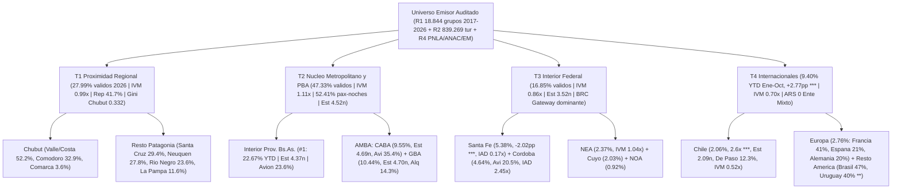

# INFORME TÉCNICO DE DEMANDA N° 5 (`ITD-ESQ-2026-05`)

**Serie Oficial de Perfiles de Demanda Turística — Esquel, Chubut (Patagonia Argentina)**  
**Marco de Certificación:** UN Tourism QUEST (`Q01AM2547AR2026` — *Indicador 1.3.1.b: Perfil y Medición de Demanda Turística*) · PETS Esquel 2030 · `INT-1958/26` · `Res. 27/26`

| Campo Institucional | Especificación Técnica Auditada |
| :--- | :--- |
| **Código de Documento** | `ITD-ESQ-2026-05` (Informe N° 5 — Cierre de la Serie Oficial de Inteligencia de Demanda) |
| **Título Formal** | **Inteligencia Geográfica de Mercados Emisores (`2016–2026`): Proximidad Regional (`Chubut` y `Patagonia`) vs. Extra-Regionales (`AMBA`, `Interior PBA`, `Centro/Federal`) e Internacionales (`Chile`, `Resto América`, `Europa`), Elasticidad Distancia–Estadía y Auditoría Geográfica del Presupuesto Público** |
| **Base Empírica Auditada** | **`18.844` grupos encuestados (`51.613` PAX)** a lo largo de cinco años completos de microdatos `R1` (`2017 n=3.043`, `2018 n=2.961`, `2019 n=3.530`, `2022 n=6.023`, `2026 YTD n=3.287`), integrados con `R2` (`an_origen_mensual`: `839.269` turistas `2016–2025`), `R4` (`PNLA 2025`: `133.282` ingresos, `ANAC`, `metrica-db` y `Ente Mixto`: `ARS 206,01M` devengados en `74` partidas) |
| **Tesis Central y Pivote Estratégico** | La dicotomía clásica "regional vs. extra-regional" oculta una **arquitectura de cuatro velocidades (Tiers `T1–T4`)** con elasticidades opuestas: **`Interior Prov. Bs.As.` (`22,67%` YTD / `26,51%` pax-noches) desplazó a `AMBA` (`19,99%`, `-6,16 pp ***`) como mercado #1 de Esquel**; **`Chubut` (`15,27%` / `17,10%` pax-noches)** opera como el único estabilizador anticíclico real (`Gini 0,332`, `51,4%` repitencia) pese a recibir apenas **`3,51%` del gasto (`IAD 0,21x`)**; y **`T4 Internacional` creció `+2,77 pp (***)` hasta `9,40%` (`Chile 2,6x ***`, `Uruguay 40% **`)** con **`ARS 0` (`0,00%`) de inversión directa del Ente Mixto**, atrapado en estadías cortas (`Chile 2,09n`, `Europa med 2,0n`). |
| **Integración Transversal** | Sintetiza y articula los hallazgos estacionales y de producto de [`ITD-ESQ-01`](file:///C:/Users/agenc/.gemini/antigravity/brain/02781472-1ef7-4c5f-85d4-3cfba2da3692/ITD-ESQ-01_PERFIL_CONSOLIDADO_DEMANDA_2022_2026.md) (Base), [`ITD-ESQ-02`](file:///C:/Users/agenc/.gemini/antigravity/brain/02781472-1ef7-4c5f-85d4-3cfba2da3692/ITD-ESQ-02_PERFIL_DEMANDA_INVIERNO_Y_LA_HOYA_2016_2026.md) (Invierno), [`ITD-ESQ-03`](file:///C:/Users/agenc/.gemini/antigravity/brain/02781472-1ef7-4c5f-85d4-3cfba2da3692/ITD-ESQ-03_PERFIL_DEMANDA_ESTIVAL_RUTERO_Y_PNLA_2016_2026.md) (Verano) e [`ITD-ESQ-04`](file:///C:/Users/agenc/.gemini/antigravity/brain/02781472-1ef7-4c5f-85d4-3cfba2da3692/ITD-ESQ-04_PERFIL_DEMANDA_OTONO_PRIMAVERA_Y_TULIPANES_2016_2026.md) (Otoño/Primavera/Tulipanes). |
| **Fecha de Emisión y Corte** | **11 de noviembre de 2026** *(Cortes verificados: `R1` al `02/11/2026`; `R2` `2016–2025`; `R4` `Ente Mixto` al `02/11/2026`, `ANAC` a `Ago 2026`, `metrica-db` al `11/11/2026`)* |

> [!IMPORTANT]
> **Cláusula de Integridad Probatoria (`UN Tourism QUEST 1.3.1.b`):** Todas las proporciones `R1` se reportan con `IC 95%` (Wilson) y pruebas exactas `Chi2`/`Fisher`/`Welch t`/`Mann-Whitney U` ejecutadas mediante [`analyze_itd05_markets.py`](file:///C:/Users/agenc/.gemini/antigravity/brain/02781472-1ef7-4c5f-85d4-3cfba2da3692/scratch/analyze_itd05_markets.py) y [`verify_math_itd05.py`](file:///C:/Users/agenc/.gemini/antigravity/brain/02781472-1ef7-4c5f-85d4-3cfba2da3692/scratch/verify_math_itd05.py). Para eliminar sesgos de estacionalidad en la comparación `2022 vs 2026`, las pruebas principales se ejecutan en ventana homóloga exacta **`Ene–Oct 2022` (`n=5.655`) vs `Ene–Oct 2026` (`n=3.255`)**, complementadas con el acumulado `YTD` (`n=3.287`).

---

## 1. Ficha Metodológica (`R1–R4`), Taxonomía en 4 Tiers y Auditoría de Reconciliación

### 1.1 Arquitectura de Inteligencia Geográfica en Cuatro Tiers (`14` Sub-Mercados)

### 1.2 Tabla Maestra de Auditoría, Depuración y Reconciliación Geográfica

En cumplimiento de los estándares de transparencia administrativa y estadística (`UN Tourism QUEST 1.3.1.b`), se documentan **seis depuraciones estructurales** aplicadas antes del modelado geográfico:

| # | Anomalía / Sesgo Geográfico Detectado | Régimen / Fuente | Diagnóstico Forense de Causa Raíz | Criterio de Depuración / Regla Aplicada |
| :---: | :--- | :--- | :--- | :--- |
| **1** | **Contaminación `GBA` y `CABA` dentro del código `22` (`Prov. Bs.As.`)** | `R1` (`Perfil_2017–2026`) | En todos los años, decenas de informantes codificaron partidos del Conurbano Bonaerense (`Morón`, `La Matanza`, `Tigre`, `Quilmes`, `Wilde`, etc.) e incluso barrios de `CABA` bajo `prov = 22` (`Interior Prov. Bs.As.`). | Se aplicó [`classify_origin`](file:///C:/Users/agenc/.gemini/antigravity/scratch/esquel_estadisticas/analyze_itd01_cross_tabs.py) con diccionario determinístico de los `24` partidos del GBA y barrios de `CABA`, separando limpiamente `CABA`, `GBA (24 Partidos)` e `Interior Prov. Bs.As.`. |
| **2** | **Inversión de códigos `Córdoba` y `Santa Fe` entre `2017–2019` y `2022–2026`** | `R1` (`Perfil_2017–2019` vs `2022–2026`) | En `2017–2019` el código `4` correspondía a `Córdoba` y `41` a `Santa Fé`; desde `2022` mutó a `3 = Córdoba` y `4/41/42 = Santa Fe`. | Se implementó `detailed_market` sensible al año + resolución por localidad (`Carlos Paz`, `Río Cuarto`, `Rosario`, `Rafaela`), logrando trazabilidad exacta en los cinco años. |
| **3** | **Aumento de `Sin dato` de origen en `2026` (`0,45% -> 7,61%`)** | `R1` (`Perfil_2026.xlsx`) | En `2026`, `250` de `3.287` grupos (`7,61%`, `p < 0,0001 ***`) no registraron provincia/país válido (concentrados en picos de atención rápida como `Octubre`). | Se reportan los porcentajes sobre total crudo (`n=3.287`) en las comparaciones temporales y sobre origen válido (`n=2.962` excl. `Resto del Mundo` y `Sin dato`) para el índice `IVM` y `IAD`, evitando distorsiones. |
| **4** | **Ventana incompleta `2026` (`Ene–02 Nov`) vs `2022` completo (`Ene–Dic`)** | `R1` (`Perfil_2022` vs `Perfil_2026`) | `Noviembre` y `Diciembre` presentan el mayor peso extranjero del año (`14,25%` y `17,01%` en `R2`), por lo que comparar `2026 YTD` contra `2022` completo subestimaría la recuperación internacional. | Todas las pruebas interanuales `2022 vs 2026` se validan en ventana estrictamente homóloga **`Ene–Oct 2022` (`n=5.655`) vs `Ene–Oct 2026` (`n=3.255`)**, confirmando que `T4 Internacional` saltó `+2,77 pp (***)` (vs `+2,00 pp ***` en YTD). |
| **5** | **Omisión de `Enero 2017` en `Perfil_2017.xlsx` y filtro `"0. Argentina"` en `2019`** | `R1` (`Perfil_2017`, `Perfil_2019`) | `Perfil_2017` solo contiene `Feb–Dic` (`n=3.043`); `Perfil_2019` escribe `"0. Argentina"` en celdas de datos. | Se consolidó el trienio prepandemia `2017–2019` (`n=9.534` grupos, `26.494` PAX) con filtro depurado (`0` filas argentinas perdidas en `2019`, `n=3.530`). |
| **6** | **Suficiencia muestral `N*` en sub-mercados pequeños (`2026`)** | `R1` (`Cuyo`, `NEA`, `NOA`, `Chile`, `Europa`, `Resto América`) | Con `IC 95%` (`p=0,5`), `Interior PBA (n=745)` logra `+-3,59 pp` y `Chubut (n=502)` `+-4,37 pp`, mientras `NOA (n=30, +-17,89 pp)`, `Cuyo (n=66, +-12,06 pp)` y `Chile (n=67, +-11,97 pp)` superan `+-10 pp`. | Se reporta el margen exacto de cada mercado y se contrasta `T4 Internacional` contra las fuentes censales `R2` (`an_origen_mensual`) y `R4` (`PNLA 2025`). |

---

## 2. Resumen Ejecutivo y Cuadro de Mando Multi-Mercado (`2017–2026`)

### 2.1 Cinco Hallazgos Geográficos de Alto Impacto Estratégico

1. **Reconfiguración de la Cúspide Emisora — `Interior Prov. Bs.As.` Supera a `AMBA` como Mercado #1:** En el acumulado comparable `Ene–Oct 2022 -> 2026` (`R1`), **`CABA` cayó `-3,07 pp` (`12,59% -> 9,52%`, `p < 0,0001 ***`)** y **`GBA (24 Partidos)` cayó `-3,23 pp` (`13,70% -> 10,48%`, `p < 0,0001 ***`)**, acumulando una erosión metropolitana de **`-6,30 pp` (`26,29% -> 20,00%`)** atribuible directamente a la pinza aérea `BUE↔EQS` documentada en `ITD-ESQ-01..04`. En sentido inverso, **`Interior Prov. Bs.As.` creció hasta `22,67%` YTD (`25,15%` de orígenes válidos; `+1,84 pp *` vs `2022`, `+5,06 pp ***` vs `2017–19`)**, con una expansión notable de su estadía media (**`3,68n -> 4,37n`, `+0,69n`**) y del uso de avión (`14,3% -> 23,6%`), convirtiéndose en el **principal generador individual de volumen de Esquel (`26,51%` de todas las pax-noches, `IVM = 1,05x`)**, liderado por ciudades intermedias del interior (`81,5%`, `+7,39 pp ***`), `Bahía Blanca (7,8%)` y `La Plata (7,5%)`.
2. **`Chubut` es el Único Amortiguador Anticíclico del Destino (`Gini 0,332`, `51,4%` Repitencia) pero Sufre Subinversión Crónica (`IAD 0,21x`):** Mientras todos los mercados extra-regionales concentran sus viajes con alta estacionalidad (`Gini 0,51–0,62`), **`Chubut` registra el índice de concentración mensual más bajo de toda la matriz (`Gini = 0,332` en `2026`, mejorando desde `0,408` en `2022`)**, distribuyendo sus arribos entre Verano (`46,3%`), Invierno (`24,8%`) y Otoño (`17,8%`, sosteniendo el `51,0%` de Semana Santa 2026). Con **`17,10%` de las pax-noches (`IVM = 1,01x`, `3,79n`, `2,77 pax`)** y una **repitencia récord del `51,4%`** (traccionada por `Valle y Costa PMY/REL/RAW 52,2%` y `Comodoro + Rada Tilly 32,9%`), el Ente Mixto le asignó apenas **`ARS 7,24M` (`3,51%` de `GAS`, `IAD = 0,21x`)** —cinco veces por debajo de su contribución real al destino.
3. **Expansión Internacional Silenciosa (`+2,77 pp ***`) con `ARS 0` de Inversión Pública (`IAD = 0,00x`):** En ventana homóloga `Ene–Oct`, **`T4 Internacional` saltó de `6,63%` (`2022`) a `9,40%` (`2026`, `p < 0,0001 ***`)**, impulsado por el rebote de **`Chile` (`0,78% -> 2,06%`, `2,6x`, `p < 0,0001 ***`)**, **`Resto del Mundo` (`1,24% -> 2,30%`, `p = 0,0001 ***`)**, **`Uruguay` (`22,45% -> 40,00%` de Resto América, `p = 0,0061 **`)** y la consolidación de **`Europa` (`2,76%`: `Francia 41,1%`, `España 21,1%`, `Alemania 20,0%`, `Suiza 10,0%`, `Italia 7,8%`)**. En `R2` multianual (`an_origen_mensual`), los extranjeros promedian **`9,57%` anual (`80.335` turistas)** con picos contracíclicos en **Diciembre (`17,01%`), Noviembre (`14,25%`), Mayo (`13,36%`) y Febrero (`12,56%`)**. Pese a ello, el Ente Mixto ejecutó **`ARS 0,00` (`0,00%`)** en promoción internacional y Esquel fracasa en retenerlos: **`Chile` promedia solo `2,09n` (`12,3% De Paso`, `IVM 0,52x`)** y **`Europa` tiene mediana de `2,0n` (`IVM 0,69x`)**.
4. **Ley de Decaimiento Distancia–Repitencia (`r = -0,875 ***`) y Fractura del Interior Federal (`T3`):** Dentro de Argentina, la fidelidad cae de forma fuertemente lineal con la distancia logarítmica (**`r = -0,875`, `p = 0,0009 ***`**: `Chubut 51,4% -> Resto Patagonia 26,9% -> GBA 19,1% -> Interior PBA 15,7% -> CABA 15,4% -> Santa Fe 14,5% -> Córdoba 11,6% -> NOA 7,1%`). En cambio, la estadía no crece monotónicamente con la distancia doméstica (`r = 0,182 ns`): alcanza un **techo en `T2 Metropolitano/PBA` (`4,52n`, `Welch & MWU p < 0,0001 ***` vs `T1 3,69n` y `T4 3,17n`)**, pero **cae en `T3 Interior Federal` (`3,52n`: `Santa Fe 3,36n`, `Cuyo 3,19n`, `Córdoba 3,70n`)** porque estos viajeros ingresan mayoritariamente en modalidad circuito rutero desde **`Bariloche / El Bolsón`** (`60` de `Santa Fe` y `38` de `Córdoba`), destinando menos noches a Esquel.
5. **Contraste de Gestión en el Centro (`Córdoba IAD 2,45x` vs `Santa Fe IAD 0,17x`) y Eje `Bariloche` como Puerta Universal:** El Ente Mixto invirtió **`ARS 22,04M` (`10,70% GAS`, `IAD = 2,45x`)** en **`Plaza Córdoba`** —logrando un salto modal histórico en **`Avión` de `7,6%` (`2022`) a `20,5%` (`2026`)** y alargando la estadía cordobesa de `3,16n` a `3,70n`—, pero destinó solo **`ARS 1,71M` (`0,83% GAS`, `1` partida, `IAD = 0,17x`)** a **`Rosario / Santa Fe`**, plaza que se contrajo **`-2,02 pp` (`7,39% -> 5,38%`, `p = 0,0002 ***`)** pese a haber aportado el `10,71%` de octubre en `2022`. A nivel de corredores, **`Bariloche / El Bolsón (RN 40 Norte)`** es el nodo #1 de entrada/salida para **`Resto Patagonia`, `Córdoba`, `Santa Fe`, `Resto América` y `Europa`**, y el #2 para `CABA`, `GBA`, `Interior PBA` y `Chile`, confirmando la urgencia de estrategias de intercepción en ruta y en `BRC`.

### 2.2 Evolución Estructural de los Cuatro Tiers (`R1`: `2017–2019` vs `2022` vs `2026`)

| Tier Geográfico (`R1`) | `2017–2019` (`n=9.534`) | `2022` (`Ene–Oct`, `n=5.655`) | **`2026` (`Ene–Oct`, `n=3.255`)** | Var. `22 -> 26` (`Ene–Oct`, `p-value`) | Cuota Pax-Noches `2026` (`IVM`) |
| :--- | :---: | :---: | :---: | :---: | :---: |
| **`T1 — Proximidad Regional`** (`Chubut` + `Resto Pat.`) | `30,65%` `[29,7;31,6]` | `26,40%` `[25,3;27,6]` | **`25,28%`** `[23,8;26,8]` | `-1,12 pp` (`ns`; `-5,43 pp ***` vs `17–19`) | **`27,57%`** (`0,99x`) |
| **`T2 — Metropolitano y PBA`** (`CABA` + `GBA` + `Int PBA`) | `41,92%` `[40,9;42,9]` | `47,14%` `[45,8;48,4]` | **`42,43%`** `[40,7;44,1]` | **`-4,72 pp` (`p < 0,0001 ***`)** | **`52,41%`** (**`1,11x`**) |
| **`T3 — Interior Federal`** (`Cba` + `SF` + `Cuyo` + `NEA` + `NOA`) | `13,59%` `[12,9;14,3]` | `19,36%` `[18,4;20,4]` | **`15,33%`** `[14,1;16,6]` | **`-4,03 pp` (`p < 0,0001 ***`)** | `14,52%` (`0,86x`) |
| **`T4 — Internacional`** (`Chile` + `R.Amér` + `Europa` + `R.Mundo`) | `11,37%` `[10,7;12,0]` | `6,63%` `[6,0;7,3]` | **`9,40%`** `[8,4;10,5]` | **`+2,77 pp` (`p < 0,0001 ***`)** | `5,50%` (`0,70x`, excl. R.Mundo) |
| **`Sin dato` de origen** | `2,46%` `[2,2;2,8]` | `0,46%` `[0,3;0,7]` | **`7,56%`** `[6,7;8,5]` | **`+7,10 pp` (`p < 0,0001 ***`)** | Excluido de `IVM` |

---

## 3. Radiografía Comparada de los `14` Sub-Mercados (`R1 2022` vs `2026`)

### 3.1 Matriz Conductual, Estadía, Acceso Modal y Valor de Mercado (`2026 YTD`)

| Mercado Emisor (`Tier`) | `n` (`2026`) · `ME 95%` | Var. `22->26` (`Ene–Oct`) | Estadía `1+n` (`IC 95%` / `Med`) | `% >=5n` / `% Paso` | `PAX` / `Tags` | `Auto` / `Avión` / `Alq` / `Bus` / `MH` (`%`) | `Cabaña` / `Hotel+` (`%`) | Repitencia (`%`) | `IVM` (`% Pax-N`) |
| :--- | :---: | :---: | :---: | :---: | :---: | :---: | :---: | :---: | :---: |
| **`Chubut`** (`T1`) | `502` (`+-4,4 pp`) | `+1,20 pp` (`ns`) | `3,79 +- 0,25n` (`3,0`) | `23,4%` / `5,1%` | `2,77` / `3,03` | `85,1 / 0,6 / 1,4 / 9,0 / 0,8` | `27,1 / 15,3` | **`51,4%`** | **`1,01x`** (`17,1%`) |
| **`Resto Patagonia`** (`T1`) | `327` (`+-5,4 pp`) | **`-2,32 pp ***`** | `3,52 +- 0,25n` (`3,0`) | `23,3%` / `5,4%` | `2,81` / `3,04` | `82,6 / 0,6 / 2,4 / 6,4 / 3,7` | `30,3 / 16,2` | `26,9%` | `0,95x` (`10,5%`) |
| **`CABA`** (`T2`) | `314` (`+-5,5 pp`) | **`-3,07 pp ***`** | **`4,69 +- 0,45n`** (`4,0`) | **`38,8%`** / `5,6%` | `2,61` / **`3,49`** | `40,4 / 35,4 / 9,6 / 6,4 / 1,9` | `24,8 / 19,7` | `15,4%` | **`1,17x`** (`12,4%`) |
| **`GBA (24 Part.)`** (`T2`) | `343` (`+-5,3 pp`) | **`-3,23 pp ***`** | **`4,70 +- 0,42n`** (`4,0`) | **`41,3%`** / `2,1%` | `2,50` / `3,36` | `53,1 / 20,1 / 14,3 / 6,4 / 1,5` | `26,5 / 26,2` | `19,1%` | **`1,17x`** (`13,5%`) |
| **`Interior PBA`** (`T2`) | **`745`** (`+-3,6 pp`) | `+1,58 pp` (`* YTD`) | **`4,37 +- 0,24n`** (`4,0`) | **`34,0%`** / `3,6%` | `2,47` / **`3,47`** | `56,6 / 23,6 / 8,1 / 3,6 / 2,7` | `27,7 / 18,5` | `15,7%` | **`1,05x`** (**`26,5%`**) |
| **`Córdoba`** (`T3`) | `151` (`+-8,0 pp`) | `-0,68 pp` (`ns`) | `3,70 +- 0,49n` (`3,0`) | `22,8%` / `4,7%` | `2,40` / `3,27` | `62,9 / 20,5 / 5,3 / 5,3 / 3,3` | `25,8 / 17,2` | `11,6%` | `0,86x` (`4,4%`) |
| **`Santa Fe`** (`T3`) | `175` (`+-7,4 pp`) | **`-2,02 pp ***`** | `3,36 +- 0,29n` (`3,0`) | `19,0%` / `1,7%` | `2,44` / `3,37` | `62,3 / 13,1 / 10,3 / 4,6 / 5,1` | `26,3 / 19,4` | `14,5%` | `0,82x` (`4,8%`) |
| **`Cuyo`** (`T3`) | `66` (`+-12,1 pp`) | `-0,41 pp` (`ns`) | `3,19 +- 0,42n` (`3,0`) | `16,1%` / `0,0%` | `2,36` / `3,12` | `77,3 / 3,0 / 3,0 / 4,5 / 3,0` | `25,8 / 13,6` | `11,3%` | `0,76x` (`1,7%`) |
| **`NEA`** (`T3`) | `77` (`+-11,2 pp`) | **`-0,78 pp *`** | `3,64 +- 0,44n` (`3,0`) | `32,9%` / `4,1%` | **`2,95`** / `3,45` | `63,6 / 10,4 / 11,7 / 3,9 / 6,5` | `18,2 / 18,2` | `21,6%` | **`1,04x`** (`2,7%`) |
| **`NOA`** (`T3`) | `30` (`+-17,9 pp`) | `-0,14 pp` (`ns`) | `4,00 +- 1,04n` (`3,0`) | `29,6%` / `6,9%` | `2,40` / `3,30` | `50,0 / 13,3 / 10,0 / 6,7 / 3,3` | `20,0 / 20,0` | `7,1%` | `0,91x` (`0,9%`) |
| **`Chile`** (`T4`) | `67` (`+-12,0 pp`) | **`+1,28 pp ***`** | **`2,09 +- 0,38n`** (`2,0`) | **`3,6%`** / **`12,3%`** | `2,79` / `2,57` | `77,6 / 0,0 / 3,0 / 7,5 / 4,5` | `20,9 / 25,4` | `21,2%` | **`0,52x`** (`1,2%`) |
| **`Resto América`** (`T4`) | `75` (`+-11,3 pp`) | `-0,08 pp` (`ns`) | `3,63 +- 0,57n` (`3,0`) | `22,1%` / `6,8%` | `2,55` / `3,13` | `48,0 / 13,3 / 18,7 / 5,3 / 5,3` | `14,7 / 29,3` | `5,5%` | `0,87x` (`2,2%`) |
| **`Europa`** (`T4`) | `90` (`+-10,3 pp`) | `+0,50 pp` (`ns`) | `3,77 +- 1,06n` (`2,0`) | `13,1%` / `1,1%` | **`1,84`** / `2,52` | `20,0 / 12,2 / 18,9 / 32,2 / 5,6` | `5,6 / 30,0` | `7,1%` | **`0,69x`** (`2,1%`) |

### 3.2 Pruebas de Contraste Inter-Tier (`2026 YTD`) y Desagregación Intra-Regional

Las diferencias estructurales entre tiers alcanzan máxima significación estadística (`p < 0,0001 ***`):

- **`T1 Proximidad` vs `T2 Metropolitano/PBA`:** Estadía **`3,69n` vs `4,52n`** (`Welch & MWU p < 0,0001 ***`), Repitencia **`41,7%` vs `16,5%`** (`p < 0,0001 ***`), Avión **`0,6%` vs `25,4%`** (`p < 0,0001 ***`).
- **`T2 Metropolitano/PBA` vs `T4 Internacional`:** Estadía **`4,52n` vs `3,17n`** (`Welch & MWU p < 0,0001 ***`), Repitencia **`16,5%` vs `9,8%`** (`p = 0,0039 **`), Avión **`25,4%` vs `9,1%`** (`p < 0,0001 ***`).
- **`T1 Proximidad` vs `T3 Interior Federal`:** Estadía estadísticamente indistinguible (`3,69n` vs `3,52n`, `Welch p = 0,2345 ns`), pero `T1` triplica la repitencia (`41,7%` vs `13,9%`, `p < 0,0001 ***`) y `T3` multiplica por `22x` el acceso aéreo (`13,6%` vs `0,6%`, `p < 0,0001 ***`).

**Sub-polos clave dentro de cada macro-mercado (`2022 -> 2026`):**
1. **`Chubut` (`n=502`):** Dominado por **`Valle y Costa (PMY/REL/RAW)` con `52,19%`** y **`Comodoro + Rada Tilly` con `32,87%`**, seguidos por `Sarmiento/Meseta (4,38%)` y **`Comarca Andina / Cordillera` (`1,20% -> 3,59%`, `p = 0,0032 **`)**.
2. **`Resto Patagonia` (`n=327`):** Balanceado en tres pilares: **`Santa Cruz (29,36%)`**, **`Neuquén (27,83%)`** y **`Río Negro (23,55%)`**, más **`La Pampa (11,62%)`** y **`Tierra del Fuego (7,65%)`**.
3. **`Interior Prov. Bs.As.` (`n=745`):** Fuerte desconcentración hacia ciudades del interior bonaerense (**`Resto Int. PBA`: `74,08% -> 81,48%`, `+7,39 pp`, `p = 0,0002 ***`**), con retroceso relativo de `La Plata` (`12,28% -> 7,52%`, `p = 0,0008 ***`) y `Mar del Plata` (`6,38% -> 3,22%`, `p = 0,0021 **`), y estabilidad de `Bahía Blanca` (`7,79%`).
4. **`Europa` (`n=90`) y `Resto América` (`n=75`):** En Europa lidera **`Francia (41,11%)`**, seguido por **`España (21,11%)`**, **`Alemania (20,00%, +7,95 pp)`**, **`Suiza (10,00%)`** e **`Italia (7,78%)`**. En Resto América, **`Brasil` mantiene el `#1` (`46,67%`)** pero **`Uruguay` casi se duplicó (`22,45% -> 40,00%`, `+17,55 pp`, `p = 0,0061 **`)**.

---

## 4. Estacionalidad Diferencial (`Gini` por Origen) y Reconciliación `R2` / `R4`

### 4.1 Perfil Estacional y Concentración Mensual (`Gini`) por Mercado (`R1`)

Cada emisor cumple un rol distinto en la curva anual de Esquel; confundirlos bajo campañas genéricas desperdicia presupuesto:

| Mercado Emisor | `Gini 2022` (`12m`) | **`Gini 2026` (`Ene–Oct`)** | Pico Mensual `2026` | Distribución Estacional Propia `2026` (`Ver` / `Oto` / `Inv` / `Pri`) | Rol Estacional Estratégico en el Destino |
| :--- | :---: | :---: | :---: | :---: | :--- |
| **`Chubut`** | `0,408` | **`0,332`** *(mínimo)* | `Ene` (`103`) *(22: `Jul`)* | **`46,3%` / `17,8%` / `24,8%` / `11,0%`** | **Estabilizador anticíclico #1** (sostiene Otoño, SS e Invierno) |
| **`Resto América`** | `0,261` | `0,449` | `Ene` (`20`) | `54,1%` / `10,8%` / `16,2%` / `18,9%` | Demanda balanceada (Brasil invierno + Uruguay verano/primavera) |
| **`Resto Patagonia`** | `0,472` | `0,478` | `Ene` (`108`) | `59,3%` / `14,5%` / `8,6%` / `17,6%` | Rutero regional estival + escapadas de Otoño y FDL Oct |
| **`CABA`** | `0,424` | `0,514` | **`Oct` (`87`)** *(superó Ene)* | `52,3%` / `5,8%` / `13,9%` / **`28,1%`** | **Bimodal aéreo (`Verano + Tulipanes Oct`); ausente en Otoño** |
| **`Córdoba`** | `0,538` | `0,519` | `Ene` (`48`) | `56,3%` / `11,9%` / `7,9%` / **`23,8%`** | Fuerte en Verano y **Octubre (`AR1820`)**; rebote en Otoño |
| **`Santa Fe`** | `0,495` | `0,527` | `Ene` (`47`) | `56,0%` / `9,1%` / `8,0%` / **`26,9%`** | Históricamente clave en **Octubre/Tulipanes** (en erosión `22->26`) |
| **`Interior PBA`** | `0,491` | `0,530` | `Ene` (`240`) | `58,8%` / `8,6%` / `9,3%` / **`23,3%`** | **Columna vertebral masiva de Verano y Tulipanes** (`#1` anual) |
| **`Chile`** | `0,284` | `0,557` | **`Feb` (`27`)** | **`76,1%`** / `13,4%` / `7,5%` / `3,0%` | **Explosión estival transandina (`Feb` paso Futaleufú)** |
| **`GBA (24 Part.)`** | `0,485` | `0,562` | `Ene` (`142`) | `61,9%` / `7,3%` / `11,1%` / `19,6%` | Alta estadía (`4,70n`) y **`Fly & Drive` (`14,3%`)** en picos |
| **`Europa`** | `0,382` | **`0,616`** | `Ene` (`35`) | **`82,2%`** / `11,1%` / `3,3%` / `3,3%` | **Concentración estival-austral (`Nov–Mar`)**; sin datos Nov–Dic aún |
| **`Cuyo`** | `0,595` | **`0,621`** *(máximo)* | `Ene` (`20`) | `68,2%` / `6,1%` / `0,0%` / `25,8%` | Hiper-estacional (Verano + Tulipanes; cero presencia invernal) |

### 4.2 Reconciliación Censal: `R2` (`an_origen_mensual`) y `R4` (`PN Los Alerces 2025`)

- **Bipolaridad Internacional en `R2` (`2016–2025`, `839.269` turistas):** Los extranjeros representan el **`9,57%`** acumulado (`80.335` turistas), distribuidos en **Verano `Ene–Mar` (`39,41%` de todos los extranjeros del año; `Feb` índice `205,5`)**, **Primavera `Oct–Dic` (`30,05%`; `Nov` `14,25%` / índice `154,4`, `Dic` `17,01%` / índice `130,3`, mientras `Oct` es el mínimo anual con `4,42%`)**, **Invierno `Jul–Sep` (`17,29%`; `Sep` `11,82%`)** y **Otoño `Abr–Jun` (`13,26%`; `May` `13,36%`, `Abr` `11,12%`)**. Esto explica por qué la promoción internacional es un **instrumento contracíclico** que llena `Noviembre`, `Diciembre`, `Febrero` y `Abril–Mayo` sin competir por camas en `Octubre` ni `Julio`.
- **Validación Censal en `PN Los Alerces` (`2025`, `133.282` registros):** `Residente Nacional / Flexipass` (`46.166`, `34,6%`), `Residente Local Esquel/Trevelin` (`39.125`, `29,3%`), `Residente Provincial Chubut` (`18.548`, `13,9%`), `Jubilados/Pensionados` (`17.178`, `12,9%`) y `General / Extranjeros` (`4.595`, `3,4%`). La convergencia entre el peso provincial en `PNLA` (`13,9%`, o `19,7%` excluyendo residentes locales) y `Chubut` en `R1` (`15,3%`) valida la robustez de la arquitectura multi-régimen.

---

## 5. Modelado Econométrico: Elasticidad Distancia–Estadía, Topología de Corredores y `IAD`

### 5.1 Curvas de Elasticidad Distancia–Estadía y Distancia–Repitencia (`2026`)

Se estimaron las elasticidades log-lineales sobre la matriz `2026` relacionando distancia terrestre aproximada (`km` hasta Esquel), estadía media (`1+n`) y tasa de repitencia:

$$
\ln(\text{Estadia}_{m}) = \alpha + \beta \cdot \ln(\text{Dist}_{m}) + \varepsilon_{m}, \qquad \text{IVM}_{m} = \frac{\text{Share\_PaxNoches}_{m}}{\text{Share\_Grupos}_{m}}, \qquad \text{IAD}_{m} = \frac{\text{Share\_GAS}_{m}}{\text{Share\_PaxNoches}_{m}}
$$

1. **Ley de Decaimiento de Repitencia con la Distancia (Domésticos, `10` mercados):** **`r = -0,875` (`p = 0,0009 ***`)** (`Spearman rho = -0,505`). La repetición cae drásticamente al cruzar la barrera de los `1.000 km`: **`Chubut (51,4%)` y `Resto Patagonia (26,9%)`** funcionan como mercados de fidelidad recurrente (donde el CRM y la agenda de eventos rinden retorno inmediato), mientras **`T2` (`15,4%–19,1%`), `T3` (`7,1%–21,6%`) y `T4` (`5,5%–7,1%`, exc. `Chile 21,2%`)** son mercados de adquisición de **primera visita (`>80%`)**.
2. **Elasticidad Distancia–Estadía Quebrada por el Efecto Corredor:** Al incluir **`Chile` (`~250 km`, `2,09n`)** junto a los `10` mercados argentinos, la elasticidad resulta positiva y significativa (**`r = +0,685`, `p = 0,0201 *`, `beta = +0,214`**). Sin embargo, **dentro de Argentina (`10` mercados), la correlación se aplana (`r = +0,182`, `p = 0,6154 ns`, `beta = +0,049`)**: los mercados del corredor **`AMBA` (`4,69–4,70n`) e `Interior PBA` (`4,37n`)** —que eligen Esquel como destino principal vía `Bs.As. Directo` o `Avión (20%–35%)`— permanecen **`+0,8` a `+1,3` noches más** que mercados igualmente distantes o más lejanos del Interior Federal (`Córdoba 3,70n`, `Santa Fe 3,36n`, `Cuyo 3,19n`), quienes utilizan Esquel como **escala intermedia de ruta**.

### 5.2 Topología de Corredores (`corr_orig` -> `Esquel` -> `corr_dest`) y Consumo por Mercado (`2026`)

| Mercado (`2026`) | Puerta de Entrada #1 y #2 (`corr_orig`) | Salida #1 y #2 (`corr_dest`) | Consumo Diferencial (`PNLA` / `Trochita` / `Trek` / `Ski` / `Trevelin`) |
| :--- | :--- | :--- | :--- |
| **`Chubut`** | `Comodoro (109)` · `Pto. Madryn (102)` | `Comodoro (100)` · `Pto. Madryn (97)` | **`Esquí #1 (21,6%)`**, `PNLA 79,4%`, `La Zeta 78,4%`, `Trochita 41,2%` |
| **`Resto Patagonia`** | **`BRC / Bolsón (82)`** · `Santa Cruz (53)` | **`BRC / Bolsón (93)`** · `Otra Prov. (51)` | **`La Zeta 85,5%`**, `Trekking 59,1%`, `Trevelin 25,5%`, `Pesca 3,2%` |
| **`CABA`** | **`Bs.As. Directo (133)`** · `BRC/Bolsón (78)` | **`Bs.As. Directo (131)`** · `BRC/Bolsón (87)` | **`PNLA 90,5%`**, **`Trekking #1 (67,0%)`**, `Trochita 48,6%`, `Esquí 12,8%`, `Tulipanes 10,1%` |
| **`GBA (24 Part.)`** | **`Bs.As. Directo (103)`** · `BRC/Bolsón (94)` | **`Bs.As. Directo (109)`** · `BRC/Bolsón (97)` | `PNLA 88,8%`, `Trochita 49,4%`, **`Tulipanes #1 (12,0%)`**, **`Alquiler Auto 14,3%`** |
| **`Interior PBA`** | **`Bs.As. Directo (210)`** · `BRC/Bolsón (186)` | **`BRC / Bolsón (237)`** · `Bs.As. Directo (214)` | **`PNLA 90,3%`**, **`Trochita #1 (49,5%)`**, **`Trevelin #1 (37,0%)`**, `Trekking 60,0%` |
| **`Córdoba`** | **`BRC / Bolsón (38)`** · `Bs.As. (15)` / `Cba Dir (15)` | **`BRC / Bolsón (46)`** · `Cba Dir (15)` | **`PNLA #1 (96,6%)`**, `La Zeta 83,1%`, `Tulipanes 10,1%`, `Viñedos 4,5%`, **`Avión 20,5%`** |
| **`Santa Fe`** | **`BRC / Bolsón (60)`** · `Bs.As. Directo (31)` | **`BRC / Bolsón (58)`** · `Bs.As. Directo (31)` | **`PNLA 93,4%`**, **`La Zeta #1 (88,4%)`**, **`Trevelin 34,7%`**, `Alquiler 10,3%`, `MH 5,1%` |
| **`Chile`** | **`Chile / Futaleufú (34)`** · `BRC/Bolsón (17)` | **`Chile (23)`** · **`BRC / Bolsón (22)`** | `La Zeta 83,3%`, `PNLA 69,0%`, `Trochita 26,2%` *(corredor binacional de tránsito rápido)* |
| **`Resto América`** | **`BRC / Bolsón (26)`** · `Santa Cruz (11)` | **`BRC / Bolsón (28)`** · `Bs.As. Directo (10)` | `PNLA 88,5%`, `Trochita 46,2%`, **`Viñedos #1 (7,7%)`**, **`Alquiler 18,7%`**, `Hotel 29,3%` |
| **`Europa`** | **`BRC / Bolsón (21)`** · `Santa Cruz (14)` · `Chile (10)` | **`BRC / Bolsón (30)`** · `Bs.As. Directo (11)` | `PNLA 84,6%`, `Trekking 52,3%`, `Trochita 16,9%`, **`Bus 32,2%`**, **`Alquiler 18,9%`**, **`Hotel 30,0%`** |

### 5.3 Auditoría Geográfica del `Ente Mixto` (`vps_em_utf8.txt`): Índice de Desalineación (`IAD`)

Al cruzar las **`74` partidas devengadas positivas (`ARS 206,01M` en `GAS`)** del Ente Mixto clasificadas por plaza geográfica objetivo contra la participación real de cada mercado en **grupos (`2026`)** y **pax-noches (`IVM`)**, aflora un desajuste presupuestario estructural:

| Plaza / Eje Geográfico (`Ente Mixto GAS`) | Partidas (`n`) | Devengado (`ARS`) | Cuota `GAS` (`%`) | Cuota Pax-Noches `2026` (`%`) | Índice `IAD` (`GAS / PaxN`) | Diagnóstico de Eficiencia Asignativa |
| :--- | :---: | :---: | :---: | :---: | :---: | :--- |
| **`Nacional / AMBA / Digital Masivo`** *(Estudio 1640, Epikoy, La 100, ESPN, TVP)* | `14` | `ARS 97,51M` | `47,33%` | `52,41%` (`T2`) | **`0,90x`** | Proporcional al volumen `T2`, pero **sin discriminación entre `AMBA` (en caída `-6,3 pp`) e `Interior PBA` (`#1` en auge)** |
| **`Plaza Córdoba`** *(Aeropuerto COR, Vía Pública, Evento, Fam)* | `7` | `ARS 22,04M` | `10,70%` | `4,37%` | **`2,45x`** | **Sobreinversión táctica** justificada solo en ventanas activas del vuelo `AR1820` (`Avión 7,6% -> 20,5%`) |
| **`Proximidad Resto Patagonia`** *(Diario Río Negro / Regional)* | `4` | `ARS 17,82M` | `8,65%` | `10,46%` | **`0,83x`** | Cobertura razonable en Río Negro/Neuquén, pero sin pauta específica en **`Santa Cruz` (`29,4%` de Resto Pat.)** |
| **`Proximidad Chubut`** *(LU17, Canal 12, ADNSUR, Comodoro)* | `6` | **`ARS 7,24M`** | **`3,51%`** | **`17,10%`** | **`0,21x`** | **Subinversión severa (`5x`)** en el único mercado anticíclico (`Gini 0,332`, `51,4%` repitencia, `51%` de `SS 2026`) |
| **`Plaza Rosario / Santa Fe`** | `1` | **`ARS 1,71M`** | **`0,83%`** | **`4,82%`** | **`0,17x`** | **Abandono comercial (`6x` subinvertido)** coincidente con la contracción `-2,02 pp ***` de Santa Fe (`2022->2026`) |
| **`Mercados Internacionales`** (`Chile`, `Uruguay`, `Brasil`, `Europa`) | **`0`** | **`ARS 0,00`** | **`0,00%`** | **`5,50%`** (`9,4%` grp) | **`0,00x`** | **Punto ciego absoluto (`0%`)** frente al único tier en expansión estadísticamente significativa (`+2,77 pp ***`) |
| **`Local / Eventos / Producción / Institucional`** | `42` | `ARS 59,69M` | `28,98%` | — | — | Gasto operativo y eventos locales (`77,1%` de pedidos sin rendición de origen/impacto) |

---

## 6. Matriz FODA Cuantificada de Posicionamiento Multi-Mercado (`2016–2026`)

| Dimensión | Eje | Factores Cuantificados y Trazabilidad (`R1–R4`) |
| :--- | :---: | :--- |
| **FORTALEZAS** | `F1` | **Liderazgo masivo y de alto valor en `Interior Prov. Bs.As.` (`#1`, `26,51%` pax-noches, `4,37n`, `IVM 1,05x`)** y alta estadía del núcleo `AMBA` (`CABA 4,69n`, `GBA 4,70n`, `IVM 1,17x`). |
| **FORTALEZAS** | `F2` | **Fidelidad estructural de `Chubut` (`51,4%` repitencia, `Gini 0,332`, `17,10%` pax-noches)** que amortigua caídas de otoño (`17,8%`) e invierno (`24,8%`). |
| **FORTALEZAS** | `F3` | **Demanda internacional en expansión orgánica (`T4 +2,77 pp ***` a `9,40%` `Ene–Oct`)** y contracíclica (`Nov 14,25%`, `Dic 17,01%`, `May 13,36%`), con rebote de `Chile (2,6x ***)` y `Uruguay (40% **)`. |
| **DEBILIDADES** | `D1` | **Desalineación extrema del presupuesto del Ente Mixto**: `Internacional 0,00x`, `Santa Fe 0,17x`, `Chubut 0,21x` vs `Córdoba 2,45x`. |
| **DEBILIDADES** | `D2` | **Baja retención nocturna en circuitos ruteros e internacionales**: `Chile 2,09n` (`12,3% De Paso`, `IVM 0,52x`), `Europa med 2,0n` (`IVM 0,69x`), `Cuyo 3,19n` y `Santa Fe 3,36n`. |
| **DEBILIDADES** | `D3` | **Erosión de calidad estadística `R1` (`Sin dato` saltó `0,46% -> 7,56% ***`)** y apagón de captura CRM (`Email <10%`), impidiendo activar marketing directo sobre el `51,4%` de repitentes de Chubut. |
| **OPORTUNIDADES** | `O1` | **Interceptar la "Puerta Universal `BRC/Bolsón`" (`Fly & Drive`: `Europa 18,9%`, `R.América 18,7%`, `GBA 14,3%`, `NEA 11,7%`, `Santa Fe 10,3%`)** con pauta geolocalizada en `BRC` y `RN 40` para sumar `+1` noche a ruteros. |
| **OPORTUNIDADES** | `O2` | **Convertir el flujo chileno transandino (`Futaleufú`, `2,6x ***`) de `2,09n` a `3+` noches** mediante campañas binacionales de compras/gastronomía/nieve y paquetes `Hotel + La Trochita + PNLA`. |
| **OPORTUNIDADES** | `O3` | **Rebalancear pauta hacia `Santa Fe / Rosario` (recuperar `-2,02 pp ***`), `Santa Cruz` (`29,4%` de Resto Patagonia) y `Uruguay / Brasil` (`86,7%` de Resto América)** en ventanas `Nov–Mar` y `Oct`. |
| **AMENAZAS** | `A1` | **Erosión acelerada de `AMBA` (`CABA -3,07 pp ***`, `GBA -3,23 pp ***`)** por tarifas monopolísticas `BUE↔EQS` (`2x–3,2x` vs `BRC`), poniendo en riesgo el segmento de mayor `IVM` (`1,17x`). |
| **AMENAZAS** | `A2` | **Pérdida de mercados federales por falta de pauta y conectividad directa (`Santa Fe -2,02 pp ***`, `NEA -0,78 pp *`, `Resto Patagonia -2,32 pp ***`)**. |
| **AMENAZAS** | `A3` | **Subestimación de mercados internacionales y *lodges*** por falta de pauta dedicada y baja cobertura `R1/R3` fuera del verano. |

---

## 7. Estrategia de Portafolio Multi-Mercado y Hoja de Ruta `PETS 2030` / `QUEST`

Para cerrar la brecha entre la demanda real auditada y la inversión pública, se establece una **arquitectura de asignación presupuestaria en cuatro carteras diferenciadas**, alineada con el **Indicador `1.3.1.b` de UN Tourism QUEST**:

| Cartera Estratégica | Mercados Objetivo | Meta Cuantitativa (`2027–2028`) | Palanca Comercial, Conectividad y Presupuesto Sugerido |
| :--- | :--- | :--- | :--- |
| **1. Cartera "Defensa de Valor y Frecuencia"** (`T2`) | **`Interior Prov. Bs.As.`** (`#1`: `26,5%` pax-n) + **`CABA / GBA`** (`IVM 1,17x`, `-6,3 pp ***`) | Frenar caída `AMBA` (`>=23%`), sostener `Int PBA >=24%` y `Est >=4,5n` | Segmentar pauta digital `Estudio 1640` separando ciudades del **Interior Bonaerense** (`Bahía Blanca`, `La Plata`, corredor `RN 3/RN 22`) del mensaje `AMBA` (enfocado en **romper el monopolio `BUE↔EQS`**, *early booking* aéreo y `Fly & Drive` vía `BRC`). |
| **2. Cartera "Estabilizador Anticíclico y Fidelidad"** (`T1`) | **`Chubut`** (`Valle/Costa 52%`, `Comodoro 33%`) + **`Santa Cruz` / `Neuquén` / `Río Negro`** | Elevar `IAD Chubut` de `0,21x -> >=0,60x` (`10%–12% GAS`), rescatar `SS` (`45% -> >=65% UF`) | Crear el **Club de Beneficios Patagónicos (CRM)** aprovechando el `51,4%` de repitencia de Chubut; pauta permanente en `Comodoro`, `Trelew/Madryn` y **`Santa Cruz` (hoy sin pauta específica)** para traccionar **Otoño (`Abr–Jun`), Semana Santa e Invierno**. |
| **3. Cartera "Recuperación Federal y Puerta `BRC`"** (`T3`) | **`Santa Fe / Rosario`** (`IAD 0,17x`, `-2,02 pp ***`) + **`Córdoba`** (`AR1820`, `IAD 2,45x`) + **`NEA`** (`IVM 1,04x`) | Rebalancear `Santa Fe` (`0,8% -> 5% GAS`), elevar estadía `T3` de `3,52n -> 4,0n` | Reasignar excedentes de pauta `Córdoba` fuera de ventana aérea (`Ene–May`) hacia **`Rosario / Santa Fe`** en **`Ago–Oct` (Tulipanes)** y **`Nov–Feb` (Verano)**, más campañas de intercepción en **`Aeropuerto BRC` y `El Bolsón`** (puerta #1 de `Córdoba`, `Santa Fe` y `NEA`). |
| **4. Cartera "Despegue Internacional y Retención"** (`T4`) | **`Chile`** (`Futaleufú`, `2,6x ***`) + **`Uruguay / Brasil`** (`87%` R.Amér) + **`Francia / España / Alemania`** (`82%` Europa) | Crear partida internacional dedicada (`0% -> 8%–10% GAS`); subir `Chile` de `2,09n -> 3,0n` y `Europa` med `2,0n -> 3,0n` | Campaña binacional `Futaleufú–Chaitén–Puerto Montt` (verano y feriados chilenos de septiembre) para retener al turista chileno que hoy cruza de paso (`12,3%`); acuerdos con operadores de **`Uruguay` (`40% **`) y `Brasil`** para `Nov–Mar` y nieve; señalética y pauta multilingüe (`FR/EN/PT`) en el corredor **`BRC -> RN 40 -> PNLA -> Santa Cruz`**. |

**Cierre de Brechas de Gobernanza Estadística (`UN Tourism QUEST 1.3.1.b` — Común a la Serie `ITD-ESQ-01..05`):**
1. **Erradicar el `Sin dato` de origen (`7,56% -> <1,5%`) y restituir la captura de Email (`<10% -> >=45%`)** mediante validación obligatoria en formulario digital de mostrador `OIT` desde enero `2027`.
2. **Implementar la Encuesta Primaria de Gasto Diario y `NPS` estratificada por Tier (`T1–T4`)** (hoy `ARS 0` ejecutado en el Ente Mixto), requisito indispensable para transformar el índice `IVM` (pax-noches) en **Gasto Total Directo por Mercado Emisor**.
3. **Condicionar el `100%` de los apoyos a eventos del Ente Mixto** (hoy `77,1%` sin rendición) a la entrega de un reporte estándar de origen de participantes (`Chubut` / `Patagonia` / `Nacional` / `Extranjero`) y pernoctes generadas.

---

## Anexo A. Trazabilidad Auditada de la Serie Completa (`ITD-ESQ-01` a `ITD-ESQ-05`)

| Artefacto / Script Auditado | Ruta Local Verificada | Alcance Auditado |
| :--- | :--- | :--- |
| **Motor Geográfico `ITD-ESQ-05` (`18.844` grupos `R1` + `R2` + `Ente Mixto`)** | [`analyze_itd05_markets.py`](file:///C:/Users/agenc/.gemini/antigravity/brain/02781472-1ef7-4c5f-85d4-3cfba2da3692/scratch/analyze_itd05_markets.py) · [`itd05_computed_metrics.txt`](file:///C:/Users/agenc/.gemini/antigravity/brain/02781472-1ef7-4c5f-85d4-3cfba2da3692/scratch/itd05_computed_metrics.txt) | `243` líneas: `4` Tiers, `14` mercados, sub-polos, `Gini`, `IC 95%`, `Chi2/Welch/MWU`, corredores y `GAS` geográfico |
| **Econometría `IVM`, `IAD` y Elasticidades Distancia–Estadía/Repitencia** | [`verify_math_itd05.py`](file:///C:/Users/agenc/.gemini/antigravity/brain/02781472-1ef7-4c5f-85d4-3cfba2da3692/scratch/verify_math_itd05.py) · [`verify_math_itd05_out.txt`](file:///C:/Users/agenc/.gemini/antigravity/brain/02781472-1ef7-4c5f-85d4-3cfba2da3692/scratch/verify_math_itd05_out.txt) | `IVM`, `IAD`, Pearson/Spearman, elasticidad log-lineal, `an_origen_mensual` y márgenes `ME 95%` |
| **Serie Completa Oficial `ITD-ESQ-2026`** | [`ITD-ESQ-01`](file:///C:/Users/agenc/.gemini/antigravity/brain/02781472-1ef7-4c5f-85d4-3cfba2da3692/ITD-ESQ-01_PERFIL_CONSOLIDADO_DEMANDA_2022_2026.md) · [`ITD-ESQ-02`](file:///C:/Users/agenc/.gemini/antigravity/brain/02781472-1ef7-4c5f-85d4-3cfba2da3692/ITD-ESQ-02_PERFIL_DEMANDA_INVIERNO_Y_LA_HOYA_2016_2026.md) · [`ITD-ESQ-03`](file:///C:/Users/agenc/.gemini/antigravity/brain/02781472-1ef7-4c5f-85d4-3cfba2da3692/ITD-ESQ-03_PERFIL_DEMANDA_ESTIVAL_RUTERO_Y_PNLA_2016_2026.md) · [`ITD-ESQ-04`](file:///C:/Users/agenc/.gemini/antigravity/brain/02781472-1ef7-4c5f-85d4-3cfba2da3692/ITD-ESQ-04_PERFIL_DEMANDA_OTONO_PRIMAVERA_Y_TULIPANES_2016_2026.md) | Serie completa auditada de `5` informes técnicos para certificación `UN Tourism QUEST 1.3.1.b` |
