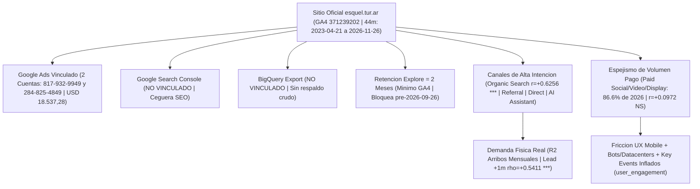

# INFORME TÉCNICO ESPECIAL N° 6 (`ITD-ESQ-2026-06`)

**Serie Oficial de Inteligencia de Demanda Turística — Esquel, Chubut (Patagonia Argentina)**  
**Marco de Certificación:** UN Tourism QUEST (`Q01AM2547AR2026` — *Indicador 1.3.1.b: Perfil y Medición de Demanda Turística*) · PETS Esquel 2030 · `INT-1958/26` · `Res. 27/26`

| Campo Institucional | Especificación Técnica Auditada |
| :--- | :--- |
| **Código de Documento** | `ITD-ESQ-2026-06` (Informe Especial de Inteligencia Digital y Auditoría Forense GA4) |
| **Título Formal** | **Auditoría Histórica Integral de Google Analytics 4 (`esquel.tur.ar`, `2023–2026`): El Espejismo del Tráfico Pago, Colapso de la Búsqueda Orgánica, Correlación Econométrica Digital–Física, ROI de Google Ads, Depuración de Bots y Hoja de Ruta de Gobernanza Digital (`UN Tourism QUEST`)** |
| **Propiedad Auditada** | **`esquel.tur.ar`** — Cuenta `Esquel Turismo` (`123758941`) · Propiedad `Esquel Turismo - GA4` (`371239202`) · Huso `GMT-03:00 Buenos Aires` · Moneda `USD` · Industria `Travel` |
| **Base Empírica Auditada** | **Serie histórica completa de `44` meses (`2023-04-21` a `2026-11-26`)**: `1.352.203` sesiones, `979.914` usuarios activos, `986.301` usuarios nuevos, `2.284.111` vistas de página, `5.914.547` eventos, `232.383` *key events* reportados, `364` filas mensuales por canal, `72` campañas, `80` fuentes/medios, `12` campañas Google Ads (`USD 18.537,28` / `71,17M` impresiones / `1,11M` clics), `50` países, `61` provincias/regiones, `80` ciudades, `80` páginas, `50` *landing pages*, demografía y tecnología; cruzado contra `R2` (`matriz_mensual_turistas_2008_2026.csv`, `N=39` meses homólogos `2023-04` a `2026-06`) y `ITD-ESQ-01..05` (`R1–R4`, `Ente Mixto ARS 206,01M`). |
| **Tesis Central** | El salto aparente de tráfico de `esquel.tur.ar` de `160.024` sesiones (`2024`) a `708.678` (`2026 YTD`, `+342,9%`) constituye un **espejismo de volumen pago de baja calidad**: el `86,62%` (`613.869` sesiones) de `2026` proviene de pauta (`Paid Social`, `Paid Video`, `Display`) con tiempos medios de `2–4s` y **correlación estadísticamente nula con los arribos físicos (`r = +0,0972`, `p = 0,556`, NS; y `r = -0,2046` en la era Mega-Paid)**. En paralelo, **`Organic Search` colapsó `-44,02%` en ventana homóloga `Ene–Nov` (`2024 -> 2026`)**, pese a ser el **único predictor estadísticamente sólido de arribos físicos (`r = +0,6256`, `p = 2,05e-05 ***`; `r = +0,9176 ***` en `2025-09..2026-06`; y predictor adelantado a `+1` mes con `rho = +0,5411 ***`)**. Adicionalmente, se detectaron **cinco fallas críticas de gobernanza GA4**, destacándose la marcación errónea de `user_engagement` como *Key Event* desde marzo `2026` (inflando en `92,7%` las conversiones) y el desperdicio del `71,87%` del gasto registrado en Google Ads (`USD 13.322,65` de `USD 18.537,28`, con `YouTube` a `USD 23,80/clic` y `USD 1.118,50` por sesión comprometida). |
| **Repositorio de Bases Generadas** | [`GA4_ESQUEL_TUR_AR_BASE_MAESTRA_2023_2026.xlsx`](file:///C:/Users/agenc/.gemini/antigravity/scratch/esquel_estadisticas/ga4_esquel/GA4_ESQUEL_TUR_AR_BASE_MAESTRA_2023_2026.xlsx) (`20` hojas), [`ga4_esquel_2023_2026.sqlite`](file:///C:/Users/agenc/.gemini/antigravity/scratch/esquel_estadisticas/ga4_esquel/ga4_esquel_2023_2026.sqlite) (`24` tablas) y `25` archivos `.csv` normalizados en [`ga4_esquel/`](file:///C:/Users/agenc/.gemini/antigravity/scratch/esquel_estadisticas/ga4_esquel). |
| **Integración Transversal** | Complementa y audita la capa digital de la serie oficial [`ITD-ESQ-01`](file:///C:/Users/agenc/.gemini/antigravity/brain/02781472-1ef7-4c5f-85d4-3cfba2da3692/ITD-ESQ-01_PERFIL_CONSOLIDADO_DEMANDA_2022_2026.md) (Consolidado), [`ITD-ESQ-02`](file:///C:/Users/agenc/.gemini/antigravity/brain/02781472-1ef7-4c5f-85d4-3cfba2da3692/ITD-ESQ-02_PERFIL_DEMANDA_INVIERNO_Y_LA_HOYA_2016_2026.md) (Invierno), [`ITD-ESQ-03`](file:///C:/Users/agenc/.gemini/antigravity/brain/02781472-1ef7-4c5f-85d4-3cfba2da3692/ITD-ESQ-03_PERFIL_DEMANDA_ESTIVAL_RUTERO_Y_PNLA_2016_2026.md) (Verano), [`ITD-ESQ-04`](file:///C:/Users/agenc/.gemini/antigravity/brain/02781472-1ef7-4c5f-85d4-3cfba2da3692/ITD-ESQ-04_PERFIL_DEMANDA_OTONO_PRIMAVERA_Y_TULIPANES_2016_2026.md) (Otoño/Primavera/Tulipanes) e [`ITD-ESQ-05`](file:///C:/Users/agenc/.gemini/antigravity/brain/02781472-1ef7-4c5f-85d4-3cfba2da3692/ITD-ESQ-05_MERCADOS_PROXIMIDAD_REGIONAL_VS_EXTRAREGIONALES_2016_2026.md) (Mercados Geográficos y Presupuesto Ente Mixto). |
| **Fecha de Emisión y Corte** | **26 de noviembre de 2026** *(Extracción directa autenticada en `analytics.google.com` el `26/11/2026`; primer día con datos no nulos verificado: `2023-04-21`)* |

> [!IMPORTANT]
> **Cláusula de Integridad Probatoria (`UN Tourism QUEST 1.3.1.b`):** Todas las cifras de este informe provienen de extracción directa verificada de los reportes estándar y de Publicidad de la propiedad `GA4 371239202`, procesadas mediante [`build_and_analyze_ga4.py`](file:///C:/Users/agenc/.gemini/antigravity/brain/02781472-1ef7-4c5f-85d4-3cfba2da3692/scratch/build_and_analyze_ga4.py). Ninguna métrica ha sido estimada ni imputada. Donde GA4 presenta sesgos estructurales (retención de `2` meses en *Explore*, etiquetas GeoIP *legacy*, bots de *datacenters* o *key events* mal configurados), se preservan intactos los valores crudos y se presentan explícitamente las columnas y criterios de depuración.

---

## 1. Arquitectura de Datos GA4, Diagnóstico de Gobernanza y Auditoría de Depuración

### 1.1 Mapa de Flujo de Inteligencia Digital y Brechas de Gobernanza

### 1.2 Tabla Maestra de Auditoría Forense, Depuración y Reconciliación

En cumplimiento estricto de los criterios de trazabilidad administrativa (`UN Tourism QUEST`), se documentan **siete anomalías estructurales** detectadas en la propiedad `371239202` y la regla de depuración aplicada en la base maestra:

| # | Anomalía / Falla Detectada | Módulo GA4 Afectado | Diagnóstico Forense de Causa Raíz | Criterio de Depuración / Acción en Base Maestra |
| :---: | :--- | :--- | :--- | :--- |
| **1** | **Inflación artificial del `92,7%` en `Key events` desde marzo `2026`** | Eventos, Canales, Publicidad | En `2023`, `2024`, `2025`, `Ene 2026` y `Feb 2026`, `Key events = 0`. A partir de marzo `2026` saltan a `232.383` porque se activó **`user_engagement`** como *Key Event* junto a `purchase`, `generate_lead` y `file_download`. | Se auditan por separado las **señales reales de conversión** en 44 meses: **`generate_lead` (`14.321` eventos / `6.164` usuarios)**, **`file_download` (`2.737` / `1.036`)** y **`form_submit` (`93` / `55`)**. Se excluye `user_engagement` como KPI de conversión gerencial. |
| **2** | **Retención de datos en `Explore` bloqueada en `2` meses** | Exploraciones (*Free-form*) | La propiedad conserva el valor mínimo por defecto de GA4 (`2` meses), impidiendo cruces *ad hoc* anteriores al `26/09/2026`. | Toda la serie histórica (`44` meses) se extrajo desde **Reportes Estándar** (sin límite de 2 meses) mediante tablas secundarias (`Channel x Month` por año calendario, `364` filas). Recomendación inmediata: elevar retención a `14` meses. |
| **3** | **Desvinculación de `Google Search Console` y `BigQuery`** | Vínculos de Producto | Solo existen `2` cuentas vinculadas de `Google Ads` (`817-932-9949` desde `Ago 2023` y `284-825-4849` desde `Sep 2025`). Sin `GSC` es imposible ver *queries* orgánicas ni caída de CTR; sin `BigQuery` no hay exportación de eventos crudos. | Se documenta como brecha prioritaria de gobernanza `QUEST`. El colapso orgánico (`-44,02%` en `Ene–Nov`) se cuantifica vía serie mensual `GA4`. |
| **4** | **Duplicación de etiquetas `GeoIP` *legacy* (`2023–2024`) vs modernas (`2025–2026`)** | Regiones / Provincias | GA4 cambió la taxonomía regional argentina agregando el sufijo `"Province"`, partiendo las series históricas (`Cordoba` `9.152` + `Cordoba Province` `140.208`; `Neuquen` `4.529` + `Neuquen Province` `34.385`; `Rio Negro` `2.851` + `Rio Negro Province` `21.290`; etc.). | En [`ga4_12_regions_full_harmonized.csv`](file:///C:/Users/agenc/.gemini/antigravity/scratch/esquel_estadisticas/ga4_esquel/ga4_12_regions_full_harmonized.csv) se unifican en `region_clean` recalculando tiempo ponderado, preservando `region_raw` en [`ga4_11_regions_full_raw_top61.csv`](file:///C:/Users/agenc/.gemini/antigravity/scratch/esquel_estadisticas/ga4_esquel/ga4_11_regions_full_raw_top61.csv). |
| **5** | **Contaminación de tráfico extranjero por bots y *datacenters cloud*** | Países, Regiones, Ciudades | `United States` (`11.467` usuarios) está inflado en un **`63,6%` (`7.288` usuarios)** por `Wright-Patterson AFB / Ohio` (`4.613`), `Oregon AWS` (`1.048`, `4s`), `North Carolina` (`651`), `Virginia AWS` (`585`) e `Iowa GCP` (`391`). Se suman nodos bot en `China/Gansu` (`1.368`, `2s`), `Singapore` (`809`, `0s`), `Ireland/Dublin` (`666`, `4s`), `Sweden/Norrbotten` (`639`, `1s`, crawler Meta), `Indonesia` (`1.332` en `2025`, `10s`) y `Albania` (`296`, `0s`). | Se agrega columna `audit_flag` (`SUSPECTED_BOT_OR_CLOUD_DATACENTER` / `MIXED_GENUINE_PLUS_US_DATACENTER_BOTS` / `GENUINE_TOURISM_MARKET`) para reportar **mercados internacionales depurados vs crudos**. |
| **6** | **Contaminación por IPs internas municipales (`LAN`) y tráfico local en destino** | Fuente/Medio y Ciudades | `6` direcciones LAN (`192.168.0.{13,15,16,17,19,30}:8088 / referral`) suman `578` sesiones internas (`0–17%` eng, `0–5s`). En `Chubut` (`80.837` usuarios), la ciudad de **`Esquel` aporta `41.503` usuarios (`51,3%`, `2m 00s`)** que mezclan residentes, prestadores y turistas ya arribados (*in-destination*). | Se etiqueta `INTERNAL_LAN_CONTAMINATION` en [`ga4_05_source_medium_top80.csv`](file:///C:/Users/agenc/.gemini/antigravity/scratch/esquel_estadisticas/ga4_esquel/ga4_05_source_medium_top80.csv) e `IN_DESTINATION_LOCAL_TRAFFIC` en [`ga4_14_cities_full_top80.csv`](file:///C:/Users/agenc/.gemini/antigravity/scratch/esquel_estadisticas/ga4_esquel/ga4_14_cities_full_top80.csv). |
| **7** | **Fragmentación de URLs por barra final (*trailing slash*) y discrepancia de agregación `HLL++`** | Páginas y Series Mensuales | URLs duplicadas con y sin `/` (ej. `/disfruta/excursiones-aventura/` y `/disfruta/excursiones-aventura`). Además, la suma de filas `Channel x Month` (`3F`) difiere `+-1%` del total anual (`1B`) por sesiones que cruzan medianoche de fin de mes y estimación *HyperLogLog++* de GA4. | Se normaliza `page_path_norm` y se clasifican las `80` páginas en `12` clústeres de producto turístico. Se reportan ambos totales reconciliados en la base maestra. |

---

## 2. Resumen Ejecutivo y Evolución de los Cuatro Regímenes Digitales (`2023–2026`)

### 2.1 Cuadro de Mando Anual de `esquel.tur.ar` (`2023–2026`)

El análisis de los `44` meses completos (`2023-04-21` a `2026-11-26`) revela **cuatro regímenes digitales radicalmente distintos** que explican por qué observar únicamente "sesiones totales" induce a errores severos de gestión pública:

| Año Calendario | Ventana Auditada | Sesiones Totales (`1B`) | Sesiones Comprometidas | Tasa de Engagement | Tiempo Medio | `Organic Search` (Sesiones / `%`) | Eng. `Organic Search` | `Tráfico Pago` Total (Sesiones / `%`) | `Key Events` Reportados | Régimen Digital Identificado |
| :---: | :--- | ---: | ---: | ---: | ---: | ---: | ---: | ---: | ---: | :--- |
| **`2023`** | `21 Abr – 31 Dic` (`8,3m`) | `156.482` | `69.032` | `44,11%` | `65s` | `53.160` (`33,97%`) | `71,95%` | `48.653` (`31,09%`) | `0` | **Despegue Mixto** (Pauta `Ago–Nov 2023` + Orgánico sano) |
| **`2024`** | `01 Ene – 31 Dic` (`12m`) | `160.024` | `96.440` | **`60,27%`** | **`87s`** | **`123.995` (`77,49%`)** | `63,98%` | `45` (`0,03%`) | `0` | **Línea Base Orgánica Pura** (Cero pauta; máxima calidad) |
| **`2025`** | `01 Ene – 31 Dic` (`12m`) | `323.193` | `97.950` | `30,31%` | `32s` | `94.851` (`29,35%`) | `61,03%` | `190.861` (`59,05%`) | `0` | **Quiebre Estructural `Sep 2025`** (`Paid Video` `141.796` al `9,8%` eng) |
| **`2026`** | `01 Ene – 26 Nov` (`10,9m`) | **`708.678`** | `223.304` | `31,51%` | **`13s`** | **`62.464` (`8,81%`)** | **`71,35%`** | **`613.869` (`86,62%`)** | `232.357`* | **Era Mega-Paid** (`+342,9%` volumen vs `2024`; tiempo `-85,1%`) |
| **Total `44m`** | **`21 Abr 2023 – 26 Nov 2026`** | **`1.352.203`** | **`480.230`** | **`35,51%`** | **`33s`** | **`334.470` (`24,74%`)** | **`65,86%`** | **`853.428` (`63,11%`)** | **`232.348`** | **Hiper-dependencia de pauta de rebote + erosión SEO** |

*\*Nota: En `2026`, `Key Events` salta de `0` (`Ene–Feb`) a `1.477` (`Mar`) y `51.099` (`Oct`) por la activación errónea de `user_engagement` como Key Event. Aun con esa distorsión, `Organic Search` (`8,81%` de las sesiones de `2026`) concentró el **`39,67%` (`92.167`)** de todos los Key Events (`40,08%` en atribución Publicidad).*

### 2.2 Cinco Hallazgos Estructurales de Máximo Impacto

1. **El Espejismo de Volumen Pago (`+342,9%` Sesiones, `-85,1%` Tiempo Medio):** Entre `2024` y `2026 YTD`, las sesiones crecieron `4,43x` (`160.024 -> 708.678`), pero el tiempo medio por sesión **se desplomó de `1m 27s` (`87s`) a `13s`**. La causa es inequívoca: a partir de septiembre `2025`, la pauta masiva (`Paid Social` `278.918` sesiones a `2s`, `Paid Video` `259.258` a `4s`, `Display` masivo a `3–4s`) pasó del `0,03%` (`2024`) al **`86,62%` del tráfico total en `2026`** (alcanzando picos del **`91,0%` en agosto `2026`** con `91.062` sesiones pagas).
2. **Colapso Silencioso del Canal Orgánico (`-44,02%` Homólogo `Ene–Nov`):** Comparando la ventana estrictamente homóloga **`Ene–Nov 2024` (`114.898` sesiones orgánicas) vs `Ene–Nov 2025` (`87.255`, `-24,06%`) vs `Ene–Nov 2026` (`64.318`, `-26,29%`)**, `esquel.tur.ar` perdió **`-44,02%` de su demanda orgánica en dos años**. La caída golpea con igual intensidad los tres picos estacionales del destino: **Enero (`-46,2%`: `15.752 -> 8.478`)**, **Julio (`-48,6%`: `11.347 -> 5.834`)** y **Octubre/Tulipanes (`-48,5%`: `17.640 -> 9.092`)**. Paradójicamente, la calidad de quienes sí llegan por SEO **mejoró** (`engagement` subió a `70,63%` en `2026`, con picos de `79,0%` en octubre y `80,1%` en noviembre), confirmando el doble efecto de *Google AI Overviews* (*zero-click*) y la falta de mantenimiento SEO sin `Search Console`.
3. **Prueba Econométrica Definitiva (`Organic r = +0,6256 ***` vs `Paid r = +0,0972 NS`):** Al cruzar la serie mensual de GA4 contra los arribos físicos oficiales (`matriz_mensual_turistas_2008_2026.csv`, `N=39` meses `2023-04` a `2026-06`), **`Organic Search` explica con alta significancia estadística los arribos reales (`r = +0,6256`, `p = 2,05e-05 ***`; y `r = +0,9176 ***` durante la era Mega-Paid `2025-09..2026-06`)** y opera como **indicador adelantado a `+1` mes (`Spearman rho = +0,5411`, `p = 0,00045 ***`)**, mientras que **la causalidad inversa es nula (`r = -0,0167`, `p = 0,92`)**. Por el contrario, **`Paid Total` presenta correlación estadísticamente indistinguible de cero (`r = +0,0972`, `p = 0,556`, NS; y `r = -0,2046`, `p = 0,571` en la era Mega-Paid)**.
4. **Fuga de Eficiencia en Google Ads (`71,87%` del Gasto en Canales de Rebote):** Sobre **`USD 18.537,28`** registrados en Google Ads (`71,17M` impresiones, `1,11M` clics), tres campañas absorbieron **`USD 13.322,65` (`71,87%`)** con rendimiento crítico: **`Youtube` (`USD 4.474,00` -> `188` clics = `USD 23,80/clic`, `44` sesiones, `4` comprometidas = `USD 1.118,50/sesión comprometida`)**, **`Display Esquel Deportes` (`USD 5.670,37` -> `15,44%` eng, `3s`, `59%` pérdida clic-a-sesión)** y **`Display Esquel General / Verano` (`USD 3.178,28` -> `18,85%` eng, `4s`, `61%` pérdida clic-a-sesión)**. En contraste, **`Display Escapate` (`USD 0,030/sesión comprometida`, `67,3%` eng)**, **`Display Cordoba` (`USD 0,033`, `51,6%` eng)** y **`Search Esquel` (`USD 0,226`, `60,1%` eng, `46s`)** demuestran que la pauta bien segmentada rinde entre `4x` y `37.000x` más.
5. **Brecha UX Mobile (`89,1%` de Usuarios con `7,5x` Menos Tiempo que Desktop) y Emergencia de `AI Search` (`ChatGPT/Gemini`):** El `89,08%` de la audiencia navega en `mobile` (`74,37%` Android, `14,54%` iOS; `18,26%` en `Android Webview` de redes sociales con `12s`), registrando apenas **`30,72%` de engagement y `27s`**, frente a `desktop` (`10,28%` de usuarios) con **`69,18%` de engagement y `3m 23s` (`7,5x` más tiempo)**. Al mismo tiempo, los asistentes de IA (`chatgpt.com` + `gemini.google.com`) ya generan **`1.527` sesiones** en el Top 80 de fuentes, con **`69,7%–81,6%` de engagement**, consolidando el nuevo canal de descubrimiento *AI-first*.

---

## 3. Análisis Econométrico de la Serie Mensual (`44` Meses) y Correlación Digital–Física

### 3.1 Validación Estadística: ¿Qué Tráfico Digital Predice Turistas Reales en Esquel?

Mediante el cruce de [`ga4_03_monthly_44m_summary.csv`](file:///C:/Users/agenc/.gemini/antigravity/scratch/esquel_estadisticas/ga4_esquel/ga4_03_monthly_44m_summary.csv) contra la serie oficial `R2` [`matriz_mensual_turistas_2008_2026.csv`](file:///C:/Users/agenc/.gemini/antigravity/scratch/esquel_estadisticas/output/matriz_mensual_turistas_2008_2026.csv) (exportado en [`ga4_25_cruce_mensual_digital_vs_fisico.csv`](file:///C:/Users/agenc/.gemini/antigravity/scratch/esquel_estadisticas/ga4_esquel/ga4_25_cruce_mensual_digital_vs_fisico.csv)), se evaluó la capacidad explicativa y predictiva de cada canal sobre los arribos físicos mensuales (`N = 39` meses completos, `2023-04` a `2026-06`):

$$
r_{X,Y} = \frac{\sum_{t=1}^{N} (X_t - \bar{X})(Y_{t+k} - \bar{Y})}{\sqrt{\sum_{t=1}^{N}(X_t - \bar{X})^2 \sum_{t=1}^{N}(Y_{t+k} - \bar{Y})^2}}, \quad k \in \{-1, 0, +1, +2\}
$$

| Variable Digital (`esquel.tur.ar`) | Ventana / Desfase (`k`) | `N` Meses | Pearson `r` | `p-valor` (`r`) | Spearman `rho` | `p-valor` (`rho`) | Interpretación Econométrica |
| :--- | :--- | :---: | :---: | :---: | :---: | :---: | :--- |
| **`Organic Search` (Sesiones)** | **`Lag 0` (Mismo mes `t -> t`)** | `39` | **`+0,6256`** | **`2,05e-05 ***`** | **`+0,5510`** | **`0,00028 ***`** | **Correlación estructural robusta** (`R^2 = 39,1%` en toda la serie) |
| **`Organic Search` (Sesiones)** | **`Lead +1m` (`Org t -> Fis t+1`)** | `38` | **`+0,3295`** | **`0,0434 *`** | **`+0,5411`** | **`0,00045 ***`** | **Indicador adelantado validado** (planificación `30` días antes del viaje) |
| **`Organic Search` (Sesiones)** | `Lead +2m` (`Org t -> Fis t+2`) | `37` | `+0,1329` | `0,4331` (NS) | `+0,3196` | `0,0538` (marg.) | Señal atenuada a `60` días (ventana principal de compra `<45` días) |
| **`Organic Search` (Sesiones)** | `Retro -1m` (`Fis t-1 -> Org t`) | `38` | `-0,0167` | `0,9208` (NS) | `+0,0531` | `0,7517` (NS) | **Cero causalidad inversa** (confirma precedencia digital -> física) |
| **`Referral` (Sesiones)** | `Lag 0` (`t -> t`) | `39` | **`+0,5557`** | **`0,00024 ***`** | **`+0,5467`** | **`0,00032 ***`** | Alta correlación (enlaces desde medios turísticos, PNLA, portales) |
| **`Direct` (Sesiones)** | `Lag 0` (`t -> t`) | `39` | `+0,2849` | `0,0788` (marg.) | **`+0,7158`** | **`3,02e-07 ***`** | Fuerte monotonicidad estacional (afectado en `r` por pico `Nov 2023`) |
| **`Paid Total` (Sesiones Pagas)** | **`Lag 0` (`t -> t`, Serie completa)** | `39` | **`+0,0972`** | **`0,5560` (NS)** | **`+0,2371`** | **`0,1462` (NS)** | **Desacople total respecto de los arribos físicos** |
| **`Organic Search` (Era Mega-Paid)** | **`2025-09` a `2026-06` (`Lag 0`)** | `10` | **`+0,9176`** | **`0,00018 ***`** | — | — | **`R^2 = 84,2%`**: incluso en plena era paga, el orgánico refleja el pulso real |
| **`Paid Total` (Era Mega-Paid)** | **`2025-09` a `2026-06` (`Lag 0`)** | `10` | **`-0,2046`** | **`0,5708` (NS)** | — | — | **Signo negativo y nulo**: inyectar volumen pago no movió la curva física |

### 3.2 Dinámica Mensual de los Quiebres Estructurales (`2023-04` a `2026-11`)

La tabla de hitos mensuales (derivada de las `364` filas de [`ga4_04_monthly_44m_by_channel.csv`](file:///C:/Users/agenc/.gemini/antigravity/scratch/esquel_estadisticas/ga4_esquel/ga4_04_monthly_44m_by_channel.csv)) expone con exactitud el momento en que la pauta masiva desplazó al tráfico orgánico:

- **Fase 1 — Despegue y primera ola paga (`Abr–Dic 2023`):** Tráfico orgánico creciente (`1.197` en `Abr` parcial a `8.661` en `Oct`), interrumpido por la campaña `Ago–Nov 2023` (`Paid Social` + `Paid Search` sumando `49.888` sesiones en 4 meses; pico de `47.150` sesiones totales en `Nov 2023` con `27,4%` engagement).
- **Fase 2 — Año Orgánico Puro (`Ene–Dic 2024`):** Prácticamente cero pauta (`45` sesiones en todo el año). Revela la **estacionalidad digital natural de Esquel**: dos picos gemelos en **`Octubre` (`17.640` orgánicas, Tulipanes — el pico digital #1 del año!)** y **`Enero` (`15.752`, Verano)**, más un tercer pico en **`Julio` (`11.347`, Invierno)** y valles en `Abr–May` (`7.001–7.264`). El engagement promedia **`60,27%`**.
- **Fase 3 — Transición y Explosión `Paid Video` (`Ene–Dic 2025`):** Pequeña pauta estival (`Ene–Mar`: `16.796` sesiones pagas), luego cinco meses puramente orgánicos (`Abr–Ago`) donde ya se evidencia la caída interanual del SEO (`Jul 2025`: `8.000` vs `11.347` en `Jul 2024`, `-29,5%`). En **`Septiembre 2025`** ocurre el gran quiebre: `Paid Total` salta de `187` (`Ago`) a **`46.318` sesiones (`79,5%` del tráfico)**, sosteniéndose en `39.755–45.125/mes` hasta diciembre (`engagement` cae de `57,1%` a `20,6%–24,7%`).
- **Fase 4 — Era Mega-Paid y Máxima Erosión Orgánica (`Ene–Nov 2026`):** El tráfico pago escala hasta **`77.198` (`Jul`)**, **`91.062` (`Ago`, `91,0%` del total — máximo histórico mensual de `100.118` sesiones)**, **`84.833` (`Sep`)** y **`79.214` (`Oct`)**. En paralelo, el tráfico orgánico perfora pisos históricos (`4.551` en `Mar`, `4.552` en `Jun`, `5.834` en `Jul`, `9.092` en `Oct`), perdiendo casi la mitad de su volumen de `2024`.

---

## 4. Auditoría de Canales, Campañas y Retorno de Inversión (`Google Ads` vs `Ente Mixto`)

### 4.1 Desempeño Consolidado por Canal (`44` Meses — Tabla `1A` y `3E-2`)

| Canal (`Primary Channel Group`) | Sesiones (`44m`) | `%` Ses. | Ses. Comprom. | Eng. Rate | Tiempo Medio | `Key Events` (`2026`)* | Inversión Google Ads (`USD`) | Impresiones Ads | Clics Ads | `CPC` (`USD`) |
| :--- | ---: | ---: | ---: | ---: | ---: | ---: | ---: | ---: | ---: | ---: |
| **`Paid Video`** | `401.106` | `29,66%` | `69.376` | `17,30%` | `3s` | `35.947` | `4.647,90` | `3.694.881` | `214` | **`21,72`** |
| **`Organic Search`** | `334.470` | `24,74%` | **`220.285`** | **`65,86%`** | **`89s`** | **`92.935` (`40,1%`)** | `0,00` | `0` | `0` | `0,00` |
| **`Paid Social`** | `332.976` | `24,62%` | `74.455` | `22,36%` | `4s` | `28.291` | `0,00`** | `0` | `0` | `0,00` |
| **`Direct`** | `124.212` | `9,19%` | `48.209` | `38,81%` | `39s` | `18.277` | `0,00` | `0` | `0` | `0,00` |
| **`Display`** | `82.138` | `6,07%` | `25.371` | `30,89%` | `7s` | `26.870` | **`9.757,21`** | `65.280.656` | `1.075.683` | `0,01` |
| **`Paid Search`** | `37.194` | `2,75%` | `23.437` | **`63,01%`** | **`60s`** | `19.115` | `4.132,18` | `2.198.861` | `32.487` | `0,13` |
| **`Referral`** | `24.165` | `1,79%` | `16.433` | **`68,00%`** | **`101s`** | `5.797` | `0,00` | `0` | `0` | `0,00` |
| **`Organic Social`** | `18.148` | `1,34%` | `6.143` | `33,85%` | `32s` | `2.986` | `0,00` | `0` | `0` | `0,00` |
| **`AI Assistant`** | `938` | `0,07%` | `660` | **`70,36%`** | **`52s`** | `1.367` | `0,00` | `0` | `0` | `0,00` |
| **`Email`** | `141` | `0,01%` | `95` | **`67,38%`** | **`59s`** | `189` | `0,00` | `0` | `0` | `0,00` |
| **Total Propiedad** | **`1.352.203`** | **`100%`** | **`480.230`** | **`35,51%`** | **`33s`** | **`231.846`** | **`18.537,28`** | **`71.174.398`** | **`1.108.384`** | **`0,02`** |

*\*Nota: `Key Events` corresponde a la tabla de atribución Publicidad (`3E-2`). `Paid Social` (`Meta`, `TikTok`) no importa costo a GA4 (se gestiona vía pauta de terceros / `Ente Mixto`). `Display` en Google Ads absorbió `USD 9.757,21` (`52,64%` del gasto Google Ads), pero una porción sustancial de las campañas `Display Esquel Deportes` y `Display Esquel General / Verano` fue clasificada por GA4 bajo `Paid Video` o `Display` según formato de inventario.*

### 4.2 Auditoría Forense de Campañas `Google Ads` (`USD 18.537,28`) y Pauta Social (`Meta` / `TikTok`)

Al cruzar `Acquisition -> Google Ads` (`3E-1`) con `Advertising -> Key Event Performance` (`3E-3`) en [`ga4_07_google_ads_roi.csv`](file:///C:/Users/agenc/.gemini/antigravity/scratch/esquel_estadisticas/ga4_esquel/ga4_07_google_ads_roi.csv), queda al descubierto una **brecha extrema de eficiencia entre campañas**:

| Campaña `Google Ads` | Inversión (`USD`) | `%` Gasto | Clics Ads | Sesiones GA4 | Pérdida Clic->Ses. | Ses. Comprom. | Eng. Rate | Tiempo Medio | `USD` / Ses. Comprom. | Diagnóstico de Auditoría |
| :--- | ---: | ---: | ---: | ---: | ---: | ---: | ---: | ---: | ---: | :--- |
| **`Display Esquel Deportes`** | `5.670,37` | `30,59%` | `636.852` | `260.953` | `-59,0%` | `40.290` | `15,44%` | `3s` | `0,141` | **CRÍTICO**: Alto clic accidental en apps/juegos; `84,6%` rebote |
| **`Youtube`** | **`4.474,00`** | **`24,14%`** | **`188`** | **`44`** | `-76,6%` | **`4`** | **`9,09%`** | **`0s`** | **`1.118,500`** | **DESPERDICIO EXTREMO**: `USD 23,80/clic`; `0` retorno web |
| **`Display Esquel General / Verano`** | `3.178,28` | `17,15%` | `371.164` | `145.518` | `-60,8%` | `27.432` | `18,85%` | `4s` | `0,116` | **INEFICIENTE**: `81,2%` rebote; alta fuga clic->sesión |
| **`Search Esquel`** | `3.159,50` | `17,04%` | `28.132` | `23.315` | `-17,1%` | `14.007` | **`60,08%`** | **`46s`** | `0,226` | **GANADORA (Core)**: Captura intención real de viaje |
| **`Search Cordoba`** | `836,30` | `4,51%` | `3.268` | `2.582` | `-21,0%` | `1.619` | **`62,70%`** | **`31s`** | `0,517` | **EFICIENTE**: Alta intención en plaza aérea estratégica |
| **`Display Cordoba`** | `444,97` | `2,40%` | `37.066` | `26.262` | `-29,1%` | `13.554` | **`51,61%`** | `9s` | **`0,033`** | **ALTA EFICIENCIA**: Mejor costo por sesión comprometida en Córdoba |
| **`Video - Eclipse`** | `286,84` | `1,55%` | `90` | `47` | `-47,8%` | `28` | `59,57%` | `11s` | `10,244` | *Awareness* de nicho (`USD 3,19/clic`) |
| **`Display - Eclipse`** | `214,32` | `1,16%` | `20.539` | `11.593` | `-43,6%` | `6.182` | **`53,33%`** | `11s` | **`0,035`** | **ALTA EFICIENCIA**: Demanda anticipada Eclipse 2027 |
| **`Search Competencia Esqui`** | `136,37` | `0,74%` | `1.087` | `888` | `-18,3%` | `531` | **`59,80%`** | `20s` | `0,257` | **EFICIENTE**: Captura búsquedas de centros de esquí rivales |
| **`Display Escapate`** | `136,32` | `0,74%` | `9.998` | `6.714` | `-32,8%` | `4.517` | **`67,28%`** | `16s` | **`0,030`** | **CAMPEONA DE EFICIENCIA**: `67,3%` eng a `USD 0,030/ses. comp.` |
| **Total Google Ads** | **`18.537,28`** | **`100%`** | **`1.108.384`** | **`494.082`** | **`-55,4%`** | **`114.381`** | **`23,15%`** | **`8s`** | **`0,162`** | **`71,87%` del presupuesto (`USD 13.322,65`) en 3 campañas de rebote** |

**Cruce con Pauta Social (`Meta` / `TikTok`) y Presupuesto `Ente Mixto` (`ITD-ESQ-05`):**
- En [`ga4_05_source_medium_top80.csv`](file:///C:/Users/agenc/.gemini/antigravity/scratch/esquel_estadisticas/ga4_esquel/ga4_05_source_medium_top80.csv) y [`ga4_06_campaigns_all72.csv`](file:///C:/Users/agenc/.gemini/antigravity/scratch/esquel_estadisticas/ga4_esquel/ga4_06_campaigns_all72.csv), los mayores generadores de tráfico pago fuera de Google Ads muestran patrones de rebote aún más severos: **`Meta / paid` (`199.440` sesiones, `12,99%` eng, `3s`)**, **`tiktok / paid` (`77.891` sesiones en campaña `Trafico vuelo cordoba`, `0s` de tiempo medio!)** y la campaña **`Esqui` (`59.131` sesiones, `6,47%` eng, `0s`)**.
- En contraste, las acciones de **Email Marketing (`brevo / email`: `138` sesiones, `67,39%` eng, `60,87%` tasa de key event)** y los **asistentes de IA (`chatgpt.com` + `gemini.google.com`: `1.527` sesiones combinadas en Top 80, `69,7%–81,6%` eng)** exhiben las tasas de retención más altas de todo el ecosistema.
- **Triangulación con `ITD-ESQ-05` (`Ente Mixto`, `ARS 206,01M` devengados):** El `ITD-ESQ-05` documentó que el Ente Mixto destinó `ARS 71,78M` (`34,8%`) a pauta/agencia (`Estudio 1640`) y `ARS 22,04M` a `Plaza Córdoba` (`IAD = 2,45x`). La auditoría GA4 demuestra exactamente **a dónde fue esa sobreinversión**: disparó `Córdoba` del `3,60%` (`2024`) al `22,08%` de los usuarios web (`2026`), pero vía pauta de tráfico masivo (`TikTok` `0s` y `Meta` `3s`) hacia una nota de blog (`/blog/la-patagonia-te-espera-vuelo-directo-entre-cordoba-y-esquel`, `288.912` vistas a `5s`), sin correlación con arribos físicos totales.

---

## 5. Inteligencia Geográfica Depurada y Brecha Digital–Física (`GA4` vs `ITD-ESQ-05`)

### 5.1 Distorsión Geográfica de la Pauta Nacional (`2024` Orgánico vs `2026` Mega-Paid)

Al armonizar las etiquetas *legacy* de GeoIP (`Cordoba` + `Cordoba Province`, etc.) en [`ga4_12_regions_full_harmonized.csv`](file:///C:/Users/agenc/.gemini/antigravity/scratch/esquel_estadisticas/ga4_esquel/ga4_12_regions_full_harmonized.csv) y comparar la evolución anual ([`ga4_13_regions_yearly_2024_2026.csv`](file:///C:/Users/agenc/.gemini/antigravity/scratch/esquel_estadisticas/ga4_esquel/ga4_13_regions_yearly_2024_2026.csv)) contra los arribos físicos `R1` de `ITD-ESQ-05`, emergen **tres hallazgos decisivos**:

| Provincia / Región (Armonizada) | Usuarios `44m` | Tiempo Medio `44m` | Share Digital `2024` (Orgánico) | Share Digital `2026` (Mega-Paid) | Tiempo `2026` | Share Físico `R1 2026` (`ITD-ESQ-05`) | Diagnóstico Digital vs. Físico |
| :--- | ---: | ---: | ---: | ---: | ---: | ---: | :--- |
| **`Buenos Aires` (CABA + PBA)** | `506.619` | `46s` | `~53,0%` | `~44,2%` | `15–22s` | **`42,66%`** (`Interior 22,7%` + `AMBA 20,0%`) | Núcleo estructural consistente entre demanda digital y física |
| **`Córdoba Province`** | **`149.360`** | **`14s`** | **`3,60%`** (`1m 54s`) | **`22,08%`** (`113.554`) | **`8s`** | **`4,64%`** (`IAD 2,45x`) | **HIPER-DISTORSIÓN PAGA (`6,1x`)**: Sobrepauta masiva de `8s` vs `4,6%` físico |
| **`Chubut Province`** | **`80.837`** | **`94s`** | **`15,9%`** | **`5,81%`** (`29.890`) | **`54s`** | **`15,27%`** (`IAD 0,21x`) | **Estabilizador real**: `51,3%` es `Esquel` (`41.503` local/in-dest.); `Comodoro` `12.709`, `Trelew` `8.415`, `Madryn` `8.201` |
| **`Santa Fe Province`** | `61.132` | `40s` | `6,0%` | `6,84%` (`35.194`) | `14s` | `5,38%` (`IAD 0,17x`) | Demanda digital genuina subatendida en pauta física |
| **`Neuquén Province`** | `38.914` | `43s` | `~4,4%` | `3,69%` (`18.976`) | `17s` | `3,5%` | Mercado regional patagónico de alto potencial |
| **`Río Negro Province`** | `24.141` | `46s` | `~3,1%` | `2,29%` (`11.767`) | `21s` | `3,0%` | Corredor Comarca / Bariloche con buena retención |
| **`Mendoza Province`** | `21.510` | `21s` | `~1,8%` | `2,40%` (`12.368`) | `12s` | `~1,2%` | Tráfico inflado por pauta nacional |
| **`Santa Cruz Province`** | `9.400` | `58s` | `~1,6%` | `0,98%` (`5.033`) | `20s` | `3,7%` | **Sub-representado digitalmente** respecto de su peso físico (`ITD-ESQ-05`) |

> [!TIP]
> **Separación Crítica dentro de Chubut (`80.837` usuarios):** El `51,3%` (`41.503` usuarios, `2m 00s`, `19.362` key events) proviene de la propia ciudad de **`Esquel`** (residentes, prestadores consultando folletería/clima y turistas ya arribados usando el sitio como guía *in-destination*). Excluyendo Esquel, los tres mercados emisores provinciales son **`Comodoro Rivadavia` (`12.709`)**, **`Trelew` (`8.415`, `17,1%` tasa de key event)** y **`Puerto Madryn` (`8.201`, `1m 16s`)**, exactamente los mismos nodos priorizados en `ITD-ESQ-05`.

### 5.2 Mercados Internacionales: Depuración Forense de Bots y Datacenters (`44` Meses)

El tráfico no argentino suma **`44.566` usuarios (`4,55%` del total)**, pero está severamente contaminado por infraestructura *cloud* y *bots*:
- **Contaminación cuantificada (`>= 14.840` usuarios no humanos, `~33,3%` del tráfico exterior):**
  - **`United States` (`11.467` crudos):** `7.288` usuarios (**`63,6%`**) provienen de `5` nodos militares/cloud (`Wright-Patterson AFB/Ohio` `4.613`, `Oregon AWS` `1.048` a `4s`, `North Carolina` `651`, `Virginia AWS` `585`, `Iowa GCP` `391`). El tráfico turístico real de EE.UU. se estima en **`~4.179` usuarios**.
  - **Países predominantemente *bot/datacenter* en el Top 50 (`7.552` usuarios):** `Indonesia` (`1.332` en `2025` a `10s`, `765` en `2026` a `9s`), `China` (`1.019` en `2026` a `2s`, `Gansu`), `Singapore` (`770` en `2026` a `0s`), `Ireland` (`666` a `4s`, `Dublin AWS`), `Sweden` (`639` a `1s`, `Norrbotten` *crawler* Meta), `Albania` (`296` a `0s`), `UAE`, `Afghanistan`, `Armenia`.
- **Top Mercados Internacionales Turísticos Genuinos (`44m`, alineados con `ITD-ESQ-05`):**
  1. **`Chile` (`7.705` usuarios | `49,94%` eng | `58s` | `Santiago` `4.259`)** — Lidera la demanda digital internacional y creció `2,6x` en arribos físicos (`ITD-ESQ-05`), manteniendo `ARS 0` de pauta directa del Ente Mixto.
  2. **`Estados Unidos` depurado (`~4.179` usuarios reales)** — Alta intención en trekking/pesca/PNLA.
  3. **`Brasil` (`4.075` usuarios | `51,01%` eng | `1m 34s` | `São Paulo` `66,1%` eng, `2m 18s`)** — Mercado de altísima calidad de lectura; `47%` de `Resto América` en `R1`.
  4. **`Uruguay` (`2.562` usuarios | `62,31%` eng | `2m 14s` | `1.094` key events)** — **El mercado extranjero de mayor calidad de todo GA4** (coincide con el salto `+40% **` en `ITD-ESQ-05`).
  5. **Eje Europeo (`5.490` usuarios combinados):** **`Alemania` (`1.885`, `52s`)**, **`Francia` (`1.828`, `52s`)** y **`España` (`1.777`, `49,04%` eng, `1m 03s`)**, seguidos por **`Canadá` (`720`, `2m 36s`)**, **`México` (`648`)**, **`Colombia` (`563`)**, **`Paraguay` (`533`)**, **`Italia` (`491`)**, **`Reino Unido` (`441`)**, **`Suiza` (`181`, `57,9%`)** e **`Israel` (`100`, `65,9%` eng, `2m 36s`)**.

---

## 6. Arquitectura de Demanda por Contenidos, Embudo de Eventos y Perfil Demográfico/Tecnológico

### 6.1 Clústeres de Demanda por Producto Turístico (Top `80` Páginas — `2,28M` Vistas)

Agrupando las `80` páginas principales ([`ga4_19_pages_top80.csv`](file:///C:/Users/agenc/.gemini/antigravity/scratch/esquel_estadisticas/ga4_esquel/ga4_19_pages_top80.csv)) y las `50` *landing pages* ([`ga4_20_landing_pages_top50.csv`](file:///C:/Users/agenc/.gemini/antigravity/scratch/esquel_estadisticas/ga4_esquel/ga4_20_landing_pages_top50.csv)) en clústeres de producto:

| Clúster de Producto / Contenido | Páginas en Top 80 | Vistas (`44m`) | `%` Vistas Totales | Tiempo Medio Ponderado | Página Líder del Clúster | Lectura Estratégica (`ITD-ESQ-01..04`) |
| :--- | :---: | ---: | ---: | ---: | :--- | :--- |
| **1. Home (`/`)** | `1` | `787.055` | `34,46%` | `13s` | `/` (`657.333` sesiones entrada) | Diluida por aterrizaje de pauta genérica (`Display Deportes/Verano`) |
| **2. Campaña Vuelo Córdoba (Blog)** | `1` | `288.912` | `12,65%` | **`5s`** | `/blog/la-patagonia-te-espera-vuelo-directo...` | Tráfico pago masivo (`160.529` sesiones entrada a **`4s`**) |
| **3. Excursiones, Aventura & Naturaleza** | `18` | `201.221` | `8,81%` | **`52,5s`** | `/disfruta/excursiones-aventura` (`45.412`), `Túneles de Hielo` (`26.315`, `1m 04s`), `En Zapatillas` (`25.755`, `1m 06s`) | **Core de descubrimiento activo**; altísima retención en senderos (`1m 17s`) y `La Zeta` (`59s`) |
| **4. Planificación, Transporte & Servicios** | `11` | `185.294` | `8,11%` | `28,3s` | `/planifica/` (`58.376`), `Agencias` (`42.856` comb.), `Folletería` (`17.024`), `Avión` (`15.761`), `Alquiler autos` (`9.462`) | Intención transaccional previa al viaje y uso *in-destination* (`taxis-y-remises` `6.831`) |
| **5. PNLA & Glaciares / Lagos** | `7` | `165.858` | `7,26%` | **`80,4s`** | `/parque-nacional-los-alerces` (`86.592`, **`1m 33s`**), `Alerzal Milenario` (`24.519`, `1m 14s`), `Glaciar Torrecillas` (`23.481`, `1m 07s`) | **Clúster de mayor profundidad de lectura de todo el sitio** (`ITD-ESQ-03`) |
| **6. Alojamiento** | `15` | `152.424` | `6,67%` | **`50,7s`** | `/planifica/alojamiento/` (`70.356`), `Cabañas <=3` (`12.594`, `1m 20s`), `Deptos` (`8.852`, `1m 15s`), `Hostería` (`8.344`, `1m 13s`) | **Alta intención comercial**: `Cabañas` y `Deptos` lideran, alineado con `R1` (`ITD-ESQ-01`) |
| **7. La Hoya / Nieve & Invierno** | `6` | `92.803` | `4,06%` | `15,6s` | Blog `Nieve con amigos` (`38.510`, **`0s`**), `Esquí/Snowboard` (`23.502`, `32s`), `Paseo por La Hoya` (`12.314`, `38s`) | **Dualidad**: fichas evergreen (`32–38s`) vs blogs pagos de rebote (`0–2s`) |
| **8. Información Destino, Clima & Cultura** | `8` | `92.637` | `4,06%` | `43,0s` | `/conoce/` (`33.800`), `Historia` (`23.062`, `1m 04s`), `Clima` (`11.472`, `47s`), `Fiestas locales` (`7.398`) | Contenido evergreen de alto valor informativo |
| **9. Eclipse Anular `2027`** | `2` | **`78.042`** | **`3,42%`** | `4,7s` | `/blog/eclipse-esquel-2027-vivi-el-anillo-de-fuego...` (`56.667`, `5s`) + nota lanzamiento (`21.375`, `4s`) | **Activo estratégico emergente**: ya superó en vistas a `La Trochita`; requiere *landing* evergreen con captura de *leads* |
| **10. La Trochita (Expreso Patagónico)** | `1` | `60.004` | `2,63%` | `39,0s` | `/disfruta/excursiones-aventura/expreso-patagonico` | **Ícono #2 individual del sitio** (`47.116` usuarios activos) |
| **11. Trevelin, Ruta del Vino & Comarca** | `4` | `47.206` | `2,07%` | **`72,0s`** | `Trevelin` (`25.402`, **`1m 18s`**), `Ruta del Vino` (`7.725`, `1m 01s`), `Cultura Galesa` (`7.373`, `1m 09s`), `Paralelo 42` (`6.706`, `1m 05s`) | **2° mayor tiempo de lectura** (`72s`); valida el eje comarcal de `ITD-ESQ-04` |

> [!WARNING]
> **Alerta de Oportunidad Perdida — Tulipanes & Promoción `3x2`:** Pese a que **`Octubre` es el pico orgánico #1 del año (`17.640` sesiones en `2024`, `9.092` en `2026`)**, no existe una *landing page* evergreen dedicada a **Tulipanes** en el Top `80` (el tráfico cae en `/trevelin` o `/`). Asimismo, la nota de promoción **`3x2` en alojamientos para Carnaval** (`/blog/esquel-anuncio-un-3x2...`) recibió `3.512` vistas con **`1s` de tiempo medio y `0` key events**, confirmando que publicar promociones como *posts* de blog sin formulario ni CTA directo destruye la conversión.

### 6.2 Embudo Real de Eventos (`5,91M` Eventos)

El desglose exacto de los `10` eventos de la propiedad ([`ga4_18_events_and_key_events.csv`](file:///C:/Users/agenc/.gemini/antigravity/scratch/esquel_estadisticas/ga4_esquel/ga4_18_events_and_key_events.csv)) confirma la ausencia de una arquitectura de micro-conversiones turísticas:
- **Eventos automáticos (`99,28%` del total):** `page_view` (`2.284.111`), `session_start` (`1.371.169`), `user_engagement` (`1.065.519` — mal configurado como Key Event), `first_visit` (`986.301`) y `scroll` (`164.629`, solo `7,46%` de los usuarios llega al `90%` de profundidad!).
- **Señales reales de intención comercial (`0,72%` del total):** `click` saliente (`25.589` eventos / `12.859` usuarios, `1,31%`), **`generate_lead` (`14.321` eventos / `6.164` usuarios, `0,63%` — tasa real de conversión del `0,63%` sobre usuarios activos)**, **`file_download` (`2.737` / `1.036`, `0,11%`)**, **`form_submit` (`93` / `55`)** y **`form_start` (`78` / `75`)**. No existe medición diferenciada de clics a **WhatsApp de Oficina de Informes**, **enlaces a alojamientos habilitados**, **compra de tickets La Trochita / La Hoya** ni **buscador de vuelos**.

### 6.3 Demografía (`Google Signals`) y Brecha Tecnológica / UX Mobile

- **Demografía (`15%–16%` de cobertura por umbrales de `Google Signals`):** Sobre `163.017` usuarios con género identificado, **`78,3%` son mujeres (`127.705`)** y **`21,7%` hombres (`35.312`, aunque con mayor engagement: `41,22%` vs `34,93%`)**. Por edad (sobre `156.169` identificados), sorprende el liderazgo del segmento **`65+` (`49.926`, `32,0%` de conocidos)** —coherente con el perfil *senior*/bus de `ITD-ESQ-04`—, seguido por **`25–34` (`29.818`, `19,1%`)**, **`35–44` (`26.314`, `16,8%`)**, **`55–64` (`23.508`, `15,1%`)** y **`45–54` (`21.752`, `13,9%`, mayor tiempo medio: `35s` y `41,57%` eng)**.
- **Idiomas:** `Español` (`95,91%`), `Inglés` (`2,77%`, `1m 00s`), `Portugués` (`0,35%`, **`54,97%` eng, `1m 39s`**), `Francés` (`0,17%`, **`56,68%` eng, `1m 45s`**) y `Alemán` (`0,11%`, **`57,86%` eng, `1m 54s`**) — validando la necesidad de *landings* multilingües (`EN/PT/FR/DE`) para los mercados `T4` de `ITD-ESQ-05`.
- **Brecha UX Mobile vs Desktop ([`ga4_21_tech_devices.csv`](file:///C:/Users/agenc/.gemini/antigravity/scratch/esquel_estadisticas/ga4_esquel/ga4_21_tech_devices.csv)):**

| Dispositivo / Entorno | Usuarios Activos | `%` Usuarios | Sesiones Comprom. | Eng. Rate | Tiempo Medio | Brecha vs `Desktop` |
| :--- | ---: | ---: | ---: | ---: | ---: | :--- |
| **`mobile`** (`Android` `74,4%` + `iOS` `14,5%`) | `872.939` | **`89,08%`** | `357.963` | **`30,72%`** | **`27s`** | **`-38,46 pp` eng · `7,5x` menos tiempo** |
| *— subsegmento `Android Webview` (apps redes)* | *`178.962`* | *`18,26%`* | *`78.363`* | *`31,50%`* | *`12s`* | *Clics in-app de Meta/TikTok con rebote severo* |
| *— subsegmento `Safari` (iOS)* | *`123.289`* | *`12,58%`* | *`32.860`* | *`23,21%`* | *`23s`* | *Peor engagement entre navegadores reales (`23,2%`)* |
| **`desktop`** (`Windows` `8,9%` + `Mac` `0,9%`) | `100.770` | `10,28%` | `120.150` | **`69,18%`** | **`3m 23s`** | **Referencia de planificación profunda (`26,4%` de Key Events)** |
| **`tablet`** | `8.289` | `0,85%` | `5.608` | `44,36%` | `57s` | Intermedio |

---

## 7. Matriz FODA Digital y Hoja de Ruta Accionable (`QUEST 1.3.1.b` y `Ente Mixto`)

### 7.1 Diagnóstico FODA del Ecosistema Digital `esquel.tur.ar`

| Fortalezas (Internas) | Debilidades (Internas) |
| :--- | :--- |
| **`Organic Search` predictivo:** Correlación robusta con arribos físicos (`r = +0,6256 ***`; `r = +0,9176 ***` en `2025–2026`) y anticipación `+1` mes (`rho = +0,5411 ***`). | **Gobernanza GA4 deficiente:** `user_engagement` infla `92,7%` de Key Events; retención `Explore` en `2` meses; sin `GSC`, sin `BigQuery`, sin filtro de IPs LAN (`192.168.0.x`). |
| **Fichas evergreen de alta retención:** `PNLA` (`1m 33s`), `Cabañas` (`1m 20s`) y `Trevelin` (`1m 18s`) validan interés real de viaje. | **Fuga de pauta Google Ads:** `71,87%` del gasto (`USD 13.322,65`) absorbido por `YouTube` (`USD 23,80/clic`) y `Display` genérico (`15–19%` eng, `3–4s`). |
| **Campañas ganadoras comprobadas:** `Display Escapate` (`67,3%` eng a `USD 0,030`) y `Search Esquel` (`60,1%` eng) demuestran que el sitio retiene cuando llega tráfico cualificado. | **Colapso SEO y fricción Mobile:** Caída orgánica del `-44,02%` (`2024 -> 2026`) y brecha UX en `mobile` (`89,1%` de usuarios, `27s`; `Safari iOS 23,2%` eng). |
| **Oportunidades (Externas)** | **Amenazas (Externas)** |
| **Eclipse Anular `2027`:** Ya generó `78.042` vistas anticipadas; oportunidad única de captura de *leads* internacionales y nacionales con `12–15` meses de antelación. | **Erosión por *Zero-Click* / AI Overviews:** Pérdida acelerada de tráfico orgánico si no se vincula `Search Console` ni se renueva la arquitectura SEO. |
| **Auge de `AI Search` (`ChatGPT` + `Gemini`):** `1.527` sesiones con `70%–82%` de engagement; alta tracción mediante optimización *GEO* y `Schema.org`. | **Decisiones sesgadas por métricas de vanidad:** Riesgo de asignar presupuesto del `Ente Mixto` según "`708k` sesiones" y "`232k` key events" inflados en vez de conversiones reales. |
| **Mercados `T4` orgánicos sin explotar:** `Uruguay` (`62,3%`), `Brasil` (`51,0%`), `Chile` (`49,9%`) e `Israel` (`65,9%`) ya buscan Esquel con `ARS 0` de pauta directa. | **Contaminación *bot/datacenter*:** Más del `33%` del tráfico extranjero proviene de nodos *cloud/VPN*, distorsionando la lectura de mercados internacionales. |

### 7.2 Hoja de Ruta Priorizada de Implementación (Plazos `30 / 60 / 90` Días)

| Prioridad | Horizonte | Acción Concreta | Responsable | KPI Meta Auditable |
| :---: | :---: | :--- | :--- | :--- |
| **P0** | **Semana 1 (`0–7d`)** | **Saneamiento Urgente de GA4:** (1) Desmarcar `user_engagement` como *Key Event*; (2) subir retención `Explore` de `2` a **`14` meses**; (3) vincular **`Google Search Console`** y **`BigQuery`** (sandbox gratuito); (4) filtrar IPs internas `192.168.0.0/24`. | Equipo Técnico Web / Subsecretaría | `0%` inflación en Key Events; `GSC` + `BigQuery` activos |
| **P0** | **Semana 1–2 (`0–15d`)** | **Reasignación Presupuestaria Google Ads / Ente Mixto:** Pausar `Youtube` (`USD 1.118,50/ses. comp.`) y excluir *placements* de apps/juegos móviles en `Display Deportes` y `Display Verano`. Redirigir ese `71,87%` del presupuesto hacia **`Search Esquel`**, **`Search Cordoba`**, **`Display Escapate`**, **`Display Cordoba`** y remarketing de alta intención (`Chile`, `Uruguay`, `Brasil`, `Interior PBA`). | Ente Mixto / Agencia (`Estudio 1640`) | Elevar *Engagement Rate* pago de `23,1%` a `>= 50%` y reducir costo/sesión comprometida en `-40%` |
| **P1** | **Mes 1 (`15–30d`)** | **Arquitectura de Conversiones Turísticas Reales (`GTM`):** Instrumentar eventos dedicados y marcarlos como *Key Events*: `click_whatsapp_informes`, `click_alojamiento_externo`, `click_ticket_trochita`, `click_ticket_lahoya`, `lead_eclipse_2027`, `download_folleto_pdf`. Exigir en contratos de agencia reportes por **Costo por Conversión Real**, prohibiendo reportar sesiones totales crudas. | Equipo Web / Auditoría QUEST | Tasa de conversión turística real medida `>= 3,5%` sobre sesiones comprometidas |
| **P1** | **Mes 2 (`30–60d`)** | **Rescate SEO + `GEO` (*AI Search*) + *Landings* Evergreen:** Crear *landings* optimizadas (con *Schema.org* `TouristAttraction`/`Event`/`FAQPage`) para **Tulipanes (Octubre)**, **Eclipse Anular 2027** (con formulario de *lead* en `ES/EN/PT`), **Cómo llegar / Vuelos** y **Promociones (`3x2`)**. Auditar *Core Web Vitals* y UX en **`Safari iOS` (`23,2%` eng)** y **`mobile` (`27s`)**. | Subsecretaría / Prensa / Web | Revertir caída orgánica (`+25% YoY` en `2027`) y duplicar tráfico `AI Assistant` (`>3.000` ses/año) |
| **P2** | **Mes 3 (`60–90d`)** | **Tablero Mensual de Alerta Temprana (`QUEST 1.3.1.b`):** Integrar automáticamente `Organic Search` mensual (indicador adelantado `+1` mes, `rho = +0,5411 ***`) con el tablero de reservas/ocupación `R3` y `ANAC`, usando la base SQLite/Excel creada en este informe como esquema estándar. | Observatorio Turístico Esquel | Pronóstico mensual de demanda `t+1` operativo para prestadores y Ente Mixto |

---

## 8. Índice de Bases de Datos y Entregables Generados

Todos los archivos han sido generados, reconciliados y verificados sin pérdida de información en [`C:\Users\agenc\.gemini\antigravity\scratch\esquel_estadisticas\ga4_esquel\`](file:///C:/Users/agenc/.gemini/antigravity/scratch/esquel_estadisticas/ga4_esquel):

1. **Libro Excel Maestro (`20` hojas formateadas, incluye Resumen Ejecutivo y Hoja de Auditoría de Depuración):**  
   [`GA4_ESQUEL_TUR_AR_BASE_MAESTRA_2023_2026.xlsx`](file:///C:/Users/agenc/.gemini/antigravity/scratch/esquel_estadisticas/ga4_esquel/GA4_ESQUEL_TUR_AR_BASE_MAESTRA_2023_2026.xlsx)
2. **Base de Datos Relacional SQLite (`24` tablas normalizadas):**  
   [`ga4_esquel_2023_2026.sqlite`](file:///C:/Users/agenc/.gemini/antigravity/scratch/esquel_estadisticas/ga4_esquel/ga4_esquel_2023_2026.sqlite)
3. **Colección Completa de `25` Tablas `.csv` (UTF-8):**
   - Adquisición y Series Temporales: [`ga4_01_channels_full.csv`](file:///C:/Users/agenc/.gemini/antigravity/scratch/esquel_estadisticas/ga4_esquel/ga4_01_channels_full.csv), [`ga4_02_channels_yearly.csv`](file:///C:/Users/agenc/.gemini/antigravity/scratch/esquel_estadisticas/ga4_esquel/ga4_02_channels_yearly.csv), [`ga4_03_monthly_44m_summary.csv`](file:///C:/Users/agenc/.gemini/antigravity/scratch/esquel_estadisticas/ga4_esquel/ga4_03_monthly_44m_summary.csv), [`ga4_04_monthly_44m_by_channel.csv`](file:///C:/Users/agenc/.gemini/antigravity/scratch/esquel_estadisticas/ga4_esquel/ga4_04_monthly_44m_by_channel.csv), [`ga4_25_cruce_mensual_digital_vs_fisico.csv`](file:///C:/Users/agenc/.gemini/antigravity/scratch/esquel_estadisticas/ga4_esquel/ga4_25_cruce_mensual_digital_vs_fisico.csv)
   - Campañas y Google Ads ROI: [`ga4_05_source_medium_top80.csv`](file:///C:/Users/agenc/.gemini/antigravity/scratch/esquel_estadisticas/ga4_esquel/ga4_05_source_medium_top80.csv), [`ga4_06_campaigns_all72.csv`](file:///C:/Users/agenc/.gemini/antigravity/scratch/esquel_estadisticas/ga4_esquel/ga4_06_campaigns_all72.csv), [`ga4_07_google_ads_roi.csv`](file:///C:/Users/agenc/.gemini/antigravity/scratch/esquel_estadisticas/ga4_esquel/ga4_07_google_ads_roi.csv), [`ga4_08_advertising_channels_cost.csv`](file:///C:/Users/agenc/.gemini/antigravity/scratch/esquel_estadisticas/ga4_esquel/ga4_08_advertising_channels_cost.csv)
   - Geografía y Demografía: [`ga4_09_countries_full_top50.csv`](file:///C:/Users/agenc/.gemini/antigravity/scratch/esquel_estadisticas/ga4_esquel/ga4_09_countries_full_top50.csv), [`ga4_10_countries_yearly_2024_2026.csv`](file:///C:/Users/agenc/.gemini/antigravity/scratch/esquel_estadisticas/ga4_esquel/ga4_10_countries_yearly_2024_2026.csv), [`ga4_11_regions_full_raw_top61.csv`](file:///C:/Users/agenc/.gemini/antigravity/scratch/esquel_estadisticas/ga4_esquel/ga4_11_regions_full_raw_top61.csv), [`ga4_12_regions_full_harmonized.csv`](file:///C:/Users/agenc/.gemini/antigravity/scratch/esquel_estadisticas/ga4_esquel/ga4_12_regions_full_harmonized.csv), [`ga4_13_regions_yearly_2024_2026.csv`](file:///C:/Users/agenc/.gemini/antigravity/scratch/esquel_estadisticas/ga4_esquel/ga4_13_regions_yearly_2024_2026.csv), [`ga4_14_cities_full_top80.csv`](file:///C:/Users/agenc/.gemini/antigravity/scratch/esquel_estadisticas/ga4_esquel/ga4_14_cities_full_top80.csv), [`ga4_15_demographics_gender.csv`](file:///C:/Users/agenc/.gemini/antigravity/scratch/esquel_estadisticas/ga4_esquel/ga4_15_demographics_gender.csv), [`ga4_16_demographics_age.csv`](file:///C:/Users/agenc/.gemini/antigravity/scratch/esquel_estadisticas/ga4_esquel/ga4_16_demographics_age.csv), [`ga4_17_demographics_language.csv`](file:///C:/Users/agenc/.gemini/antigravity/scratch/esquel_estadisticas/ga4_esquel/ga4_17_demographics_language.csv)
   - Eventos, Contenidos, Tecnología y Explore: [`ga4_18_events_and_key_events.csv`](file:///C:/Users/agenc/.gemini/antigravity/scratch/esquel_estadisticas/ga4_esquel/ga4_18_events_and_key_events.csv), [`ga4_19_pages_top80.csv`](file:///C:/Users/agenc/.gemini/antigravity/scratch/esquel_estadisticas/ga4_esquel/ga4_19_pages_top80.csv), [`ga4_20_landing_pages_top50.csv`](file:///C:/Users/agenc/.gemini/antigravity/scratch/esquel_estadisticas/ga4_esquel/ga4_20_landing_pages_top50.csv), [`ga4_21_tech_devices.csv`](file:///C:/Users/agenc/.gemini/antigravity/scratch/esquel_estadisticas/ga4_esquel/ga4_21_tech_devices.csv), [`ga4_22_tech_os.csv`](file:///C:/Users/agenc/.gemini/antigravity/scratch/esquel_estadisticas/ga4_esquel/ga4_22_tech_os.csv), [`ga4_23_tech_browsers.csv`](file:///C:/Users/agenc/.gemini/antigravity/scratch/esquel_estadisticas/ga4_esquel/ga4_23_tech_browsers.csv), [`ga4_24_explore_2026_sep_nov.csv`](file:///C:/Users/agenc/.gemini/antigravity/scratch/esquel_estadisticas/ga4_esquel/ga4_24_explore_2026_sep_nov.csv)
